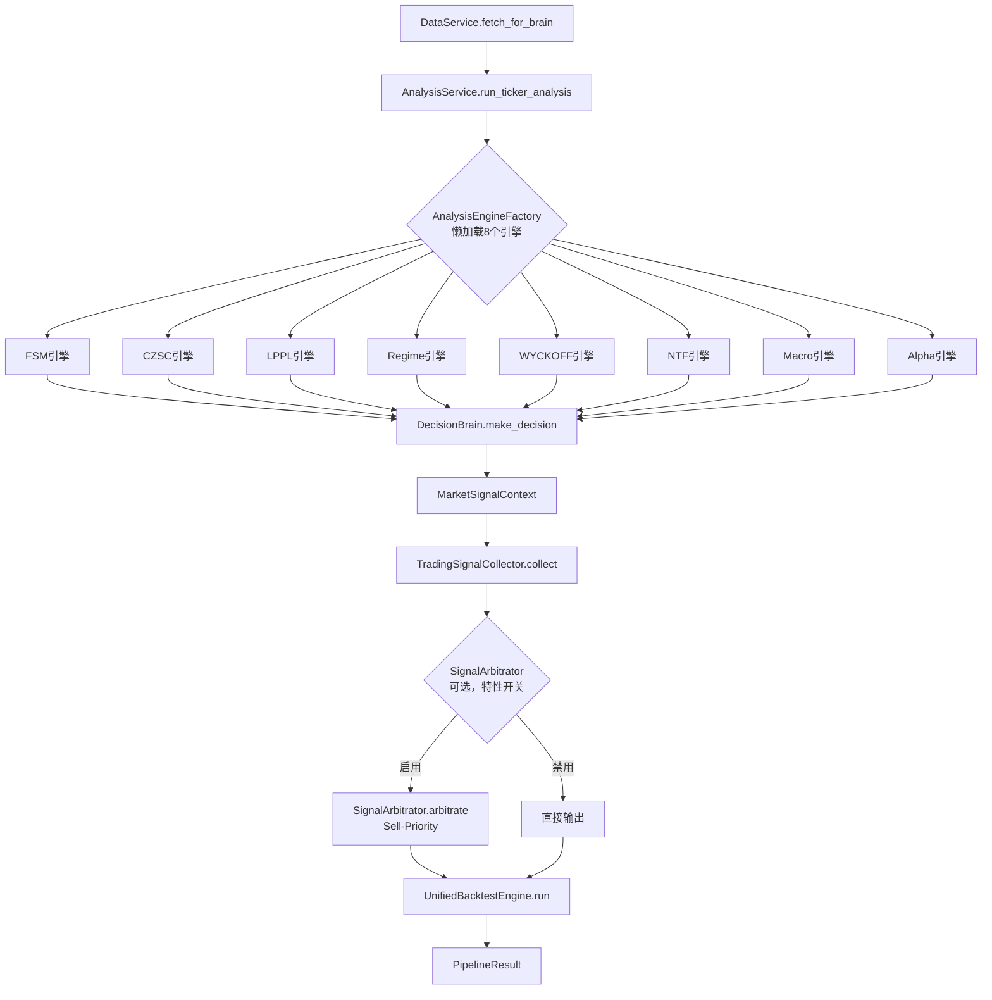
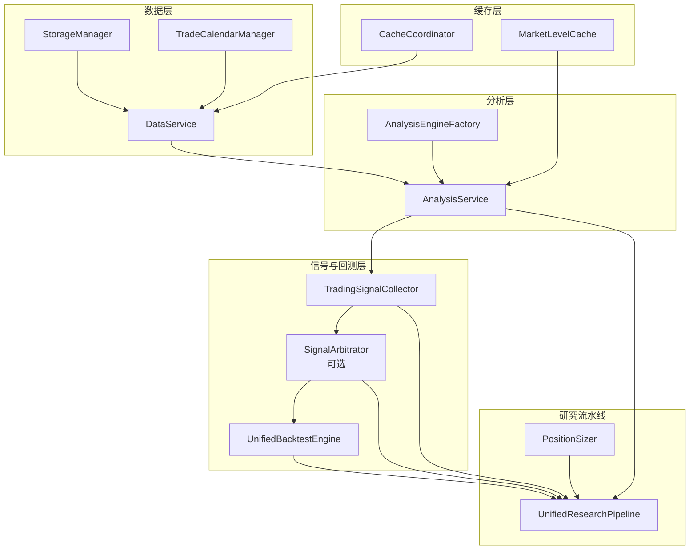

# 阶段 0：UniQuant 全局架构识别

> **分析时间**：2026-11-24  
> **工作树状态**：干净（commit `434aab1`，第25轮）  
> **代码规模**：229个Python文件 / 56,991行活跃代码

---

## 1. 系统定位

UniQuant 是一个**生产级A股量化研究与交易平台**，覆盖从数据接入、多引擎分析、信号生成、回测撮合到风险管理的完整链路。当前已完成25轮迭代，具备：
- ✅ 87%+测试覆盖率（249个测试文件，3,490个测试函数）
- ✅ 端到端N2N验证闭环（第25轮）
- ✅ 云通道随机抽样三方对账（第24轮）
- ✅ 科学控制平面（degrees-of-freedom ledger + alpha四阶门禁）

---

## 2. 八层模块职责表

| 层 | 路径 | 文件数 | LOC | 占比 | 职责 |
|---|---|---:|---:|---:|---|
| `shared` | `src/uniquant/shared/` | 40 | 6,897 | 12.1% | 协议/契约、常量、配置、异常、缓存、日志、A股规则（涨跌停/整手/成本/滑点）、时间提供者、事件总线、熔断开关、DI容器 |
| `data` | `src/uniquant/data/` | 40 | 7,808 | 13.7% | 湖优先单源接入（mootdx本地/在线）、公司行动复权（单轨`CorporateActionAdjuster`）、gbbq/主数据管理器、解析器、清洗器、校验器、GBBQ/日历写入器 |
| `brain` | `src/uniquant/brain/` | 73 | 20,917 | 36.7% | 策略与研究引擎：FSM、CZSC、LPPL、NTF、Regime、Wyckoff、指标、因子、筛选器、alpha解耦器 |
| `signal` | `src/uniquant/signal/` | 3 | 1,194 | 2.1% | 标准信号模型、适配器、归一化、聚合、仲裁、质量检查 |
| `hands` | `src/uniquant/hands/` | 20 | 4,681 | 8.2% | 回测、A股撮合、函数式策略注册表（`STRATEGY_MAP`）、报告、鲁棒性与敏感性工具（含CFFEX跨资产/TWAP/SAGA） |
| `risk` | `src/uniquant/risk/` | 5 | 1,655 | 2.9% | 仓位管理、回撤、EVT、结构风险、组合优化器、稀疏凸优化器、合规引擎 |
| `services` | `src/uniquant/services/` | 28 | 8,554 | 15.0% | DAG服务容器、分析编排、数据服务、缓存协调/市场缓存、报告、扫描、健康、验证、研究流水线 |
| `research` | `src/uniquant/research/` | 12 | 1,885 | 3.3% | 科学控制平面：alpha四阶门禁（`alpha_tier_engine`）、策略沙盒、自由度账本（trials → BH-FDR / alpha-wealth） |
| `ui` | `src/uniquant/ui/` | 8 | 3,400 | 6.0% | Streamlit仪表板、健康检查、UI管理器逻辑、LPPL可视化 |

**架构特征**：
- **brain层最重**（36.7%）：反映多引擎并行的策略研究定位
- **signal层最轻**（2.1%）：说明信号层高度抽象，依赖适配器模式
- **risk层较小**（2.9%）：风控逻辑可能分散在brain和services中

---

## 3. 核心数据流与控制流

### 3.1 主运行时链路

### 3.2 ServiceContainer DAG拓扑

**依赖方向**：严格单向（DAG），无循环依赖。`AnalysisService`不直接import `DataService`，通过容器注入接口依赖。

---

## 4. 关键入口文件清单

| 文件 | 职责 | 风险等级 |
|---|---|---|
| `src/uniquant/shared/interfaces.py` | 跨层类型契约：`TradingSignal`, `ResearchDataPack`, `RegimeOutput`, `LPPLOutput`, `CZSCOutput`, `NtfOutput`, `WyckoffOutput`, `AlphaOutput`, protocols | 🔴 高 |
| `src/uniquant/services/service_container.py` | 运行时依赖图与服务生命周期（216行，懒加载DAG工厂） | 🔴 高 |
| `src/uniquant/services/analysis_service_v2.py` | 主分析工作流与失败默认值（重构后~300行纯编排器） | 🔴 高 |
| `src/uniquant/services/analysis/engine_factory.py` | 引擎注册表与懒import行为 | 🔴 高 |
| `src/uniquant/data/sources/mootdx_local.py` | 本地TDX湖接入路径（跨数据工作流使用） | 🟡 中 |
| `src/uniquant/data/pipeline/data_validator.py` | OHLC数据正确性防护栏 | 🟡 中 |
| `src/uniquant/signal/adapters.py` | 将异构引擎输出转换为可执行`TradingSignal` | 🔴 高 |
| `src/uniquant/signal/arbitrator.py` | Sell-Priority信号仲裁（置信度规则） | 🟡 中 |
| `src/uniquant/hands/backtest/unified_engine.py` | 用户面向的类型化回测行为（T+1约束） | 🔴 高 |
| `src/uniquant/hands/backtest/unified_matching_engine.py` | 向量化A股执行约束撮合 | 🔴 高 |
| `src/uniquant/shared/limit_checker.py` | 涨跌停检查（主板/科创板/创业板/北交所/ST） | 🔴 高 |
| `src/uniquant/shared/cost_model.py` | 佣金/印花税/过户费/滑点模型 | 🟡 中 |
| `src/uniquant/shared/kill_switch.py` | 共享熔断开关（Fail-Closed） | 🟡 中 |
| `src/uniquant/brain/factors/registry.py` | 因子治理与访问门控 | 🟡 中 |
| `config/config.yaml` | 全局运行时行为（14KB，数据源/缓存/网络配置） | 🟡 中 |

---

## 5. 核心技术栈

| 类别 | 依赖 | 版本约束 | 用途 |
|---|---|---|---|
| **数据处理** | numpy | ≥2.0.0 | 数值计算基础 |
| | pandas | ≥2.0.0, <3.0.0 | 时间序列与DataFrame |
| | scipy | ≥1.10.0, <2.0.0 | 科学计算（LPPL拟合等） |
| | pyarrow | ≥14.0.0, <24.0.0 | Parquet列式存储 |
| | polars | ≥1.0.0 | 高性能DataFrame（跨截面关联） |
| | duckdb | ≥0.9.0 | 分析型SQL查询（配置中标注未消费#TODO） |
| **数据源** | mootdx | ≥0.11.7, <1.0.0 | 通达信本地/在线数据（主源） |
| | tdxdata | ≥0.2.13 | 通达信新协议在线通道（第20轮替代） |
| | akshare | ≥1.12.0, <2.0.0 | 在线数据对账（第24轮） |
| **性能** | numba | ≥0.58.0, <1.0.0 | JIT编译（`@njit`内核） |
| | joblib | ≥1.3.0, <2.0.0 | 并行计算 |
| **UI** | streamlit | ≥1.20.0 | Web仪表板 |
| | plotly | ≥5.0.0 | 交互式图表 |
| **基础设施** | loguru | ≥0.7.0 | 结构化日志 |
| | pybreaker | ≥1.0.0 | 熔断器模式 |
| | sqlalchemy | ≥2.0.0 | 数据库ORM（用途待确认） |

**可选依赖**：czsc（缠中说禅库，CI未安装，4个模块`importorskip`）、pytdx/tdxpy（旧通达信协议）、baostock（对账源）、weasyprint（PDF报告）

---

## 6. 当前架构优点

1. **清晰的分层与DAG依赖** ✅
   - 8层职责明确，依赖方向严格单向
   - `ServiceContainer`使用懒加载工厂，避免启动时IO
   - 无循环依赖（`AnalysisService`不直接import `DataService`）

2. **强类型契约** ✅
   - `interfaces.py`定义所有跨层数据结构（`@dataclass`）
   - 使用`Protocol`定义接口（如`PositionSizerProtocol`）
   - 枚举类型约束（`MarketRegime`, `RegimeType`, `NtfSide`）

3. **可测试性优秀** ✅
   - 87.33%总覆盖率（dev）/ 86.04%（CI）
   - 249个测试文件，3,490个测试函数
   - 分层覆盖率：最弱`risk` 73.14%，最强`hands` 99.81%

4. **特性开关与渐进式启用** ✅
   - `SignalArbitrator`通过`feature_flags.signal_arbitration`控制
   - `FactorRegistry`通过`feature_flags.factor_gate`控制访问级别
   - 支持灰度发布和回滚

5. **研究控制平面独立** ✅
   - `research/`独立于生产代码
   - 四阶门禁诚实化（Rule 4：不允许伪造输入，fail-closed）
   - degrees-of-freedom ledger追踪多重测试

6. **证据链可审计** ✅
   - `results/EVIDENCE_MANIFEST.json`内容哈希账本
   - CI运行`evidence_manifest.py verify`防止漂移
   - 第24-25轮的N2N验证和对账结果已入账本

7. **A股规则完整实现** ✅
   - T+1、涨跌停、ST限制、印花税、过户费、整手交易
   - 独立模块：`limit_checker.py`, `market_rules.py`, `cost_model.py`, `slippage_model.py`
   - 第6条规则明确：任何改动需要专门测试和审查

---

## 7. 当前架构风险

### 7.1 结构风险 🟡

1. **brain层过重**（73文件，36.7%）
   - 包含8个引擎（FSM/CZSC/LPPL/NTF/Regime/Wyckoff/Alpha/Indicators）
   - 可能需要按引擎拆分为独立子包，降低耦合
   - 建议：阶段3深入分析各引擎的依赖关系

2. **signal层过轻**（3文件，2.1%）
   - `adapters.py`, `aggregator.py`, `arbitrator.py`承担全部信号职责
   - 可能存在职责拥挤，需验证是否满足实盘需求
   - 建议：阶段5详细审查信号聚合与仲裁逻辑

3. **risk层分散**（5文件，2.9%）
   - 风控逻辑可能分散在`brain/`（止损）、`services/`（健康检查）、`hands/`（回测约束）
   - 需验证风控是否真正接入信号生成和回测执行
   - 建议：阶段7审计风控闭环

### 7.2 数据风险 🔴

4. **数据湖依赖**（多GB，gitignored）
   - 部分测试依赖本地数据湖，CI环境跳过（163 skipped）
   - 风险：本地通过但CI不覆盖真实数据路径
   - 缓解：第24-25轮已建立云通道对账和N2N验证

5. **数据源配置不一致** 🟡
   - `config.yaml`配置了eastmoney/sina等多个在线源
   - 实际主源是mootdx（本地TDX）+ tdxdata（在线）
   - 风险：配置漂移，文档与实际不符
   - 建议：阶段2梳理实际数据源路由

6. **Freshness SLA依赖Wine**（第25轮发现）
   - 本地湖日线L1停摆（最新2026-11-17，停摆2交易日）
   - Wine缺失时需重锚到在线通道
   - 风险：生产环境Wine不可用时的数据新鲜度
   - 缓解：`fetch_price`现可自动补齐（第24轮）

### 7.3 文档风险 🟡

7. **历史文档漂移**
   - `AGENTS.md`的Current State快照已标注"过期"（截至第9轮）
   - 部分docs/下文档描述目标状态或重构前缺口
   - 风险：新开发者可能误信过时信息
   - 缓解：`docs/index.md`有Freshness Matrix标注状态

8. **CLAUDE.md从未提交** ⚠️
   - `AGENTS.md`引用的"10条编码规则"原文件未入库
   - 当前`CLAUDE.md`是诚实整合版（源引用）
   - 风险：规则执行可能不一致
   - 缓解：当前版本已源引用并诚实标注

### 7.4 复杂度风险 🟡

9. **配置复杂性**
   - `config.yaml` 14KB，包含缓存TTL/网络超时/数据源URL等
   - 多个YAML文件（config/factors/optimal_params/trading）
   - 风险：配置项冲突或未使用
   - 建议：审计配置消费情况

10. **可选依赖碎片化**
    - `[all]`包含tdx/baostock/curl/report/js等
    - 部分依赖可能仅在特定脚本使用
    - 风险：安装膨胀，依赖冲突
    - 建议：审计实际依赖使用率

---

## 8. 历史文档可信度评估

| 文档 | 状态 | 可信度 | 说明 |
|---|---|---|---|
| `AGENTS.md` | ✅ 当前 | 高 | 最新2轮保留，旧轮归档到`docs/archive/` |
| `docs/index.md` | ✅ 当前 | 高 | 有Freshness Matrix，路径验证脚本 |
| `CLAUDE.md` | ✅ 当前 | 高 | 诚实整合版，源引用清晰 |
| `docs/ANALYSIS_PROMPT_PLAYBOOK.md` | ✅ 当前 | 高 | 标准分析流程 |
| `docs/reanalysis/I_live_system_map.md` | ⚠️ 历史 | 低 | 2026-07-09快照，数字已被取代 |
| `docs/reanalysis/Z_*_20260710.md` | ⚠️ 历史 | 低 | 第10轮前的审计，已过时 |
| `docs/analysis/POST_SIMPLIFICATION_*_20261016.md` | ✅ 当前 | 中 | 第9轮后评估，第10-25轮更新未完全反映 |
| `docs/analysis/WYCKOFF_*_20260812.md` | ✅ 当前 | 中 | Wyckoff研究定稿，但后续轮次有更新 |
| `docs/archive/AGENTS_CHANGELOG_ROUNDS.md` | ✅ 归档 | 高 | 第1-22轮完整日志 |
| `docs/packages/*.md` | ⚠️ 混合 | 中 | 头部已修正，正文可能仍描述Phase 0-1迁移状态 |

**建议**：以当前源代码为准，历史文档仅作参考。

---

## 9. 阶段1输入清单

为阶段1（服务编排分析）准备：

### 必读文件
- [ ] `src/uniquant/services/service_container.py`（完整216行）
- [ ] `src/uniquant/services/analysis_service_v2.py`（完整~300行）
- [ ] `src/uniquant/services/research_pipeline.py`（研究流水线编排）
- [ ] `src/uniquant/services/analysis/engine_factory.py`（引擎工厂）
- [ ] `src/uniquant/services/data_service.py`（数据服务）
- [ ] `src/uniquant/services/cache_coordinator.py`（缓存协调）
- [ ] `src/uniquant/services/market_cache.py`（市场级缓存）
- [ ] `tests/test_engine_factory.py`（引擎工厂测试）

### 待验证假设
1. `ServiceContainer.initialize()` 是否真的无IO（懒加载）？
2. `AnalysisService.run_ticker_analysis()` 的完整流程和失败默认值？
3. `engine_factory.bind_orchestrator()` 何时调用？解决什么问题？
4. `MarketLevelCache` 和 `CacheCoordinator` 的职责边界？
5. `UnifiedResearchPipeline` 如何串联分析→信号→回测→风控？
6. 是否存在隐式耦合或接口漂移？

### 已确认事实（从阶段0）
- ServiceContainer使用懒加载工厂模式（`register_factory`）
- 依赖注入通过`c.get("service_name")`实现
- 特性开关控制`SignalArbitrator`和`FactorRegistry`的启用
- `AnalysisService`是纯编排器（~300行，重构前1642行God Object）

---

## 10. 校验清单

- [x] 覆盖全部8层模块（shared/data/brain/signal/hands/risk/services/ui + research）
- [x] 说明DAG依赖方向（严格单向，无循环）
- [x] 列出≥10个关键文件（实际15个）
- [x] 明确哪些旧文档不可直接信任（I_live_system_map等）
- [x] 把结论绑定到具体文件
- [x] 区分当前事实、历史文档、待验证假设
- [x] 统计各层文件数和LOC
- [x] 识别架构优点（7项）和风险（10项，按严重程度分级）

---

## 阶段0结论

UniQuant展现了**高度成熟的量化平台架构**：
- ✅ 清晰的分层和DAG依赖
- ✅ 强类型契约和依赖注入
- ✅ 优秀的测试覆盖率（87%+）
- ✅ 完整的A股规则实现
- ✅ 独立的研究控制平面

主要风险集中在：
- 🔴 brain层过重（36.7%），可能需要拆分
- 🔴 数据湖依赖导致CI覆盖不完整
- 🟡 signal/risk层过轻，需验证是否满足实盘需求
- 🟡 历史文档漂移，需以代码为准

**下一阶段**：阶段1 - 服务编排分析（深入`ServiceContainer`和`AnalysisService`的运行时行为）

---

**分析人**：Claude (Anthropic)  
**审核状态**：待用户确认  
**产物路径**：`docs/analysis/00_architecture_map.md`
