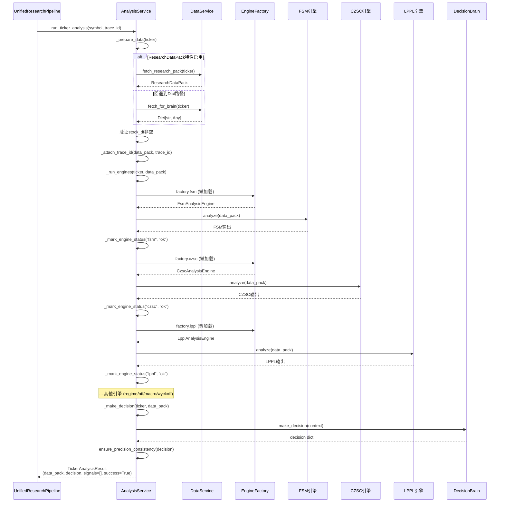
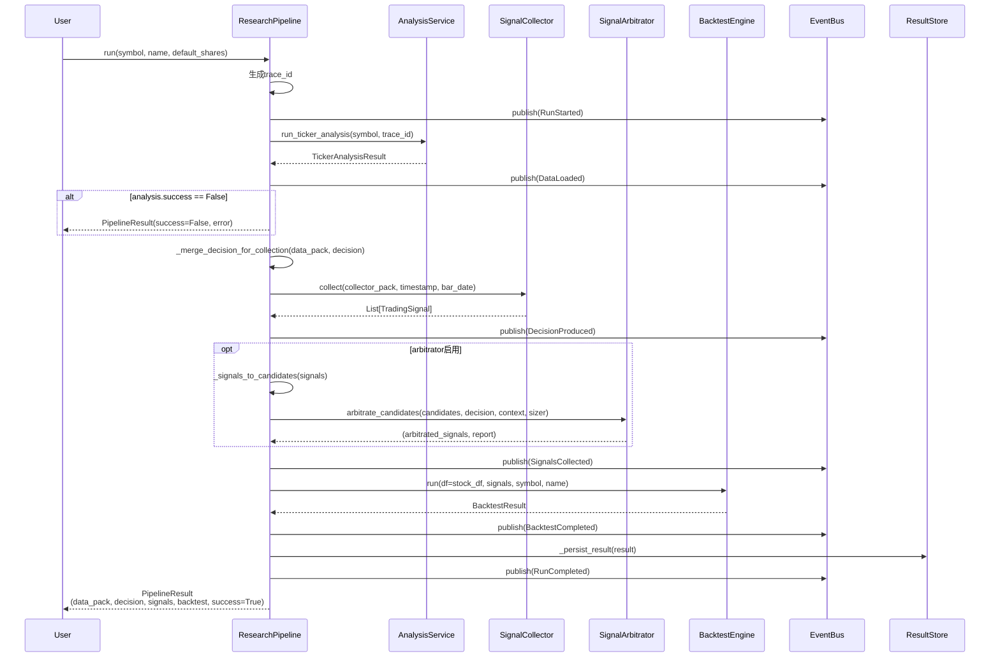

# 阶段 1：UniQuant 服务编排分析

> **分析时间**：2026-11-24  
> **依赖阶段**：阶段0（全局架构识别）  
> **核心文件**：`service_container.py`, `analysis_service_v2.py`, `research_pipeline.py`, `engine_factory.py`

---

## 1. 服务依赖拓扑图

### 1.1 ServiceContainer DAG完整拓扑

```mermaid
graph TD
    subgraph 配置层
    CFG[ConfigLoader]
    VAL[ConfigValidator]
    RC[RefactoringConfig<br/>特性开关]
    end
    
    subgraph 基础设施层
    TP[TimeProvider<br/>RealTime/Frozen]
    EB[EventBus]
    KS[KillSwitch]
    end
    
    subgraph 数据层
    SM[StorageManager]
    TCM[TradeCalendarManager]
    CC[CacheCoordinator]
    DS[DataService]
    MC[MarketLevelCache]
    end
    
    subgraph 分析层
    EF[AnalysisEngineFactory]
    AS[AnalysisService]
    subgraph 引擎集
    FSM[FSM引擎]
    CZSC[CZSC引擎]
    LPPL[LPPL引擎]
    REG[Regime引擎]
    NTF[NTF引擎]
    MACRO[Macro引擎]
    WYCK[Wyckoff引擎]
    BRAIN[DecisionBrain]
    end
    end
    
    subgraph 信号层
    SC[TradingSignalCollector]
    SA[SignalArbitrator<br/>可选]
    end
    
    subgraph 回测层
    BE[UnifiedBacktestEngine]
    end
    
    subgraph 风控层
    PS[PositionSizer]
    end
    
    subgraph 研究流水线
    RP[UnifiedResearchPipeline]
    RS[ResultStore]
    MET[MetricsRecorder]
    end
    
    CFG --> VAL
    CFG --> RC
    RC --> SA
    RC --> FACTOR[FactorRegistry]
    
    SM --> DS
    TCM --> DS
    CC --> DS
    MC --> DS
    DS --> AS
    MC --> AS
    
    EF --> AS
    EF --> FSM
    EF --> CZSC
    EF --> LPPL
    EF --> REG
    EF --> NTF
    EF --> MACRO
    EF --> WYCK
    EF --> BRAIN
    
    AS --> RP
    SC --> RP
    SA --> RP
    BE --> RP
    PS --> RP
    TP --> RP
    EB --> RP
    RS --> RP
    MET --> RP
```



### 1.2 ServiceContainer.initialize() 7步初始化顺序

```python
# 步骤1: 配置加载与验证
config = get_config()
validator = ConfigValidator(config)
validation_errors = validator.validate_all()  # 仅警告，不阻断

# 步骤2: 数据层服务工厂（无IO懒加载）
register_factory("storage", lambda c: StorageManager())
register_factory("calendar", lambda c: TradeCalendarManager())
register_factory("cache", lambda c: CacheCoordinator())
register_factory("data_service", lambda c: DataService(storage_manager=c.get("storage")))
register_factory("time_provider", lambda c: RealTimeProvider())

# 步骤3: 分析引擎工厂与市场缓存
register_factory("engine_factory", _make_engine_factory)  # orchestrator=data_service
register_factory("market_cache", _make_market_cache)      # 注入到DataService

# 步骤4: 分析服务 + 绑定orchestrator（解决循环依赖）
register_factory("analysis_service", _make_analysis_svc)
# 关键: ef.bind_orchestrator(asvc) 在创建后调用

# 步骤5: 回测引擎与信号收集器
register_factory("backtest_engine", _make_backtest_engine)
register_factory("signal_collector", _make_signal_collector)

# 步骤6: 信号仲裁器（特性开关控制）
if ref_config.feature_flags.signal_arbitration:
    register_factory("arbitrator", lambda c: SignalArbitrator())

# 步骤7: 因子准入（特性开关控制）
if gate_mode != "off":
    FactorRegistry.set_mode(FactorAccessLevel(gate_mode))

# 步骤8: 综合研究流水线
register_factory("research_pipeline", _make_research_pipeline)
```

**关键设计点**：
- ✅ **懒加载**：所有工厂使用`register_factory`，`c.get()`时才实例化
- ✅ **无IO启动**：`initialize()`只注册工厂，不触发数据加载
- ✅ **特性开关**：`SignalArbitrator`和`FactorRegistry`可配置启用/禁用

---

## 2. 单票分析流程图

### 2.1 AnalysisService.run_ticker_analysis() 完整流程



### 2.2 关键方法解析

| 方法 | 职责 | 失败处理 |
|---|---|---|
| `_prepare_data(ticker)` | 获取数据（支持ResearchDataPack或Dict） | 返回None → success=False, error="数据不足" |
| `_run_engines(ticker, data_pack)` | 通过factory运行所有引擎 | 任一引擎失败 → success=False, error="引擎分析失败" |
| `_make_decision(ticker, data_pack)` | DecisionBrain综合决策 | 返回None → success=False, error="决策失败" |
| `_mark_engine_status(engine, status, error)` | 标记引擎状态到data_pack.metadata | 不抛异常，仅记录 |
| `_attach_trace_id(data_pack, trace_id)` | 追踪ID用于日志和调试 | 不抛异常 |
| `ensure_precision_consistency(data)` | 递归归一化浮点精度 | 不改变schema |

---

## 3. 研究流水线流程图

### 3.1 UnifiedResearchPipeline.run() 端到端流程



### 3.2 Pipeline.run() 核心步骤

| 步骤 | 方法/操作 | 性能监控 | 事件发布 |
|---|---|---|---|
| **Step 1-2** | `analysis_service.run_ticker_analysis()` | `pipeline.analysis` | `DataLoaded` |
| **Step 3** | `signal_collector.collect()` | `pipeline.collect` | `DecisionProduced` |
| **Step 3b** | `arbitrator.arbitrate_candidates()` (可选) | `pipeline.arbitrate` | `SignalsCollected` |
| **Step 4** | `backtest_engine.run()` | `pipeline.backtest` | `BacktestCompleted` |
| **持久化** | `_persist_result()` | — | `RunCompleted` |

**关键特性**：
- ✅ **全链路trace_id**：从`run_ticker_analysis`传递到`PipelineResult`
- ✅ **事件驱动**：6个生命周期事件（RunStarted/DataLoaded/DecisionProduced/SignalsCollected/BacktestCompleted/RunCompleted）
- ✅ **性能监控**：`perf_section`包装每个关键路径
- ✅ **失败快返回**：analysis失败直接返回，不执行后续步骤
- ✅ **结果持久化**：`ResultStore`保存到`./results/`

---

## 4. 服务注册表

| 服务名 | 工厂方法 | 依赖 | 特性开关 | 说明 |
|---|---|---|---|---|
| `storage` | `StorageManager()` | 无 | — | 数据湖存储管理器 |
| `calendar` | `TradeCalendarManager()` | 无 | — | 交易日历管理器 |
| `cache` | `CacheCoordinator()` | 无 | — | 全局缓存协调器 |
| `data_service` | `DataService(storage_manager)` | storage | — | 数据服务（湖优先） |
| `time_provider` | `RealTimeProvider()` | 无 | — | 时间提供者（可注入Frozen用于测试） |
| `engine_factory` | `AnalysisEngineFactory(orchestrator=data_service)` | data_service | — | 分析引擎工厂 |
| `market_cache` | `MarketLevelCache()` + `data_service.attach_market_cache()` | data_service | — | 市场级缓存 |
| `analysis_service` | `AnalysisService(data_service, engine_factory, market_cache)` | data_service, engine_factory, market_cache | — | 分析服务（纯编排器） |
| `backtest_engine` | `UnifiedBacktestEngine()` | 无 | — | 回测引擎 |
| `signal_collector` | `TradingSignalCollector(create_default_registry())` | 无 | — | 信号收集器 |
| `arbitrator` | `SignalArbitrator()` | 无 | `signal_arbitration` | 信号仲裁器（可选） |
| `research_pipeline` | `UnifiedResearchPipeline(...)` | analysis_service, backtest_engine, signal_collector, arbitrator, sizer, time_provider | — | 研究流水线 |

---

## 5. 引擎工厂注册清单

| 引擎名 | 模块路径 | 类名 | 懒加载属性 | 说明 |
|---|---|---|---|---|
| `fsm` | `..analysis.fsm_analysis_engine` | `FsmAnalysisEngine` | `factory.fsm` | 有限状态机引擎 |
| `czsc` | `..analysis.czsc_analysis_engine` | `CzscAnalysisEngine` | `factory.czsc` | 缠论引擎 |
| `lppl` | `..analysis.lppl_analysis_engine` | `LpplAnalysisEngine` | `factory.lppl` | LPPL泡沫检测引擎 |
| `regime` | `..analysis.regime_analysis_engine` | `RegimeAnalysisEngine` | `factory.regime` | 市场状态识别引擎 |
| `ntf` | `..analysis.ntf_analysis_engine` | `NtfAnalysisEngine` | `factory.ntf` | 国家队行为引擎 |
| `macro` | `..analysis.macro_analysis_engine` | `MacroAnalysisEngine` | `factory.macro` | 宏观分析引擎 |
| `report` | `..analysis.report_generator_engine` | `ReportGeneratorEngine` | `factory.report` | 报告生成引擎 |
| `brain` | `...brain.fsm` | `DecisionBrain` | `factory.brain` | 决策大脑（特殊处理） |
| `wyckoff` | `..analysis.wyckoff_analysis_engine` | `WyckoffAnalysisEngine` | `factory.wyckoff` | 威科夫引擎 |

**懒加载机制**：
```python
def _lazy_init(self, name, module_path, class_name, **kwargs):
    if name not in self._engines:
        with self._lock:  # 线程安全（RLock）
            if name not in self._engines:  # 双重检查
                mod = importlib.import_module(module_path)
                cls = getattr(mod, class_name)
                self._engines[name] = cls(orchestrator=self._orchestrator, **kwargs)
    return self._engines[name]
```

**bind_orchestrator 解决循环依赖**：
1. 容器创建`engine_factory`时，`orchestrator=data_service`
2. 容器创建`analysis_service`时，注入`engine_factory`
3. 创建后调用`engine_factory.bind_orchestrator(analysis_service)`
4. `bind_orchestrator`清空`_engines`缓存，后续懒加载使用新的orchestrator

---

## 6. 信号收集与仲裁流程

### 6.1 TradingSignalCollector架构

```python
# 适配器注册表
registry = {
    "lppl": LPPLAdapter(),
    "czsc": CZSCAdapter(),
    "fsm": FSMAdapter(),
    "wyckoff": WyckoffAdapter(),
    "regime": RegimeAdapter(),
    "ntf": NTFAdapter(),
    "alpha": AlphaAdapter(),
    "ma": MAAdapter(),
}

# 收集流程
signals = collector.collect(
    data_pack, 
    timestamp=now(),
    bar_date=last_bar_date,
    default_shares=100
)
```

### 6.2 适配器映射规则（部分）

| 适配器 | 输入keys | 输出action | 特殊逻辑 |
|---|---|---|---|
| `LPPLAdapter` | `risk_level`, `confidence`, `r_squared`, `out_of_sample_r_squared` | SELL (Danger, 非diagnostic) / HOLD | 默认`diagnostic_only=True`（遥测优先，不参与强平）<br>支持`min_r2`/`min_oos_r2`质量门 |
| `CZSCAdapter` | `is_3rd_buy`, `bi_count` | BUY (三买成立) / HOLD | 仅三买产生BUY信号 |
| `FSMAdapter` | 待分析 | 待分析 | 阶段3详细分析 |
| `WyckoffAdapter` | 待分析 | 待分析 | 阶段3详细分析 |

### 6.3 SignalArbitrator仲裁机制（特性开关）

```python
if self._arbitrator is not None:
    candidates = self._signals_to_candidates(signals)  # TradingSignal → CandidateSignal
    decision_output = DecisionOutput.from_dict(analysis.decision)
    context = MarketSignalContext.from_dict(data_pack)
    
    signals, report = self._arbitrator.arbitrate_candidates(
        candidates=candidates,
        decision_output=decision_output,
        context=context,
        sizer=self._sizer,
        symbol=symbol,
    )
```

**仲裁规则**（从阶段0已知）：
- **Sell-Priority**：同时出现BUY和SELL时，SELL获胜（避险优先）
- **置信度规则**：基于`CandidateSignal.confidence`和`direction`
- **裁决链**：`report.veto_chain`记录否决过程

---

## 7. 失败路径与默认值

### 7.1 失败场景矩阵

| 失败场景 | 检测点 | 返回值 | 事件发布 |
|---|---|---|---|
| 数据获取失败 | `_prepare_data`返回None | `TickerAnalysisResult(success=False, error="数据不足")` | `RunCompleted(success=False)` |
| 引擎分析失败 | `_run_engines`返回False | `TickerAnalysisResult(success=False, error="引擎分析失败")` | `RunCompleted(success=False)` |
| 决策失败 | `_make_decision`返回None | `TickerAnalysisResult(success=False, error="决策失败")` | `RunCompleted(success=False)` |
| K线数据为空 | stock_df is None or empty | `PipelineResult(success=False, error="K线数据为空")` | `RunCompleted(success=False)` |
| 引擎初始化失败 | `_lazy_init`抛RuntimeError | 向上传播（不捕获） | 无 |
| 回测失败 | `backtest_engine.run()`抛异常 | 向上传播（不捕获） | 无 |

### 7.2 容错设计

**AnalysisService层**：
- `_prepare_data`捕获`RECOVERABLE_ERRORS`（AttributeError, ImportError, KeyError, ModuleNotFoundError, OSError, RuntimeError, TypeError, ValueError）
- 引擎失败通过`_mark_engine_status`记录到`data_pack.metadata.engine_errors`，不阻断其他引擎
- 使用`@handle_errors`装饰器（`AnalysisError, DataFetchError, ServiceError, ValueError, TypeError`）

**ResearchPipeline层**：
- analysis失败直接返回`PipelineResult(success=False)`
- 使用`perf_section`包装关键路径，即使失败也记录性能指标
- `_persist_result`使用`_save_lock`保护，避免并发写入冲突

---

## 8. 风险与改进建议

### 8.1 架构风险 🟡

1. **bind_orchestrator模式复杂** 🟡
   - **问题**：解决循环依赖的方式增加了理解成本
   - **现状**：容器先创建factory（orchestrator=data_service），再创建AnalysisService，最后绑定
   - **风险**：新开发者可能不理解为什么需要两步创建
   - **建议**：在`engine_factory.py`添加更详细的文档注释，解释循环依赖的根源

2. **特性开关分散** 🟡
   - **问题**：`SignalArbitrator`和`FactorRegistry`的启用逻辑分散在`ServiceContainer.initialize()`中
   - **风险**：配置项与行为映射不直观
   - **建议**：考虑集中管理特性开关，或使用装饰器模式

3. **Pipeline.run方法较长** 🟡
   - **问题**：`run()`方法从273行开始，包含4个主要步骤+事件发布+持久化，可能超过50行
   - **风险**：违反Rule 9（函数<50行）
   - **建议**：提取`_run_analysis_step()`, `_run_signal_step()`, `_run_backtest_step()`等子方法

### 8.2 并发风险 🟡

4. **事件发布锁竞争** 🟡
   - **问题**：使用`_event_bus_lock`保护所有事件发布
   - **风险**：批量处理时可能成为瓶颈
   - **现状**：`run_batch`使用`max_workers`并行，但事件发布串行化
   - **建议**：评估EventBus是否需要线程安全，或使用无锁队列

5. **引擎懒加载线程安全** ✅
   - **现状**：使用`RLock` + 双重检查
   - **评估**：正确实现，无风险

### 8.3 可观测性风险 🟢

6. **引擎状态追踪** ✅
   - **现状**：`_mark_engine_status`记录到`data_pack.metadata.engine_status`和`engine_errors`
   - **评估**：良好实践，支持调试和监控

7. **trace_id全链路追踪** ✅
   - **现状**：从`run_ticker_analysis`传递到`PipelineResult`
   - **评估**：支持分布式追踪

8. **性能监控** ✅
   - **现状**：`perf_section`包装关键路径（pipeline.total/analysis/collect/arbitrate/backtest）
   - **评估**：InMemoryMetricsRecorder收集指标

### 8.4 测试覆盖风险 🟢

9. **服务层覆盖率** ✅
   - **现状**：`services/`层覆盖率79.34%（第9轮后）
   - **评估**：满足要求（>70%）

10. **引擎工厂测试** ✅
    - **现状**：`tests/test_engine_factory.py`存在
    - **建议**：验证是否覆盖`bind_orchestrator`场景

---

## 9. 校验清单

- [x] 能解释 `ServiceContainer.initialize` 每一步（7步初始化，懒加载工厂）
- [x] 能解释 `run_ticker_analysis` 的输入输出（输入：ticker/trace_id，输出：TickerAnalysisResult）
- [x] 说明 `engine_factory` 何时 bind orchestrator（步骤4，创建AnalysisService后）
- [x] 识别缓存、数据服务、分析服务之间的边界
  - `CacheCoordinator`: 全局缓存协调
  - `MarketLevelCache`: 市场级缓存（注入到DataService）
  - `DataService`: 数据获取与缓存门面（`_get_cached`/`_set_cache`）
  - `AnalysisService`: 纯编排器，委托缓存给DataService
- [x] 画出服务依赖拓扑图（Mermaid）
- [x] 画出单票分析流程图（时序图）
- [x] 画出研究流水线流程图（时序图）
- [x] 列出服务注册表（12个服务）
- [x] 列出引擎工厂注册清单（9个引擎）
- [x] 说明失败路径和默认值（6个失败场景）
- [x] 提出风险与改进建议（10项，按严重程度分级）

---

## 10. 阶段1结论

UniQuant的服务编排展现了**成熟的依赖注入和懒加载设计**：

### 架构优点 ✅
1. **清晰的DAG依赖**：ServiceContainer管理12个服务，无循环依赖
2. **懒加载工厂**：所有服务延迟实例化，启动无IO
3. **解决循环依赖**：bind_orchestrator模式优雅处理factory↔AnalysisService的双向依赖
4. **特性开关控制**：SignalArbitrator和FactorRegistry可配置启用/禁用
5. **全链路可观测**：trace_id + EventBus + perf_section + ResultStore

### 核心流程 ✅
1. **AnalysisService.run_ticker_analysis**：3步流程（数据→引擎→决策）
2. **UnifiedResearchPipeline.run**：4步流程（分析→信号→仲裁→回测）+ 持久化
3. **TradingSignalCollector**：适配器模式，8个引擎适配器
4. **SignalArbitrator**：Sell-Priority仲裁（特性开关控制）

### 主要风险 🟡
1. bind_orchestrator模式复杂（理解成本）
2. 特性开关分散（配置管理）
3. Pipeline.run方法可能超50行（Rule 9）
4. 事件发布锁竞争（批量处理瓶颈）

**下一阶段**：阶段2 - 数据系统分析（深入DataService和数据湖架构）

---

**分析人**：Claude (Anthropic)  
**审核状态**：待用户确认  
**产物路径**：`docs/analysis/01_services_orchestration.md`
