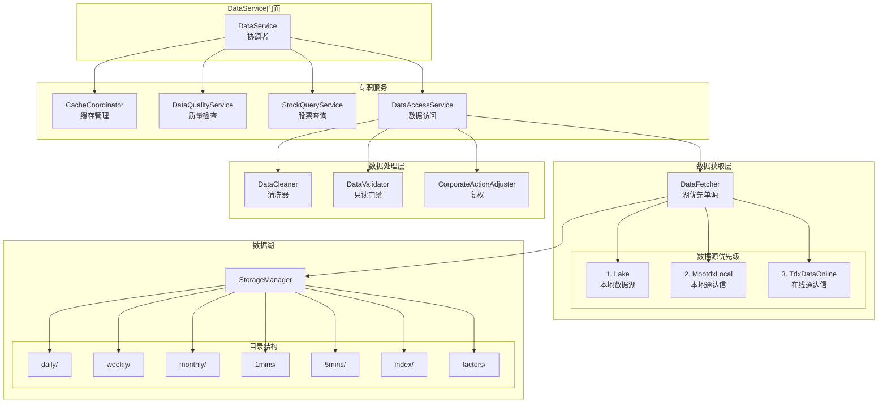
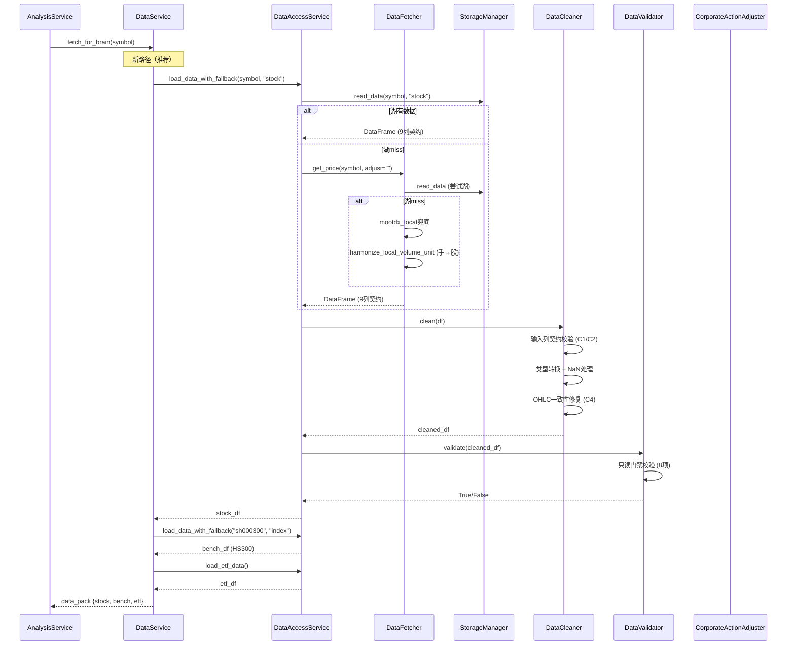

# 阶段 2：UniQuant 数据系统分析

> **分析时间**：2026-11-24  
> **依赖阶段**：阶段0（全局架构）、阶段1（服务编排）  
> **核心文件**：`data_service.py`, `data_fetcher.py`, `storage_manager.py`, `data_cleaner.py`, `data_validator.py`

---

## 1. 数据架构总览 - 门面模式

### 1.1 DataService门面架构



### 1.2 核心职责分工

| 组件 | 职责 | 关键方法 |
|---|---|---|
| `DataService` | 门面协调，向后兼容 | `fetch_for_brain()`, `fetch_research_pack()` |
| `CacheCoordinator` | 缓存生命周期管理 | `get()`, `set()`, `clear()`, `get_stats()` |
| `DataQualityService` | 数据质量检查 | 质量指标计算 |
| `StockQueryService` | 股票元数据查询 | `stock_map`, `etf_list`, `get_stock_info()` |
| `DataAccessService` | 数据加载与回退 | `load_data_with_fallback()`, `load_etf_data()` |
| `DataFetcher` | 湖优先数据获取 | `get_price()`, `fetch_for_brain()` (旧接口) |
| `DataCleaner` | 数据清洗（原子操作） | `clean()`, `clean_stock_daily()` |
| `DataValidator` | 只读门禁校验 | `validate()`, `validate_stock_daily()` |
| `CorporateActionAdjuster` | 复权因子调整 | `get_corporate_action_adjuster()` |
| `StorageManager` | 数据湖文件读写 | `write_parquet()`, `read_data()`, `get_symbols()` |

---

## 2. 数据源矩阵

### 2.1 数据源优先级（预注册裁决D1）

```python
# data_fetcher.py 第20-25行
# 湖优先单源 (预注册裁决 D1): 仅保留本地 mootdx 解包兜底。
# 爬虫源 (Tdx/Baostock/Sina/Ths/Tencent) 模块级 import 已删除
```

| 优先级 | 数据源 | 类型 | 用途 | 状态 |
|---|---|---|---|---|
| **1** | `Lake` | 本地Parquet | 主数据源（日线/分钟线/指数/因子） | ✅ 主力 |
| **2** | `MootdxLocal` | 本地通达信解包 | 湖miss时兜底 | ✅ 兜底 |
| **3** | `TdxDataOnline` | 通达信新协议在线 | 本地都miss时在线拉取 | ✅ 第20轮替代 |

### 2.2 已删除的数据源

| 数据源 | 类型 | 删除原因 |
|---|---|---|
| `TdxSource` | 爬虫 | 模块级import已删除（D1裁决） |
| `BaostockSource` | 爬虫 | 模块级import已删除 |
| `SinaSource` | 爬虫 | 模块级import已删除 |
| `ThsSource` | 爬虫 | 模块级import已删除 |
| `TencentSource` | 爬虫 | 模块级import已删除 |

**关键设计**：爬虫源需走后续裁决，且必须从`sources/`直接导入，不得回流`data_fetcher.py`。

### 2.3 数据类型支持

| 数据类型 | 存储位置 | 格式 | 更新频率 | 数据源 |
|---|---|---|---|---|
| 股票日线 | `data/lake/quotes/daily/*.parquet` | 9列契约 | 日更 | Lake → mootdx_local → tdxdata_online |
| 股票周线 | `data/lake/quotes/weekly/*.parquet` | 同日线 | 周更 | 从日线重采样 |
| 股票月线 | `data/lake/quotes/monthly/*.parquet` | 同日线 | 月更 | 从日线重采样 |
| 1分钟线 | `data/lake/quotes/1mins/*.parquet` | 8列契约 | 实时 | mootdx_local |
| 5分钟线 | `data/lake/quotes/5mins/*.parquet` | 8列契约 | 实时 | mootdx_local |
| 指数日线 | `data/lake/quotes/index/*.parquet` | 9列契约 | 日更 | Lake → mootdx_local |
| 复权因子 | `data/factors/*.parquet` | adj_factor | 事件驱动 | CorporateAction |
| 行业分类 | 网络（eastmoney/sina） | — | 按需 | get_industry_data() |
| 板块行情 | 网络（eastmoney/sina） | — | 按需 | get_sector_performance() |

---

## 3. 核心数据流

### 3.1 fetch_for_brain() 双路径



### 3.2 fetch_for_brain() 两条路径对比

| 路径 | 方法 | 返回值 | 用途 |
|---|---|---|---|
| **DataService路径** (新) | `DataService.fetch_for_brain()` | `Dict[str, pd.DataFrame]`<br/>{stock, bench, etf} | 主路径，包含基准和ETF |
| **DataFetcher路径** (旧) | `DataFetcher.fetch_for_brain()` | `Dict`<br/>{stock, symbol, timestamp} | 旧接口，向后兼容 |

**关键差异**：
- DataService路径：返回3个DataFrame（stock + bench + etf），经过DataAccessService（清洗+校验）
- DataFetcher路径：仅返回stock（直读湖原始价，adjust=""），不经过清洗

### 3.3 fetch_research_pack() 类型化路径

```python
def fetch_research_pack(self, symbol: str) -> ResearchDataPack:
    raw = self.fetch_for_brain(symbol)  # 调用DataService路径
    result = ResearchDataPack.from_dict(raw, symbol=symbol)
    if "etf" in raw:
        result.metadata["etf_data"] = raw["etf"]
    return result
```

**优势**：
- 强类型（`ResearchDataPack` dataclass）
- 支持`stock_df`属性访问
- metadata可扩展（etf_data, engine_status, trace_id等）

---

## 4. GET_PRICE_RETURN_CONTRACT（冻结契约）

```python
# data_fetcher.py 第54-68行
GET_PRICE_RETURN_CONTRACT = {
    "columns": [
        "date", "open", "high", "low", "close", 
        "amount", "volume", "reserved", "code"
    ],
    "adjusted_columns": [..., "adj_factor"],
    "date_dtype": "datetime64[ns]",
    "order": "date ascending",
    "dedup": "date unique (keep last)",
    "empty": "empty DataFrame carrying the contract columns",
    "sources": ("lake", "mootdx_local", "tdxdata_online"),
    "volume_unit": "shares",
    "amount_unit": "CNY",
    "adjust": "qfq/hfq -> CorporateActionAdjuster (OHLC only, +adj_factor)",
    "anchor": "qfq anchored to the latest lake date (adjust before slicing)",
    "write_back": "never (lake writes belong to data_access_service)",
}
```

### 4.1 契约要点

| 字段 | 契约 | 说明 |
|---|---|---|
| **列序** | 9列固定顺序 | date/open/high/low/close/amount/volume/reserved/code |
| **date dtype** | `datetime64[ns]` | 已按date升序，无重复date |
| **量纲** | volume=股(shares), amount=元(CNY) | 实测锚点：amount/close≈volume中位0.9999 |
| **复权** | qfq/hfq仅调整OHLC，+adj_factor列 | 锚定最新湖日期（先复权后切片） |
| **写回** | never | 湖写入属于data_access_service |
| **空值** | 空DataFrame携带契约列 | df.empty is True |

### 4.2 量纲自校准机制

```python
# data_fetcher.py 第74-75行
LOCAL_VOLUME_HAND_RATIO_RANGE = (60.0, 160.0)
LOCAL_VOLUME_HAND_FACTOR = 100.0

def harmonize_local_volume_unit(df):
    ratio = (df["amount"] / (df["close"] * df["volume"])).median()
    if 60.0 <= ratio <= 160.0:  # 明确落在"手"区间
        df["volume"] *= 100.0   # 手→股
    return df
```

**问题**：
- 湖volume=股，amount=元 → amount/(close*volume) ≈ 1.0
- mootdx本地对股票输出volume=手 → 比值≈100
- mootdx本地对ETF输出volume=股 → 比值≈1
- **自校准**：比值在60-160区间才x100，否则原样

---

## 5. 数据清洗流程（DataCleaner）

### 5.1 清洗6步流程

```python
def clean(self, df: pd.DataFrame) -> pd.DataFrame:
    # 1. 标准化列名（小写）
    df.columns = [col.lower() for col in df.columns]
    
    # 2. 输入列契约校验（C1/C2）
    self._assert_input_contract(df)
    # 必需列：date, close, amount, volume
    # 缺列显式失败（ValueError），禁止静默造列
    
    # 3. 类型转换
    # price_cols: open, high, low, close → pd.to_numeric
    # volume: pd.to_numeric + fillna(0)
    # amount: pd.to_numeric + NaN原样保留（禁止fill/兜底，污染illiq因子）
    
    # 4. 处理缺失值和重复值
    df = df.dropna(subset=["date", "close"])
    df["date"] = pd.to_datetime(df["date"])
    
    # 价格列NaN防护：仅ffill（取历史值，因果方向）
    # C3红线：禁止bfill（首段NaN回填必来自未来→前视偏差）
    for col in ["open", "high", "low"]:
        df[col] = df[col].ffill()
    
    df = df.drop_duplicates(subset=["date"], keep="last")
    
    # 5. 修复OHLC一致性
    # high >= max(open, close)
    # low <= min(open, close)
    # C4红线：修复条数写入attrs审计标记
    
    # 6. 排序并重置索引
    df = df.sort_values("date").reset_index(drop=True)
    df.attrs["cleaner_repaired"] = repaired  # 审计标记
```

### 5.2 输入列契约（C1/C2）

```python
@staticmethod
def _assert_input_contract(df):
    # C1: date和close必需
    missing = [col for col in ("date", "close") if col not in df.columns]
    if missing:
        raise ValueError(f"cleaner 输入列契约违规: 缺失必需列 {missing}")
    
    # C2: amount必需（禁止close*volume兜底）
    if "amount" not in df.columns:
        raise ValueError("amount 缺失禁止 close*volume 兜底，污染illiq因子")
    
    # volume/vol双schema检测
    if "volume" not in df.columns:
        if "vol" in df.columns:
            raise ValueError("检测到vol/volume双schema，请上游统一为volume命名")
        raise ValueError("缺失必需列 ['volume']")
```

### 5.3 数据质量红线

| 红线 | 规则 | 原因 |
|---|---|---|
| **C3** | 禁止bfill | 首段NaN回填必来自未来→前视偏差 |
| **C4** | OHLC修复计数写入attrs | 审计可追溯，不加新列 |
| **illiq因子保护** | amount禁止fill/兜底 | close*volume会污染illiq因子计算 |

---

## 6. 数据校验流程（DataValidator）

### 6.1 设计原则

```python
# data_validator.py 第9-14行
"""
设计原则 (QTR-OS Blueprint §4.3 / Master Audit R04):
- 纯只读门禁: 严禁在局部副本上静默修复并虚假返回 True。
- 发现破损帧 (如 High < Low 或 High < Open/Close) 必须严格返回 False 阻断落盘。
- 数据的原子清洗与修复职责唯一交由 DataCleaner 负责。
"""
```

### 6.2 8项校验规则

| # | 校验项 | 阻断级别 | 说明 |
|---|---|---|---|
| 1 | 必要列检查 | 🔴 阻断 | date, code, open, high, low, close, volume, amount |
| 1.5 | 核心数值非空 | 🔴 阻断 | open, high, low, close, volume（FIX-2封堵NaN比较漏洞） |
| 2 | 价格极值逻辑 | 🔴 阻断 | High >= Low |
| 3 | 价格逻辑关系 | 🔴 阻断 | High >= Open/Close, Low <= Open/Close |
| 4 | 成交量非负 | 🔴 阻断 | volume >= 0 |
| 5 | 成交额告警 | 🟡 告警 | amount > 0（不阻断） |
| 6 | 异常值检测 | 🟡 告警 | 单日振幅 > 99% |
| 7 | 日期连续性 | 🟡 告警 | 间隔 > 14天可能缺失 |
| 8 | 复权状态 | 🟡 告警 | adjustflag=1为未复权 |

### 6.3 FIX-2: NaN比较漏洞封堵

```python
# data_validator.py 第32-37行
# 1.5 核心数值非空校验 (FIX-2: 封堵 IEEE 754 下 NaN 比较恒为 False 绕过门禁漏洞)
core_numeric_cols = ["open", "high", "low", "close", "volume"]
if df[core_numeric_cols].isna().any().any():
    n_nan = df[core_numeric_cols].isna().sum().to_dict()
    logger.error(f"数据验证失败: 核心行情列存在 NaN 缺失值: {n_nan}")
    return False
```

**问题**：IEEE 754标准下，`NaN < NaN`、`NaN >= NaN`等比较恒为False，可能绕过门禁  
**解决**：先显式检查NaN，再进行逻辑比较

---

## 7. 数据湖存储结构

### 7.1 目录结构

```
data/
├── lake/
│   └── quotes/
│       ├── daily/              # 日线
│       │   ├── 600519.SH.parquet
│       │   ├── 000001.SZ.parquet
│       │   └── ...
│       ├── weekly/             # 周线
│       ├── monthly/            # 月线
│       ├── 1mins/              # 1分钟线
│       ├── 5mins/              # 5分钟线
│       └── index/              # 指数
│           ├── 000001.SH.parquet  # 上证指数
│           ├── 399001.SZ.parquet  # 深证成指
│           └── sh000300.parquet   # HS300
└── factors/                    # 因子数据
```

### 7.2 湖读取候选符号展开

```python
# data_fetcher.py 第78-95行
def lake_candidate_symbols(symbol: str) -> list[str]:
    """湖读取候选符号: 带市场后缀原样优先, 裸代码按板块推断后缀展开。
    
    裸代码 (如 '600519') 直接 read_data 会 miss 湖文件 (湖按 '600519.SH' 存),
    不解析就会错误地滑进本地兜底。推断顺序: 6/9->SH, 0/2/3->SZ, 4/8->BJ。
    """
    sym = str(symbol)
    if "." in sym or not sym.isdigit():
        return [sym]
    if sym.startswith(("6", "9")):
        order = (".SH", ".SZ", ".BJ")
    elif sym.startswith(("0", "2", "3")):
        order = (".SZ", ".SH", ".BJ")
    elif sym.startswith(("4", "8")):
        order = (".BJ", ".SH", ".SZ")
    else:
        order = (".SH", ".SZ", ".BJ")
    return [sym] + [f"{sym}{suffix}" for suffix in order]
```

**示例**：
- `"600519"` → `["600519", "600519.SH", "600519.SZ", "600519.BJ"]`
- `"000001"` → `["000001", "000001.SZ", "000001.SH", "000001.BJ"]`

### 7.3 原子写入与路径遍历防护

```python
# storage_manager.py 第118-150行
def write_parquet(self, file_path, df, overwrite=False):
    # 1. 路径遍历校验
    resolved = file_path_obj.resolve()
    data_dir_resolved = self.data_dir.resolve()
    if not resolved.is_relative_to(data_dir_resolved):
        logger.error(f"路径遍历拒绝: {file_path} 不在 {self.data_dir} 内")
        return False
    
    # 2. 文件锁
    lock_path = str(file_path_obj.with_suffix(file_path_obj.suffix + ".lock"))
    with FileLock(lock_path):
        # 3. 临时文件 + 原子重命名
        tmp_path = file_path_obj.with_name(f".{file_path_obj.name}.tmp.{os.getpid()}")
        df.to_parquet(tmp_path)
        tmp_path.rename(file_path_obj)  # 原子操作
```

**安全特性**：
- ✅ **路径遍历防护**：`Path.is_relative_to`（非字符串前缀）
- ✅ **原子写入**：临时文件 + `FileLock` + 原子重命名
- ✅ **防覆盖**：`overwrite=False`时跳过已存在文件

---

## 8. A股字段要求表

| 字段 | 类型 | 单位 | 必需 | 说明 | 校验规则 |
|---|---|---|---|---|---|
| `date` | datetime64[ns] | — | ✅ | 交易日期 | 升序，无重复，间隔≤14天 |
| `open` | float | 元 | ✅ | 开盘价 | > 0，≤ high |
| `high` | float | 元 | ✅ | 最高价 | ≥ max(open, close), ≥ low |
| `low` | float | 元 | ✅ | 最低价 | ≤ min(open, close), ≤ high |
| `close` | float | 元 | ✅ | 收盘价 | > 0，≤ high, ≥ low |
| `volume` | int | 股(shares) | ✅ | 成交量 | ≥ 0，非NaN |
| `amount` | float | 元(CNY) | ✅ | 成交额 | > 0（告警），禁止fill |
| `code` | str | — | ✅ | 股票代码 | 6位数字 |
| `reserved` | — | — | ❌ | 保留列 | 契约要求但可能为空 |
| `adj_factor` | float | — | ❌ | 复权因子 | qfq/hfq时添加 |
| `pre_close` | float | 元 | ❌ | 昨收价 | 部分场景需要 |
| `adjustflag` | int | — | ❌ | 复权标志 | 1=未复权（告警） |

---

## 9. fetch_for_brain输出结构

### 9.1 DataService.fetch_for_brain() 输出

```python
{
    "stock": pd.DataFrame,      # 股票日线（9列契约，已清洗+校验）
    "bench": pd.DataFrame,      # 基准指数（HS300，sh000300）
    "etf": pd.DataFrame,        # ETF数据（固定列表）
}
```

### 9.2 DataFetcher.fetch_for_brain() 输出（旧接口）

```python
{
    "stock": pd.DataFrame,      # 股票日线（直读湖原始价，adjust=""）
    "symbol": str,              # 股票代码
    "timestamp": str,           # ISO格式时间戳
}
```

### 9.3 fetch_research_pack() 输出

```python
ResearchDataPack(
    symbol="600519.SH",
    stock_df=pd.DataFrame,      # 股票日线
    metadata={
        "etf_data": pd.DataFrame,   # ETF数据（可选）
        "engine_status": {},         # 引擎状态（由AnalysisService填充）
        "engine_errors": {},         # 引擎错误（由AnalysisService填充）
        "trace_id": "abc123",        # 追踪ID（由AnalysisService填充）
    }
)
```

---

## 10. 数据质量风险清单

### 10.1 已防护风险 ✅

| 风险 | 防护机制 | 位置 |
|---|---|---|
| **前视偏差（look-ahead bias）** | C3红线禁止bfill | `data_cleaner.py:51` |
| **OHLC逻辑错误** | DataCleaner修复 + DataValidator阻断 | `data_cleaner.py:60-76`, `data_validator.py:40-56` |
| **NaN比较绕过** | FIX-2显式检查NaN | `data_validator.py:32-37` |
| **路径遍历攻击** | `Path.is_relative_to`校验 | `storage_manager.py:128-139` |
| **数据源混乱** | 湖优先单源，爬虫源已删除 | `data_fetcher.py:20-25` |
| **量纲不一致** | harmonize_local_volume_unit自校准 | `data_fetcher.py:98-125` |
| **amount缺失污染illiq因子** | 契约校验 + 禁止fill/兜底 | `data_cleaner.py:100-104` |
| **原子写入失败** | 临时文件 + FileLock + 原子重命名 | `storage_manager.py:148-150` |

### 10.2 潜在风险 🟡

1. **两条fetch_for_brain路径** ⚠️
   - **问题**：DataService和DataFetcher都有同名方法，行为不同
   - **DataService路径**：返回{stock, bench, etf}，经过清洗+校验
   - **DataFetcher路径**：仅返回{stock, symbol, timestamp}，直读湖原始价
   - **风险**：调用方可能混淆，导致数据不一致
   - **建议**：阶段3验证哪些引擎使用哪条路径，考虑统一或重命名

2. **量纲自校准边界情况** 🟡
   - **问题**：依赖amount/close比值，极端情况可能误判
   - **现状**：比值在60-160区间才x100
   - **风险**：涨停/跌停时amount和volume关系可能异常
   - **缓解**：日志记录校正操作，可审计

3. **数据湖过期** 🔴
   - **问题**：第24轮发现本地湖L1停摆（最新2026-11-17，停摆2交易日）
   - **现状**：湖优先，但湖过期时不自动更新
   - **风险**：使用过期数据进行回测或分析
   - **缓解**：第24轮`fetch_price`现可自动补齐，第25轮Freshness SLA探针
   - **建议**：验证FreshnessValidator是否在生产路径启用

4. **ETF数据固定列表** 🟡
   - **问题**：`_load_etf_data()`返回固定ETF列表
   - **风险**：新上市ETF不在列表中
   - **影响**：低（ETF主要用于基准对比，非核心策略）

5. **行业/板块数据依赖网络** 🟡
   - **问题**：`get_industry_data()`和`get_sector_performance()`依赖网络源（eastmoney/sina）
   - **风险**：网络不可用时功能降级
   - **缓解**：`@handle_errors`装饰器返回None，不阻断主流程

6. **复权锚点选择** 🟡
   - **问题**：qfq锚定最新湖日期（先复权后切片）
   - **风险**：湖过期时复权因子可能不完整
   - **现状**：`anchor: "qfq anchored to the latest lake date"`
   - **建议**：验证CorporateActionAdjuster的复权因子来源

---

## 11. 数据系统改进建议

### 11.1 短期改进（P1）🟡

1. **统一fetch_for_brain路径**
   - **现状**：DataService和DataFetcher两条路径行为不同
   - **建议**：DataFetcher.fetch_for_brain标记为`@deprecated`，引导使用DataService路径
   - **工作量**：2小时（重命名+文档）

2. **Freshness SLA强制检查**
   - **现状**：FreshnessValidator存在但不强制
   - **建议**：在`fetch_for_brain`入口检查湖新鲜度，超期时自动在线补齐
   - **工作量**：4小时（集成FreshnessValidator + 测试）

3. **量纲校正日志增强**
   - **现状**：harmonize_local_volume_unit记录info日志
   - **建议**：添加metrics指标（校正次数/占比），支持监控
   - **工作量**：1小时

### 11.2 中期改进（P2）🟢

4. **数据湖自动同步**
   - **现状**：湖过期需手动触发更新
   - **建议**：定时任务（cron）自动同步在线数据到湖
   - **工作量**：8小时（调度器 + 监控）

5. **ETF列表动态化**
   - **现状**：固定ETF列表
   - **建议**：从stock_metadata_manager动态获取
   - **工作量**：4小时

6. **数据质量指标面板**
   - **现状**：DataQualityService存在但未集成到UI
   - **建议**：Streamlit仪表板展示数据质量指标（新鲜度/完整性/准确性）
   - **工作量**：16小时

---

## 12. 校验清单

- [x] 说明股票、指数、ETF、行业数据路径（§2.3数据类型支持）
- [x] 说明数据为空、数据源失败时的行为（§3.1数据流，湖miss时回退）
- [x] 检查date/open/high/low/close/volume/pre_close等字段（§8 A股字段要求表）
- [x] 说明哪些数据可用于回测，哪些只适合展示或研究（§2.3，日线/分钟线可回测，行业/板块仅研究）
- [x] 梳理所有数据源和source routing（§2.1-2.2，湖优先单源）
- [x] 分析fetch_for_brain如何生成data_pack（§3.1-3.3，双路径+类型化路径）
- [x] 分析数据清洗、校验、复权、对齐流程（§5-6，DataCleaner+DataValidator）
- [x] 分析数据湖存储结构和读取方式（§7，目录结构+原子写入）
- [x] 审计缺失数据、错价、未来数据、缓存污染和字段不一致风险（§10，已防护8项+潜在6项）
- [x] 数据源矩阵（§2）
- [x] 数据流入流程（§3）
- [x] 数据清洗校验流程（§5-6）
- [x] 数据湖读写机制（§7）
- [x] A股字段要求表（§8）
- [x] fetch_for_brain输出结构（§9）
- [x] 数据质量风险清单（§10）
- [x] 数据系统改进建议（§11）

---

## 13. 阶段2结论

UniQuant的数据系统展现了**严格的数据质量防护和清晰的架构分层**：

### 架构优点 ✅
1. **门面模式清晰**：DataService协调4个专职服务（Cache/Quality/Query/Access）
2. **湖优先单源**：预注册裁决D1，爬虫源已删除，避免数据源混乱
3. **冻结契约**：GET_PRICE_RETURN_CONTRACT明确9列schema和量纲
4. **严格清洗**：DataCleaner 6步流程，C3/C4红线防护
5. **只读门禁**：DataValidator 8项校验，FIX-2封堵NaN漏洞
6. **原子写入**：FileLock + 临时文件 + 原子重命名
7. **路径遍历防护**：Path.is_relative_to（非字符串前缀）

### 核心机制 ✅
1. **数据源优先级**：Lake → mootdx_local → tdxdata_online
2. **量纲自校准**：amount/close比值在60-160区间才x100（手→股）
3. **前视偏差防护**：C3红线禁止bfill，仅允许ffill（因果方向）
4. **illiq因子保护**：amount禁止fill/兜底
5. **湖读取符号展开**：裸代码按板块推断后缀（6/9→SH, 0/2/3→SZ, 4/8→BJ）

### 主要风险 🟡
1. 🔴 **数据湖过期**：第24轮发现L1停摆，需验证Freshness SLA
2. 🟡 **两条fetch_for_brain路径**：DataService和DataFetcher行为不同
3. 🟡 **量纲自校准边界**：极端行情可能误判
4. 🟡 **ETF固定列表**：新上市ETF不在列表
5. 🟡 **行业/板块数据依赖网络**：网络不可用时降级

**下一阶段**：阶段3 - 多引擎分析（深入8个Brain引擎的输入输出和信号解释）

---

**分析人**：Claude (Anthropic)  
**审核状态**：待用户确认  
**产物路径**：`docs/analysis/02_data_system.md`
