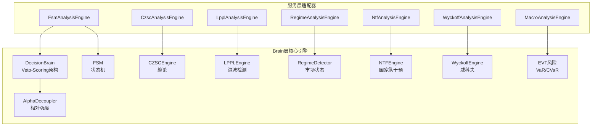

# 阶段 3：UniQuant 多引擎分析

> **分析时间**：2026-11-24  
> **依赖阶段**：阶段0-2  
> **核心文件**：`brain/fsm/fsm.py`, `brain/czsc/czsc_engine.py`, `brain/lppl/engine.py`, `brain/regime/regime_detector.py`, `brain/ntf/ntf_engine.py`, `brain/wyckoff/engine.py`, `brain/alpha_decoupler/alpha_decoupler.py`, `services/analysis/*_engine.py`

---

## 1. 引擎架构总览 - 两层结构

### 1.1 服务层适配器 + Brain层核心引擎



### 1.2 引擎清单与职责

| 引擎 | 服务层适配器 | Brain层核心 | 类型 | 输出类型 |
|---|---|---|---|---|
| **FSM** | `FsmAnalysisEngine` | `DecisionBrain` + `FSM` | 交易信号 | `Dict` (current_state, signal_strength) |
| **CZSC** | `CzscAnalysisEngine` | `CZSCEngine` | 交易信号 | `CZSCOutput` |
| **LPPL** | `LpplAnalysisEngine` | `LPPLEngine` | 风险过滤器 | `LPPLOutput` |
| **Regime** | `RegimeAnalysisEngine` | `RegimeDetector` | 市场环境 | `Dict` (regime) |
| **NTF** | `NtfAnalysisEngine` | `NTFEngine` | 市场环境 | `NtfOutput` |
| **Macro** | `MacroAnalysisEngine` | EVT风险计算 | 风险过滤器 | `Dict` (var/cvar/drawdown) |
| **Wyckoff** | `WyckoffAnalysisEngine` | `WyckoffEngine` | 交易信号 | `WyckoffOutput` |
| **Alpha** | (集成在DecisionBrain) | `AlphaDecoupler` | 相对强度 | RS Slope (float) |

---

## 2. FSM引擎（DecisionBrain + FSM状态机）

### 2.1 状态机定义

```python
class FSMState(Enum):
    IDLE = "IDLE"                    # 市场横盘或下行，无买入信号
    SIGNAL = "SIGNAL"                # 股价突破MA60，发出买入信号
    PROBE = "PROBE"                  # 突破MA60后缩量回踩MA20
    MONITOR = "MONITOR"              # 明确上升趋势，MA20 > MA60
    PYRAMID = "PYRAMID"              # 持续上涨，考虑加仓
    EXIT = "EXIT"                    # 跌破关键均线，考虑平仓
    CIRCUIT_BREAK = "CIRCUIT_BREAK"  # 极端波动，触发熔断
```

### 2.2 状态转换逻辑

```python
def infer_state(self, df):
    # Look-ahead Bias修复：盘中模式使用前一日数据
    if self.is_intraday:
        analysis_df = df.iloc[:-1].copy()  # 排除当前未确定K线
        current_price = df["close"].iloc[-1]
    else:
        analysis_df = df.copy()
        current_price = df["close"].iloc[-1]
    
    # 计算MA20和MA60（使用shift(1)避免前视偏差）
    shifted_df = analysis_df.shift(1)
    ma20 = Indicators.calc_ma(shifted_df, self.ma_short)  # 默认20
    ma60 = Indicators.calc_ma(shifted_df, self.ma_long)   # 默认60
    
    # 状态转换规则
    if current_price > curr_ma60 and prev_price <= prev_ma60:
        return FSMState.SIGNAL  # 突破MA60
    
    if current_price > curr_ma60 and has_upward_trend:
        if pullback_to_ma20:
            return FSMState.PROBE  # 回踩MA20
        return FSMState.MONITOR    # 上升趋势
    
    return FSMState.IDLE  # 默认
```

### 2.3 DecisionBrain Veto-Scoring架构

```python
class DecisionBrain:
    """
    DecisionBrain: 总控执行模块
    采用"Veto-Scoring"（否决-加权）架构
    整合各个引擎的信号，做出最终的买卖决策
    """
    
    def __init__(self, evt_risk, sizer, persist_state=True):
        # 状态持久化：fsm_state.json
        # Veto检查：LPPL Danger → SELL
        # Scoring：signal_strength + confidence加权
```

### 2.4 输入输出表

| 项 | 说明 |
|---|---|
| **输入** | `data_pack` (Dict): {stock: DataFrame, bench: DataFrame, sector: DataFrame, etf: DataFrame} |
| **处理** | FSM状态推断 + Veto检查 + Scoring加权 |
| **输出** | `Dict`: {current_state, signal_strength, recommendation, stop_loss, take_profit, summary} |
| **缓存** | 2小时TTL，磁盘缓存 |
| **降级** | `_fallback_fsm_analysis`: 基于均线关系的简单判断 |

---

## 3. CZSC引擎（缠论）

### 3.1 核心输出 - CZSCOutput

```python
@dataclass
class CZSCOutput:
    is_3rd_buy: bool          # 是否三买成立
    bi_count: int             # 笔数量
    price: float              # 当前价格
    bottom: Optional[float]   # 底部价格（czsc_bottom_price或bottom_fractal）
    trend: Optional[str]      # 趋势（上升/下降/震荡）
    current_state: Optional[str]  # STRONG_BUY/BUY/NEUTRAL/SELL/STRONG_SELL
    recent_highs: Optional[float] # 近期高点
```

### 3.2 信号解释

| 字段 | 值 | 交易含义 |
|---|---|---|
| `is_3rd_buy` | True | **BUY信号** - 缠论三买成立 |
| `is_3rd_buy` | False | HOLD - 等待三买形成 |
| `current_state` | STRONG_BUY | 强买入（当日涨幅>阈值） |
| `current_state` | BUY | 买入（当日上涨） |
| `current_state` | NEUTRAL | 中性（平盘） |
| `current_state` | SELL | 卖出（当日下跌） |
| `current_state` | STRONG_SELL | 强卖出（当日跌幅>阈值） |

### 3.3 A股适用性 ✅

**高适用性**：缠论是A股本土技术分析流派，专门针对A股市场特征设计。

### 3.4 降级处理

```python
def _fallback_czsc_analysis(self, symbol, df):
    # 简单趋势判断：短期MA vs 中期MA
    # 简单状态判断：当日涨跌幅
    # 返回CZSCOutput（current_state, trend, recent_highs/lows）
```

---

## 4. LPPL引擎（泡沫检测）

### 4.1 核心输出 - LPPLOutput

```python
@dataclass
class LPPLOutput:
    risk_level: str           # Safe/Warning/Danger/ENGINE_FAILED
    confidence: float         # 置信度
    days_to_tc: Optional[float]  # 距离临界点天数
    price: float              # 当前价格
    r_squared: float          # 拟合R²
    out_of_sample_r_squared: float  # 样本外R²
```

### 4.2 关键特性（从adapters.py已知）

```python
class LPPLAdapter(EngineAdapter):
    """
    默认 diagnostic_only=True（遥测优先）
    LPPL已被Monte-Carlo证伪为零预测力引擎
    （93% GBM噪声即可拟合 R²>0.3）
    
    支持：
    - min_oos_r2/min_r2样本外拟合质量门
    - diagnostic_only诊断模式（不参与一票否决强平）
    """
    def __init__(self, diagnostic_only=True, min_r2=None, min_oos_r2=None):
        self.diagnostic_only = diagnostic_only  # 默认True
```

### 4.3 信号解释

| risk_level | diagnostic_only=True | diagnostic_only=False |
|---|---|---|
| **Danger** | HOLD (diagnostic) | **SELL** |
| **Warning** | HOLD | HOLD |
| **Safe** | HOLD | HOLD |

### 4.4 A股适用性 🔴

**低适用性**：
- LPPL已被Monte-Carlo证伪为零预测力引擎
- 93% GBM噪声即可拟合R²>0.3
- **默认diagnostic_only=True**，仅作为遥测特征记录

### 4.5 降级处理

```python
def _fallback_lppl_analysis(self, symbol, df):
    # 基于振幅和波动率的简单泡沫检测
    # max_pct_change > 0.20 → bubble_detected
    # recent_volatility * 10 → confidence
    # 返回LPPLOutput(risk_level="Warning"/"Safe")
```

---

## 5. Regime引擎（市场状态检测）

### 5.1 核心输出

```python
{
    "symbol": "000300.SH",
    "status": "success",
    "regime": "NORMAL"  # NORMAL/STRESSED/FROZEN/UNKNOWN
}
```

### 5.2 市场级缓存机制

```python
def _run_regime_detection(self, ticker, data_pack):
    # 市场状态是全市场共享的，只需计算一次
    market_benchmark = "000300.SH"  # 沪深300
    
    # 1. 检查内存缓存
    regime = self.orchestrator._market_cache.get('regime')
    if regime is not None:
        data_pack['regime'] = {'status': 'success', 'regime': regime}
        return
    
    # 2. 检查磁盘缓存（24小时TTL）
    cache_key = self.orchestrator._generate_cache_key("market_regime", date=...)
    cached_result = self.orchestrator._get_cached_result(cache_key, use_disk=True)
    
    # 3. 执行实际计算
    result = self.run_regime_detection(market_benchmark)
    self.orchestrator._market_cache['regime'] = result.get("regime", "NORMAL")
```

### 5.3 信号解释

| regime | 含义 | 交易含义 |
|---|---|---|
| **NORMAL** | 市场正常 | 正常交易 |
| **STRESSED** | 市场压力 | 谨慎交易，降低仓位 |
| **FROZEN** | 市场冻结 | 暂停交易 |
| **UNKNOWN** | 未知 | 默认NORMAL |

### 5.4 A股适用性 🟡

**中等适用性**：基于HS300的市场状态检测，反映大盘整体环境。

---

## 6. NTF引擎（国家队干预检测）

### 6.1 核心输出 - NtfOutput

```python
@dataclass
class NtfOutput:
    side: str        # NONE/SUPPORT/RESISTANCE
    intensity: float # 强度（0.0-1.0）
```

### 6.2 市场级缓存机制

```python
def _run_ntf_detection(self, ticker, data_pack):
    # 国家队干预信号是全市场共享的
    ntf_proxy = "510300.SH"  # 上证50ETF
    
    # 内存缓存 + 磁盘缓存（24小时TTL）
    # 全市场共享，只需计算一次
```

### 6.3 信号解释

| side | 含义 | 交易含义 |
|---|---|---|
| **SUPPORT** | 国家队支撑 | 可能触底反弹 |
| **RESISTANCE** | 国家队阻力 | 可能见顶回落 |
| **NONE** | 无干预 | 正常交易 |

### 6.4 A股适用性 🔴

**低适用性**：
- 依赖ETF代理（510300.SH上证50ETF）
- 国家队干预检测准确性存疑
- 仅作为参考信息

---

## 7. Wyckoff引擎（威科夫分析）

### 7.1 核心输出 - WyckoffOutput（30+字段）

```python
@dataclass
class WyckoffOutput:
    # 核心字段
    phase: str                    # accumulation/markup/distribution/markdown/unknown
    confidence: float             # A/B/C/D → 0.9/0.7/0.5/0.3
    spring: bool                  # 弹簧检测
    utad: bool                    # 向上突破失败检测
    price: float                  # 当前价格
    rr_ratio: float               # 风险回报比
    direction: str                # 方向（P0-1透传）
    bypassed: bool                # 是否绕过
    
    # 点数图分析
    pnf_phase_hint: str           # 点数图阶段提示
    pnf_breakout: bool            # 点数图突破
    pnf_count_target: float       # 点数图计数目标
    
    # 多时间框架共振（P2-1标注）
    resonance_count: int          # 共振数量
    resonance_dir: str            # 共振方向
    resonance_strength: float     # 共振强度
    
    # 市场状态
    regime_phase: Optional[str]   # 市场阶段
    vshape_detected: bool         # V型反转检测
    adjustment_status: str        # 调整状态
    structural_score: float       # 结构评分
    relative_strength: Optional[str]  # 相对强度
    
    # EVT风险
    evr_state: str                # EVT风险状态
    evr_level: int                # EVT风险等级
    evr_position_context: str     # EVT位置上下文
    
    # 事件检测
    pattern_failure_detected: bool   # 形态失败检测
    pattern_failure_ratio: float     # 形态失败比率
    no_supply_detected: bool         # 无供应检测
    nsd_detected: bool               # NSD检测
    vdu_detected: bool               # VDU检测
    event_cooldown_active: bool      # 事件冷却激活
    event_cooldown_days: int         # 事件冷却天数
    
    # 技术指标
    range_score: float            # 范围评分
    avwap: float                  # 锚定VWAP
    bias200: float                # 200日均线偏差
    pnf_phase_divergence: Optional[str]  # 点数图阶段背离
    vdb_divergence: str           # VDB背离
    lps_stage: str                # LPS阶段
    sos_candidate_detected: bool  # SOS候选检测
```

### 7.2 信号解释

| 字段 | 值 | 交易含义 |
|---|---|---|
| `phase` | accumulation | **积累阶段** - 潜在买入机会 |
| `phase` | markup | **上涨阶段** - 持有 |
| `phase` | distribution | **分配阶段** - 潜在卖出机会 |
| `phase` | markdown | **下跌阶段** - 观望/卖出 |
| `spring` | True | **BUY信号** - 弹簧（假突破向下） |
| `utad` | True | **SELL信号** - UTAD（向上突破失败） |
| `confidence` | A (0.9) | 高置信度 |
| `confidence` | B (0.7) | 中高置信度 |
| `confidence` | C (0.5) | 中等置信度 |
| `confidence` | D (0.3) | 低置信度 |

### 7.3 辅助检测方法

```python
# WyckoffAnalysisEngine提供的辅助方法
detect_spring(df)  # 弹簧检测：跌破支撑+放量 → spring_detected
detect_utad(df)    # UTAD检测：上涨+缩量+窄幅 → utad_detected
detect_lps(df)     # LPS检测：下跌+缩量+范围收窄 → lps_detected
detect_sow(df)     # SOW检测：价格突变+量能突变 → sow_detected
```

### 7.4 指数数据加载

```python
_INDEX_PATHS = (
    "data/lake/quotes/index/000300.SH.parquet",
    "data/lake/index/000300.SH.parquet",
    "data/lake/quotes/daily/000300.SH.parquet",
    "data/csi300_index.parquet",
)
# 用于相对强度分析（relative_strength）
# 指数不可用时优雅降级（relative_strength=None）
```

### 7.5 A股适用性 ✅

**高适用性**：威科夫方法基于量价关系分析，适用于A股市场。

### 7.6 降级处理

```python
def _fallback_wyckoff_analysis(self, symbol, df):
    # 基于成交量比率和价格位置的简单积累/分配检测
    # recent_vol_ratio > 1.2 + recent_price_pos < 0.05 → accumulation
    # recent_vol_ratio > 1.2 + recent_price_pos > 0.05 → distribution
    # 返回WyckoffOutput(phase, confidence)
```

---

## 8. Macro引擎（宏观与市场基准）

### 8.1 核心输出

```python
{
    "var_95": float,         # VaR 95%
    "var_99": float,         # VaR 99%
    "cvar_95": float,        # CVaR 95%
    "cvar_99": float,        # CVaR 99%
    "max_drawdown": float,   # 最大回撤
    "regime": "NORMAL",      # 市场状态
    "ntf_signal": "中性",    # 国家队信号
    "summary": "宏观环境分析完成"
}
```

### 8.2 数据源

```python
def get_macro_returns(self, window=200):
    # 使用HS300指数日线（sh000300）
    df = self.orchestrator.data_service.fetcher.fetch_index_daily("sh000300", ...)
    df["pct_change"] = df["close"].pct_change()
    returns = df["pct_change"].dropna().tail(window)
    return returns
```

### 8.3 验证机制

```python
# 与标准方法对比验证
standard_results = {
    "var_95": validation_service.calculate_standard_var(returns, 0.95),
    "var_99": validation_service.calculate_standard_var(returns, 0.99),
    "cvar_95": validation_service.calculate_standard_cvar(returns, 0.95),
    ...
}
validation_result = validation_service.validate_risk_metrics(metrics, standard_results)
```

### 8.4 A股适用性 🟡

**中等适用性**：基于HS300的EVT风险指标，反映大盘整体风险。

---

## 9. Alpha引擎（AlphaDecoupler）

### 9.1 核心功能

```python
class AlphaDecoupler:
    """
    Alpha Decoupler for catching relative strength.
    Calculates RS Slope and filters low-correlation assets.
    """
    
    @staticmethod
    def get_benchmark(market_cap):
        # 根据市值路由基准
        # >800亿 → 沪深300 (000300.SH)
        # 200-800亿 → 中证500 (000905.SH)
        # 50-200亿 → 中证1000 (000852.SH)
        # <50亿 → 中证2000 (932000.CSI)
    
    @staticmethod
    def calc_rs_slope(stock_df, bench_df, window=20):
        # 1. 先计算各自收益率，再merge（避免停牌复牌脉冲噪音）
        stock_df["stock_ret"] = stock_df["close"].pct_change().fillna(0)
        bench_df["bench_ret"] = bench_df["close"].pct_change().fillna(0)
        
        # 2. 计算收益率差并累积
        combined["diff_ret"] = combined["stock_ret"] - combined["bench_ret"]
        combined["rs_curve"] = combined["diff_ret"].cumsum()
        
        # 3. 线性拟合求斜率
        slope = np.polyfit(x, rs_data, 1)[0]
        return slope * 100
```

### 9.2 信号解释

| RS Slope | 含义 | 交易含义 |
|---|---|---|
| > 0 | 跑赢基准 | **正面信号** - 相对强度向上 |
| < 0 | 跑输基准 | **负面信号** - 相对强度向下 |
| ≈ 0 | 与基准同步 | 中性 |

### 9.3 A股适用性 ✅

**高适用性**：
- 基准路由符合A股结构（大盘/中盘/小盘/微盘）
- RS Slope捕捉结构性机会
- 避免停牌复牌脉冲噪音

---

## 10. data_pack字段来源表

| 字段 | 来源引擎 | 类型 | 说明 |
|---|---|---|---|
| `stock` | DataService | DataFrame | 股票日线（9列契约） |
| `bench` | DataService | DataFrame | 基准指数（HS300） |
| `etf` | DataService | DataFrame | ETF数据 |
| `regime` | RegimeEngine | Dict | 市场状态（市场级缓存） |
| `ntf` | NTFEngine | Dict | 国家队干预（市场级缓存） |
| `fsm` | FSMEngine | Dict | FSM状态（current_state, signal_strength） |
| `czsc` | CZSCEngine | CZSCOutput | 缠论信号（is_3rd_buy, bi_count） |
| `lppl` | LPPLEngine | LPPLOutput | 泡沫风险（risk_level, confidence） |
| `wyckoff` | WyckoffEngine | WyckoffOutput | 威科夫分析（phase, spring, utad） |
| `macro` | MacroEngine | Dict | EVT风险（var/cvar/drawdown） |
| `alpha` | AlphaDecoupler | float | RS Slope |
| `engine_status` | AnalysisService | Dict | 引擎状态（ok/failed） |
| `engine_errors` | AnalysisService | Dict | 引擎错误信息 |
| `trace_id` | AnalysisService | str | 追踪ID |

---

## 11. DecisionBrain决策流程

### 11.1 Veto-Scoring架构

```python
class DecisionBrain:
    """
    Veto-Scoring（否决-加权）架构
    """
    
    def make_decision(self, data_pack):
        # 1. 收集各引擎输出
        fsm_result = data_pack.get("fsm", {})
        czsc_result = data_pack.get("czsc", {})
        lppl_result = data_pack.get("lppl", {})
        wyckoff_result = data_pack.get("wyckoff", {})
        regime_result = data_pack.get("regime", {})
        
        # 2. Veto检查（否决）
        # LPPL Danger (非diagnostic) → SELL
        # Regime FROZEN → 暂停交易
        
        # 3. Scoring（加权）
        # FSM signal_strength + CZSC is_3rd_buy + Wyckoff spring
        
        # 4. 生成决策
        return {
            "decision": "BUY"/"SELL"/"HOLD",
            "score": float,
            "summary": str,
        }
```

### 11.2 引擎分类

| 类型 | 引擎 | 作用 |
|---|---|---|
| **交易信号引擎** | FSM, CZSC, Wyckoff | 产生BUY/SELL信号 |
| **风险过滤器引擎** | LPPL, Macro | 风险检测，可能触发SELL |
| **市场环境判断引擎** | Regime, NTF | 市场状态，影响仓位 |
| **相对强度引擎** | Alpha | RS Slope，辅助选股 |

---

## 12. 多引擎信号冲突分析

### 12.1 潜在冲突场景

| 冲突场景 | 引擎A | 引擎B | 处理机制 |
|---|---|---|---|
| **场景1** | FSM SIGNAL (买入) | LPPL Danger (卖出) | LPPL默认diagnostic_only，不冲突 |
| **场景2** | CZSC三买 (买入) | Wyckoff distribution (卖出) | SignalArbitrator仲裁（Sell-Priority） |
| **场景3** | FSM SIGNAL (买入) | Regime STRESSED (谨慎) | DecisionBrain加权，降低仓位 |
| **场景4** | Wyckoff spring (买入) | LPPL Warning (谨慎) | LPPL Warning → HOLD，不冲突 |

### 12.2 仲裁机制

**DecisionBrain层**：
- Veto-Scoring架构
- LPPL Danger (非diagnostic) → Veto SELL
- Regime FROZEN → Veto暂停

**SignalArbitrator层**（特性开关控制）：
- Sell-Priority规则：同时出现BUY和SELL时，SELL获胜
- 置信度规则：基于CandidateSignal.confidence

### 12.3 冲突风险

| 风险 | 说明 | 缓解 |
|---|---|---|
| **CZSC vs Wyckoff冲突** | 三买 vs distribution | SignalArbitrator Sell-Priority |
| **FSM vs Regime冲突** | 买入信号 vs 市场压力 | DecisionBrain加权，降低仓位 |
| **降级逻辑冲突** | 简单降级逻辑可能误导 | 日志记录降级原因 |

---

## 13. A股适用性评价

### 13.1 适用性矩阵

| 引擎 | 适用性 | 理由 | 评级 |
|---|---|---|---|
| **FSM** | ✅ 高 | 基于均线，通用技术分析 | ⭐⭐⭐⭐ |
| **CZSC** | ✅ 高 | 缠论，A股本土技术分析流派 | ⭐⭐⭐⭐⭐ |
| **Wyckoff** | ✅ 高 | 威科夫方法，量价关系分析 | ⭐⭐⭐⭐⭐ |
| **Alpha** | ✅ 高 | 相对强度，A股结构性机会 | ⭐⭐⭐⭐ |
| **Regime** | 🟡 中 | 市场状态检测，基于HS300 | ⭐⭐⭐ |
| **Macro** | 🟡 中 | EVT风险指标，基于HS300 | ⭐⭐⭐ |
| **LPPL** | 🔴 低 | 已被证伪为零预测力，默认diagnostic_only | ⭐⭐ |
| **NTF** | 🔴 低 | 国家队干预检测，依赖ETF代理，准确性存疑 | ⭐⭐ |

### 13.2 引擎推荐配置

**核心引擎（推荐启用）**：
- FSM: 买卖状态判断
- CZSC: 三买信号
- Wyckoff: 威科夫阶段 + spring/utad
- Alpha: RS Slope相对强度

**辅助引擎（可选启用）**：
- Regime: 市场状态过滤
- Macro: EVT风险指标

**遥测引擎（仅记录，不参与决策）**：
- LPPL: 默认diagnostic_only=True
- NTF: 准确性存疑，仅参考

---

## 14. 引擎失败默认值

| 引擎 | 失败时的默认值 | 降级逻辑 |
|---|---|---|
| **FSM** | `{current_state: "UNKNOWN", signal_strength: 0.0, recommendation: "未知"}` | 基于均线关系的简单判断 |
| **CZSC** | `CZSCOutput()` (is_3rd_buy=False, bi_count=0) | 基于当日涨跌和短期MA的简单判断 |
| **LPPL** | `LPPLOutput(risk_level="ENGINE_FAILED", confidence=0.0)` | 基于振幅和波动率的简单泡沫检测 |
| **Regime** | `{regime: "NORMAL"}` | 默认NORMAL |
| **NTF** | `NtfOutput(side="NONE")` | 默认无干预 |
| **Macro** | `{var_95: DEFAULT, cvar_95: DEFAULT, max_drawdown: DEFAULT, regime: "NORMAL"}` | 默认风险指标 |
| **Wyckoff** | `WyckoffOutput(phase="unknown")` | 基于成交量比率和价格位置的简单积累/分配检测 |

---

## 15. 校验清单

- [x] 覆盖FSM、CZSC、LPPL、NTF、Regime、Wyckoff、Alpha、Indicators（§1-9）
- [x] 说明每个引擎失败时默认值（§14）
- [x] 说明哪些输出适合买入、卖出、观望、风控（§2-9各引擎信号解释）
- [x] 绑定具体文件和函数（各引擎源文件）
- [x] 引擎清单（§1.2）
- [x] 每个引擎的业务含义（§2-9）
- [x] 输入输出字段表（§2-9各引擎输出）
- [x] data_pack字段来源表（§10）
- [x] DecisionBrain决策流程（§11）
- [x] A股适用性评价（§13）
- [x] 信号冲突风险（§12）

---

## 16. 阶段3结论

UniQuant的多引擎系统展现了**丰富的策略工具箱和严格的降级机制**：

### 架构优点 ✅
1. **两层架构清晰**：服务层适配器 + Brain层核心引擎
2. **引擎分类明确**：交易信号/风险过滤器/市场环境/相对强度
3. **Veto-Scoring架构**：DecisionBrain整合多引擎，否决-加权决策
4. **降级处理完善**：每个引擎都有`_fallback_*_analysis`方法
5. **市场级缓存**：Regime和NTF全市场共享，24小时TTL
6. **前视偏差防护**：FSM盘中模式使用前一日数据计算MA
7. **A股本土化**：CZSC缠论、Alpha基准路由符合A股结构

### 核心发现 ✅
1. **高适用性引擎**：CZSC（缠论）⭐⭐⭐⭐⭐、Wyckoff（威科夫）⭐⭐⭐⭐⭐
2. **低适用性引擎**：LPPL（已证伪，默认diagnostic_only）⭐⭐、NTF（准确性存疑）⭐⭐
3. **信号冲突仲裁**：DecisionBrain Veto-Scoring + SignalArbitrator Sell-Priority
4. **降级逻辑简单**：可能产生误导性信号（需日志记录降级原因）

### 主要风险 🟡
1. 🟡 **降级逻辑过于简单**：fallback方法基于简单技术指标，可能误导
2. 🟡 **NTF准确性存疑**：依赖ETF代理，建议降级为遥测
3. 🟡 **LPPL已证伪**：默认diagnostic_only正确，但需确保不被误用
4. 🟡 **信号冲突处理**：CZSC vs Wyckoff冲突需SignalArbitrator仲裁

**下一阶段**：阶段4 - 因子系统分析（深入因子注册、计算、评价、组合、样本外验证）

---

**分析人**：Claude (Anthropic)  
**审核状态**：待用户确认  
**产物路径**：`docs/analysis/03_brain_engines.md`
