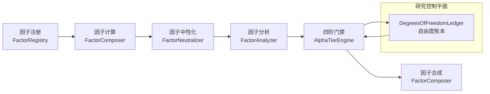
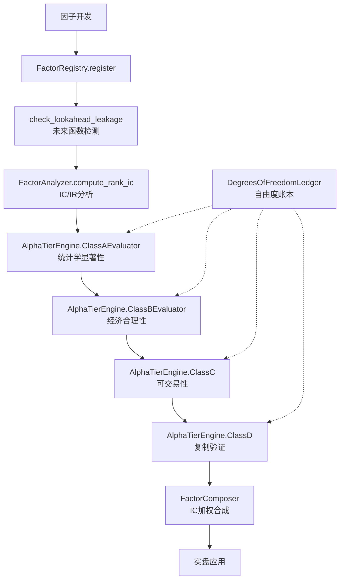

# 阶段 4：UniQuant 因子系统分析

> **分析时间**：2026-11-24  
> **依赖阶段**：阶段0-3  
> **核心文件**：`brain/factors/registry.py`, `brain/factors/analyzer.py`, `brain/factors/composer.py`, `brain/factors/neutralizer.py`, `research/gates/alpha_tier_engine.py`, `research/ledger/degrees_of_freedom.py`

---

## 1. 因子系统架构总览

### 1.1 因子生命周期



### 1.2 核心组件

| 组件 | 职责 | 关键方法 |
|---|---|---|
| `FactorRegistry` | 因子注册中心（单例+线程安全） | `register()`, `get_enabled()`, `check_access()` |
| `FactorAnalyzer` | IC/IR分析（Rank IC, lookahead检测） | `compute_rank_ic()`, `check_lookahead_leakage()` |
| `FactorComposer` | 因子合成（Z-score, 正交化, IC加权） | `compute_all_factors()`, `_resolve_ic_result()` |
| `FactorNeutralizer` | 因子中性化（行业+市值） | `neutralize()`, `mad_winsorize()` |
| `AlphaTierEngine` | 四阶门禁（Class A/B/C/D） | `ClassAEvaluator.evaluate()`, `ClassBEvaluator.evaluate()` |
| `DegreesOfFreedomLedger` | 自由度账本（多重测试校正） | `register_trial()`, BH-FDR/Bonferroni |

---

## 2. FactorRegistry（因子注册中心）

### 2.1 设计模式

```python
class FactorRegistry:
    """
    全局因子注册中心（单例模式 + 线程安全）
    Thread-safe implementation with lock-protected dictionary.
    Also provides access control gate (WARN/BLOCK mode).
    """
    _factors: Dict[str, FactorInfo] = {}
    _instance = None
    _lock = threading.Lock()
    _loaded: bool = False
    _mode: FactorAccessLevel = FactorAccessLevel.WARN
```

### 2.2 因子元信息

```python
@dataclass
class FactorInfo:
    name: str                    # 因子名称（唯一）
    category: str                # technical/fundamental/alternative/custom
    compute_func: Callable       # 计算函数
    default_weight: float = 1.0
    enabled: bool = True
    description: str = ""
```

### 2.3 访问控制门禁

```python
class FactorAccessLevel(Enum):
    FREE = "free"   # 自由访问
    WARN = "warn"   # 未注册因子访问时告警
    BLOCK = "block" # 拦截未注册因子访问
```

```python
@classmethod
def check_access(cls, name: str) -> bool:
    """准入检查: 在 WARN/BLOCK 模式下拦截未注册因子的访问"""
    with cls._lock:
        if name in cls._factors:
            return True
        if cls._mode == FactorAccessLevel.BLOCK:
            raise ValueError(f"未注册因子被拦截: {name}")
        if cls._mode == FactorAccessLevel.WARN:
            logger.warning("未注册因子访问: %s (mode=warn)", name)
        return True
```

### 2.4 配置覆盖机制

```python
@classmethod
def register(cls, name, compute_func, category="custom", default_weight=1.0, description=""):
    # 从factors.yaml读取覆盖配置
    try:
        cfg = get_config()
        factor_cfg = cfg.get(f"factors.{name}")
        if factor_cfg is not None:
            if not factor_cfg.get("enabled", True):
                logger.info(f"⏭️ 因子 {name} 被 factors.yaml 禁用，跳过注册")
                return
            if "weight" in factor_cfg:
                default_weight = factor_cfg["weight"]
            if "category" in factor_cfg:
                category = factor_cfg["category"]
    except ImportError as e:
        logger.warning("因子配置加载器不可用，使用默认注册参数: %s", e)
    except (AttributeError, KeyError, TypeError, ValueError, RuntimeError) as e:
        logger.error("因子 %s 配置读取失败: %s", name, e)
        raise  # 配置失败必须可见，不允许静默回退
```

**关键设计**：
- ✅ 配置失败必须可见（不允许静默回退到默认权重）
- ✅ 禁用的因子跳过注册
- ✅ 支持weight/category覆盖

---

## 3. FactorAnalyzer（因子分析器）

### 3.1 Rank IC计算

```python
def compute_rank_ic(self, factor_values, forward_returns):
    """
    计算 Rank IC (Spearman 秩相关系数)
    """
    factor_clean = factor_values.dropna()
    returns_clean = forward_returns.dropna()
    # Spearman秩相关
    ic, p_value = stats.spearmanr(factor_clean, returns_clean)
    return ic
```

### 3.2 IC分析结果

```python
@dataclass
class FactorICResult:
    factor_name: str
    ic_mean: float          # IC均值
    ic_std: float           # IC标准差
    icir: float             # IC信息比率 (IC均值/IC标准差)
    ic_positive_ratio: float # IC>0比例
    ic_t_stat: float        # IC t统计量
    n_periods: int          # 期数
```

### 3.3 持有期分析

```python
DEFAULT_HOLDING_PERIODS = [1, 5, 20]  # 1天、5天、20天
```

### 3.4 Lookahead Bias检测

```python
def check_lookahead_leakage(df, factor_func, factor_cols):
    """
    Detect look-ahead bias using future perturbation invariance.
    
    Runs factor_func on the original df, then on copies with future close prices
    perturbed at multiple cutoffs. If any factor value before a cutoff changes,
    it depends on future data → raises LookaheadBiasError.
    """
    baseline = factor_func(df.copy()).copy()
    n = len(df)
    cutoffs = [int(n * p) for p in [0.33, 0.50, 0.66]]
    
    for cutoff in cutoffs:
        perturbed = df.copy()
        future_close = perturbed.loc[cutoff:, "close"].values
        perturbed.loc[cutoff:, "close"] = future_close * rng.uniform(1.5, 3.0, size=len(future_close))
        
        result = factor_func(perturbed.copy()).copy()
        
        for col in factor_cols:
            b_before = baseline.loc[:cutoff - 1, col]
            r_before = result.loc[:cutoff - 1, col]
            
            if not np.allclose(b_before.fillna(0).values, r_before.fillna(0).values, rtol=1e-5):
                raise LookaheadBiasError(f"Look-ahead bias detected in factor '{col}'")
    
    return True
```

**检测原理**：
1. 在33%/50%/66%三个cutoff点扰动未来close价格（×1.5~3.0）
2. 如果cutoff前的因子值变化 → 依赖未来数据 → 抛出LookaheadBiasError
3. 使用随机种子42保证可复现

### 3.5 AnalysisMode与负shift防护

```python
class AnalysisMode(Enum):
    BACKTEST = auto()  # 允许负shift（离线回测）
    LIVE = auto()      # 禁止未来数据泄漏

def _compute_forward_returns(self, df, holding_period, price_col="close", mode="backtest"):
    """
    ⚠️ 警告: 此方法使用负 shift 引入未来数据，仅限离线回测使用。
    """
    if mode == "live":
        raise ValueError(
            "Lookahead bias detected: _compute_forward_returns uses negative shift "
            "which introduces future data. This method is NOT safe for live trading. "
            "Use mode='backtest' for offline factor analysis only."
        )
    
    # 检查未来时间戳
    if "date" in df.columns:
        max_date = pd.to_datetime(df["date"]).max()
        if max_date > pd.Timestamp(get_time_provider().now()):
            raise ValueError(
                f"Future timestamp detected in data: {max_date}. "
                "Data contains future dates beyond current time."
            )
    
    future_ret = df[price_col].shift(-holding_period) / df[price_col] - 1
    return future_ret
```

**三层防护**：
1. **AnalysisMode枚举**：BACKTEST vs LIVE
2. **mode="live"时禁止负shift**：抛出ValueError
3. **时间戳检查**：检测数据中的未来日期

---

## 4. AlphaTierEngine（四阶门禁）

### 4.1 四个等级

```python
class AlphaTier(str, Enum):
    TIER_UNRATED = "UNRATED"                              # 未评级（默认）
    TIER_A = "TIER_A_STATISTICALLY_SUPPORTED"            # 统计学支持
    TIER_B = "TIER_B_ECONOMICALLY_PLAUSIBLE"             # 经济学合理
    TIER_C = "TIER_C_TRADABLE_CANDIDATE"                 # 可交易候选
    TIER_D = "TIER_D_REPLICATED_STRATEGY"                # 复制策略
```

### 4.2 Class A Evaluator（统计学显著性与过拟合）

**Newey-West t统计量（HAC稳健标准误）**：

```python
@staticmethod
def compute_newey_west_t(ic_series, forecast_horizon=5):
    """
    计算Newey-West t统计量（HAC: Heteroskedasticity and Autocorrelation Consistent）
    """
    mean = float(np.mean(arr))
    max_lags = max(forecast_horizon - 1, int(np.floor(4.0 * (t_len / 100.0) ** (2.0 / 9.0))))
    
    # 计算自协方差
    gamma0 = float(np.mean(demeaned ** 2))
    for lag in range(1, max_lags + 1):
        weight = 1.0 - lag / (max_lags + 1.0)
        cov_l = float(np.mean(demeaned[lag:] * demeaned[:-lag]))
        gamma_sum += 2.0 * weight * cov_l
    
    var_hac = (gamma0 + gamma_sum) / t_len
    se_hac = np.sqrt(var_hac)
    t_stat = mean / se_hac
    return mean, t_stat, p_val
```

**Class A门槛（严格）**：

```python
thresholds = {
    "min_abs_ic": 0.025,           # |mean_ic| >= 0.025
    "min_abs_t_nw": 3.00,          # |t_newey_west| >= 3.00
    "min_icir": 0.70,              # |icir| >= 0.70
    "min_res_ic": 0.015,           # 残差IC >= 0.015
    "min_pos_res_ratio": 0.65,     # 残差IC>0比例 >= 0.65
    "max_pbo": 0.20,               # PBO <= 0.20
    "max_p_adj_bh": 0.05,          # BH-FDR校正后p值 <= 0.05
}

passed = (
    abs(mean_ic) >= thresholds["min_abs_ic"]
    and abs(t_nw) >= thresholds["min_abs_t_nw"]
    and abs(icir) >= thresholds["min_icir"]
    and (mean_res_ic * np.sign(mean_ic)) >= thresholds["min_res_ic"]
    and pos_res_ratio >= thresholds["min_pos_res_ratio"]
    and pbo_value <= thresholds["max_pbo"]
    and trial_rec.p_adj_bh_fdr <= thresholds["max_p_adj_bh"]
)
```

### 4.3 DegreesOfFreedomLedger（自由度账本）

```python
trial_rec = ledger.register_trial(
    experiment_id=f"exp_{factor_name}_{int(datetime.now().timestamp())}",
    hypothesis_id=f"alpha.{family_id}.{factor_name}",
    family_id=family_id,
    search_space=search_space,
    test_statistic_name=StatisticType.IC_NEWEY_WEST_T,
    raw_statistic_value=t_nw,
    sample_size_T=len(ic_series),
    cross_section_N=500,
    p_raw=p_raw,
    factor_correlation_matrix=factor_corr_matrix,
)
```

**多重测试校正**：
- **BH-FDR**（Benjamini-Hochberg False Discovery Rate）：控制假发现率
- **Bonferroni校正**：控制族错误率（更保守）
- **搜索空间追踪**：SearchSpaceSpec记录参数空间大小

### 4.4 Class B Evaluator（经济与风格合理性）

```python
class ClassBEvaluator:
    @staticmethod
    def wls_orthogonalize(factor_vals, industry_dummies, log_caps, weights):
        """
        截面加权最小二乘 WLS 回归：剥离 31 个行业哑变量和对数市值。
        """
        x_mat = np.column_stack([np.ones(n), industry_dummies, log_caps])
        w_sqrt = np.sqrt(weights)[:, None]
        x_w = x_mat * w_sqrt
        y_w = factor_vals * np.sqrt(weights)
        
        beta, _, _, _ = np.linalg.lstsq(x_w, y_w, rcond=None)
        resid = factor_vals - x_mat @ beta
        
        # 计算R²
        r2 = 1.0 - (ss_res / max(ss_tot, 1e-12))
        return resid, r2
```

**评估指标**：
- pure_ic_series: 纯因子IC序列（剥离行业和市值后）
- r2_series: R²序列（行业和市值解释力）

### 4.5 Fail-Closed机制（Rule 4）

```python
@dataclass
class PromotionReport:
    factor_name: str
    final_tier: AlphaTier  # 默认TIER_UNRATED
    passed_class_a: bool = False
    passed_class_b: bool = False
    passed_class_c: bool = False
    passed_class_d: bool = False
    gate_results: List[GateResult] = field(default_factory=list)
    rejection_reason: Optional[str] = None
```

**关键设计**：
- ✅ **TIER_UNRATED为默认状态**：未通过门禁的因子保持未评级
- ✅ **缺少必要输入→fail-closed**：不允许伪造residual_ic_series、pbo_value等
- ✅ **严格的统计学门槛**：t_NW >= 3.00（对应p < 0.003）
- ✅ **多重测试校正**：BH-FDR防止数据挖掘偏差
- ✅ **自由度账本**：追踪所有试验，防止p-hacking

---

## 5. FactorComposer（因子合成器）

### 5.1 核心功能

```python
class FactorComposer:
    """
    多因子合成器（支持无限扩展）
    
    支持:
    - Z-score 标准化
    - 对称正交化 (Symmetric Orthogonalization)
    - IC 加权合成
    """
    def __init__(self, orthogonalize: bool = True):
        self.registry = FactorRegistry()
        self.analyzer = FactorAnalyzer()
        self.orthogonalize = orthogonalize
        self.last_diagnostics = self._new_diagnostics()
```

### 5.2 计算流程

```python
def compute_all_factors(self, df, mode="backtest", return_diagnostics=False):
    # 1. 获取所有启用的因子
    enabled_factors = list(self.registry.get_enabled())
    self.last_diagnostics["requested_factors"] = [factor.name for factor in enabled_factors]
    
    # 2. 逐个计算因子
    for factor in enabled_factors:
        try:
            factor_series = pd.Series(index=df.index, dtype=float)
            
            # 按股票代码分组
            for group in self._iter_groups(df):
                group_df = self._sort_group(group.copy())  # 按时间排序
                
                # 调用因子计算函数
                try:
                    series = factor.compute_func(group_df.copy(), mode=mode)
                except TypeError:
                    series = factor.compute_func(group_df.copy())  # 兼容旧接口
                
                # 验证返回长度
                if len(series) != len(group_df):
                    self.last_diagnostics["failed_factors"][factor.name] = "length mismatch"
                    continue
                
                factor_series.loc[group_df.index] = series.to_numpy()
            
            factor_values[factor.name] = factor_series
            self.last_diagnostics["computed_factors"].append(factor.name)
        except Exception as e:
            self.last_diagnostics["failed_factors"][factor.name] = str(e)
    
    return factor_values, self.get_last_diagnostics()
```

### 5.3 诊断机制

```python
{
    "requested_factors": ["factor_a", "factor_b", "factor_c"],
    "computed_factors": ["factor_a", "factor_b"],
    "used_factors": ["factor_a", "factor_b"],
    "missing_requested_factors": ["factor_c"],
    "failed_factors": {"factor_c": "计算超时"},
    "orthogonalization_attempted": True,
    "orthogonalization_failed": False,
    "orthogonalization_error": None,
    "composite_status": "DEGRADED",  # OK/DEGRADED/UNAVAILABLE
    "composite_usable": True
}
```

**状态判定**：
- **OK**: 所有因子计算成功，无缺失
- **DEGRADED**: 有因子失败或缺失，但仍有可用因子
- **UNAVAILABLE**: 无可用因子

---

## 6. FactorNeutralizer（因子中性化）

### 6.1 MAD Winsorize（稳健缩尾）

```python
def mad_winsorize(series, n=5):
    """
    中位数绝对偏差（MAD）缩尾处理
    比 std 更稳健（不受极端值影响）
    """
    median = series.median()
    mad = (series - median).abs().median()
    mad_scaled = mad * 1.4826  # 转换为与std等价
    upper = median + n * mad_scaled
    lower = median - n * mad_scaled
    return series.clip(lower, upper)
```

### 6.2 行业+市值中性化

```python
def neutralize(self, factor, industry_dummies, log_market_cap, winsorize_n=5):
    """
    行业和市值中性化
    """
    if len(factor) < 10:
        return factor
    
    # 1. MAD Winsorize
    cleaned = mad_winsorize(factor, n=winsorize_n)
    
    # 2. OLS回归剥离行业和市值
    X = np.column_stack([
        np.ones(len(cleaned)),      # 截距
        log_market_cap.values,       # 对数市值
        industry_dummies.values,     # 31个行业哑变量
    ])
    
    valid = ~np.isnan(cleaned.values) & ~np.isnan(X).any(axis=1)
    if valid.sum() < 10:
        return factor
    
    # 3. 最小二乘回归
    y = cleaned.values[valid]
    X_valid = X[valid]
    coef, _, _, _ = np.linalg.lstsq(X_valid, y, rcond=None)
    
    # 4. 返回残差（纯因子）
    residual = np.full(len(factor), np.nan)
    residual[valid] = y - X_valid @ coef
    return pd.Series(residual, index=factor.index, name=factor.name)
```

**关键特性**：
- ✅ 31个行业哑变量（申万行业分类）
- ✅ 对数市值中性化
- ✅ MAD Winsorize（比std更稳健）
- ✅ 有效样本<10时返回原因子（避免过拟合）

---

## 7. 未来函数防护机制

### 7.1 多层防护体系

| 层级 | 机制 | 位置 | 说明 |
|---|---|---|---|
| **第1层** | AnalysisMode枚举 | `analyzer.py` | BACKTEST vs LIVE |
| **第2层** | mode="live"禁止负shift | `_compute_forward_returns()` | 抛出ValueError |
| **第3层** | 时间戳检查 | `_compute_forward_returns()` | 检测未来日期 |
| **第4层** | LookaheadBiasError | `check_lookahead_leakage()` | 未来扰动不变性测试 |
| **第5层** | FactorComposer模式传递 | `compute_all_factors(mode=...)` | 将mode传递给因子函数 |

### 7.2 check_lookahead_leakage详解

```python
def check_lookahead_leakage(df, factor_func, factor_cols):
    """
    未来扰动不变性检测
    """
    # 1. 计算基线因子值
    baseline = factor_func(df.copy()).copy()
    
    # 2. 在33%/50%/66%三个cutoff点扰动未来close价格
    cutoffs = [int(n * p) for p in [0.33, 0.50, 0.66]]
    
    for cutoff in cutoffs:
        perturbed = df.copy()
        future_close = perturbed.loc[cutoff:, "close"].values
        # 扰动未来价格（×1.5~3.0）
        perturbed.loc[cutoff:, "close"] = future_close * rng.uniform(1.5, 3.0, size=len(future_close))
        
        # 3. 重新计算因子
        result = factor_func(perturbed.copy()).copy()
        
        # 4. 检查cutoff前的因子值是否变化
        for col in factor_cols:
            b_before = baseline.loc[:cutoff - 1, col]
            r_before = result.loc[:cutoff - 1, col]
            
            # 如果cutoff前的值变化 → 依赖未来数据
            if not np.allclose(b_before.fillna(0).values, r_before.fillna(0).values, rtol=1e-5):
                raise LookaheadBiasError(f"Look-ahead bias detected in factor '{col}'")
    
    return True
```

**检测原理**：
- 如果因子在t时刻的值依赖于t+k时刻的数据（k>0），则扰动t+k时刻的数据应该影响t时刻的因子值
- 如果扰动未来数据后，过去的因子值不变 → 因子不依赖未来数据 → 通过检测

---

## 8. 因子上线路径

### 8.1 完整流程



### 8.2 因子准入标准

| 阶段 | 门槛 | 说明 |
|---|---|---|
| **Lookahead检测** | 通过check_lookahead_leakage | 无未来函数 |
| **Class A** | \|IC\| >= 0.025, \|t_NW\| >= 3.00, \|ICIR\| >= 0.70 | 统计学显著性 |
| **Class A** | 残差IC >= 0.015, pos_res_ratio >= 0.65 | 剥离行业市值后仍有效 |
| **Class A** | PBO <= 0.20, p_adj_bh <= 0.05 | 过拟合控制 |
| **Class B** | WLS正交化后R² < 阈值 | 非行业/市值代理 |
| **Class C** | 可交易性验证（换手率/成本） | 实际可交易 |
| **Class D** | 样本外复制验证 | 稳健性 |

---

## 9. A股横截面选股适用性评价

### 9.1 优势 ✅

1. **行业中性化** ✅
   - 31个行业哑变量（申万行业分类）
   - 剥离行业效应，提取纯因子收益

2. **市值中性化** ✅
   - 对数市值
   - 避免小市值溢价污染因子

3. **稳健统计** ✅
   - MAD Winsorize（比std更稳健）
   - Newey-West t统计量（HAC稳健标准误）

4. **四阶门禁** ✅
   - 严格的统计学门槛（t_NW >= 3.00）
   - 经济学合理性（WLS正交化）
   - 可交易性验证
   - 样本外复制

5. **多重测试校正** ✅
   - BH-FDR控制假发现率
   - Bonferroni校正
   - 自由度账本防止p-hacking

6. **Lookahead Bias检测** ✅
   - 未来扰动不变性测试
   - AnalysisMode枚举（BACKTEST vs LIVE）
   - 时间戳检查

7. **诊断机制** ✅
   - FactorComposer记录详细诊断信息
   - 失败因子、缺失因子、正交化状态

### 9.2 潜在问题 🟡

1. **残差IC要求可能过于严格** 🟡
   - min_res_ic = 0.015
   - pos_res_ratio >= 0.65
   - **风险**：剥离行业和市值后，很多因子可能失效
   - **建议**：验证历史因子库的通过率

2. **PBO阈值可能过于宽松** 🟡
   - max_pbo = 0.20
   - **风险**：20%的过拟合概率仍然较高
   - **建议**：考虑收紧到0.10或0.15

3. **样本外验证依赖** 🟡
   - 需要walk_forward_pipeline验证
   - **风险**：如果walk-forward实现不严格，可能引入未来函数
   - **建议**：阶段5验证walk_forward_pipeline

4. **因子相关性矩阵** 🟡
   - Class A评估时传入factor_corr_matrix
   - **风险**：如果因子相关性高，BH-FDR校正可能不足
   - **建议**：使用对称正交化消除共线性

---

## 10. 因子分类体系

### 10.1 因子类别

| 类别 | 说明 | 示例 |
|---|---|---|
| **technical** | 技术因子 | 动量、波动率、换手率 |
| **fundamental** | 基本面因子 | PE、PB、ROE、营收增长 |
| **alternative** | 另类因子 | 舆情、资金流、筹码 |
| **custom** | 自定义因子 | 用户自定义 |

### 10.2 因子文件组织

```
src/uniquant/brain/factors/
├── registry.py              # 因子注册中心
├── analyzer.py              # IC/IR分析
├── composer.py              # 因子合成
├── neutralizer.py           # 因子中性化
├── base.py                  # 基类
├── custom_factors.py        # 自定义因子
├── chip_factors.py          # 筹码因子
├── fundamental_factors.py   # 基本面因子
├── financial_bridge.py      # 财务数据桥接
├── cscv_pbo_analyzer.py     # CSCV-PBO过拟合分析
└── walk_forward_pipeline.py # 滚动验证
```

---

## 11. 校验清单

- [x] 区分backtest mode和live mode（§3.5 AnalysisMode枚举）
- [x] 说明negative shift的风险（§3.5 _compute_forward_returns）
- [x] 说明样本内、样本外、滚动验证（§8.2因子准入标准）
- [x] 提出可执行的因子准入标准（§8.2，Class A-D门槛）
- [x] 因子注册机制（§2 FactorRegistry）
- [x] 因子计算流程（§5 FactorComposer）
- [x] IC/IR分析流程（§3 FactorAnalyzer）
- [x] 未来函数防护机制（§7，5层防护体系）
- [x] 因子上线路径（§8，完整流程）
- [x] 当前因子体系风险（§9.2，4个潜在问题）
- [x] 从研究到实盘的改进路线（§9-10）

---

## 12. 阶段4结论

UniQuant的因子系统展现了**严格的统计学门禁和完善的未来函数防护**：

### 架构优点 ✅
1. **因子注册中心**：单例+线程安全，访问控制门禁（FREE/WARN/BLOCK）
2. **配置覆盖机制**：从factors.yaml读取enabled/weight/category，配置失败必须可见
3. **Lookahead Bias检测**：未来扰动不变性测试（33%/50%/66% cutoff）
4. **AnalysisMode枚举**：BACKTEST vs LIVE，live模式禁止负shift
5. **四阶门禁**：Class A/B/C/D，严格的统计学和经济学校验
6. **Newey-West t统计量**：HAC稳健标准误
7. **多重测试校正**：BH-FDR + Bonferroni + 自由度账本
8. **因子中性化**：31个行业哑变量 + 对数市值
9. **MAD Winsorize**：比std更稳健
10. **诊断机制**：FactorComposer记录详细诊断信息

### 核心机制 ✅
1. **Lookahead检测**：扰动未来close价格，检查过去因子值是否变化
2. **Class A门槛**：|IC| >= 0.025, |t_NW| >= 3.00, |ICIR| >= 0.70, PBO <= 0.20
3. **Fail-Closed**：TIER_UNRATED为默认状态，缺少输入不允许伪造
4. **自由度账本**：追踪搜索空间和试验次数，防止p-hacking

### 主要风险 🟡
1. 🟡 **残差IC要求严格**：min_res_ic=0.015可能过滤太多因子
2. 🟡 **PBO阈值宽松**：max_pbo=0.20仍有20%过拟合概率
3. 🟡 **样本外验证依赖**：需验证walk_forward_pipeline实现
4. 🟡 **因子相关性**：高相关性时BH-FDR可能不足

**下一阶段**：阶段5 - 信号系统分析（深入信号适配器、仲裁器、聚合规则）

---

**分析人**：Claude (Anthropic)  
**审核状态**：待用户确认  
**产物路径**：`docs/analysis/04_factor_system.md`
