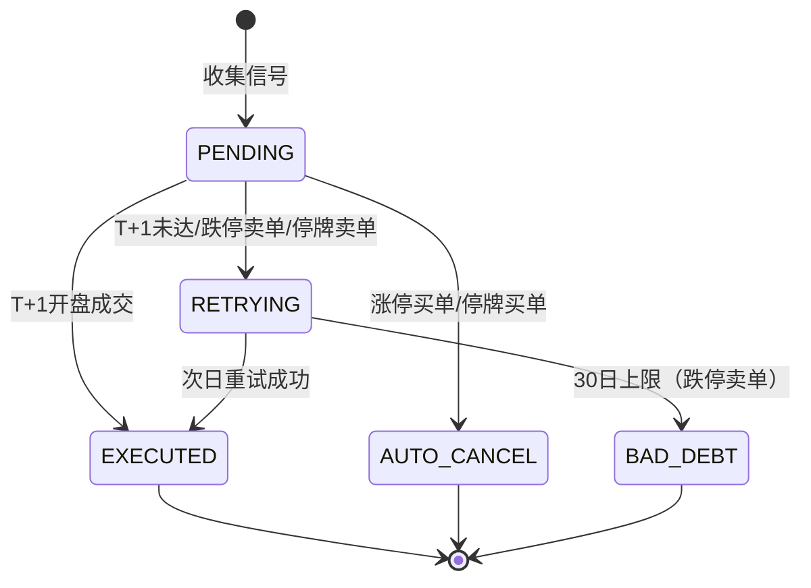

# 阶段 6：UniQuant 回测与撮合分析

> **分析时间**：2026-11-24  
> **依赖阶段**：阶段0-5  
> **核心文件**：`hands/backtest/unified_engine.py`, `hands/backtest/unified_matching_engine.py`, `hands/backtest/unified_models.py`

---

## 1. 回测系统架构总览

### 1.1 核心组件

```mermaid
graph TD
    A[List[TradingSignal]] --> B[UnifiedBacktestEngine.run]
    B --> C[_prepare_dataframe<br/>补充pre_close/avg_daily_volume]
    C --> D[逐bar回测主循环]
    D --> E{Step 1: 执行挂单<br/>T+1延迟}
    E --> F[防线A: T+1检查]
    E --> G[防线B: 涨跌停拦截]
    E --> H[防线C: 停牌拦截]
    E --> I[防线D: 资金约束]
    E --> J[防线E: 非对称成本]
    E --> K[防线F: 滑点方向]
    E --> L[防线G: 整手取整]
    D --> M{Step 2: 更新权益}
    D --> N{Step 3: 收集信号<br/>生成挂单}
    N --> O[互斥排队保护<br/>INV-6]
    D --> P[BacktestResult]
```

### 1.2 防线清单

```python
"""
防线清单:
  A. T+1 铁律: 交易日序号差 >= 1
  B. 涨跌停拦截: 涨停不买入, 跌停不卖出
  C. 停牌拦截: volume=0 不成交
  D. 资金永不透支: 实时 cash_available 全局扣减
  E. 非对称成本: 印花税仅卖方, 最低佣金5元
  F. 滑点方向: 买高卖低, 使用交易量而非日均量
  G. 整手取整: A股100股为一手
"""
```

---

## 2. 回测主循环流程

### 2.1 三步流程

```python
def run(self, df, signals, symbol="", name=None):
    # 准备数据
    df = self._prepare_dataframe(df)
    signal_map = self._index_signals_by_date(signals)
    
    # 初始化状态
    cash = self.initial_capital
    position = 0
    buy_date = None
    pending_order = None
    
    for idx in range(len(df)):
        ts = pd.Timestamp(dates[idx])
        
        # 跳过非交易日
        if not self.trade_calendar.is_trading_day(ts):
            equity = cash + position * closes[idx]
            equity_curve.append(equity)
            continue
        
        # ── Step 1: 执行前一根bar的挂单 (T+1延迟) ──
        if pending_order is not None:
            exec_price_raw = opens[idx]  # T+1日开盘价成交
            vol = int(volumes[idx])
            
            # 防线C: 停牌拦截
            if vol <= 0:
                if pending_order["action"] == "SELL" and position > 0:
                    pending_order["status"] = "RETRYING"
                    pending_order["retry_count"] += 1
                else:
                    pending_order = None  # 买单停牌自动取消
            else:
                if pending_order["action"] == "BUY":
                    record, cash = self._execute_buy(...)
                    pending_order = None  # 买单执行后作废（Auto-Cancel）
                
                elif pending_order["action"] == "SELL":
                    # 防线A: T+1检查
                    if not self._check_t1(buy_date, ts):
                        pending_order["status"] = "RETRYING"
                    else:
                        record, cash = self._execute_sell(...)
                        if record is None:
                            # 防线B: 跌停拒卖强制结转
                            retry_count += 1
                            if retry_count >= 30:
                                # 终局坏账清退（0元出清）
                                position = 0
        
        # ── Step 2: 更新权益 ──
        equity = cash + position * closes[idx]
        equity_curve.append(equity)
        
        # ── Step 3: 收集当日信号 → 生成挂单 ──
        if pending_order is not None and pending_order.get("status") == "RETRYING":
            # 互斥排队保护（INV-6）: 拦截买入信号
            pass
        else:
            # 信号优先级: LPPL SELL > BUY > 其他SELL
            for sig in day_signals:
                if sig.action == "SELL" and "lppl" in sig.reason.lower():
                    pending_order = {"action": "SELL", ...}
                    break
```

### 2.2 挂单生命周期



---

## 3. 七大防线详解

### 3.1 防线A: T+1铁律

```python
def _check_t1(self, buy_date, sell_date):
    """交易日序号差 >= 1"""
    return check_t1_compliance(buy_date, sell_date, self.trade_calendar)
```

**实现机制**：
- 买入日期和卖出日期之间至少间隔1个交易日
- T+1未达时，卖单结转至下一交易日（RETRYING）
- 使用TradeCalendarManager检查交易日

**验证** ✅：
```python
# 示例：T日买入，T日卖出 → 拒绝
buy_date = pd.Timestamp("2026-11-24")
sell_date = pd.Timestamp("2026-11-24")
_check_t1(buy_date, sell_date)  # False

# 示例：T日买入，T+1日卖出 → 允许
sell_date = pd.Timestamp("2026-11-25")
_check_t1(buy_date, sell_date)  # True
```

### 3.2 防线B: 涨跌停拦截

```python
def _check_limit(self, price, pre_close, action, symbol="", name=None):
    """涨停不买入, 跌停不卖出"""
    return check_limit_price(price, pre_close, action, symbol=symbol, name=name)
```

**板块涨跌幅限制**：
```python
MarketConstants.LIMIT_RATIO = {
    "main": (1.10, 0.90),      # 主板 ±10%
    "sci_tech": (1.20, 0.80),  # 科创板 ±20%
    "gem": (1.20, 0.80),       # 创业板 ±20%
    "beijing": (1.30, 0.70),   # 北交所 ±30%
    "st": (1.05, 0.95),        # ST股 ±5%
}
```

**特殊规则**：
- **主板新股首日**: +44%/-36%
- **科创板/创业板前5日**: 无涨跌幅限制
- **北交所首日**: 无涨跌幅限制

**跌停拒卖处理**：
```python
# 跌停拒卖强制结转（Mandatory Rollover, INV-6）
if record is None:  # 跌停拒卖
    retry_count += 1
    if retry_count < 30 and position > 0:
        pending_order["status"] = "RETRYING"
        pending_order["shares"] = position  # 同步最新持仓
    else:
        # 终局坏账清退（0元出清, INV-7）
        bad_debt_record = TradeRecord(
            action="SELL",
            price=0.0,
            shares=position,
            reason="BAD_DEBT_LIMIT_DOWN_30D_EXPIRED",
        )
        position = 0
```

### 3.3 防线C: 停牌拦截

```python
# 停牌拦截
if vol <= 0:
    logger.debug(f"停牌拒绝: {date_key} volume=0")
    if pending_order["action"] == "SELL" and position > 0:
        # 卖单停牌结转（最多30日）
        pending_order["status"] = "RETRYING"
        pending_order["retry_count"] += 1
    else:
        # 买单停牌自动取消（Auto-Cancel）
        pending_order = None
```

**处理规则**：
- 买单停牌 → Auto-Cancel（自动取消）
- 卖单停牌 → RETRYING（结转，最多30日）
- 30日上限后放弃结转

### 3.4 防线D: 资金永不透支

```python
# 实时cash_available全局扣减
record, cash = self._execute_buy(
    shares_requested=pending_order["shares"],
    cash_available=cash,
    ...
)
```

**实现机制**：
- 实时检查cash_available
- 买入时扣减现金（含佣金、过户费、滑点）
- 卖出时增加现金（扣除印花税、佣金、过户费、滑点）

### 3.5 防线E: 非对称成本

```python
# 印花税仅卖方
def _calc_stamp_duty(self, value, timestamp=None):
    """印花税 (仅卖方)"""
    return calculate_stamp_duty(value, self.stamp_duty_rate, timestamp=timestamp)

# 最低佣金5元
def _calc_commission(self, value):
    """佣金 = max(value × 费率, 最低佣金)"""
    return calculate_commission(value, self.commission_rate, self.min_commission)
```

**成本模型**：

| 成本项 | 费率 | 最低/上限 | 说明 |
|---|---|---|---|
| **佣金** | 0.03% | 最低5元 | 双向收取 |
| **印花税** | 0.05%（2023-08-28起） | 无 | 仅卖方 |
| **过户费** | 0.001% | 无 | 仅沪市股票 |
| **滑点** | 分段平方根冲击 | 上限500 bps | 买高卖低 |

### 3.6 防线F: 滑点方向

```python
def compute_execution_prices(self, prices, volumes, avg_daily_volumes, is_buy, quantities=None):
    if quantities is not None:
        # 真实订单参与率: eta = quantities / avg_daily_volumes
        eta = quantities / avg_daily_volumes
        
        # 分段平方根冲击模型
        impact = np.where(
            eta <= 0.10,  # 小中单
            0.001 * np.sqrt(np.maximum(eta / 0.10, 0.0)),  # 0~10 bps
            0.001 + 0.01 * (eta - 0.10)  # 大单流动性承压
        )
        impact = np.minimum(impact, 0.05)  # 上限500 bps
    
    # 滑点方向: 买高卖低
    direction = 1.0 if is_buy else -1.0
    return prices * (1.0 + direction * total_slip)
```

**滑点模型**：

| 订单类型 | eta范围 | 冲击成本 | 说明 |
|---|---|---|---|
| **小单** | eta ≤ 0.01 | 0~3 bps | 散户小单 |
| **中单** | 0.01 < eta ≤ 0.10 | 3~10 bps | 中等订单 |
| **大单** | eta > 0.10 | 10~500 bps | 流动性承压 |

**关键特性**：
- ✅ 使用交易量（quantities）而非日均量
- ✅ 分段平方根冲击模型
- ✅ 上限截断（500 bps）

### 3.7 防线G: 整手取整

```python
# A股100股为一手
shares = (sized_shares // get_board_rule(symbol).lot_size) * get_board_rule(symbol).lot_size
```

**实现机制**：
- 100股为一手（lot_size=100）
- 向下取整到整手
- 如果取整后≤0，使用100股（1手）

---

## 4. UnifiedMatchingEngine（向量化撮合）

### 4.1 滑点计算

```python
def compute_execution_prices(self, prices, volumes, avg_daily_volumes, is_buy, 
                             symbols=None, quantities=None, timestamps=None):
    if quantities is not None:
        # 真实订单参与率
        eta = quantities / avg_daily_volumes
        
        # 分段平方根冲击模型
        impact = np.where(
            eta <= 0.10,
            0.001 * np.sqrt(np.maximum(eta / 0.10, 0.0)),  # 0~10 bps
            0.001 + 0.01 * (eta - 0.10)  # 10~500 bps
        )
        impact = np.minimum(impact, 0.05)  # 上限500 bps
    
    # SlippageModel（可选）
    if self.slippage_model is not None and symbols is not None:
        model_rates = np.array([
            self.slippage_model.estimate(symbol=s, quantity=q, direction=direction_str, ...)
            for s, q, p, t in zip(symbols, quantities, prices, timestamps)
        ])
        total_slip = model_rates + impact
    else:
        total_slip = self.slippage_rate + impact
    
    # 滑点方向
    direction = 1.0 if is_buy else -1.0
    return prices * (1.0 + direction * total_slip)
```

### 4.2 涨跌停检查（向量化）

```python
def compute_limit_status_vectorized(self, prices, pre_closes, symbols, names=None, trading_days_listed=None):
    n = len(prices)
    is_limit_up = np.zeros(n, dtype=bool)
    is_limit_down = np.zeros(n, dtype=bool)
    valid = pre_closes > 0
    price_ratios = np.where(valid, prices / np.maximum(pre_closes, 1e-8), 1.0)
    tol = MarketConstants.PRICE_TOLERANCE
    
    # Fast path: 无names和trading_days_listed时完全向量化
    if names is None and trading_days_listed is None:
        board_types = np.array([get_board_type(s) for s in symbols])
        for board_type, (up_r, down_r) in MarketConstants.LIMIT_RATIO.items():
            board_mask = board_types == board_type
            mask = board_mask & valid
            is_limit_up |= mask & (price_ratios >= up_r - tol)
            is_limit_down |= mask & (price_ratios <= down_r + tol)
        return {"is_limit_up": is_limit_up, "is_limit_down": is_limit_down}
    
    # Slow path: ST名称检测和IPO特殊规则
    for i in range(n):
        if not valid[i]:
            continue
        
        # ST名称检测
        bt = get_board_type(symbols[i])
        if names is not None and names[i]:
            nu = names[i].upper()
            if any(nu.startswith(p) for p in ("ST", "*ST", "S*ST")):
                bt = "st"
        
        # IPO特殊规则
        if trading_days_listed is not None and trading_days_listed[i] > 0:
            tdl = int(trading_days_listed[i])
            if bt == "main" and tdl == 1:
                # 主板新股首日: +44%/-36%
                if pr >= 1.44 - tol:
                    is_limit_up[i] = True
                if pr <= 0.64 + tol:
                    is_limit_down[i] = True
                continue
            if bt in ("sci_tech", "gem") and tdl <= 5:
                # 科创板/创业板前5日无涨跌幅限制
                continue
            if bt == "beijing" and tdl == 1:
                # 北交所首日无涨跌幅限制
                continue
        
        up_r, down_r = MarketConstants.LIMIT_RATIO.get(bt, MarketConstants.LIMIT_RATIO["main"])
        if pr >= up_r - tol:
            is_limit_up[i] = True
        if pr <= down_r + tol:
            is_limit_down[i] = True
    
    return {"is_limit_up": is_limit_up, "is_limit_down": is_limit_down}
```

### 4.3 FillResult结构

```python
@dataclass
class FillResult:
    executed_shares: np.ndarray
    exec_prices: np.ndarray
    commissions: np.ndarray
    stamp_duties: np.ndarray
    slippages: np.ndarray
    transfer_fees: np.ndarray
    rejected_mask: np.ndarray          # 涨跌停拒绝
    t1_violation_mask: np.ndarray      # T+1违规
    limit_violation_mask: np.ndarray   # 涨跌停违规
    cash_shortfall_mask: np.ndarray    # 资金不足
```

---

## 5. 成交成本模型

### 5.1 佣金

```python
def calculate_commission(value, commission_rate, min_commission):
    """佣金 = max(value × 费率, 最低佣金)"""
    return max(value * commission_rate, min_commission)
```

**参数**：
- 费率: COMMISSION_PCT（默认0.0003，即0.03%）
- 最低佣金: MIN_COMMISSION（默认5元）
- 双向收取（买入和卖出都收）

### 5.2 印花税

```python
def calculate_stamp_duty(value, stamp_duty_rate, timestamp=None):
    """印花税 (仅卖方)"""
    rate = get_stamp_tax_pct(timestamp)  # 2023-08-28起减半征收
    return value * rate
```

**参数**：
- 费率: 0.001（1‰）→ 2023-08-28起0.0005（0.5‰）
- 仅卖方
- 时间敏感（2023-08-28前1‰，之后0.5‰）

### 5.3 过户费

```python
TRANSFER_FEE_PCT = 0.00001  # 0.001%
```

**参数**：
- 费率: 0.001%
- 仅沪市股票（has_transfer_fee）
- 双向收取

### 5.4 滑点

**分段平方根冲击模型**：

| 订单类型 | eta范围 | 冲击成本公式 | 实际范围 |
|---|---|---|---|
| **小单** | eta ≤ 0.01 | 0.001 × √(eta / 0.10) | 0~3 bps |
| **中单** | 0.01 < eta ≤ 0.10 | 0.001 × √(eta / 0.10) | 3~10 bps |
| **大单** | eta > 0.10 | 0.001 + 0.01 × (eta - 0.10) | 10~500 bps |

**上限**：500 bps（5%）

---

## 6. 回测结果指标

### 6.1 BacktestResult核心指标

```python
@dataclass
class BacktestResult:
    trades: List[TradeRecord]
    equity_curve: List[float]
    daily_returns: List[float]
    initial_capital: float
    final_cash: float
    metadata: Dict[str, Any]
    benchmark_return: float
    
    @property
    def total_return(self):
        """总收益率"""
        return (equity_curve[-1] - initial_capital) / initial_capital
    
    @property
    def sharpe(self):
        """夏普比率"""
        return calculate_sharpe_ratio(daily_returns, period_days=1)
    
    @property
    def annualized_return(self):
        """年化收益率"""
        return (1 + total_return) ** (252 / n_days) - 1
    
    @property
    def max_drawdown(self):
        """最大回撤"""
        ec = np.array(equity_curve)
        rolling_max = np.maximum.accumulate(ec)
        dd = (rolling_max - ec) / np.maximum(rolling_max, 1e-10)
        return np.max(dd)
    
    @property
    def win_rate(self):
        """胜率"""
        closed = [t for t in trades if t.action == "SELL"]
        wins = sum(1 for t in closed if t.pnl > 0)
        return wins / len(closed)
    
    @property
    def profit_factor(self):
        """盈利因子"""
        total_profit = sum(t.pnl for t in closed if t.pnl > 0)
        total_loss = abs(sum(t.pnl for t in closed if t.pnl < 0))
        return total_profit / total_loss
```

### 6.2 参数敏感性分析

```python
def sensitivity_scan(self, df, signals, symbol="", slippages=None, commissions=None):
    """
    滑点/佣金敏感性分析
    遍历给定的滑点率和佣金率组合，分别运行回测
    """
    slippages = slippages or [0.0, 0.0005, 0.001, 0.002, 0.003]
    commissions = commissions or [0.0, 0.0003, 0.0005, 0.001]
    
    return run_sensitivity_scan(
        engine_factory=_factory,
        df=df,
        signals=signals,
        slippages=slippages,
        commissions=commissions,
    )
```

---

## 7. 特殊机制

### 7.1 互斥排队保护（INV-6）

```python
# 若存在RETRYING结转状态的清仓卖单，严禁被BUY信号覆写
if pending_order is not None and pending_order.get("status") == "RETRYING":
    day_signals = signal_map.get(date_key, [])
    for sig in day_signals:
        if sig.action == "BUY":
            logger.warning(f"标的{symbol}存在结转中的清仓卖单(RETRYING), 拦截买入信号")
    # 保持pending_order结转状态不变，次日集合竞价置顶重试
```

**目的**：防止在跌停卖单结转期间被买入信号覆盖

### 7.2 终局坏账清退（INV-7）

```python
# 跌停结转达到30日上限，执行终局坏账清退（0元出清）
if retry_count >= 30:
    logger.warning(f"跌停结转达到30日上限，执行终局坏账清退 (0元出清, INV-7)")
    bad_debt_record = TradeRecord(
        action="SELL",
        price=0.0,
        shares=position,
        reason="BAD_DEBT_LIMIT_DOWN_30D_EXPIRED",
    )
    trades.append(bad_debt_record)
    position = 0
```

**目的**：处理极端情况（连续30日跌停无法卖出）

### 7.3 幸存者偏差检查

```python
# 检查股票是否在回测期间退市
survivorship_warning = ""
try:
    mgr = StockMetadataManager()
    delist_date = mgr.get_delist_date(symbol)
    if delist_date is not None:
        last_bar = pd.to_datetime(df["date"].iloc[-1])
        if pd.to_datetime(delist_date) <= last_bar:
            survivorship_warning = f"Symbol delisted {delist_date}; backtest extends to {last_bar.date()}"
            metadata["survivorship_warning"] = survivorship_warning
except (OSError, KeyError, TypeError):
    pass
```

**目的**：检测回测期间股票退市的情况

---

## 8. 信号优先级（遗留逻辑）

### 8.1 LPPL SELL优先

```python
# LPPL SELL优先（遗留逻辑）
for sig in day_signals:
    if sig.action == "SELL" and position > 0 and pending_order is None \
            and sig.reason and "lppl" in sig.reason.lower():
        pending_order = {
            "action": "SELL",
            "shares": position,
            "reason": sig.reason,
            "status": "PENDING",
        }
        break
```

### 8.2 信号优先级顺序

1. **LPPL SELL**（遗留逻辑，优先于其他SELL）
2. **BUY**（position == 0时）
3. **其他SELL**（position > 0时）

### 8.3 与SignalArbitrator的不一致

**问题**：
- 🟡 **回测引擎中LPPL SELL优先于其他SELL**
- **与SignalArbitrator仲裁逻辑不一致**（SignalArbitrator中LPPL优先级最低99）
- **原因**：历史遗留逻辑，未同步更新

**建议**：
- 统一使用SignalArbitrator的仲裁结果
- 移除回测引擎中的LPPL SELL优先逻辑

---

## 9. A股交易规则验证

### 9.1 规则实现矩阵

| 规则 | 实现 | 验证 | 位置 |
|---|---|---|---|
| **T+1** | ✅ 交易日序号差≥1 | buy_date和sell_date检查 | `_check_t1()` |
| **涨跌停** | ✅ 涨停不买，跌停不卖 | check_limit_price + 板块规则 | `_check_limit()` |
| **停牌** | ✅ volume=0不成交 | 买单取消，卖单结转 | 回测主循环 |
| **资金约束** | ✅ 永不透支 | 实时cash_available检查 | `_execute_buy()` |
| **印花税** | ✅ 仅卖方 | calculate_stamp_duty | `_calc_stamp_duty()` |
| **过户费** | ✅ 仅沪市 | TRANSFER_FEE_PCT + has_transfer_fee | `_execute_buy/sell()` |
| **佣金** | ✅ 最低5元 | calculate_commission | `_calc_commission()` |
| **滑点** | ✅ 买高卖低 | compute_execution_prices | `_execute_buy/sell()` |
| **整手** | ✅ 100股整数倍 | lot_size取整 | 回测主循环 |
| **ST股** | ✅ ±5% | ST名称检测 | `compute_limit_status_vectorized()` |
| **科创板/创业板** | ✅ ±20% | 板块规则 | `compute_limit_status_vectorized()` |
| **北交所** | ✅ ±30% | 板块规则 | `compute_limit_status_vectorized()` |
| **新股** | ✅ 首日+44%/-36% | trading_days_listed检查 | `compute_limit_status_vectorized()` |

### 9.2 板块涨跌幅限制

| 板块 | 涨停 | 跌停 | 特殊规则 |
|---|---|---|---|
| **主板** | +10% | -10% | 新股首日+44%/-36% |
| **科创板** | +20% | -20% | 前5日无限制 |
| **创业板** | +20% | -20% | 前5日无限制 |
| **北交所** | +30% | -30% | 首日无限制 |
| **ST股** | +5% | -5% | 名称检测 |

---

## 10. 潜在偏差

### 10.1 LPPL SELL优先级遗留逻辑 🟡

**问题**：
- 回测引擎中LPPL SELL优先于其他SELL
- 与SignalArbitrator仲裁逻辑不一致（LPPL优先级最低99）
- LPPL已降为遥测层（diagnostic_only=True）

**影响**：
- 回测结果可能受LPPL SELL影响
- 与实盘仲裁逻辑不符

**建议**：
- 统一使用SignalArbitrator的仲裁结果
- 移除回测引擎中的LPPL SELL优先逻辑

### 10.2 滑点模型假设 🟡

**假设**：
- 分段平方根冲击模型
- 小单（eta≤0.10）：0~10 bps
- 大单（eta>0.10）：10~500 bps
- 上限500 bps

**风险**：
- 极端行情下滑点可能被低估
- 流动性枯竭时实际滑点可能超过500 bps

**缓解**：
- 使用交易量而非日均量
- SlippageModel可自定义

### 10.3 坏账清退价格 🟡

**问题**：
- 30日跌停后0元出清
- price=0.0

**风险**：
- 实际跌停开板后可能有部分回收
- 保守估计，可能低估收益

**影响**：
- 极端情况下的保守处理
- 实际影响较小（30日连续跌停极少见）

### 10.4 幸存者偏差 🟢

**现状**：
- ✅ 已实现幸存者偏差检查
- ✅ 依赖StockMetadataManager的delist_date
- ✅ 添加survivorship_warning到metadata

**局限**：
- 依赖StockMetadataManager的完整性
- 退市股票的历史数据可能不完整

---

## 11. 校验清单

- [x] 验证T日信号、T+1 open成交逻辑（§3.1，§2.1 Step 1）
- [x] 验证涨停不买、跌停不卖（§3.2）
- [x] 验证印花税只在卖出侧（§3.5，§5.2）
- [x] 验证资金不能透支（§3.4）
- [x] 检查停牌volume=0（§3.3）
- [x] 回测流程图（§2）
- [x] 撮合规则表（§4）
- [x] A股交易约束校验表（§9）
- [x] 成交成本模型（§5）
- [x] 信号到订单到成交流程（§2.2挂单生命周期）
- [x] 回测偏差风险（§10）
- [x] 改进建议（§10）

---

## 12. 阶段6结论

UniQuant的回测系统展现了**完整的A股交易规则实现和严格的七大防线**：

### 架构优点 ✅
1. **七大防线完整**：T+1、涨跌停、停牌、资金、成本、滑点、整手
2. **向量化撮合**：UnifiedMatchingEngine支持批量处理
3. **板块规则完整**：主板/科创板/创业板/北交所/ST股
4. **新股特殊规则**：首日+44%/-36%，前5日无限制
5. **非对称成本**：印花税仅卖方，最低佣金5元
6. **滑点模型**：分段平方根冲击，买高卖低
7. **特殊机制**：互斥排队保护（INV-6），终局坏账清退（INV-7）
8. **幸存者偏差检查**：检测退市股票
9. **参数敏感性分析**：滑点/佣金敏感性扫描

### 核心机制 ✅
1. **T+1延迟执行**：T日信号，T+1日开盘成交
2. **涨跌停拦截**：涨停不买，跌停不卖
3. **停牌处理**：买单取消，卖单结转（最多30日）
4. **资金约束**：实时cash_available检查
5. **滑点方向**：买高卖低，使用交易量

### 主要风险 🟡
1. 🟡 **LPPL SELL优先级遗留逻辑**：与SignalArbitrator不一致
2. 🟡 **滑点模型假设**：极端行情下可能低估
3. 🟡 **坏账清退价格**：0元出清过于保守
4. 🟢 **幸存者偏差**：已实现检查，依赖数据完整性

**下一阶段**：阶段7 - 风控与实盘就绪分析（深入风险引擎、仓位管理、实盘部署）

---

**分析人**：Claude (Anthropic)  
**审核状态**：待用户确认  
**产物路径**：`docs/analysis/06_backtest_matching.md`
