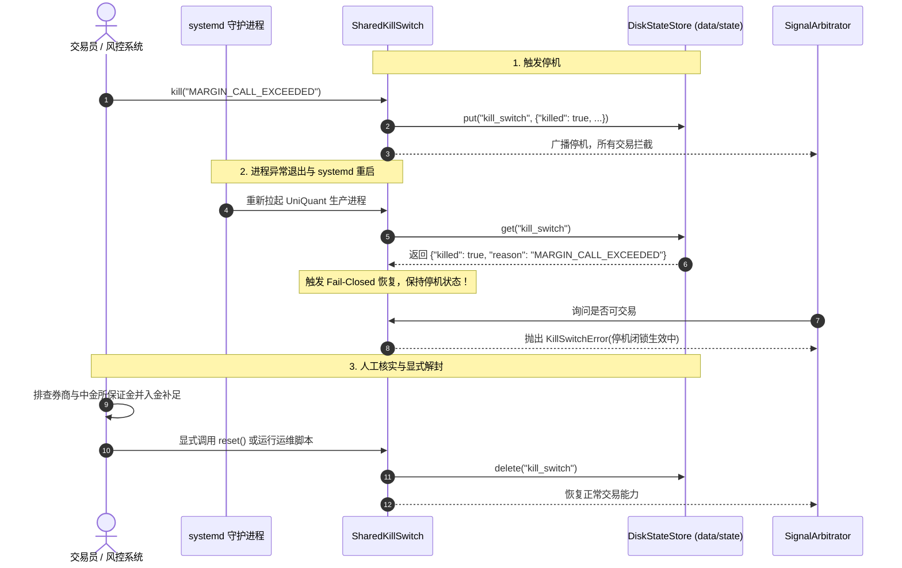

# UniQuant 崩溃恢复与状态落盘语义设计规范 (T9a)

> **Document Status**: Active / Implemented (Wave 1 T9a 落地)  
> **Date**: 2026-11-21  
> **Governing Principles**: `CLAUDE.md` 十项原则 (Rule 4 真实性第一, Rule 5 防御性编程, Rule 9 架构纯洁度)  
> **Deployment Morphology**: **云主机单机节点 + pip 直装 + systemd / cron（免 Docker，轻量化部署）**

---

## 1. 背景与目标

在**免 Docker**的云主机部署形态下，量化交易节点采用 `systemd` 进行服务守护与故障自愈重启，采用 `cron` 执行日历定时任务（如收盘后数据湖同步、SLA 检测、报表生成）。

在这种部署架构下，若仅在内存中维护关键交易状态（如急停开关 `SharedKillSwitch`、订单执行 Saga、策略状态机 FSM），一旦进程遭遇异常崩溃或被 `systemd` 自动重启，系统将出现**状态漂移或危险复苏（Silent Resumption）**：
- **致命反例**：实盘遭遇中金所保证金警报或严重追保（CFFEX Critical Margin Depletion），触发了 `KillSwitch` 紧急停机。此时若机器内存泄露重启，系统若无持久化状态，会在重启后视作全新开机，继续盲目下单，造成资金击穿。
- **设计目标**：确立严格的**崩溃恢复与状态落盘语义（Crash Recovery & State Semantics）**，实现：
  1. **Fail-Closed 停机防线**：停机与风控熔断状态跨进程、跨重启持久保持，非人工显式确认绝不自动复原。
  2. **轻量原子存储**：不引入 Redis/PostgreSQL 等外部守护依赖，基于本地磁盘的 `StateStore` 接口实现文件级原子落盘（`tmp + os.replace + FileLock`），彻底杜绝半写与数据损坏。
  3. **清晰的持久化边界**：严格界定"必须落盘"与"禁止落盘"的状态类型，避免过度持久化造成 IO 抖动。

---

## 2. 状态分类与持久化边界

| 状态类别 | 关键组件 / 对象 | 是否落盘 | 存储介质与格式 | 恢复语义与策略 |
|---|---|---|---|---|
| **风控停机状态** | `SharedKillSwitch` | **必须落盘** | `data/state/kill_switch.json` | **Fail-Closed**：服务重启时若检测到文件存在且 `killed=True`，强制进入停机闭锁，拒绝所有买卖意图，必须人工显式调用 `reset()` 清理。 |
| **分布式/本地交易事务** | `ExecutionSagaOrchestrator` | **必须落盘 (Phase 2)** | `data/state/saga_{id}.json` | **Saga 补偿或推进**：重启时扫描未决事务，若步骤处于中间态，依据幂等日志触发补偿回滚或对账重查。 |
| **标的策略状态** | `FSMStateMachine` / 仓位状态 | **必须落盘 (Phase 2)** | `data/state/fsm_positions.json` | **对账重锚**：重启后比对券商/期货柜台真实持仓与 FSM 记忆状态，若有差异记入法医审计日志并降级告警。 |
| **实时行情感知** | 实时 Snap 抽样、分笔 Tick、内存滑动窗口 | **严禁落盘** | 内存易失对象 | **易失重拉**：重启后丢弃内存缓存，重新通过 `DataFetcher` 与在线源/数据湖拉取最新基线数据。 |
| **中间计算特征** | 因子中间矩阵、指标计算临时变量 | **严禁落盘** | 内存易失对象 | **纯函数重算**：因子与信号由历史日线/分钟线纯函数计算推导，无需落盘维护状态。 |

---

## 3. 持久化架构与原子性契约

### 3.1 `StateStore` 抽象协议 (`uniquant.shared.state_store`)

采用 Python typing 的 `@runtime_checkable Protocol` 定义统一存储契约，实现模块间依赖倒置：

```python
@runtime_checkable
class StateStore(Protocol):
    """持久化状态存储契约 (T9a)"""
    def get(self, key: str) -> Optional[Dict[str, Any]]: ...
    def put(self, key: str, data: Dict[str, Any]) -> None: ...
    def delete(self, key: str) -> bool: ...
    def exists(self, key: str) -> bool: ...
```

### 3.2 `DiskStateStore` 本地盘原子实现

采用进程间互斥文件锁与 POSIX 原子重命名保障并发与崩溃一致性：
1. **进程隔离**：操作受 `FileLock(data/state/.{key}.lock)` 互斥保护，支持跨进程/多 worker 安全调用。
2. **原子写入**：
   - 写入临时隐藏文件：`data/state/.{key}.tmp.{pid}`；
   - 执行 `f.flush()` 与 `os.fsync(f.fileno())` 强制刷盘；
   - 调用 POSIX 原语 `os.replace` 将临时文件原子替换为正式文件 `data/state/{key}.json`；
   - 发生任何写入异常时，自动安全清理临时文件，100% 保证既有文件完整无损（经混沌故障注入单测验证）。
3. **Key 规范性安全校验**：仅允许 `^[a-zA-Z0-9_\-]+$` 安全字符，杜绝路径遍历（Path Traversal）漏洞。

---

## 4. `SharedKillSwitch` 持久化生命周期与运维规范



### 4.1 崩溃恢复与停机验证指令
- **查看当前急停状态**：
  ```bash
  python3 -c "from uniquant.shared.kill_switch import get_kill_switch; ks = get_kill_switch(); print(f'Killed: {ks.is_killed}, Reason: {ks.reason}')"
  ```
- **手动触发急停**：
  ```bash
  python3 -c "from uniquant.shared.kill_switch import get_kill_switch; get_kill_switch().kill('MANUAL_OPERATOR_HALT')"
  ```
- **显式恢复交易（慎用，须在风控对账全绿后执行）**：
  ```bash
  python3 -c "from uniquant.shared.kill_switch import get_kill_switch; get_kill_switch().reset()"
  ```

---

## 5. 验收证据与测试覆盖

- **单测证据**：
  - `tests/shared/test_state_store.py`: 6 项测试全绿（覆盖协议符合性、写入/读取/删除生命周期、非法 key 防御、非 dict 防御、损坏 JSON 自愈容错、`os.replace` 崩溃故障注入原子性断言）。
  - `tests/shared/test_persistent_kill_switch.py`: 2 项测试全绿（覆盖进程重启恢复断言、Fail-Closed 防线验证、显式 reset 清除持久化状态验证）。
  - `tests/test_production_kill_switch.py`: 9 项原有生产急停开关测试 100% 兼容全绿。
- **并发与锁时延**：
  - 本地磁盘状态落盘端到端耗时在微秒~毫秒级（17 项单测累计执行仅 0.40s），满足高频风控与日终断言的性能预算。
