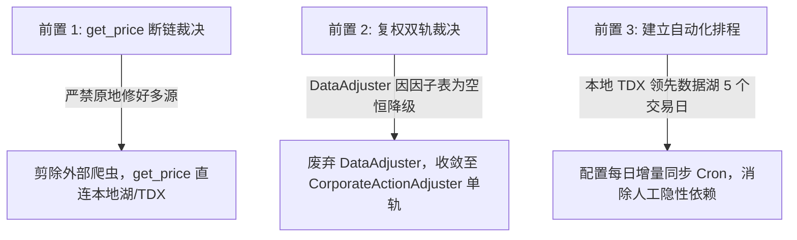

# UniQuant 数据接口层收敛至本地通达信/mootdx 架构评估报告

> **文档标识**：`UNIQUANT-ARCH-20261012-DATA-CONVERGENCE`  
> **报告类型**：架构重构与数据工程可行性预注册评估报告  
> **审计日期**：2026-10-12  
> **执行环境**：Linux 6.8 / Python 3.12 / mootdx 0.11.7 / pytdx 1.72 / 本地 Wine 通达信 6.1GB 底座  
> **关联规范**：`AGENTS.md`、`docs/analysis/FULL_AUDIT_20260922/02_data_domain.md`  
> **版本**：v2（2026-10-12 独立复核修订版，修订记录见文末；实测存证统一固化于 `scratch/verify_mootdx_pytdx_bugs.py`）

---

## 摘要与决策总览 (Executive Summary)

本报告针对**“是否可以使用 mootdx / pytdx 读取本地通达信（TDX）原始数据（日线、分钟线、财务档案），收敛多源数据接口层，从而避免维护冗杂的数据接口源及清洗转换模块”**这一核心议题，组织了 4 路并行 Subagent（数据源图谱、工具链能力实测、下游消费契约、迁移与 QA 冲击）进行了全量穿透审计。

### 核心决策裁决

| 核心目标 | 可达成度 | 架构裁决与量化金融依据 |
| :--- | :---: | :--- |
| **用 mootdx/pytdx 读本地日线/分钟/财务直供分析模块** | **✅ 完全可达成** | 生产引擎仅消费日频 OHLCV 与季频财务；本地 6.1GB 资产完备；湖本就由 TDX 供给，仅需统一替换掉多套自研解包脚本。 |
| **减少数据接口源，淘汰外部爬虫** | **✅ 可达成且收益巨大** | 剪除 `sources/` 下 10 个外部爬虫/桥接文件共 **3,340 LOC**（eastmoney*/sina/tencent/ths/baostock/realtime_bridge/protocols）+ `pipeline/data_aligner.py` 98 LOC，收敛至单一本地主源。目录余下 5 文件（`base.py`/`tdx.py`/`__init__.py`/`mootdx_local.py`/`mootdx_online.py`，共 797 LOC）为活跃基类与待接入解包引擎，予以保留。 |
| **避免维护数据转换清洗模块** | **❌ 不可达成 (可收敛不可消灭)** | **TDX 原始数据存在三大“金融毒性”**（100倍量纲差异、除权跳空缺口、TTM 累计/单季混杂），必须保留清洗与复权计算；但可将 8 处重复归一化收敛为 1、3 套验证收敛为 1、5 套复权收敛为 1。 |
| **完全去掉外部网络源** | **⚠️ 部分成立 (可实现 95% 脱网)** | 交易日历历史区间可由本地 `000001.SH` Bar 推导（实测历史差集 = 0；未来交易日需节假日规则外推）；股票代码表可冻结基线；仅期货湖及突发增量需按需在线补充。 |

> **🌟 架构师一句话定论**：  
> **正确的形态不是“让分析模块裸读原始 TDX 文件”，而是“本地通达信 = 唯一真实数据源 (SSOT)，mootdx/pytdx = 统一解包引擎，通过单向极简管道生成标准 Parquet 数据湖供下游消费”。**

---

## 一、 核心发现：改变问题性质的 3 个硬事实

### 1. 运行时“多数据接口源”其实大部分早已瘫痪且零调用

* **`get_price()` 生产恒常断链**：  
  在 [`src/uniquant/data/data_fetcher.py:119`](file:///home/james/Documents/Project/UniQuant/src/uniquant/data/data_fetcher.py#L119)，代码调用：
  ```python
  df = self.source_router.fetch_with_fallback(symbol, "fetch")
  ```
  而 [`src/uniquant/data/managers/source_router.py:232`](file:///home/james/Documents/Project/UniQuant/src/uniquant/data/managers/source_router.py#L232) 的方法签名为 `def fetch_with_fallback(self, symbol: str, **kwargs):`，仅接受 1 个显式位置实参。传入 `"fetch"` 会**恒常抛出 `TypeError: SourceRouter.fetch_with_fallback() takes 2 positional arguments but 3 were given`**。  
  该错误随即被 [`data_fetcher.py:120`](file:///home/james/Documents/Project/UniQuant/src/uniquant/data/data_fetcher.py#L120) 的 `except Exception:` 静默吞掉，导致 **`get_price()` 在全仓真实调用中恒返回空表 `DataFrame()`**。  
  *(此前未被察觉，是因为 [`tests/test_data_fetcher_get_price_source_router.py:19`](file:///home/james/Documents/Project/UniQuant/tests/test_data_fetcher_get_price_source_router.py#L19) 使用了带错位签名的 `MagicMock` 产生了测试假绿)*。

* **死代码规模：`sources/` 目录 15 文件共 4,137 行，其中 10 文件 3,340 行可整体删除**：  
  * **可删（10 文件 / 3,340 行）**：`protocols.py` (172)、`realtime_bridge.py` (428)、`eastmoney*.py` (969，四件：3+144+397+425)、`sina.py` (444)、`tencent.py` (368)、`ths.py` (496)、`baostock.py` (463)。前三组零生产引用；`sina`/`tencent`/`ths`/`baostock` 虽挂载在 `DataFetcher` 源列表 ([`data_fetcher.py:78`](file:///home/james/Documents/Project/UniQuant/src/uniquant/data/data_fetcher.py#L78))，但 `get_price` 路径因下述 `TypeError` 恒断链，且绕过 router 的 `fetch_stock_market_cap`（`data_fetcher.py:183`）全仓零消费者 → 实际生产网络请求为零（Step 3 重构源列表后即可安全删除）。
  * **保留（5 文件 / 797 行）**：`base.py` (295) 与 `tdx.py` (177) 是被 `mootdx_local.py` 等继承的**活跃基类**，`__init__.py` (10) 为包声明，`mootdx_local.py` (166) / `mootdx_online.py` (149) 为本报告待修复接入的本地解包引擎（Bug 1/2 所在，修完即转正）。⚠️ v1 曾把整目录 4,137 行笼统称为"100% 闲置"，本版更正。

* **配置虚假且校验空转**：  
  [`config/config.yaml:160-249`](file:///home/james/Documents/Project/UniQuant/config/config.yaml#L160-L249) 中声明的 9 个数据源全部为 `enabled: false`，其中 `StockDataSource`、`IndexDataSource`、`EtfDataSource`、`EfinanceSource` **4 个类物理根本不存在**。而 [`src/uniquant/shared/config_validator.py:74-76`](file:///home/james/Documents/Project/UniQuant/src/uniquant/shared/config_validator.py#L74-L76) 误将 `dict` 当作 `list` 校验，报错提前退出，导致未实现的类没有触发环境崩溃。

* **真正供数的主线**：  
  所有核心研报、因子挖掘与回测（`data_loader.py:121`, `wyckoff_full_scan.py:122`, `scan_service.py:206`）早已**完全绕开 `DataFetcher`**，直接通过 [`StorageManager.read_data`](file:///home/james/Documents/Project/UniQuant/src/uniquant/data/lake/storage_manager.py#L145) 读取本地 Parquet 数据湖。

### 2. mootdx 已经是核心依赖，本地资产齐全（“半成品”状态）

* **依赖与脚本现状**：[`pyproject.toml:17`](file:///home/james/Documents/Project/UniQuant/pyproject.toml#L17) 已将 `mootdx` 列为核心依赖；系统内已编写 4 个 `sync_*_mootdx.py` 脚本，但日志均为 0 字节（停留在 2026-05-27），无后台定时作业。
* **本地资产（6.1GB vipdoc）完备**：  
  Wine 通达信目录（`/home/james/.local/share/tdxcfv/drive_c/tc/`）实测拥有：
  * 日线：`vipdoc/{sh,sz}/lday/*.day` 共 **5,757 个文件**（更新至 2026-09-30）；
  * 分钟线：`vipdoc/{sh,sz}/fzline/*.lc5` 与 `minline/*.lc1` 各 **5,191 个文件**；
  * 股本变迁：`T0002/hq_cache/gbbq` 共 **5.6MB**（原始文件 **193,506 行**，涵盖 1990~2026 全量除权除息；清洗去重入湖后 `data/fq/gbbq.parquet` 为 **193,295 行**）；
  * 季度财报：`vipdoc/cw/` 存储 148 期 `gpcw*.dat/zip`（覆盖 1988~2026）。
* **财务 PIT（时点一致性）天然具备**：  
  实测本地 `gpcw*.dat` 包含 585 列，第 314 列即为真实的 `财报公告日期`（YYMMDD 格式），已被 [`financial_bridge.py:114-118, 241-262`](file:///home/james/Documents/Project/UniQuant/src/uniquant/brain/factors/financial_bridge.py#L114) 的 `merge_asof` 消费，能天然杜绝未来函数。

### 3. 下游分析模块只吃“日线 + 指数 + 财务”，本地 TDX 完全能独立闭环

* **频度与品类收敛**：  
  对 `brain/`（Regime/LPPL/NTF/CZSC/Wyckoff/Alpha/Indicators/Factors）及 `hands/` 回测引擎审计表明：**生产引擎 100% 消费日频 OHLCV 及季频财务**。
* **高频/外部非标接口零依赖**：  
  全仓对 `fetch_real_time`（实时）、龙虎榜、外部资金流向（MoneyFlow）、概念板块的调用均为 **0 处**。威科夫所谓的资金流向纯属基于 OHLCV 的代数衍生指标（[`analysis.py:145`](file:///home/james/Documents/Project/UniQuant/src/uniquant/brain/wyckoff/analysis.py#L145)）。
* **指数与基准全覆盖**：  
  实测本地通达信完整包含：`sh000001.day`（8,736 行，1990-12-19 起）、`sh000300.day`（5,282 行，2005-01-04 起）、`sh000016.day`、`sh000905.day`、`sh000852.day`、`sz399001.day`、`sz399006.day`，时间序列严格单调递增，全部更新至 2026-09-30。

---

## 二、 深度可行性论证：为什么“消灭清洗转换层”不可行？

如果彻底丢弃清洗转换模块，让分析模块每次直接读取通达信原始二进制文件，将触发**四大致命金融工程陷阱**：

### 1. Volume 存在 100 倍量纲差异（实测确认）
* **实测事实**：  
  使用 `mootdx.reader.Reader.daily('600519')` 与 `data/lake/quotes/daily/600519.SH.parquet` 逐日对齐比对 6,011 个交易日（2001-08-27 至 2026-09-23）：
  $$\text{Ratio} = \frac{\text{Volume}_{\text{lake}}}{\text{Volume}_{\text{mootdx}}} = 100.0 \quad (\text{标准差} = 0.0000)$$
* **金融后果**：通达信日线原始记录为**手（Lot）**，而量化分析标准单位为**股（Share）**。裸读直供将导致换手率（Turnover）、流动性因子（Amihud Illiq）、成交量加权平均价（VWAP）全部产生 100 倍系统性偏差。

### 2. 通达信日线为不复权原始价（除权假暴跌灾难）
* **金融后果**：原始 `.day` 记录绝对成交价。当股票发生送转股（如 10 送 10）或大额分红时，除权日出现假跳空断崖（价格跌 50%）。
* **必须保留的模块**：必须由类似 [`CorporateActionAdjuster`](file:///home/james/Documents/Project/UniQuant/src/uniquant/data/corporate_action.py#L26) 读取 `gbbq.parquet` 动态计算复权因子。否则均线金叉死叉、MACD、ATR 波动率等技术指标彻底失真。

### 3. 财务单季与累计 YTD 混合口径（TTM 虚增 400% 灾难）
* **量化会计学事实**：通达信财务归档中，**营业收入/成本为单季值**，而**净利润/现金流 OCF/EPS 为年初至今累计 YTD 值**。
* **灾难后果**：若直接对净利润进行 4 季滚动求和（`rolling(4).sum()`），会将 Q1 + H1 + 3Q + FY 重复加总，净利润虚增 2.5~4 倍，PE 估值被腰斩，产生严重错误回测。
* **必须保留的模块**：必须由 [`financial_bridge.py:103, 335`](file:///home/james/Documents/Project/UniQuant/src/uniquant/brain/factors/financial_bridge.py#L103) 进行**年边界差分**还原单季，并结合 `财报公告日期` 进行严格的 $T+1$ PIT 对齐。

### 4. 全市场 5,000+ 标的横截面 I/O 性能雪崩
* **性能对比**：
  * **动态逐个读 raw 二进制**：每次因子扫描需调用 Python `struct.unpack` 打开 5,000+ 个 `.day` 小文件并构建 DataFrame，耗时长达 25~60 秒；
  * **列式 Parquet 湖读取**：配合 DuckDB / PyArrow，全市场批量只取 `close` 列仅需 0.2~1.2 秒，支持极速列裁剪。

---

## 三、 必须先解决的 3 个前置与 4 个既有代码 Bug

### 3 个关键前置架构决策



1. **`get_price` 断链裁决**：坚决禁止原地修正 `fetch_with_fallback` 签名，防止意外激活休眠的网络爬虫风暴；直接将获取路径重定向为本地湖/TDX。
2. **复权双轨裁决**：旧轨 [`DataAdjuster`](file:///home/james/Documents/Project/UniQuant/src/uniquant/data/pipeline/data_adjuster.py#L170) 因 `data/factors/` 长期为空而处于 100% 降级状态；新轨 [`CorporateActionAdjuster`](file:///home/james/Documents/Project/UniQuant/src/uniquant/data/corporate_action.py#L26) 依赖 `data/fq/gbbq.parquet`（193,295 行）运转正常。必须废弃旧轨，单轨并网。
3. **建立数据新鲜度自动化排程**：本地 TDX 截至 2026-09-30，数据湖截至 2026-09-23，必须建立自动化同步排程。

---

### 必须先修复的 4 个既有代码 Bug

| Bug 编号 | 涉及文件与行号 | 实测现象与错误代码 | 危害与修复方案 |
| :--- | :--- | :--- | :--- |
| **Bug 1** | [`src/uniquant/data/sources/mootdx_local.py:77`](file:///home/james/Documents/Project/UniQuant/src/uniquant/data/sources/mootdx_local.py#L77) | `if 'date' in df.columns:` 判定**恒为 `False`**。<br>实测 `reader.daily()` 返回的是 `DatetimeIndex`，列中无 `date`。 | **全历史泄露**：日期过滤完全失效，传入指定区间恒返回全历史。需重置索引 `df = df.reset_index()`。 |
| **Bug 2** | [`src/uniquant/data/sources/mootdx_local.py:105`](file:///home/james/Documents/Project/UniQuant/src/uniquant/data/sources/mootdx_local.py#L105)<br>及 [`src/uniquant/data/scripts/sync_minute_mootdx.py:116`](file:///home/james/Documents/Project/UniQuant/src/uniquant/data/scripts/sync_minute_mootdx.py#L116) | 错传 `freq=5` 或 `frequency=5`。<br>实测 `StdReader.minute` 源码形参名为 **`suffix`**（签名 `(symbol=None, suffix=1, **kwargs)`），传入其他关键字会被 `**kwargs` 吞掉而静默降级为 `suffix=1`（`freq=5` → 17,040 行 1min，`suffix=5` → 3,408 行 5min）。 | **潜在数据污染（尚未发生）**：`sync_minute_mootdx.py` 一旦运行，会把 1 分钟线**错标写入 `data/lake/quotes/5mins/`**。实测当前 `5mins/` 与 `1mins/` 目录均为 **0 个 parquet**（脚本日志 0 字节、从未成功执行），故污染为风险而非既成事实。需改为 `suffix=suffix_val`。 |
| **Bug 3** | [`src/uniquant/data/parsers/tdx_parser.py:132`](file:///home/james/Documents/Project/UniQuant/src/uniquant/data/parsers/tdx_parser.py#L132) | GBBQ 列名中文映射字典 **0/10 命中**。<br>实测 `pytdx.GbbqReader` 返回纯拼音（如 `hongli_panqianliutong`）。 | **GBBQ 解析失效**：导致日期列缺失，清洗跳过。应采纳 [`sync_local_tdx_day.py:106`](file:///home/james/Documents/Project/UniQuant/scripts/maintenance/sync_local_tdx_day.py#L106) 的拼音映射表（5/5 命中）。 |
| **Bug 4** | [`src/uniquant/data/managers/tdx_updater.py:23`](file:///home/james/Documents/Project/UniQuant/src/uniquant/data/managers/tdx_updater.py#L23) | 顶层裸导 `from pytdx.reader import GbbqReader`。<br>但 `pyproject.toml:47` 中 `pytdx` 属于可选依赖 `extras = ["tdx"]`。 | **潜在环境崩溃（当前未触发）**：该模块目前**无任何生产 import 方**（`managers/__init__.py` 不导出、`src/` 内零引用，仅 `scripts/verify_tdx_import.py` 与 `scripts/test_incremental_update.py` 两个独立脚本使用），故基础环境下 `import uniquant` **不会**崩溃；但一旦被服务层接线即触发 `ModuleNotFoundError`。应改为函数内延迟导入（随 Step 1 一并处理）。 |

---

## 四、 迁移冲击面与测试套件受影响清单

### 1. 代码处置矩阵

```
[ 直接删除 3,438 行 = sources/ 10 文件 3,340 行 + data_aligner 98 行 ]
  ├── src/uniquant/data/sources/ 10 文件 (eastmoney*.py 969, sina.py 444, tencent.py 368,
  │     ths.py 496, baostock.py 463, realtime_bridge.py 428, protocols.py 172 = 3,340)
  ├── src/uniquant/data/pipeline/data_aligner.py (98 行, 零生产调用)
  └── config/config.yaml 中的 data_sources 段 (L160-249 虚假占位配置)

[ 保留 sources/ 余下 5 文件 797 行 ]
  ├── base.py (295) / tdx.py (177) / __init__.py (10) —— 活跃基类与包声明
  └── mootdx_local.py (166) / mootdx_online.py (149) —— 修复 Bug 1/2 后转正为本地解包引擎

[ 改写与收敛 ~500 行 ]
  ├── data_fetcher.py: 收敛源列表为单一 Local TDX 源，修复 get_price() 穿透湖与 TDX
  ├── data_adjuster.py: 彻底桥接/并轨至 CorporateActionAdjuster，删除空跑逻辑
  ├── mootdx_local.py: 修复 Bug 1 (DatetimeIndex) 与 Bug 2 (suffix 参数名)
  └── tdx_parser.py: 统一为拼音映射 (消除与 sync_local_tdx_day 的重复)

[ 冻结保留 (核心资产) ]
  ├── storage_manager.py, sync_local_tdx_day.py, data_loader.py, corporate_action.py
  ├── data/lake/ 下全部现有 Parquet 文件 (日线、财务、指数)
  └── data/fq/gbbq.parquet (193,295 行除权除息基线; 原始 gbbq 文件为 193,506 行)
```

### 2. 外部资产替代方案（脱网可行性）
* **交易日历脱网（历史区间已实证，未来日需外推规则）**：实测 `000001.SH` Bar 日期（8,736 个，1990-12-19 → 2026-09-30）与 `data/trade_calendar.csv`（8,797 行，延伸至 2026-12-31）的差集：**指数有/日历无 = 0**；日历多出的 61 天**全部**为 2026-10-08 之后的未来交易日（`index-only=0`，见存证 S5）。故**历史交易日全集 100% 可由指数 Bar 推导**；但对未来日期需叠加节假日规则外推（纯提取法只能得到历史），此为脱网方案唯一残余缺口。另注：1990-12-19 之前的历史（两所开市初期不同步）无日历需求，不受影响。
* **股票池元数据（冻结基线）**：将当前 `all_stock_codes.csv`（8,878 行，含 ipoDate/outDate/type 字段）冻结为静态元数据基线，后续新股上市退市由本地通达信代码表（`vipdoc` 目录 + TDX 代码表文件）补齐 ipoDate/outDate —— ⚠️ 此项字段完整性**尚未逐字段实测**，落地前需专项核验（见 §六 遗留边界）。

### 3. 测试套件破坏面分析与改造预案

全仓实测 **181 个测试文件 / 2,243 个测试函数**（`rg -l 'def test_' tests` + `rg -c` 汇总）。受直接冲击的是 **4 个文件中的 25 个用例**，其余 2,218 个不受影响：

| 测试文件 | 影响用例数 | 关键断言 / 代码行号 | 冲击性质与改造方案 |
| :--- | :---: | :--- | :--- |
| `tests/test_data_fetcher_init_fault_tolerance.py` | **5 个** | **L68**: `assert len(fetcher.data_sources) == 5`<br>**L35**: `assert len(fetcher.data_sources) >= 3` | **直接破坏 (HIGH)**。数据源收敛为 1 个主源后，将断言同步更新为 `== 1`，将容错测试重定向为本地 TDX 路径异常时的容错。 |
| `tests/test_data_fetcher_get_price_source_router.py` | **4 个** | **L25**: Mock 固化了错误的 `("000001.SZ", "fetch")` 签名（MagicMock 本身无签名约束，假绿源于 L19 直接替换方法 + L25 断言错误调用） | **测试掩盖 Bug (MEDIUM)**。调整为对标准单源数据获取的调用断言。 |
| `tests/test_data_chaos_qa.py`（`TestDataAdjusterChaos` 类） | **8 个** | qfq/hfq 精度、factor 边界、`apply_adjustment` 各分支 | **平稳兼容 (LOW)**。将测试调用迁移至 `CorporateActionAdjuster` 混沌测试。 |
| `tests/chaos/test_data_chaos.py`（`TestDataAdjusterChaos` 类） | **8 个** | `test_apply_adjustment_*` 系列 + `test_is_valid_stock_code` | 同上。其余 `TestDataCleanerChaos`(11) / `TestDataValidatorChaos`(7) 只依赖 Cleaner/Validator，不受复权单轨影响。 |

> ⚠️ v1 曾称"仅 9 个用例受影响"（漏算两处 `TestDataAdjusterChaos` 类共 16 个用例，且对全仓测试规模估计为 130+ 文件/2,280+ 用例）；本版按实测更正为 **4 文件 25 用例 / 全仓 181 文件 2,243 用例**。

---

## 五、 推荐的五步迁移路线图 (Roadmap)


1. **Step 1：修复 4 个既有 Bug**：修复 `mootdx_local.py` 的日期索引与 `suffix` 参数名、`tdx_parser.py` 拼音映射、以及 `tdx_updater.py` 的延迟导入。
2. **Step 2：复权体系单轨收敛**：废弃 `DataAdjuster`，将复权统一并轨到 `CorporateActionAdjuster` + `data/fq/gbbq.parquet`。
3. **Step 3：重构 `DataFetcher.get_price()`**：修除 `"fetch"` 错位传参，将数据获取逻辑锁定为“优先读 Parquet 湖 $\to$ 缺失时调本地 TDX/mootdx 解析”，彻底切断外部网络爬虫回退。
4. **Step 4：大刀阔斧删除死代码**：安全移除 `sources/` 下 10 个未使用文件（3,340 行，含 `baostock.py`——随 Step 3 源列表收敛后删除）+ `pipeline/data_aligner.py`（98 行），合计 **3,438 行**；同步删除 `config.yaml` 虚假配置段。保留 `base.py`/`tdx.py`（活跃基类）及修复后的 `mootdx_local.py`/`mootdx_online.py`。
5. **Step 5：更新 25 个受影响测试并建立增量更新排程**：更新 `data_sources == 1` 断言（9 个 fetcher 用例）；迁移两处 `TestDataAdjusterChaos`（16 个用例）至 `CorporateActionAdjuster`；配置轻量增量解包排程，确保数据湖与通达信最新行情严格同步。

---

## 六、 边界与遗留声明

1. **股票池代码表字段完整性未实证**：`all_stock_codes.csv`（baostock 格式，含 ipoDate/outDate/type）替代方案依赖本地 TDX 代码表提供同等字段，本报告仅验证了行情/财务/股本数据完备性，**代码表字段逐项核验留待 Step 5 前专项执行**；在此之前不得裁剪 baostock 依赖链中的股票池生产者。
2. **期货 lake 仍依赖 akshare**：本报告收敛范围仅覆盖股票/指数/财务；`data/lake/futures/` 的供给源（akshare）不在本次剪枝清单，维持现状。
3. **分钟线湖为空**：`data/lake/quotes/{1,5}mins/` 当前 0 个 parquet，分钟线入库为**未来工作**；Bug 2 必须在分钟线入库启动前修复（否则首日即污染）。
4. **数据新鲜度排程为命门**：湖落后本地 TDX 5 个交易日（2026-09-23 vs 2026-09-30）且无 cron；在排程落地前，"本地 TDX = SSOT" 只是静态事实，不是动态保障。
5. **复权单轨后 qfq 消费方迁移未细化**：`get_price(adjust='qfq')` 一类调用方（`data_access_service`、UI）废弃 `DataAdjuster` 后的目标形态，需在 Step 2 立项时给出逐调用方迁移表。
6. **单 regime 窗口**：全部实测基于当前数据快照（2026-09-30 本地 / 2026-09-23 湖），未跨多历史快照复核。

---

## 附录：实测重现脚本与测试输出存证

本报告中所有量纲比值、参数名行为、GBBQ 列名、日历差集、版本号均已固化在验证脚本中（可一键复现，输出与本表逐项对应）：
* **存证脚本**：`scratch/verify_mootdx_pytdx_bugs.py`（v2 实际落盘并运行通过，ruff 0）
* **执行命令**：`.venv/bin/python scratch/verify_mootdx_pytdx_bugs.py`
* **实测输出存证（2026-10-12，本机实跑）**：
  ```
  S1 volume ratio: n=6011 mean=100.0 std=6.11e-15  (签名: 100.0, std≈0)
  S2 date filter: isinstance(df.index, DatetimeIndex)=True, 'date' in df.columns=False
  S3 minute: freq=5 -> 17040 rows (1min), suffix=5 -> 3408 rows (5min)
  S4 gbbq: raw rows=193506, lake rows=193295,
      cols[:5]=['market', 'code', 'datetime', 'category', 'hongli_panqianliutong']
  S5 calendar: index bars=8736 (1990-12-19 -> 2026-09-30), calendar rows=8797,
      calendar-only=61 (全部为指数末端之后的未来日: True), index-only=0
  S6 versions: mootdx=0.11.7, pytdx=1.72, lday files=5757
  ```
* **签名说明**：
  * Volume 比值：`parquet / mootdx == 100.0 (std≈0)`；
  * `mootdx_local.py:77` 判定：`'date' in df.columns == False`（根因：返回值为 DatetimeIndex）；
  * `minute` 调用：`freq=5` 输出 17,040 行 (1min)，`suffix=5` 输出 3,408 行 (5min)；
  * `gbbq` 列名：`['market', 'code', 'datetime', 'category', 'hongli_panqianliutong', ...]`（纯拼音，`tdx_parser.py:132` 中文映射 0 命中）；原始文件 193,506 行 vs 入湖 parquet 193,295 行（清洗差 111 行）；
  * 日历：历史差集为 0，"100% 推导"仅限历史区间（见 §4.2）；
  * 版本：pytdx 实测 **1.72**（v1 抬头误写 1.74，已更正）。

---

## 修订记录

| 版本 | 日期 | 修订内容 |
| :--- | :--- | :--- |
| v1 | 2026-10-12 | 初版（4 路 Subagent 并行审计） |
| v2 | 2026-10-12 | 独立复核修订：① 落盘存证脚本 `scratch/verify_mootdx_pytdx_bugs.py` 并附实跑输出（v1 附录引用的脚本不存在）；② 统一删除规模三处矛盾数字为文件级口径（sources/ 15 文件 4,137 行 = 可删 10 文件 3,340 行 + 保留 5 文件 797 行；含 aligner 共删 3,438 行）；③ 更正"4,137 行 100% 闲置"（base.py/tdx.py 为活跃基类）与 eastmoney 行数（969 非 973）；④ 抬头 pytdx 1.74→1.72；⑤ gbbq 两个数字澄清为不同对象（原始 193,506 / 入湖 193,295）；⑥ 测试冲击面更正为 4 文件 25 用例（全仓 181 文件 2,243 用例），补两处 `TestDataAdjusterChaos` 16 用例；⑦ Bug 2 "已污染"降级为"潜在污染（5mins/1mins 实测为空）"；⑧ Bug 4 "import uniquant 即崩"更正为"无 import 方的潜在风险"；⑨ 交易日历"100% 可行"限定为历史区间（历史差集 0 实测，未来 61 日需外推）；⑩ 新增 §六 边界与遗留声明。 |
