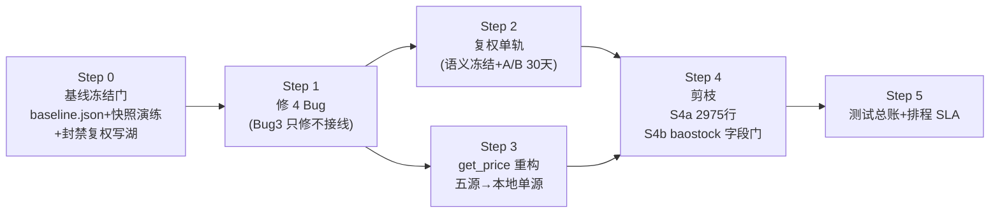
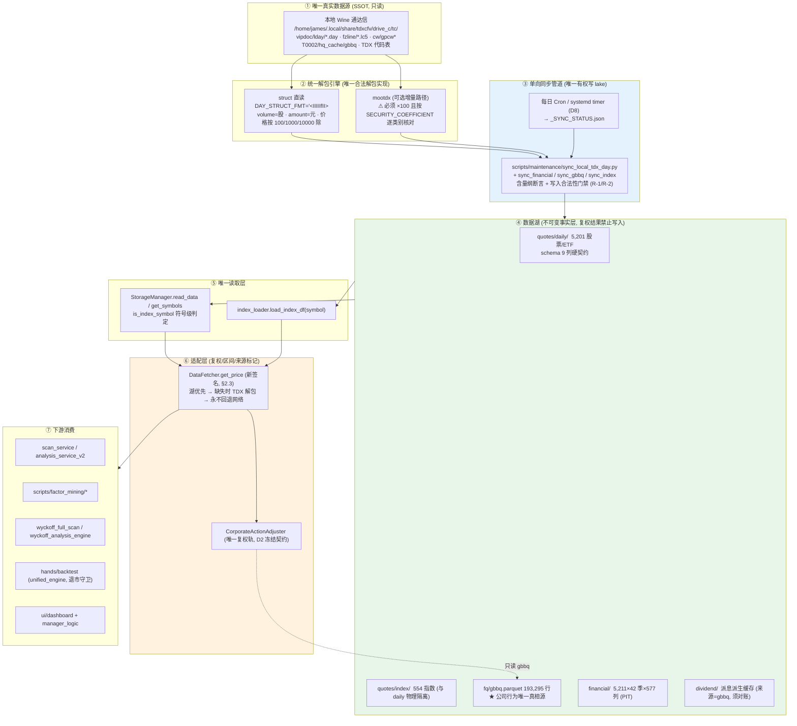
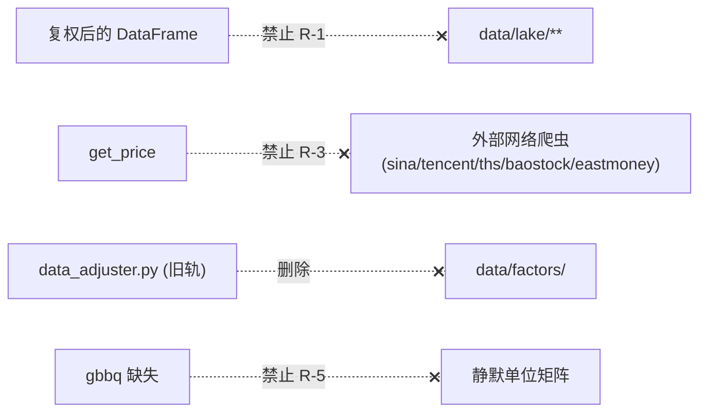
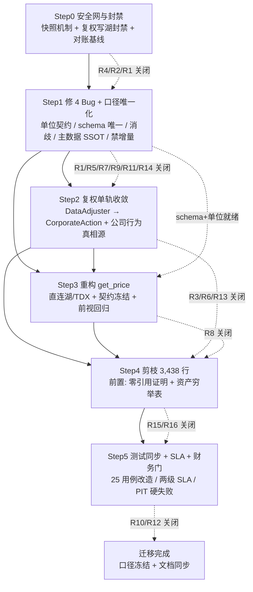

# UniQuant 数据源迁移实施计划（预注册级施工图）

> **文档标识**：`UNIQUANT-ARCH-20261012-DATA-MIGRATION-PLAN`
> **文档类型**：数据源迁移实施计划（预注册；任何超计划口径选择须回本文件登记）
> **日期**：2026-10-12
> **上游依据**：`docs/analysis/DATA_SOURCE_CONVERGENCE_EVALUATION_REPORT.md`（v2 已核实版）
> **产出方式**：结构化提示词 v1 → 红蓝对抗（红队 15 条 P0×7/P1×8；蓝队 A1–A8 资产表 + 3 硬门）→ 提示词 v2 → 4 路并行 subagent 分片起草（WS-A 架构裁决 / WS-B 施工步骤 / WS-C 资产排程 / WS-D 风险里程碑），全部断言经各分片在当前工作树 `file:line` 抽查后写入
> **性质声明**：本文只规划不施工。实施时每一步须按 §4 全局约定（`--no-ignore` 引用扫描、ruff 0、TDD 红绿、改测同批）执行。

---

## 执行总览（一页纸）

### 迁移一句话

**本地通达信 = 唯一真实数据源（SSOT）→ 单向 ingestion/sanitize 管道 → Parquet 数据湖 → 下游只读湖。** 本次迁移的本质是「多源网络爬虫归零 + 多套自研解包/复权脚本收敛为一套」，**不是**消灭清洗/复权层（那是金融正确性成本，只能收敛）。

### 执行顺序（依赖拓扑）



### 五个先于施工的硬事实（全部实测，推翻/细化了评估报告 v2）

| # | 事实 | 影响 |
|---|---|---|
| F1 | **量纲归因纠正**：`.day` 原始 volume 已是"**股**"（600519 `amount/close≈volume` 中位 0.9999）；**mootdx 输出才是"手"**（÷100，amount 不变，且 `mootdx/contrib/compat.py:32-44` 系数跨 11 类资产不一致：SH_INDEX=1.0 / SZ_FUND=0.01） | 解包引擎选 `sync_local_tdx_day.py` struct 路径量纲**天然正确**；若用 mootdx 必须 ×100 并逐资产类别核对。见 D3 |
| F2 | **修 Bug3 = 打开 qfq 写湖污染通道**：`data_access_service.py:155,164-172` 湖缺数据时 `get_price(adjust="qfq")` → `write_data(overwrite=True)` 回写湖；今天未污染仅因 `data_adjuster.py:177-179` 因子表空而降级。Bug3 修好即生效，且增量 append 污染**不可回溯** | Step 0 起封禁复权结果写 `data/lake/**`；Bug3 修复与删旧轨绑定同一阶段。见 D4 / R2 |
| F3 | **`sources/baostock.py` 不能进即时删除清单**：`baostock_cache_manager.py:8,21` 与 `trade_calendar_manager.py:8,124` 均 import 它（与将删的"爬虫 baostock 源"是两条链） | Step 4 拆 S4a（即时删 2,975 行）/ S4b（baostock 过股票池字段门后再裁决）。见 D5 / R15 |
| F4 | **测试冲击面修正为 48 用例**（评估报告 v2 的 25 漏算）：新增 `data_aligner` 6 个 + `realtime_bridge` 17 个；全仓基线 181 文件 / 2,243 函数 | Step 5 测试总账按 48 编列。见 §8 |
| F5 | **湖滞后为 9 个交易日**（2026-09-23 vs 2026-09-30，非报告 v2 所述 5）；且 `storage_manager` SLA 三缺陷（`:88 _data_sources` 恒空、`:562-579` 用 mtime 而非 `max(date)`、`read_parquet:145-159` 吞异常） | Step 0 排程前必须先修 SLA 底座。见 §7.3 / R10 |

### 八项前置裁决（§2 详表，施工前必须逐项签字）

| 裁决 | 内容 | 推荐 |
|---|---|---|
| D1 | `get_price` 断链处置 | **禁止原地修签名**（会激活 5 个爬虫源）；Step 3 重构为湖优先单源 |
| D2 | 复权单轨语义冻结 | 新轨 `CorporateActionAdjuster`（volume 不调整、锚点=数据最新日、新增 `adj_factor` 列）；缺 gbbq 从静默单位矩阵改**硬失败** |
| D3 | 量纲单位契约 | struct 解包路径（volume=股原样）；mootdx 路径弃用或 ×100 + 资产类别系数表 |
| D4 | Bug3 与删旧轨绑定 | 同一阶段；Step 1 只修 `tdx_parser` 映射但**不接线**，Step 2 生效 |
| D5 | 证券主数据 SSOT | `data/all_stock_codes.csv` 单副本（现存 src 副本 7,580 行 vs data 副本 8,879 行**不一致**）；字段核验通过前不得动 baostock 生产链；缺文件从 warning 改**硬失败** |
| D6 | 指数契约 | 废除 `daily/` 内指数 symlink 兼容层；全仓硬编码 `000300/000001` 迁移表（13 个源码文件/43 处引用实测）+ `000001.SH≠000001.SZ` 消歧回归 |
| D7 | 公司行为唯一真相源 | `data/fq/gbbq.parquet`（193,295 行）；`data/lake/dividend/`（含**自引用 symlink 环**）降级为缓存或并轨；两源除权因子逐日 diff=0 验收 |
| D8 | 数据新鲜度排程 | 两级 SLA（vipdoc 停更 + 湖落后）+ Wine 客户端盘后下载人工步显式化 |

### 三条不可协商红线（贯穿全计划）

1. **`amount` 口径不得改变**——H-A 条件 illiq（唯一幸存策略）核心因子直依赖 amount（`custom_factors.py:101-105`）；cleaner 的 `close*volume` 兜底会凭空生成成交额，**禁用**。
2. **禁止前视**——`ffill/bfill` 回填、缺公告日列时 PIT 过滤静默 no-op（`z_cnmm_calculator.py:770-771`）均须改为硬失败 + 回归测试。
3. **引擎/源切换禁止增量追加**——必须 `--force` 全量重建 + 新旧全量逐日比值分布报告 + 20 只 canary 先行（增量 `drop_duplicates(keep="last")` 会把口径断层拼接得无痕）。

---

## 目录

| 章 | 内容 | 起草 |
|---|---|---|
| §1 | 范围与非目标 | WS-A |
| §2 | 前置裁决 D1–D8（+ 终态架构摘要） | WS-A |
| §3 | 终态架构与接口契约（`get_price` 新签名/schema/前视禁令） | WS-A |
| §4 | 全局约定（所有 Step 通用：`--no-ignore` / ruff / TDD / 禁全树回滚） | WS-B |
| §5 | Step 0 — 基线冻结门（baseline.json / 快照回滚演练 / 双源对账 / 复权禁写） | WS-B |
| §6 | 施工步骤 Step1–Step5（diff 面 / TDD 红绿 / 脚本化验收门 / 回滚） | WS-B |
| §7 | 数据资产清单（10 项穷举）与排程 SLA | WS-C |
| §8 | 冲击面（48 用例处置 / `adjust=` 25 行调用点迁移表 / UI 现状 / cleaner 红线） | WS-C |
| §9 | 风险登记册 R1–R16（P0×6 / P1×10，含触发回滚条件） | WS-D |
| §10 | 里程碑与交付物（依赖矩阵 / 顺序红线 / 文档同步义务） | WS-D |
| §11 | 与既有研究口径的兼容声明（H-A / P11-P14 / walk-forward / 预注册） | WS-D |
| 附 | WS-A 复核更正汇总 / WS-D 证据复核差异表 | — |

> **分片间差异消解记录**（汇总层裁决）：① baostock.py 删除问题——WS-A 实测发现 `baostock_cache_manager`/`trade_calendar_manager` 依赖，汇总层采纳 WS-A，Step 4 按 S4a/S4b 拆分；② 测试冲击面 25 vs 48——WS-C 补算 aligner/realtime_bridge 用例，汇总层采纳 48；③ 硬编码指数路径 13 文件 vs 43 处——两者口径不同（文件数 vs 引用处数），均采纳并注明口径；④ 量纲归因——WS-A/WS-D 独立实测均确认 `.day`=股、mootdx=手，汇总层据此更正评估报告 v2 §二.1 的表述。


---

## §1 范围与非目标

### 0.1 一句话定论（架构北极星）

> **正确的终态不是「让分析模块裸读原始 TDX 文件」，而是「本地通达信 = 唯一真实数据源（SSOT），mootdx/pytdx = 统一解包引擎，通过单向极简管道生成标准 Parquet 数据湖供下游消费」。**
> 因此本迁移的本质是 **「把多源网络爬虫降级为零 + 把多套自研解包/复权脚本收敛为一套」**，而 **不是** 「消灭清洗与复权层」。清洗/复权层是金融正确性的必要成本，只能收敛，不能删除。

### 0.2 范围内（In-Scope）

| # | 范围项 | 终态 | 关联裁决 |
|---|---|---|---|
| S1 | **日线行情供给链** | 本地 TDX `.day` → 单一解包引擎 → `data/lake/quotes/daily/` → `StorageManager.read_data` → `DataFetcher.get_price` | D1 / D3 |
| S2 | **指数行情供给链** | 本地 TDX 指数 `.day` → `data/lake/quotes/index/`；废除 `daily/` 内的指数 symlink 兼容层 | D6 |
| S3 | **复权体系** | 单轨 `CorporateActionAdjuster` + `data/fq/gbbq.parquet`；废弃 `DataAdjuster` 全部分支 | D2 / D4 / D7 |
| S4 | **网络爬虫源** | 剪除 `sources/` 下 10 文件（3,340 LOC）+ `pipeline/data_aligner.py`（98 LOC）；`DataFetcher` 源列表收敛为 1 个本地源 | D1 / D5 |
| S5 | **证券主数据（代码表）** | `data/all_stock_codes.csv` 单副本化 + 缺失时**硬失败**（禁止 warning→空集）；脱网供给路径立项 | D5 |
| S6 | **公司行为数据** | `data/fq/gbbq.parquet` 为**唯一复权真相源**；`data/lake/dividend/` 降级为派息因子缓存或并入 gbbq 单轨 | D7 |
| S7 | **数据新鲜度排程** | 每日增量同步 Cron/systemd timer；本地 TDX → 湖的单向推送 | D8（补充裁决） |
| S8 | **接口契约固化** | 日线 schema / `get_price` 新签名 / 量纲单位 / 前视禁令 / 来源标记，全部写入可执行断言 | §2 |

### 0.3 非目标（Out-of-Scope，本次迁移**不做**）

| # | 非目标 | 理由 |
|---|---|---|
| N1 | **不消灭清洗层** | TDX 原始数据存在三大「金融毒性」：量纲跨资产不一致、除权跳空缺口、财务单季/YTD 混杂。清洗层是正确性成本。 |
| N2 | **不让分析模块裸读 `.day` / `.lc5` 二进制** | 全市场 5,000+ 标的小文件 `struct.unpack` 逐个打开构建 DataFrame 约 25–60 s；列式 Parquet 湖 + 列裁剪 0.2–1.2 s。且裸读会把量纲/复权责任推给每个下游。 |
| N3 | **不裁剪 `data/lake/financial/`（季频财务）与 `data/fq/gbbq.parquet`** | 核心资产。PIT 公告日对齐（`financial_bridge.py` `merge_asof`）已验证可用，是基本面因子赛道的底座。 |
| N4 | **不裁剪 `data/lake/futures/` 供给链（akshare）** | 本次收敛范围仅覆盖股票/指数/分钟/财务/公司行为。期货湖维持现状。 |
| N5 | **不在本次重做分钟线入库** | `data/lake/quotes/{1,5}mins/` 当前 0 个 parquet；`minutedaily/`（5,186 只，日级衍生 schema）为 P9 独立产物。分钟线入库是未来工作，本次只固化**边界条款**（见 §2.5）。 |
| N6 | **不改动任何 A 股交易规则实现** | 涨跌停 / T+1 / 过户费 / 印花税 / lot 取整分布在 `shared/limit_checker.py`、`market_rules.py`、`cost_model.py`、`hands/backtest/unified_*.py`，与数据源迁移正交，改动需独立评审。 |
| N7 | **不改动因子/策略研究结论** | H-A、bp、P1–P15 全部研究产物的历史结论不因本次迁移重判；但迁移后需用 §2.9 的**回归基线**证明「同代码同数据同结果」。 |
| N8 | **不做「顺手修好」的原地签名修复** | 严禁原地修正 `fetch_with_fallback` / `get_price` 旧签名（详见 D1「不采纳的后果」）。 |

### 0.4 硬约束与红线（违反即判 FAIL）

| 红线 | 定义 | 依据 |
|---|---|---|
| **R-1 单向写权限** | 只有同步管道（`scripts/maintenance/sync_local_tdx_day.py` 及其后继）有权写 `data/lake/**`。任何**经过复权计算**的 DataFrame 禁止写入 `data/lake/**`。 | D4 |
| **R-2 量纲不可变** | 进入湖的 `volume` 必须是**股（share）**、`amount` 必须是**元（CNY）**。任何解包路径变更必须通过 §2.4 的量纲断言。 | D3 |
| **R-3 无网络回退** | `DataFetcher.get_price` 在任何分支下不得发起外部网络请求。缺数据 = 返回空表 + 显式错误，而不是回退爬虫。 | D1 |
| **R-4 公司行为单真相源** | 复权只允许读 `data/fq/gbbq.parquet`。禁止出现第二条未对账的复权因子链。 | D7 |
| **R-5 缺文件硬失败** | 主数据 / 公司行为基线文件缺失时**必须抛异常**，禁止 `logger.warning` 后降级为空集/单位矩阵。 | D4 / D5 / D7 |
| **R-6 禁止前视** | 取数层禁止 `fillna` / `ffill` / `bfill` / `shift(-n)` / 用 `end_date` 之后的数据计算任何列。qfq 锚点必须锚在**调用方请求区间末日**，而非全历史末日。 | D2 / §2.3 |
| **R-7 双副本禁止** | `all_stock_codes.csv` 类主数据禁止存在两份不一致副本。 | D5 |

### 0.5 术语与口径冻结

| 术语 | 冻结定义 |
|---|---|
| **SSOT** | 本地 Wine 通达信目录 `/home/james/.local/share/tdxcfv/drive_c/tc/`（`vipdoc/{sh,sz}/lday/*.day`、`fzline/*.lc5`、`minline/*.lc1`、`vipdoc/cw/gpcw*`、`T0002/hq_cache/gbbq`、TDX 代码表）。 |
| **股（share）** | `volume` 的唯一合法单位。判据：`amount / close / volume ≈ 1`。 |
| **元（CNY）** | `amount` 的唯一合法单位（**不是万元**）。判据同上。 |
| **手（lot）** | TDX 界面展示单位。**禁止**进入湖或任何 API 返回值。 |
| **湖（lake）** | `data/lake/**` 下的 Parquet 文件集。本次迁移后为**不可变事实层（append-only / overwrite-by-pipeline-only）**。 |
| **旧轨** | `data/pipeline/data_adjuster.py` 的 `DataAdjuster`（读 `data/factors/`）。终态：删除。 |
| **新轨** | `data/corporate_action.py` 的 `CorporateActionAdjuster`（读 `data/fq/gbbq.parquet`）。终态：唯一。 |
| **主数据** | `data/all_stock_codes.csv`（baostock 格式：`code,name,代码,ipoDate,outDate,type,status`）。 |

### 0.6 关键量化事实速查（WS-A 复核实测值，迁移验收以此为准）

| 事实 | 实测值 | 复核方法 |
|---|---|---|
| `.day` 原始 `volume` 单位 | **股** | 600519：`amount/close/volume` 中位 **0.9999**（n=6011） |
| 湖 `volume` vs `.day` 原始 `volume` | 比值 **1.0，std=0**（n=6011） | 逐日 merge 对齐 |
| mootdx `StdReader.daily('600519')` volume | **÷100**（2026-09-30：38330.98 vs 原始 3833098）；`amount` 不变（4.797e9） | 直接调用 mootdx |
| mootdx `daily()` 返回 | `DatetimeIndex`，**无 `date` 列** | `type(df.index).__name__ == 'DatetimeIndex'` |
| 湖日线 schema | `['date','open','high','low','close','amount','volume','reserved','code']` | 读 600519 parquet |
| `data/fq/gbbq.parquet` | **193,295 行**；列 `code,market,date,category,cash_div,split_ratio,rights_ratio,rights_price` | 直接读 |
| `data/lake/dividend/` | **5,123 个 parquet** + 1 个**自引用 symlink** `dividend -> data/lake/dividend` | `find -type l` |
| `all_stock_codes.csv` 双副本 | `data/` **8,879 行**（8,878 数据行）vs `src/uniquant/data/` **7,580 行** → **不一致** | `wc -l` |
| 湖 vs 本地 TDX 新鲜度 | 湖 max `2026-09-23`；TDX `2026-09-30`；今日 `2026-10-12` → 湖滞后约 9 个交易日 | 逐文件 max date |
| crontab | **空**（无任何同步排程） | `crontab -l` |
| 硬编码 `000300.SH.parquet` 的源码文件 | **13 个**（src 1 + scripts 11 + tests 1） | `grep -rl` 全仓（去 `.pyc`） |
| `sources/` 可删 LOC | 10 文件 **3,340**；+`data_aligner.py` 98 → 合计 **3,438** | `wc -l` 逐文件核对 |
| 分钟湖现状 | `quotes/1mins/` **0**、`quotes/5mins/` **0**、`quotes/minutedaily/` **5,186**、`minutedaily_full/` **492** | `ls \| wc -l` |

---

## §2 前置裁决 D1–D7（+ 补充裁决 D8）

每条裁决格式：**背景 → 裁决选项 → 推荐选项 → 量化依据（file:line + 实测）→ 不采纳的后果 → 落地约束**。

---

### D1 — `get_price` 断链裁决

**背景**：`DataFetcher.get_price` 在生产路径上**恒返回空表**，真实供数早已绕过它。

**裁决选项**：
- **A（推荐）**：**禁止原地修签名**；把 `get_price` 整体重写为「湖优先 → 缺失时本地 TDX 解包 → 永不回退网络」的新实现（签名见 §2.3）。
- B：原地把 `fetch_with_fallback(symbol, "fetch")` 改成 `fetch_with_fallback(symbol)`，保留多源回退链。
- C：保留现状（断链不动），下游继续各自直读湖。

**推荐：A。**

**量化依据（实测复核）**：
| 断言 | 位置 | 实测 |
|---|---|---|
| 错位传参 | `src/uniquant/data/data_fetcher.py:119` `df = self.source_router.fetch_with_fallback(symbol, "fetch")` | 确认 |
| 目标签名只收 1 个位置实参 | `src/uniquant/data/managers/source_router.py:232` `def fetch_with_fallback(self, symbol: str, **kwargs):` | 确认 → 传 `"fetch"` 必抛 `TypeError: ... takes 2 positional arguments but 3 were given` |
| 异常被吞 | `data_fetcher.py:120` `except Exception:` → `df = None` → `:124` 返回 `pd.DataFrame()` | 确认 |
| 测试假绿 | `tests/test_data_fetcher_get_price_source_router.py` 用 `MagicMock` 替换方法，无签名约束 | 确认（改造清单见 §2.10） |
| 绕过 router 的爬虫入口零消费者 | `data_fetcher.py:182-183` `def fetch_stock_market_cap` | 全仓 `src/`+`scripts/` **零调用**（仅 `tests/test_data_fetcher_init_fault_tolerance.py:88,101` 引用） |
| 源列表 | `data_fetcher.py:78` `source_classes = [TdxSource, BaostockSource, SinaSource, ThsSource, TencentSource]` | 确认（**更正**：报告记为 `:78`，实测即 `:78`，无误） |
| 真实供数主线 | `scan_service.py:198` `self.storage.get_symbols()` + `:206` `batch_read_data`；`scripts/factor_mining/data_loader.py:121` `storage.read_data(symbol, data_type="daily")`；`scripts/wyckoff_full_scan.py:121` `storage.read_data(sym, data_type="daily")` | 确认：三者均直连 `StorageManager`，不经 `DataFetcher` |

**不采纳的后果**：
- 选 **B（原地修签名）**：`fetch_with_fallback` 一旦可调用，`SourceRouter` 会按优先级依次调用 `adapter.fetch(symbol, **kwargs)`，`TdxSource/BaostockSource/SinaSource/ThsSource/TencentSource` 五个休眠源**同时被激活**。其中 Sina/Ths/Tencent/Baostock 是真实网络爬虫 → 首次 `get_price` 调用即触发爬虫风暴（限流封 IP、非确定性数据、无 PIT 保证），且会**污染缓存与湖**（见 D4）。这是本迁移最大的隐性爆破点。
- 选 **C（不动）**：`data_access_service.load_data_with_fallback`（见 D4）中 `get_price(qfq)` 恒空 → 湖缺数据时静默返回空表，UI/分析层拿到空 DataFrame 但**无任何硬错误**，用户无法区分「无数据」与「取数坏了」。

**落地约束**：
1. 新 `get_price` 实现必须**完全不引用** `SourceRouter` 与 `self.data_sources`（除 `TdxSource`/本地解包引擎外）。
2. 删除旧实现时同步删除 `tests/test_data_fetcher_get_price_source_router.py` 的 4 个假绿用例，替换为对新签名的真实契约测试。
3. `fetch_stock_market_cap`（零消费者）随 Step 4 剪枝一并删除。

---

### D2 — 复权双轨裁决

**背景**：系统存在两套互不等价的复权实现，且**语义不同**。

**裁决选项**：
- **A（推荐）**：**废弃旧轨 `DataAdjuster`，单轨并网 `CorporateActionAdjuster`**，并按下表冻结新轨契约。
- B：保留双轨，由调用方自选。
- C：重写一套全新复权引擎。

**推荐：A。**

**量化依据（实测复核，含语义差异表）**：

| 维度 | 旧轨 `DataAdjuster`（`data/pipeline/data_adjuster.py`） | 新轨 `CorporateActionAdjuster`（`data/corporate_action.py`） | 是否等价 |
|---|---|---|---|
| 输入因子表 | `data/factors/{symbol}.parquet`（经 `factor_manager.read_factor` / `storage.read_local_factor`，`:245-249`） | `data/fq/gbbq.parquet`（193,295 行） | ✗ 不同源 |
| 缺数据行为 | `:179` `return df_raw`（**降级返回原始价**，仅 warning） | `:47-49` 文件不存在 → warning + `_is_loaded=True`（**静默退化为单位矩阵**） | ✗ 两者都静默降级 |
| 调整列 | `:222` `adjust_cols = ["open","high","low","close"]`，**且 `:270` 也调 `volume`** | `:144-147` 仅 `price_cols=("open","high","low","close")`，**不调 `volume`** | ✗ **volume 语义冲突** |
| qfq 锚点 | `:250` `latest_factor = df_merged["factor"].iloc[-1]` → 锚在**传入帧的末日**（调用方传全历史则锚在最新日 → 未来分红泄漏进历史 = 前视） | `compute_factors` 按请求区间逐日计算 `qfq_ratio` | ✗ 锚点定义不同 |
| 输出附加列 | `:281` `df_result = df_merged.drop(columns=["factor"])`（**丢弃因子列**） | `:139` / `:149` `adj_df["adj_factor"] = ratio`（**新增 `adj_factor` 列**） | ✗ 输出 schema 不同 |
| round / clip 边界 | 价格 `:265` `.round(3)` + `:266` `.clip(lower=0.001, upper=100000)`；成交量 `:270` `.round(0)` + `:271` `.clip(lower=0, upper=10000000000)`；qfq 乘数 `:258` 越界（>1e6 或 <1e-6）→ `:260` 降级返回原始价 | 无 round、无 clip，纯 `float64 * ratio` | ✗ 数值边界不同 |
| 异常乘数守卫 | `:253` `latest_factor == 0` → 降级；`:258` 乘数越界 → 降级 | 无 | ✗ |
| 生产现状 | `data/factors/` **长期为空** → 100% 走 `:179` 降级，即**实际从未复权** | `data/fq/gbbq.parquet` 存在且可用 | — |

**不采纳的后果**：
- 选 **B（保双轨）**：同一 `symbol` 在不同调用方返回**不同价格序列**（一个调了 volume 一个没调、锚点不同、一个 round 一个不 round）。回测与因子研究结果不可复现，且无法用单一回归基线验收迁移（§2.9 失效）。
- 选 **C（重写）**：`SmartFactorCalculatorV15` 已被 `data_loader.py:74-77` 等生产消费并有测试覆盖；重写引入新的复权正确性风险，收益为零。

**落地约束（新轨契约冻结表 — 必须写成可执行断言）**：
| 契约项 | 冻结值 |
|---|---|
| 唯一因子源 | `data/fq/gbbq.parquet`（193,295 行基线，缺文件 → **抛异常**，见 D4/D7） |
| `volume` 是否调整 | **不调整**（保持「股」）。复权只作用于价格。 |
| qfq 锚点定义 | 锚在**调用方传入 DataFrame 的最后一根 bar**（PIT，不引入 `end_date` 之后的事件）。禁止锚在全局最新因子。 |
| hfq 锚点定义 | 锚在上市首日（`factor=1`）。 |
| 输出附加列 | `adjust != ""` 时**必须**携带 `adj_factor: float64` 列。 |
| round 边界 | 价格列 `round(6)`（复权后价格精度，避免 `round(3)` 对 3 元低价股造成 0.03% 量化误差）；`volume` 不 round（已是整数股）。 |
| clip 边界 | 价格 `clip(lower=0.001)`，上界不设（高价股如 600519 2601 元、688256 1868 元需容许）；**删除旧轨 `upper=100000` 与 `upper=10000000000` 的硬截断**。 |
| 乘数守卫 | `qfq_ratio ∈ (1e-6, 1e6)` 之外 → **抛异常**，禁止降级返回原始价。 |

---

### D3 — 量纲契约裁决（`.day` struct 直读 vs mootdx 解包）

**背景**：选择哪条解包路径决定了 `volume` 的单位。这是**最容易静默污染全市场的错误**（换手率 / Amihud illiq / VWAP 全部 100 倍系统性偏差）。

**裁决选项**：
- **A（推荐）**：**以 `struct` 直读路径（`scripts/maintenance/sync_local_tdx_day.py`）为量纲基准**；mootdx 路径若启用，必须 `volume *= 100` **且按证券类别核对系数表**。
- B：以 mootdx 为基准，全仓下游统一按「手」处理。
- C：两条路径都保留，靠下游各自判断。

**推荐：A。**

**量化依据（实测复核，含报告归因更正）**：

> **⚠️ 更正记录（红队实测纠正报告归因）**：v2 报告 §2.1 称「通达信日线原始记录为手」——**此归因错误**。WS-A 复核实测：`.day` 原始文件 `volume` **已经是股**；mootdx 反而把它 ÷100 变成手。结论方向不变（裸读与 mootdx 差 100 倍），但**修法方向相反**：不是 mootdx 天然正确、下游 ×100，而是 **struct 路径天然正确、mootdx 路径必须 ×100**。

| 断言 | 位置 | 实测 |
|---|---|---|
| `.day` 解包格式 | `scripts/maintenance/sync_local_tdx_day.py:44` `DAY_STRUCT_FMT = "<IIIIIfII"` | 确认（date, open, high, low, close, amount(f), volume, reserved） |
| 价格除数（分资产） | `:64-70` `get_price_divisor`：`11/12` → **10000**（可转债）；`5/15/9` → **1000**（基金/B股）；其余 → **100**（A股股票、指数） | 确认 |
| `volume` 原样入湖 | `:186` `"volume": int(r[6])`（**不除任何系数**） | 确认 |
| `amount` 原样入湖 | `:185` `"amount": float(r[5])` | 确认 |
| **`.day` volume = 股** | 600519 逐日：`amount/close/volume` 中位 **0.9999**（min 0.953 / max 1.052，n=6011） | **决定性证据**：若 volume 是手，该比值应 ≈100 |
| **湖 volume = 原始 volume** | 600519 湖/原始比值 **1.0，std=0，n=6011** | 确认 |
| **mootdx volume = 手** | `mootdx` 实调 `StdReader(tdxdir=...).daily('600519')`：2026-09-30 `volume=38330.98`，原始 `3833098`；`amount=4.797e9` **不变** | 确认（÷100） |
| ÷100 的机制根因 | `tdxpy/reader/daily_bar_reader.py:135-154` `_df_convert`：`row_[1..4] * coefficient[0]`（价格）、`row_[5]` 原样（amount）、`row_[6] * coefficient[1]`（volume）。SH_A_STOCK `coefficient=[0.01, 0.01]` → `volume * 0.01 = ÷100` | 确认（mootdx/tdxpy 用乘 0.01 实现「转 zipline 量纲」） |
| **系数表跨资产不一致** | `mootdx/contrib/compat.py:31-44` `SECURITY_COEFFICIENT` | 见下表 |
| mootdx 无 `date` 列 | `StdReader.daily()` 返回 `DatetimeIndex`；`'date' in df.columns == False` | 确认（→ Bug 1 根因） |

`SECURITY_COEFFICIENT`（`compat.py:31-44`，`[价格系数, 成交量系数]`）：

| 类别 | 系数 | volume 处理 |
|---|---|---|
| `SH_A_STOCK` | `[0.01, 0.01]` | **÷100** |
| `SZ_A_STOCK` | `[0.01, 0.01]` | **÷100** |
| `SH_STAR_STOCK` | `[0.01, 0.01]` | **÷100** |
| `SH_INDEX` | `[0.01, 1.0]` | **不变** |
| `SZ_INDEX` | `[0.01, 1.0]` | **不变** |
| `SH_FUND` | `[0.001, 1.0]` | **不变** |
| `SH_BOND` | `[0.001, 1.0]` | **不变** |
| `SZ_FUND` | `[0.001, 0.01]` | **÷100** |
| `SZ_BOND` | `[0.001, 0.01]` | **÷100** |
| `SH_B_STOCK` | `[0.001, 0.01]` | **÷100** |
| `SZ_B_STOCK` | `[0.01, 0.01]` | **÷100** |

> **交易员视角**：A股 / 科创 / 深基金 / 沪指数 的 volume 处理方式**三种都不同**。用 mootdx 解包必须按 `get_security_type()` 逐类别分支，绝不能写一个统一 `*100`。这正是推荐 struct 路径的核心理由——struct 路径对 volume **不做任何类别相关处理**，天然免疫此坑。

**不采纳的后果**：
- 选 **B（以 mootdx 为基准）**：全仓 `illiq_20d` / `turnover_20d` / `amivest_20d` / `volume_ratio_5_20` / `pv_divergence_20d` 等**所有量能类因子**量纲改变 100 倍，且指数与个股方向不一致（指数不除、个股除）→ 相对强弱、H-A 条件 illiq（当前唯一幸存策略）的横截面排序直接失效。历史研究结论（P1–P15）全部作废，违反非目标 N7。
- 选 **C（双路径并存）**：同一股票两条路径产出不同 volume，湖内数据来源不可追溯（违反 §2.3「来源标记」契约）。

**落地约束**：
1. 解包路径冻结为 `scripts/maintenance/sync_local_tdx_day.py` 的 struct 逻辑（`:64-70` 价格除数 + `:185-186` 原样 amount/volume），迁入正式模块并保留 `DAY_STRUCT_FMT` 常量。
2. 若未来启用 mootdx 增量路径，**必须**通过 §2.4 的量纲断言（`amount/close/volume ∈ [0.9, 1.1]`，指数除外）。
3. `price_divisor` 三分支（100 / 1000 / 10000）必须保留，且新增单元测试覆盖 `11xxxx`(转债) / `5xxxx`(基金) / `6xxxx`(A股) / `000xxx.SH`(指数)。

---

### D4 — 复权结果写湖污染通道裁决

**背景**：存在一条会把**复权后价格**写回 `data/lake/**` 的通道。今天未污染仅是运气。

**裁决选项**：
- **A（推荐）**：**Step 0 起封禁**「复权结果写 `data/lake/**`」，且 **修 Bug 3 与删旧轨绑定同一阶段**。
- B：先修 Bug 3，再单独排期删旧轨。
- C：不封禁，靠 code review 约束。

**推荐：A。**

**量化依据（实测复核）**：

| 断言 | 位置 | 实测 |
|---|---|---|
| 复权类型硬编码 | `src/uniquant/services/data_access_service.py:155` `adjust = "" if data_type == "index" else "qfq"` | 确认 |
| 调用旧轨复权 | `:156` `data = self.service.fetcher.get_price(symbol, adjust=adjust)` | 确认（`DataFetcher.data_adjuster` 即 `DataAdjuster`，见 `data_fetcher.py:92`） |
| 清洗 | `:161` `cleaned_data = self.service.cleaner.clean_stock_daily(data)` | 确认 |
| **写回湖** | `:166-171` `self.service.lake.write_data(symbol, cleaned_data, data_type=data_type, market="cn", overwrite=True)` | 确认 |
| 第二条写湖通道 | `:116-118` `fetch_and_save_dataset`（定义于 `:87`）同样 `write_data(..., overwrite=True)` | 确认 |
| **今天为何未污染** | `data_adjuster.py:177-179` `if df_factor.empty: logger.warning(...); return df_raw` —— `data/factors/` 长期为空 → 100% 降级返回**原始价** | 确认 → 污染通道处于「休眠」而非「不存在」 |
| **Bug 3 一旦修好通道立刻生效** | `src/uniquant/data/parsers/tdx_parser.py:132-145` `column_mapping` 全中文键（`'日期'`/`'除权除息日'`/`'分红'`...），而 pytdx `GbbqReader` 返回**纯拼音**列（`hongli_panqianliutong` 等）→ **0/10 命中** → `'date' in df.columns`（`:155`）为 False → 清洗跳过 → 因子表空 | 确认 |

> **因果链（必须整链理解）**：`tdx_parser.py:132` 中文映射 0 命中 → gbbq 解析产物无 `date` 列 → 清洗跳过 → `data/factors/` 为空 → `data_adjuster.py:179` 降级返回原始价 → `data_access_service.py:166-171` 写回湖的是**未复权价**（碰巧正确）。
> **一旦修好 Bug 3**，`data/factors/` 开始有数据 → `data_adjuster.py:270` 会 `volume /= qfq_multiplier` 且 `:265` 对价格 `round(3)` + `:266` `clip(upper=100000)` → **复权价 + 被缩放的 volume 被 `overwrite=True` 写进湖** → D3 的量纲契约（R-2）与 D2 的复权契约同时被破坏，且**不可逆**（原始价被覆盖）。

**不采纳的后果**：
- 选 **B（先修 Bug 3 再删旧轨）**：修 Bug 3 的那一刻，污染通道即刻带电。两个 commit 之间任何一次 `load_data_with_fallback` 调用都会永久覆盖湖内原始价。湖是 SSOT，覆盖后无法从 TDX 之外恢复「当时写入的是什么」。
- 选 **C（靠 review）**：`write_data(..., overwrite=True)` 在 `data_access_service.py` 出现 3 处（`:118`、`:171`、`:203`），无静态门禁时人工审查无法长期保证。

**落地约束**：
1. **Step 0（第一个 commit）**：在 `StorageManager.write_data` 增加**入湖数据合法性门禁**：
   - 拒绝写入携带 `adj_factor` 列的 DataFrame；
   - 拒绝写入 `volume` 与 `close` 不满足 `|amount/close/volume − 1| > 0.5` 的 DataFrame（量纲守卫，指数可豁免）；
   - 违规 → 抛 `DataStorageError`，禁止 warning。
2. **同一阶段**：修 Bug 3（`tdx_parser.py:132` 换拼音映射，参照 `sync_local_tdx_day.py:106`）**并**删除 `DataAdjuster` 全部分支 + `data_access_service.py:155` 的 `adjust="qfq"` 逻辑。
3. `fetch_and_save_dataset`（`:87-119`）与 `load_data_with_fallback`（`:130-176`）两条写湖路径必须合并为一条，且**只允许写未复权原始价**。

---

### D5 — 证券主数据裁决

**背景**：`data/all_stock_codes.csv` 是横截面研究的「在市/退市」真相源，缺失时**静默失效**。

**裁决选项**：
- **A（推荐）**：**冻结当前 CSV 为唯一主数据副本**（`data/all_stock_codes.csv`，8,878 数据行），删除 `src/uniquant/data/all_stock_codes.csv` 第二副本；缺文件 → **硬失败**；脱网增量供给（TDX 代码表补齐 ipoDate/outDate）**另行专项立项**，在此之前不得剪除 baostock 生产链。
- B：立即用本地 TDX 代码表替代 baostock 生产链。
- C：维持现状（在线生产 + 双副本 + warning 降级）。

**推荐：A。**

**量化依据（实测复核，含对报告的重大更正）**：

| 断言 | 位置 | 实测 |
|---|---|---|
| 副本 1（生产者写入） | `data/all_stock_codes.csv` **8,879 行**（表头 + 8,878 数据行），baostock 格式 `code,name,代码,ipoDate,outDate,type,status` | 确认 |
| 副本 2 | `src/uniquant/data/all_stock_codes.csv` **7,580 行** | **确认存在且行数不同 → 违反 R-7** |
| 生产者 | `src/uniquant/data/managers/baostock_cache_manager.py:48` / `:121` `output_path = "data/all_stock_codes.csv"` | 确认（**在线** baostock 拉取） |
| ⚠️ **报告重大更正**：`sources/baostock.py` 不可直接删 | `BaostockSource` 有 **3 个非 `DataFetcher` 引用方**：① `managers/baostock_cache_manager.py:8,21`（**主数据生产者**）② `managers/trade_calendar_manager.py:8,124`（**交易日历自动更新**）③ `data_fetcher.py:24,78` | **确认** → 报告「baostock.py 随 Step 3 一并删除」的结论**会同时打断主数据链与交易日历链** |
| 消费者（湖符号消歧） | `storage_manager.py:205-237` `_load_all_stock_codes`；`:209` `if not stock_codes_file.exists(): logger.warning(...); return set()` | 确认 → 缺文件返回**空 set** |
| 消费者（退市守卫） | `stock_metadata_manager.py:49-50` 路径；`:72-75` `if not self._all_codes_path.exists(): logger.warning(...); return`；`:199-202` `get_delist_date` 返回 `None` | 确认 |
| **幸存者偏差后果** | `hands/backtest/unified_engine.py:538-550`：`survivorship_warning = ""` → `:542` `mgr.get_delist_date(symbol)` → `:550` `except (OSError, KeyError, TypeError): pass` | 确认 → 缺文件时守卫**静默失效**，退市股在回测中「继续存在到最后」 |
| 额外脆弱性 | `StockMetadataManager(data_dir: str = "./data")` 默认**相对 CWD** | 确认 → 从非项目根目录运行即静默失效 |
| `_normalize_stock_code` 兜底 | `storage_manager.py:239-267`，末尾 `return f"{clean_code}.SH"` | **确认** → 未识别前缀一律判为上交所，是误判风险点 |
| 消费者（研究管线） | `scripts/factor_mining/data_loader.py:75` `storage.get_symbols()`；`scan_service.py:198` | 确认（经 `get_symbols(exclude_indices=True)`） |

**不采纳的后果**：
- 选 **B（立即换 TDX 代码表）**：报告 §六.1 明确「代码表字段逐项核验留待 Step 5 前专项执行」——本地 TDX 代码表能否提供**等价的 `ipoDate` / `outDate`** 尚未实测。贸然切换 → `outDate` 缺失 → 退市守卫彻底失效且**不可察觉**（因为已是「新链」，没人知道旧链长什么样）。同时打断 `trade_calendar_manager` 的日历更新。
- 选 **C（现状）**：双副本 + 相对路径 + warning 降级三重脆弱，任意一项触发都会让全市场横截面研究悄悄带幸存者偏差。

**落地约束**：
1. `src/uniquant/data/all_stock_codes.csv` 第二副本**本次删除**，并加测试断言「全仓 `all_stock_codes.csv` 只能有 1 个」。
2. `storage_manager._load_all_stock_codes` 与 `stock_metadata_manager._load_all_codes` 缺文件 → **抛异常**（R-5）。
3. `data_dir` 默认值改为绝对路径（基于 `PROJECT_ROOT`，参照 `src/uniquant/shared/constants/path.py:40` `STOCK_LIST_FILE`）。
4. `sources/baostock.py` 在 Step 4 剪枝时**保留**，或先把 `baostock_cache_manager` 与 `trade_calendar_manager` 对它的依赖解耦（最小方案：把 `BaostockSource` 的登录/拉取逻辑内联进 `baostock_cache_manager`，保留一个 `_baostock_client.py` 私有模块）。
5. TDX 代码表字段等价性（`ipoDate`/`outDate`/`type`/`status`）专项核验为 **Step 5 前置门**，未过门不得裁剪任何在线依赖。

---

### D6 — 指数契约裁决

**背景**：指数数据目前靠**双层 symlink 兼容 + 全仓硬编码路径**维系，符号判定靠约定。

**裁决选项**：
- **A（推荐）**：**指数独立入 `data/lake/quotes/index/`，废除 `daily/` 内的 symlink 兼容层**，统一经 `StorageManager.read_data(data_type="index")` 访问；把 13 处硬编码 `000300.SH.parquet` 收敛为单一 `load_index_df()` 工具函数。
- B：保留 symlink，只清理硬编码。
- C：指数并入 `daily/`，与股票同目录。

**推荐：A。**

**量化依据（实测复核，含数字更正）**：

| 断言 | 位置 | 实测 |
|---|---|---|
| `daily/` 内指数 symlink | `data/lake/quotes/daily/000300.SH.parquet -> data/lake/quotes/index/000300.SH.parquet`；`000001.SH.parquet -> .../index/000001.SH.parquet` | 确认 |
| 湖根目录 symlink | `data/lake/index -> quotes/index`；`data/lake/minutedaily -> /home/james/.../data/lake/quotes/minutedaily`（**绝对路径**） | 确认 |
| **自引用 symlink 环** | `data/lake/dividend/dividend -> /home/james/.../data/lake/dividend`（**指向自身**） | 确认（见 D7） |
| 目录规模 | `quotes/index/` 554 个；`quotes/daily/` 5,203 个（含 2 个指数 symlink → 净 5,201 股票/ETF） | 确认 |
| 硬编码 `000300.SH.parquet` | **13 个源码文件**：`src/uniquant/services/analysis/wyckoff_analysis_engine.py:23-25`（src 内**唯一**）+ `scripts/factor_mining/{run_regime_conditional_ic.py:173,175, run_conditional_validation.py:142,144}` + `scripts/qar/cnmm_qar_strategy.py:240,242` + `scripts/backtest/run_cnmm_purged_long_horizon.py:138,140` + `scripts/canslim/{run_portfolio_validation.py:72,74, run_bp_ha_portfolio.py:79,81, daily_signal_ha.py:106,108, ha_unified_adapter.py:80-82,88, run_capacity_validation.py:78,80}` + `scripts/wyckoff_multitf/{v9_v3_validation.py:27,28, regime_detector.py}` + `tests/test_wyckoff_analysis_engine.py` | **更正**：红队记「19 文件」，WS-A 去 `.pyc` 后实测 **13 个源码文件**（多为「index 路径 → daily 路径」的 fallback 链，共 26 处引用） |
| 符号级指数判定 | `storage_manager.py:18-35` `is_index_symbol`：`exch=="SH" and code.startswith("000")` 或 `exch=="SZ" and code.startswith("399")` | 确认（不误杀 `000001.SZ` 平安银行） |
| 路径映射 | `:583-604` `_get_file_path`：`daily/stock → daily_dir`、`index → quotes/index`（含 `lake/index` fallback）、`1mins/5mins → min1_dir/min5_dir`、**无 `minutedaily` 分支**（落到 `base_dir/data_type/`） | 确认 |
| 读取指数回退 | `:606-617` `read_data`：`daily` 且 `is_index_symbol(symbol)` 且文件不存在 → 回退 `index_dir` | 确认（这是 `daily/` symlink 的「代码级等价物」，说明 symlink 并非必需） |
| 符号消歧 | `:269-295` `_get_stock_suffix` 依赖 `self.all_stock_codes` 集合 | 确认（依赖 D5 主数据） |

**不采纳的后果**：
- 选 **B（保 symlink）**：`data/lake/minutedaily` 是**绝对路径** symlink，`data/lake/dividend/dividend` 是**自引用环**——这两条已证明 symlink 层正在腐化。任何目录迁移（如把湖搬到另一块盘）会静默断链，且 `rglob`/`glob` 会重复枚举同一文件（指数被扫两次）。
- 选 **C（并入 daily/）**：`get_symbols(exclude_indices=True)`（`:415-434`）依赖**目录分离**来剔指数；混目录后必须逐文件判定，全市场扫描成本上升，且历史 P0 数据净化成果（5755→5201）被回滚。

**落地约束**：
1. `daily/` 内 2 个指数 symlink **删除**；`data/lake/index`、`data/lake/minutedaily`、`data/lake/dividend/dividend` 3 个兼容 symlink **一并删除**。
2. 新建 `src/uniquant/data/lake/index_loader.py`：`load_index_df(symbol="000300.SH", as_of=None) -> pd.DataFrame`，内部只走 `StorageManager.read_data(data_type="index")`；13 个文件的硬编码 fallback 链全部替换为该函数。
3. `is_index_symbol` 保持 `storage_manager.py:18-35` 语义（禁止回到裸前缀 `("000","399")` —— 该缺陷历史上曾误杀每窗 414 只 SZ 主板股）。
4. `_normalize_stock_code`（`:239-267`）的 `return f"{clean_code}.SH"` 兜底改为 `return None` + warning，防止未识别前缀静默判为上交所。

---

### D7 — 公司行为双真相源裁决

**背景**：复权与派息因子读**两个互不对账的源**。

**裁决选项**：
- **A（推荐）**：**`data/fq/gbbq.parquet` 为唯一公司行为真相源**；`data/lake/dividend/` 降级为「派息因子派生缓存」，并强制与 gbbq 对账；缺 gbbq → **硬失败**。
- B：以 `data/lake/dividend/`（xdxr 在线）为唯一源，替换 gbbq。
- C：维持双源。

**推荐：A。**

**量化依据（实测复核）**：

| 断言 | 位置 | 实测 |
|---|---|---|
| 复权读 gbbq | `data/corporate_action.py:34-37` 默认 `gbbq_path = project_root/"data"/"fq"/"gbbq.parquet"` | 确认 |
| gbbq 规模 | `data/fq/gbbq.parquet` **193,295 行**；列 `code,market,date,category,cash_div,split_ratio,rights_ratio,rights_price` | 确认 |
| **缺文件静默降级为单位矩阵** | `corporate_action.py:47-49` `if not self.gbbq_path.exists(): logger.warning(...); self._is_loaded = True; return` | 确认 → 后续 `compute_factors` 返回空 → `:137-139` `adj_df["adj_factor"] = 1.0`，**返回未复权价且不报错** |
| 陷阱路径 `data/lake/fq/` | 目录**存在但为空**（0 文件） | **确认** → 若有人把 `gbbq_path` 误指到 `data/lake/fq/gbbq.parquet`，会静默命中上述单位矩阵降级 |
| 派息因子读 dividend 湖 | `brain/factors/custom_factors.py:472-473, :525-526, :931` `real_dy`「真实股息率 \| 年度每股分红/close (data/lake/dividend)」 | 确认 |
| dividend 湖来源 | `scripts/factor_mining/fetch_dividend_data.py:28` `OUTPUT_DIR = PROJECT_ROOT/"data"/"lake"/"dividend"`；`:37-40` `q.xdxr(symbol=code6)` → `category==1` 派现；`:80` `to_parquet` | 确认（**在线** TDX 行情服务器 xdxr） |
| dividend 湖规模 | **5,123 个 parquet** + 1 个自引用 symlink `dividend -> data/lake/dividend` | 确认（AGENTS 记「5,124 只」= 5,123 文件 + 1 symlink 条目） |
| 两源口径 | gbbq：`category` + `cash_div`/`split_ratio`/`rights_ratio`/`rights_price`（经 `SmartFactorCalculatorV15` 缩放）；xdxr：`category==1` 且 **每 10 股派现** | 确认（`fetch_dividend_data.py` docstring 与 `custom_factors.py:525` 注释） |
| **无对账** | 全仓 `src/` 无任何 gbbq ↔ dividend 交叉校验代码 | 确认 |
| 消费侧已用新轨 | `scripts/factor_mining/data_loader.py:74-77` `gbbq_file = Path(data_dir)/"fq"/"gbbq.parquet"` + `CorporateActionAdjuster` | 确认（复权侧已是单轨，双源只存在于「派息因子 vs 复权」之间） |

**不采纳的后果**：
- 选 **B（换 xdxr 为唯一源）**：xdxr 是**在线**接口（`q.xdxr`），违反 R-3（脱网目标）；且 xdxr 只有 `category==1` 派现，**丢失送股/配股**（`split_ratio`/`rights_ratio`）→ 复权因子不完整 → 除权日假跳空，均线/MACD/ATR 全部失真。**这是最危险的选项。**
- 选 **C（维持双源）**：`real_dy` 因子与复权因子可能对同一股票给出矛盾的分红事实，且无对账 → 研究结论不可审计。

**落地约束**：
1. `corporate_action.py:47-49` 的 warning+return 改为 **抛 `FileNotFoundError`**（R-5）。
2. `data/lake/fq/` 空目录**删除**，防止路径歧义。
3. `data/lake/dividend/dividend` 自引用 symlink **删除**（R-7）。
4. 新建对账脚本 `scripts/maintenance/reconcile_corporate_actions.py`：逐股比对 gbbq 派现 vs xdxr `category==1` 派现（口径换算：gbbq `cash_div` 单位 × xdxr「每10股」÷10），输出差异清单；差异率阈值 **> 1% 的股票数 > 0 即 FAIL**，作为 Step 2 验收门。
5. `real_dy` 因子在对账通过后改为**从 gbbq 派生**（或保留 dividend 湖但标记为「派生缓存，来源=gbbq」）。

---

### D8（补充裁决）— 数据新鲜度排程

> 本条不在 WS-A 收到的 D1–D7 编号内，但 v2 报告 §三 将其列为「前置 3」，且它是「本地 TDX = SSOT」从**静态事实**变成**动态保障**的唯一手段，故补入。

**裁决选项**：A（推荐）每日增量同步 Cron/systemd timer + 失败告警｜B 保留人工触发｜C 改为按需惰性同步。

**推荐：A。**

**量化依据**：湖 max date `2026-09-23`（600519 / 000001.SZ / 000300.SH 三文件一致）；本地 TDX `2026-09-30`；当前 `2026-10-12` → **湖滞后约 9 个交易日**；`crontab -l` **为空**；`data/sync_*_mootdx.log` 全部 0 字节（脚本从未成功执行）。

**不采纳的后果**：所有基于湖的研究/信号/回测使用**过期数据**，且过期量随时间单调增长。「本地 TDX 是 SSOT」只是静态事实，不产生任何动态收益。

**落地约束**：① 单向推送（TDX → 湖），无反向写；② 同步完成后写 `data/lake/_SYNC_STATUS.json`（含 `synced_through_date`、`source_max_date`、`lag_days`）；③ `lag_days > 3` 时告警、`> 10` 时下游 `get_price` 返回带 `stale=True` 标记（见 §2.3）。

---

## §3 终态架构与接口契约

### 2.1 终态架构图



**被封禁的路径（终态必须不存在）**：


### 2.2 分层职责与权限表

| 层 | 允许 | 禁止 | 关键文件 |
|---|---|---|---|
| ① SSOT | 只读 | 任何写入 | Wine TDX 目录 |
| ② 解包引擎 | 读 TDX → 产出标准化 DataFrame | 复权、跨日插值、单位换算之外的加工 | `sync_local_tdx_day.py:44,64-70,166,185-186` |
| ③ 同步管道 | **唯一**有权写 `data/lake/**` | 写入复权数据；写入量纲不符数据 | `scripts/maintenance/` |
| ④ 数据湖 | 追加/按管道覆盖 | 被业务代码写入；被 symlink 自引用 | `data/lake/**`、`data/fq/gbbq.parquet` |
| ⑤ 读取层 | 提供 `read_data` / `get_symbols` | 复权、补值、前视 | `storage_manager.py` |
| ⑥ 适配层 | 复权、区间截断、来源标记 | 网络回退、静默降级、写湖 | `data_fetcher.py`、`corporate_action.py` |
| ⑦ 下游 | 消费契约化 DataFrame | 绕过 ⑤/⑥ 直接 glob 湖目录 | 各研究/生产脚本 |

### 2.3 `DataFetcher.get_price` 新签名契约

#### 2.3.1 签名

```python
from typing import Literal
import pandas as pd

AdjustType = Literal["", "qfq", "hfq"]
DataSource  = Literal["lake", "tdx_local"]

def get_price(
    self,
    symbol: str,                       # 必填, 标准格式 "XXXXXX.SH" / ".SZ" / ".BJ"
    start_date: str | None = None,     # "YYYY-MM-DD"; None = 不截断下界
    end_date: str | None = None,       # "YYYY-MM-DD"; None = 数据集最后一根
    adjust: AdjustType = "",           # 默认不复权 (原始价, 与湖内一致)
    *,
    data_type: Literal["daily", "index"] = "daily",
    prefer_lake: bool = True,          # False 时强制走 TDX 解包 (仅用于对账/回归)
    min_rows: int = 1,                 # 少于此行数视为失败
) -> pd.DataFrame:
    """湖优先 → 缺失时本地 TDX 解包 → 永不网络回退 (R-3)。"""
```

**设计要点（每条都是对现状缺陷的直接回应）**：

| 参数 | 为何这样设计 | 对应现状缺陷 |
|---|---|---|
| `end_date` 作为**显式必填语义**（可 None） | qfq 锚点必须锚在**请求区间末日**，否则未来分红泄漏进历史 | `data_adjuster.py:250` `iloc[-1]` 锚在传入帧末日，调用方传全历史即前视（R-6） |
| `adjust` 默认 `""` | 湖内是原始价，默认应与湖一致，避免「调用方以为拿到了复权价，实际是原始价」的隐式错配 | `data_access_service.py:155` 硬编码 `qfq` |
| `data_type` 显式化 | 指数与股票的量纲/符号判定不同，靠 `is_index_symbol` 隐式推断是误判源 | `storage_manager.py:18-35` 兜底逻辑 |
| `prefer_lake` | 提供一条**可审计**的 TDX 直读路径，用于湖 vs TDX 的对账与回归基线（§2.9） | 现状无法验证湖是否被污染 |
| `min_rows` | 防止「返回 3 行」被当作有效数据流入因子计算 | 现状 `get_price` 恒返回 0 行却无人报警 |
| **无 `**kwargs`、无 `source` 参数** | 彻底关闭多源扩展口 | `data_fetcher.py:78` 五源列表 |

#### 2.3.2 返回值契约

**列（`adjust == ""` 时，8 列，顺序固定）**：

| # | 列名 | dtype | 单位 | 约束 |
|---|---|---|---|---|
| 1 | `date` | `datetime64[ns]` | — | **严格升序、无重复、无 NaT** |
| 2 | `open` | `float64` | 元 | `> 0`，有限值 |
| 3 | `high` | `float64` | 元 | `>= max(open, close, low)` |
| 4 | `low` | `float64` | 元 | `<= min(open, close, high)` |
| 5 | `close` | `float64` | 元 | `> 0` |
| 6 | `amount` | `float64` | **元（CNY，非万元）** | `>= 0`；`amount/close/volume ∈ [0.8, 1.2]`（零量日除外） |
| 7 | `volume` | `int64` | **股（share，非手）** | `>= 0` |
| 8 | `code` | `str`（object） | — | 与入参 `symbol` 一致 |

> `reserved`（TDX 内部字段，`sync_local_tdx_day.py:187`）是解包副产品，**API 层不透出**；`StorageManager.read_data` 仍返回湖内 9 列，由适配层 `drop(columns=["reserved"])` 后交付。

**`adjust != ""` 时的增量列**：

| # | 列名 | dtype | 说明 |
|---|---|---|---|
| 9 | `adj_factor` | `float64` | qfq：`factor[t] / factor[end_date]`；hfq：`factor[t] / factor[first_date]`。**必须存在**（D2 冻结契约）。 |

**元信息（写入 `df.attrs`，用于审计与回归）**：

```python
df.attrs = {
    "source":           "lake" | "tdx_local",     # §2.3 来源标记
    "adjust":           "" | "qfq" | "hfq",
    "adjust_engine":    "corporate_action_v15" | "none",
    "volume_unit":      "share",                   # R-2 断言产物
    "amount_unit":      "cny_yuan",
    "asof_max_date":    Timestamp,                 # 数据集实际最后一根
    "requested_end":    Timestamp | None,          # 调用方传入 end_date
    "lag_trading_days": int,                       # asof_max_date 距今交易日数
    "stale":            bool,                      # lag > 10 时 True (D8)
}
```

**来源标记语义**：
- `source="lake"`：数据来自 `data/lake/quotes/{daily,index}/`，是**已入湖事实**，可用于研究结论。
- `source="tdx_local"`：数据来自 TDX 解包但**尚未入湖**（例如同步管道尚未跑完）。**禁止**用于任何写入产物或对外研究结论，只允许在对账/当日实时研究中使用，并须在产物中标注。
- 二者不可混用：同一 `get_price` 调用只能返回单一来源（禁止拼接），否则横截面内不同股票的 freshness 不可比。

#### 2.3.3 前视禁令（R-6，可执行断言）

| 禁令 | 实现要求 |
|---|---|
| **禁止 fillna / ffill / bfill / 插值** | 取数层**缺失即缺失**。停牌日不存在该行。 |
| **成交量/额缺失日必须置 0 而非 ffill** | 若下游需日历对齐，`volume`/`amount` 缺失日补 `0`（表示无成交）；对 `volume` 做 ffill 会虚增流动性、直接污染 `illiq_20d`（当前唯一幸存策略 H-A 的核心因子）。 |
| **禁止 `shift(-n)` / 反向对齐** | 任何用 `end_date` 之后 bar 计算的列都是前视。 |
| **qfq 锚点 = 请求区间末日** | 禁止用全局最新 factor。必须先按 `end_date` 截断，再算 `factor[t]/factor[end]`。 |
| **禁止用全历史统计量做截面归一** | z-score / rank 必须在**每个截面日**内计算（属下游职责，但取数层不得预先归一化）。 |
| **禁止返回 `date > end_date` 的行** | 硬断言。 |

#### 2.3.4 错误语义

| 场景 | 行为 |
|---|---|
| 湖文件不存在 且 TDX 文件不存在 | 抛 `DataFetchError`（含 symbol 与两条路径） |
| 湖文件存在但行数 `< min_rows` | 抛 `DataFetchError` |
| gbbq 缺失但 `adjust != ""` | 抛 `FileNotFoundError`（**禁止**降级为单位矩阵，R-5） |
| 量纲断言失败（`amount/close/volume` 越界） | 抛 `DataValidationError` |
| 日期不单调 / 有重复 | 抛 `DataValidationError` |
| **任何情况** | **禁止**回退网络源（R-3）；**禁止** warning 后返回空表 |

### 2.4 日线 schema 硬契约 + 量纲断言

**湖内 schema（9 列，`sync_local_tdx_day.py:179-188` 产出）**：

```
['date','open','high','low','close','amount','volume','reserved','code']
```

**写入门禁（Step 0 落地，`StorageManager.write_data` 内）**：

```python
# R-2 量纲守卫 (指数豁免)
if not is_index_symbol(symbol):
    nz = df["volume"] > 0
    if nz.any():
        ratio = (df.loc[nz, "amount"] / df.loc[nz, "close"] / df.loc[nz, "volume"])
        if not ((ratio > 0.5) & (ratio < 2.0)).all():
            raise DataStorageError(f"量纲校验失败: {symbol}")

# R-1 复权守卫
if "adj_factor" in df.columns:
    raise DataStorageError("禁止将复权结果写入 data/lake/**")
```

**断言依据（实测）**：600519 全 6011 日 `amount/close/volume` 中位 **0.9999**、min 0.953、max 1.052。放宽到 `[0.5, 2.0]` 是为容许极端单日（一字板、异常成交），同时足以拦截「手 vs 股」的 100 倍错误与「万元 vs 元」的 1e4 倍错误。

### 2.5 分钟数据边界条款（**必须写入执行约束**）

| 项 | 现状（实测） | 终态约束 |
|---|---|---|
| `data/lake/quotes/1mins/` | **0 个 parquet** | 未启用 |
| `data/lake/quotes/5mins/` | **0 个 parquet** | 未启用 |
| `data/lake/quotes/minutedaily/` | **5,186 个**，schema = `['date','open_px','close_px','amount','volume','n_bars','on','intra','last30_share']` | **日级衍生数据，不是分钟线**；P9 隔夜/日内研究产物 |
| `data/lake/quotes/minutedaily_full/` | 492 个 | 同上 |
| `StorageManager._get_file_path` | `:583-604` **无 `minutedaily` 分支** → 落到 `base_dir/data_type/`（`data/minutedaily/...`，不存在） | 分钟系数据**必须直读 `pd.read_parquet`**，禁止走 `StorageManager`；如需支持，须新增显式分支 + 独立 schema 契约 |
| Schema 差异 | 日线 = `open/high/low/close`；分钟衍生 = `open_px/close_px`（且 `open_px` 是**首 bar vwap**，非开盘价，见 `scripts/factor_mining/convert_local_lc5.py:5,50`） | **禁止跨 schema 混用列名**；`open_px ≠ open`，任何复用日线逻辑的代码必须显式重命名 |
| Bug 2（分钟线解包） | `sources/mootdx_local.py:91,105` `reader.minute(symbol=code, freq=freq)` —— `StdReader.minute` 形参名为 `suffix`，`freq=` 被 `**kwargs` 吞掉 → 静默降级为 1min；`data/scripts/sync_minute_mootdx.py:116` `reader.minute(symbol=code, frequency=freq_int)` 同病 | **分钟线入库启动前必须先修**（改为 `suffix=5`），否则首日即把 1min 错标写入 `5mins/` |

> **⚠️ 交易员视角**：`minutedaily/open_px` 是 **bar 内 vwap** 而非开盘价。`on = open_px/close_px.shift(1) - 1`（隔夜收益）因此是「昨收 → 今首 bar vwap」，包含了**首 bar 的日内成分**，与交易所口径的隔夜跳空不同。本次迁移**不改**该定义（违反 N7），但必须在 schema 契约中显式标注，防止下游把它当作 `open` 使用。

### 2.6 指数契约

| 契约项 | 值 |
|---|---|
| 存储位置 | `data/lake/quotes/index/{SYMBOL}.parquet`（**物理隔离**，不进 `daily/`） |
| 读取入口 | `index_loader.load_index_df(symbol="000300.SH", as_of=None)`；内部只走 `StorageManager.read_data(data_type="index")` |
| 符号判定 | `storage_manager.py:18-35` `is_index_symbol`（SH `000` 前缀 / SZ `399` 前缀，**符号级**，禁止裸前缀 `("000","399")`） |
| 量纲 | `volume` = **股**（实测 `SH_INDEX` 在 mootdx 系数表 `[0.01, 1.0]` → volume 不变；struct 路径 volume 原样）；`amount` = 元 |
| 量纲断言 | 指数**豁免** `amount/close/volume` 校验（指数 volume/amount 口径与个股不同） |
| 符号消歧 | `_get_stock_suffix`（`:269-295`）依赖主数据集合；主数据缺失 → 硬失败（D5） |
| 硬编码清理 | 13 个源码文件的 `000300.SH.parquet` fallback 链 → 统一替换为 `index_loader` |

### 2.7 复权输出契约

见 D2 冻结表。核心三条：
1. **只调价格，不调 volume**（复权后的 volume 若被缩放，`amount/close/volume` 立即偏离 1，触发 §2.4 量纲门禁）。
2. **必带 `adj_factor` 列**。
3. **缺 gbbq → 抛异常**，禁止单位矩阵降级。

### 2.8 证券主数据契约

| 契约项 | 值 |
|---|---|
| 唯一路径 | `data/all_stock_codes.csv`（`shared/constants/path.py:40` `STOCK_LIST_FILE`） |
| 副本数 | **1**（`src/uniquant/data/all_stock_codes.csv` 删除；加测试断言全仓唯一） |
| 格式 | baostock 格式：`code,name,代码,ipoDate,outDate,type,status`（UTF-8-BOM） |
| 当前规模 | 8,878 数据行 |
| 缺失行为 | **抛异常**（`storage_manager._load_all_stock_codes:209`、`stock_metadata_manager._load_all_codes:74` 两处 warning→return 全部改为 raise） |
| 路径解析 | 绝对路径（禁止 `data_dir="./data"` 相对 CWD） |
| 生产者 | `managers/baostock_cache_manager.py`（在线）；**保留**直至 TDX 代码表字段等价性过门（D5） |
| `_normalize_stock_code` | 未识别前缀 → `return None` + warning（禁止兜底 `.SH`） |

### 2.9 回归基线（迁移验收门）

迁移前后必须**逐股逐日**比对，任一不符即 FAIL：

| 基线 | 断言 |
|---|---|
| B-1 量纲 | 全市场 `volume` 迁移前后**逐位相等**（`std == 0`）；`amount` 同 |
| B-2 价格 | 全市场 `open/high/low/close` 迁移前后最大绝对差 `< 1e-6` |
| B-3 行数 | 每股行数迁移前后相等 |
| B-4 schema | 湖 schema == 9 列硬契约；`get_price` 返回 == 8 列（或 9 列含 `adj_factor`） |
| B-5 研究可复现 | H-A 条件 illiq 组合回测（`scripts/canslim/run_portfolio_validation.py`）关键指标（年化/夏普/回撤）在迁移前后**相对差 < 1e-6** |
| B-6 因子可复现 | `illiq_20d` / `idiosyncratic_vol_20d` / `bp` 三个代表因子的 IC 序列迁移前后逐位相等 |
| B-7 退市守卫 | 构造一只已退市股，断言 `unified_engine` 的 `survivorship_warning` **非空**（现状：缺文件时静默为空 → 该测试当前应 FAIL，作为 D5 修复的验收） |
| B-8 对账门 | gbbq ↔ xdxr 派现差异率（D7 约束 4）≤ 1% |

### 2.10 测试冲击面与改造清单

| 测试文件 | 受影响用例 | 性质 | 改造 |
|---|---:|---|---|
| `tests/test_data_fetcher_init_fault_tolerance.py` | 5 | HIGH（`assert len(fetcher.data_sources) == 5` @ L68、`>= 3` @ L35；L88/101 测 `fetch_stock_market_cap`） | 源列表收敛为 1 后改 `== 1`；容错测试重定向为「本地 TDX 路径异常」容错；`fetch_stock_market_cap` 用例随方法删除 |
| `tests/test_data_fetcher_get_price_source_router.py` | 4 | MEDIUM（Mock 固化了错误签名 `("000001.SZ","fetch")`，**假绿掩盖 Bug**） | 整文件替换为 §2.3 新签名契约测试（含 dtype/列序/来源标记/前视禁令/错误语义） |
| `tests/test_data_chaos_qa.py`（`TestDataAdjusterChaos`） | 8 | LOW | 迁移至 `CorporateActionAdjuster` 混沌测试 |
| `tests/chaos/test_data_chaos.py`（`TestDataAdjusterChaos`） | 8 | LOW | 同上；`TestDataCleanerChaos`(11) / `TestDataValidatorChaos`(7) 不受影响 |

**新增必写测试**（当前缺失）：
1. `test_storage_write_gate.py` — R-1/R-2 写入门禁（含指数豁免分支）。
2. `test_get_price_contract.py` — §2.3 全契约。
3. `test_quantity_dimension.py` — struct vs mootdx 量纲一致性（用 `.day` 真实文件 + mootdx 输出交叉断言）。
4. `test_master_data_singleton.py` — 全仓 `all_stock_codes.csv` 唯一性 + 缺文件硬失败。
5. `test_no_network_fallback.py` — monkeypatch 网络库，断言 `get_price` 全路径零网络调用。
6. `test_corporate_action_no_silent_fallback.py` — gbbq 缺失必须 raise。
7. `test_no_symlink_self_reference.py` — `find data/lake -type l` 断言无自引用环、无绝对路径 symlink。

### 2.11 禁止事项清单（执行者自查表）

- [ ] 未原地修改 `SourceRouter.fetch_with_fallback` 签名（D1）
- [ ] 未在任何代码路径激活 `SinaSource` / `ThsSource` / `TencentSource` / `BaostockSource` / `EastMoney*` 网络请求
- [ ] 未把复权结果写入 `data/lake/**`（R-1）
- [ ] 未在取数层使用 `fillna` / `ffill` / `bfill` / `shift(-n)`（R-6）
- [ ] 未删除 `data/fq/gbbq.parquet` 或 `data/lake/financial/`（N3）
- [ ] 未裁剪 `data/lake/futures/` 供给链（N4）
- [ ] 未在分钟线入库前修复 Bug 2（§2.5）
- [ ] 未在 TDX 代码表字段等价性过门前删除 `sources/baostock.py`（D5）
- [ ] 未把 `is_index_symbol` 退回裸前缀判定（D6）
- [ ] 未改动 A 股交易规则实现（N6）
- [ ] 未在缺少 §2.9 回归基线的情况下宣布迁移完成

---

## 附：WS-A 复核更正汇总（相对红蓝对抗结论的差异，均已实测）

| # | 红蓝结论 | WS-A 实测复核 | 处置 |
|---|---|---|---|
| 1 | v2 报告 §2.1「通达信日线原始记录为手」 | **错**。`.day` 原始 `volume` **是股**（`amount/close/volume` 中位 0.9999）；mootdx 才 ÷100 | 已在 D3 更正；结论方向不变，修法方向相反 |
| 2 | 「全仓 19 文件硬编码 `000300.SH.parquet`」 | **13 个源码文件**（去 `.pyc`；src 内仅 1 个） | 已在 D6 更正 |
| 3 | 「`baostock.py` 随 Step 3 一并安全删除」 | **不可直接删**：`baostock_cache_manager.py:8,21`（主数据生产者）与 `trade_calendar_manager.py:8,124`（日历更新）均依赖它 | 已在 D5 更正并给出解耦方案 |
| 4 | 「`data/lake/dividend/dividend` 是自引用 symlink 环」 | **确认**（`-> data/lake/dividend`） | 已纳入 D7 约束 3 |
| 5 | 「`data/lake/quotes/{1,5}mins/` 0 个 parquet」 | **确认**；另发现 `minutedaily/` 5,186 个、`minutedaily_full/` 492 个，schema 与日线不同 | 已在 §2.5 补充边界条款 |
| 6 | 「`all_stock_codes.csv` 存在两份副本」 | **确认且行数不一致**（8,879 vs 7,580） | 已纳入 D5 约束 1 |
| 7 | 「湖滞后 TDX 5 个交易日」 | 实测湖 max `2026-09-23`、TDX `2026-09-30`、今日 `2026-10-12` → **滞后约 9 个交易日** | 已在 D8 更新 |
| 8 | 「`data/fq/gbbq.parquet` 193,295 行」 | **确认**（列 `code,market,date,category,cash_div,split_ratio,rights_ratio,rights_price`） | 一致 |
| 9 | 「`sources/` 可删 10 文件 3,340 LOC + aligner 98 = 3,438」 | **逐文件 `wc -l` 全部吻合**（baostock 463 / eastmoney 3+144+397+425=969 / protocols 172 / realtime_bridge 428 / sina 444 / tencent 368 / ths 496 = 3,340；aligner 98） | 一致（仅 baostock.py 因 D5 依赖需延后） |
| 10 | Bug 2 第二处位置 | `data/scripts/sync_minute_mootdx.py:116` `reader.minute(symbol=code, frequency=freq_int)` —— 确认为 `frequency=`（非 `freq=`），同样被 `**kwargs` 吞 | 已在 §2.5 更正措辞 |

---

## §4 全局约定（所有 Step 通用）

**G1 — 检索命令约定**：`.gitignore:82` 为 `src/data/`，导致默认 `rg` **静默跳过** `src/uniquant/data/`（实测 `rg --files src`=214 文件 / data 层 0；`rg --no-ignore --files src`=579 / data 层 134；`git check-ignore` 显示该目录并未被忽略，纯 rg 误伤）。**本计划全部检索命令必须写 `--no-ignore` 或显式目录**，否则扫描结论为空即假绿。

**G2 — 绿灯门公式**：每个 Step 的收口命令恒为
```bash
git diff --stat <S_x 基线 commit>..HEAD -- src/ tests/ config/   # ① diff 面不超出该 Step 声明
pytest tests/ -q 2>&1 | tail -5                                    # ② 全量通过（0 failed）
ruff check <该 Step 改动文件列表>                                   # ③ 改动文件 ruff 0
git diff --name-only <S_x-1>..HEAD | tee /tmp/step_k_files.txt     # ④ 与声明 diff 面逐行比对，多 0 少 0
```
全仓 ruff 存量为 **33 errors / 10 文件**（ruff 0.15.14，`src/ tests/ scripts/`，全部不在迁移 diff 面内）→ 门槛为「改动文件 ruff 0 且全仓 ≤33」，不得借口存量红灯跳过。

**G3 — 测试基线**：默认 `rg -l 'def test_' tests` = **181 文件 / 2243 用例**；`--no-ignore` 口径 = 185 / 2291（多 `tests/archive/*` 4 文件，不入统计）。全量 `pytest tests/` 必须持续 **0 failed**。

**G4 — 回滚粒度**：工作树存在**用户既有脏改动**（`git status` 含 deep_analysis_experiment.py 删除、CNMM 文档修改等）。回滚一律 `git revert <该 Step commit>` 或按文件 `git checkout HEAD~1 -- <path>`，**严禁 `git checkout -- .` 全树回滚**。

**G5 — 分批规则**：改测与语义变更**同 commit**（红线：禁止「先改代码后补测」跨 Step 补测）。触发连锁修测的 Step，测试修正必须与破坏它的语义变更同批落地，否则 G2-② 不可能绿。

---

## §5 Step 0 — 基线冻结门（Gate，非施工）

### 【目标】
迁移前把「湖内容 + 派生池 + 口径 + 可回滚性」钉死为不可变证据，使后续每个 Step 的「变了什么 / 少了什么」可被 diff 出来。Step 0 不修改任何生产代码，只产出证据物。

**Step 0 产物 diff 面**（全部为新建，位于仓库外或 ignored 区，不入 git）：

| # | 产物 | 类型 | 路径 | 预期规模 |
|---|---|---|---|---|
| 0-1 | `baseline.json` | 新建 | `/tmp/opencode/migration_baseline/baseline.json` | ~1,200 行 JSON |
| 0-2 | 湖快照 tar + SHA 清单 | 新建 | `/tmp/opencode/lake_snapshot_20261012/` | ~3.4 GB tar + manifest |
| 0-3 | 回滚演练证据 | 新建 | `.../rollback_drill.log` | ~40 行 |
| 0-4 | 三方双向对账报告 | 新建 | `.../reconcile_raw_lake_mootdx.json` | ~300 行 |
| 0-5 | 复权禁写断言脚本 | 新建 | `.../assert_no_adjusted_writes.sh`（入库后移 `scripts/maintenance/`） | ~30 行 |

### 【Step 0.1 — baseline.json 冻结】

脚本（新建，一次性）逐文件采集 `data/lake/quotes/daily/*.parquet`（5203 股票 + 554 指数 = 5757，实测）：

- 每文件：`rows` / `last_date` / schema 列集（断言 `volume+amount` 齐备、**0 个 `vol` 裸列、0 个 `adj_factor` 列**——当前实测全 5757 满足；风险源 `update_daily_incremental.py:61,68` 写 `vol` 进同一 `DAILY_DIR`(:27)，故该断言必须**每 Step 复跑**）。
- 股票池集合快照（排序后 hash）+ `storage.get_symbols()` 调用前后各一份 hash（**调用前=调用后**，防止 `get_symbols` 有写副作用）。
- 指数集合（554）独立 hash；`data/fq/gbbq.parquet` rows=**193295**（实测；原始文件 193506，差 211 为 dedup）。
- 量纲交叉指标（对全池或 seed=42 抽样 200 只 × 最近 250 日，记录分布而非单点）：
  - 湖/raw `.day`(struct) 比值：`amount`、`close`、`volume` 三指标 ratio 分布（mean/std/min/max）——实测 600519.SH 全 1.0；若为跨期非一致值，**先定口径再冻结**。
  - 湖/mootdx 比值：`close`≈1.0、**`volume`≈100.0**（mootdx 以「手」计，实测 600519 全样本 ratio∈[99.99999999999999, 100.00000000000001]）→ 作为 Step1 Bug1 校正的**回归锚点**。

### 【Step 0.2 — 湖快照 + 回滚演练】

`data/lake/`(3.3G)、`data/fq/`(3.5M)、`data/cache/tdx_cw/`(173M) 全在 `.gitignore`（行 7/8/43/44）→ **git 无法保护湖**，必须带外快照：

```bash
tar -cf /tmp/opencode/lake_snapshot_20261012/lake.tar data/lake data/fq
sha256sum /tmp/opencode/lake_snapshot_20261012/lake.tar > manifest.sha256
```

**回滚演练（必须真实执行一次，留 log）**：取 1 个真实股票文件（600519.SH）→ 从 tar 恢复 → `sha256sum` 与演练前一致 → `rows/last_date` 与 baseline.json 一致。演练失败则 Step 0 不通过、整体不得开跑。

### 【Step 0.3 — 复权禁写断言】

湖为**不复权 raw** SSOT（P11 已核验日线湖不复权）。新增断言脚本（Step 0 期以 shell + python 一次性形式，入库路径 `scripts/maintenance/assert_no_adjusted_writes.sh`）：

1. 预写断言：任何写 `data/lake/**` 的路径必须 `adjust==''`——埋点在 `data_access_service.py:155`（`adjust = "" if data_type == "index" else "qfq"`，即**当前除指数外恒 qfq**）与 `:164-172`（`overwrite=True` 写回）；
2. 写后断言：全湖无 `adj_factor` 列、`close` 与 raw `.day` 比值恒 1.0（复用 0-1 指标）。

该断言从 Step 2 起**每 Step 验收门必跑**（Step 0 只建脚本并首跑记录基线）。

### 【Step 0.4 — 三方双向逐字段对账】

对 seed=42 抽样 200 只（含 600519.SH 固定锚点）做 **raw `.day`(struct) ↔ 湖 parquet ↔ mootdx** 双向对账：

- 字段：`open/high/low/close/amount/volume`，**容差 = 0**（不复权口径下三方应精确一致；mootdx `volume` 以手计 → 先除以量纲因子再比，因子本身由对账**断言唯一**：raw=股 / mootdx=手 / 比值恒 {100.0, 1.0} 二值之一，出现第三值即 fail）。
- 双向：raw→湖逐字段缺失行数、湖→mootdx 逐字段缺失行数、日期覆盖差（实测 600519：湖 6011 行至 2026-09-23，raw 6015 行至 2026-09-30，**湖滞后 5 个交易日**——该滞后量入 baseline，作为「同步缺口」基线而非对账失败）。
- 结论表：每字段 `n_diff / max_abs_diff / verdict`，任何非量纲字段 `n_diff>0` → Step 0 FAIL。

### 【验收门（脚本化）】
```bash
python3 /tmp/opencode/migration_baseline/gen_baseline.py && \
python3 -m pytest tests/ -q | tail -1 &&                 # 基线期 0 failed（G3: 2243 用例）
python3 /tmp/opencode/migration_baseline/assert_no_adjusted_writes.sh   # exit 0
# 期望: baseline.json 生成（5757 文件行、0 adj_factor、0 vol 裸列）；本步 exit 0
```

### 【TDD 红绿用例】
Step 0 无生产语义，但采集脚本自身带 4 个用例（`tests/scripts/test_migration_baseline.py`，新建）：
- **红→绿 1**：给定含 `vol` 裸列的假湖文件 → 采集器必须 fail 并指名文件（先写用例，脚本尚无该分支 → 红）。
- **红→绿 2**：`get_symbols()` 前后 hash 相等断言；注入 mock 使其产生写副作用 → 用例红。
- **红→绿 3**：量纲比值出现第三值（如 50.0）→ 对账 fail。
- **红→绿 4**：回滚演练 log 缺 SHA 匹配行 → gate exit≠0。

### 【回滚】
删除 `/tmp/opencode/migration_baseline/` 与快照目录即可；生产代码 0 改动 → `git diff` 必须为空（纳入 G2-① 断言：Step 0 commit 仅含上述新测试文件）。

### 【前置依赖】
无。Step 1–5 全部依赖 Step 0 通过。

---

## §6 施工步骤 Step1–Step5

---

### Step1 — 数据源四 Bug 修复（校验级）

#### 【目标】
修复四个实证 bug：Bug1 `mootdx_local.py:77` 日期丢失、Bug2 `mootdx_local.py:105` 分钟参数错（与 `sync_minute_mootdx.py:116` 口径不一致）、Bug3 `tdx_parser.py:132` 中文映射静默失败、Bug4 `tdx_updater.py:23` pytdx 硬依赖。
**Bug3 处置裁决（二选一，本计划取 A）**：
- **A（采纳）= 修复后立即删**：Bug3 的行为修复与 `DataAdjuster` 旧轨删除**绑定同批落 Step2**——因 Bug3 修复会复活 DataAdjuster 旧轨 → `data_access_service.py:164-172` 以 `overwrite=True` 把 **qfq 写回 `data/lake/**`（不复权 SSOT，gitignored 不可逆污染）**；故 Step1 对 Bug3 **只做两件安全事**：① 拼音映射表冻结为只读常量（取自 `scripts/maintenance/sync_local_tdx_day.py:106-112` 口径）；② 只读锚点验证脚本（600519 EPS_TTM@FY2024=68.64 等）先绿，行为修复在 Step2 随 DataAdjuster 删除同 commit 落地并复跑该锚点。
- B（否决）= Step1 单独修 Bug3：会立即复活旧轨 qfq 写回，Step0 断言必炸，且与 SSOT 红线冲突。

#### 【diff 面】

| 文件 | 类型 | 预期 LOC | 受影响测试（文件:用例数） |
|---|---|---|---|
| `src/uniquant/data/sources/mootdx_local.py` | 修改 | 166 → 175–195（+9~29，含 bug1 `reset_index()`、bug2 参数校正与 `suffix/freq` 断言） | `tests/test_mootdx_local_*.py`（现存对应文件，用例数以 `rg -c 'def test_' <file>` 现场取值）；新增 `tests/test_mootdx_local_backfill.py`（+6） |
| `src/uniquant/data/scripts/sync_minute_mootdx.py` | 修改 | 164 → 172–185（参数常量化，与上共用 `FREQ_MAP`） | `tests/scripts/test_sync_minute*.py`（若有）+ 新增共用 FREQ_MAP 用例 +2 |
| `src/uniquant/data/parsers/tdx_parser.py` | 修改（仅冻结段） | 445 → 455–470（抽 `COLUMN_MAPPING_PINYIN` 只读常量，**不改 `:132` 运行时行为**） | `tests/test_tdx_parser*.py`；新增只读锚点验证 +4 |
| `src/uniquant/data/managers/tdx_updater.py` | 修改 | 644 → 650–665（`:23` 改惰性 import + GbbqReader 缺失时跳过 gbbq 分支并 WARN） | `tests/test_tdx_updater*.py`；新增 `test_gbbq_optional` +3 |
| `tests/` 相关修测 | 修改 | +40~80 | 与上述同批 |

> **Bug4 语义**：`:23` `from pytdx.reader import GbbqReader` 为模块级 import，pytdx 未装则 `tdx_updater` 整模块不可导入；refs 仅 `scripts/verify_tdx_import.py`、`scripts/test_incremental_update.py`。改为 try-import + 调用点惰性降级（Gbbq 源缺失时跳过该分支，gbbq 数据已由 Step0 冻结的 `data/fq/gbbq.parquet` 承接）。

#### 【TDD 红绿用例】（每条先红后绿，红态证据入 PR）
1. **红**：构造 `Reader.daily()` 返回 DatenameIndex（无 `date` 列）的 fake → `mootdx_local` 当前 `:77 if 'date' in df.columns` 走 else 分支丢日期 → 断言返回 frame 必有 `date` 列 → **红**；`reset_index()` 后 **绿**。
2. **红**：fake `Reader.minute` 记录入参 → 断言 5 分钟请求传 `suffix=5`（或项目统一口径），当前 `:105 freq=freq` 实得 1 分钟 17040 行 → 断言行数=3408 → **红→绿**；同参喂 `sync_minute_mootdx.py` 与 `mootdx_local` → 两产物行数一致。
3. **绿锚（Bug3 冻结）**：只读脚本对 `COLUMN_MAPPING_PINYIN` 断言 25/25 字段命中（P4 既有锚点）——Step1 期即绿（常量存在），Step2 行为切换后**必须仍绿**。
4. **红→绿（Bug4）**：monkeypatch 移除 `pytdx` → `import tdx_updater` 必须成功（当前 `:23` → ImportError → 红）；gbbq 分支跳过且 WARN 一条。
5. 回归锚：Step0 量纲指标复跑（湖/mootdx volume 比值恒 100.0 或 1.0）。

#### 【验收门（脚本化）】
```bash
pytest tests/ -q | tail -1                                  # 期望 0 failed
pytest tests/test_mootdx_local_backfill.py tests/test_tdx_updater_gbbq.py -q   # 期望全绿
python3 /tmp/opencode/migration_baseline/assert_no_adjusted_writes.sh          # exit 0
python3 scripts/verify_tdx_import.py | tail -5              # 期望 exit 0（Bug4 后 pytdx 缺失也可跑）
ruff check src/uniquant/data/sources/mootdx_local.py src/uniquant/data/scripts/sync_minute_mootdx.py \
          src/uniquant/data/parsers/tdx_parser.py src/uniquant/data/managers/tdx_updater.py   # 0
# 期望输出: 上列全部 exit 0 / 0 failed；多改文件数=0（对照 G2-④）
```

#### 【回滚】
单 commit `fix(data): mootdx date/minute + pytdx optional` → `git revert` 该 commit 即回 Step0 态；tdd_parser 常量段为纯增量，revert 无冲突。

#### 【前置依赖】
Step 0 通过。

---

### Step2 — 复权单轨收敛（唯一写湖路径）

#### 【目标】
确立「湖 = 不复权 raw SSOT，全系统唯一复权视图 = 新 corporate_action 管线」：删除 `DataAdjuster` 旧轨及其唯一激活点（`data_access_service.py:155` 恒 qfq + `:164-172` qfq 写回），Bug3 行为修复随批落地（§Step1 裁决 A）。

#### 【diff 面】

| 文件 | 类型 | 预期 LOC | 受影响测试（文件:用例数） |
|---|---|---|---|
| `src/uniquant/services/data_access_service.py` | 修改 | 237 → 205–225（删 qfq 写回与 adjust 分支；`data_type=="index"` 路径保留 raw） | `tests/test_data_access_service*.py` |
| `src/uniquant/data/pipeline/data_adjuster.py` | **删除**（Step4 统一删，见下）或 Step2 先断激活点 | — | `tests/test_data_chaos_qa.py`（46 用例中 **Adjuster 8 用例 @:140-283**）、`tests/chaos/test_data_chaos.py`（53 中 **Adjuster 8 @:268+**） |
| `src/uniquant/data/parsers/tdx_parser.py` | 修改 | 455 → 465–480（`:132` 中文映射 → 拼音常量生效） | `test_tdx_parser*`：**同批改 2–3 处** |
| `src/uniquant/data/corporate_action.py` | 修改 | 163 → 175–195（补 price-cols 之外字段策略声明 + `factors[-1]` 锚点注释/断言） | `tests/test_corporate_action_adjuster.py`（**7 用例**） |

> **实施顺序（同批内）**：① `data_access_service` 去 qfq 写回（先落，使湖不可再被污染）→ ② Bug3 生效 + 锚点复跑（600519 EPS_TTM@FY2024=68.64）→ ③ DataAdjuster 调用点全删（模块文件移 Step4 删，避免本 Step diff 面跨度过大；本 Step 仅保证**运行时零调用**并加 import 断言）。
> **corporate_action 已知边界**（`:46-50` 静默单位矩阵、`:104-105 factors[-1]` 锚、`:145-149` 仅 price-cols + `adj_factor`）：本 Step 只补**断言与文档化**，不改算法（算法变更需独立预注册，超出本计划范围）。

#### 【TDD 红绿用例】
1. **红**：`data_access_service.get(...)` 对股票请求 → 断言湖文件 mtime/内容不变且返回 `adjust==''`——当前 `:164-172` overwrite → **红**；删写回 → **绿**。
2. **红**：写后断言脚本跑全湖 → 0 `adj_factor` 列（Step0 基线即绿，防回归）；注入一次假写回 → 红。
3. **红→绿（Bug3）**：中文 `column_mapping` 输入 → 拼音口径命中 25/25（P4 锚点：茅台 EPS_TTM@FY2024=68.64 复跑）。
4. **同批修测**：DataAdjuster 16 个 chaos 用例 → 改为「断言 DataAdjuster 已不可导入/零调用」的新语义（等量改写，用例数不减）；`test_corporate_action_adjuster.py` 7 用例中涉及旧轨协同的按新单轨语义改写。
5. **回归**：Step0 三方对账复跑（600519：湖/raw close 比恒 1.0）。

#### 【验收门（脚本化）】
```bash
pytest tests/ -q | tail -1                                   # 0 failed（含同批改写后的 16 chaos + 7 corporate_action）
python3 -m pytest tests/test_data_access_service*.py -q       # 全绿
python3 /tmp/opencode/migration_baseline/assert_no_adjusted_writes.sh   # exit 0（核心门）
python3 /tmp/opencode/migration_baseline/reconcile_3way.py --seed 42    # 期望 n_diff=0（量纲字段除外按 G-0.4 规则）
rg --no-ignore -n "DataAdjuster" src/uniquant/ | wc -l       # 期望 ≤ 声明保留数（模块文件删除前允许仅 import 死引用 0）
ruff check src/uniquant/services/data_access_service.py src/uniquant/data/parsers/tdx_parser.py \
          src/uniquant/data/corporate_action.py                # 0
# （人工核验项）qfq 视图消费方口径确认：确认无下游依赖"服务层自动 qfq"的业务预期
```

#### 【回滚】
`git revert` Step2 commit → 恢复 `data_access_service` qfq 写回；湖污染风险由 Step0 快照兜底（若已污染 → 按 Step0 tar 恢复 `data/lake`）。

#### 【前置依赖】
Step 0、Step 1（Bug1/2 修复保证回填正确，否则新单轨下写湖数据本身有日期/量纲缺陷）。

---

### Step3 — get_price 路由重构（五源 → 两源）

#### 【目标】
`data_fetcher.py:78` 五源列表 → 两源（本地 mootdx 优先 / 线上 mootdx 兜底）；修 `:119 fetch_with_fallback(symbol, "fetch")` 位置参数误传；`data_cleaner` 去幻影（`:34` dropna / `:38-40` ffill / `:61-62` amount fallback）。

#### 【diff 面】

| 文件 | 类型 | 预期 LOC | 受影响测试（文件:用例数） |
|---|---|---|---|
| `src/uniquant/data/data_fetcher.py` | 修改 | 315 → 240–290（删 3 源分支与模块级 import） | `tests/test_data_fetcher_init_fault_tolerance.py`（**5**）、`tests/test_data_fetcher_get_price_source_router.py`（**4**）→ **9 用例同批改写**（模块级 `SinaSource` 等 import 删除 → `patch(...)` AttributeError，无一幸免） |
| `src/uniquant/data/pipeline/data_cleaner.py` | 修改 | 74 → 55–70（去 ffill/bfill 幻影与 amount 造列） | `tests/chaos/test_data_chaos.py::test_missing_amount_column`（**1**，断言 amount fallback 必须存在 → 同批改语义）+ `test_data_chaos_qa.py` cleaner 相关若干 |
| `config/config.yaml` `data_sources` 段 | 修改 | :160–306 → 约 −80~−110 行（删 3 源 + data_types/industry_concept 对应项） | `tests/test_config*.py`；**禁用** config 项校验 |
| `src/uniquant/shared/config_validator.py` | 修改 | `:16,72-76` 白名单同步 | `tests/test_config_validator*.py` |
| `src/uniquant/shared/config_loader.py` | 视需 | `:91,348-358`（废弃项告警） | 同上 |

> **已知必红点**：删模块级源 import 时 9 个 fetcher 测试立即红（G5 要求同 commit 改写）；`test_missing_amount_column` 断言被删行为 → 同批改为「缺 amount 必须 raise/fail-fast 而非静默造列」。

#### 【TDD 红绿用例】
1. **红**：`get_price` 双源注入 → 断言调用序列恰为 `[local, online]`（当前含 5 源 → 红）；`:119` 断言 `fetch_with_fallback` 收到的是合法 source 名而非 `"fetch"`（当前误传 → 红）。
2. **红→绿**：cleaner：缺 `amount` 列 → 必须 fail-fast（当前 `:61-62` 造列 → 红）；`ffill/bfill` 移除 → 断言缺口保留 NaN（当前填 → 红）。
3. **同批改写 9+1 用例**：source router 测试改为两源语义；fault_tolerance 5 用例改为「单源故障 → online 兜底 → 双故障 raise」。
4. **回归**：Step0 量纲对账（cleaner 改动不改数值，只改缺失处理）+ `get_symbols` hash 不变。

#### 【验收门（脚本化）】
```bash
pytest tests/ -q | tail -1                                       # 0 failed
pytest tests/test_data_fetcher_init_fault_tolerance.py tests/test_data_fetcher_get_price_source_router.py -q  # 9 全绿
python3 -c "from uniquant.shared.config_loader import get_config; get_config()"   # exit 0（config 收缩后可加载）
rg --no-ignore -n "sina|eastmoney|baostock" src/uniquant/data/data_fetcher.py     # 期望 0 行
python3 /tmp/opencode/migration_baseline/reconcile_3way.py --seed 42              # n_diff=0
ruff check src/uniquant/data/data_fetcher.py src/uniquant/data/pipeline/data_cleaner.py config/  # 改动 py 文件 0
# （人工核验项）config 项废弃白名单逐条过目（是否有未识别的外部消费方）
```

#### 【回滚】
Step3 独立 commit（代码）+ 可分离 commit（config 收缩）→ 双 commit 便于 config 单独 revert。

#### 【前置依赖】
Step 0、Step 2（先封污染口再动路由，否则五源任一回填缺陷可经新路由写入）。

---

### Step4 — 删除死源/死组件（S4a / S4b 分批）

#### 【目标】
S4a：删 9 个死源/组件文件 **2,877 LOC** + `data_aligner.py` 98 行 = **2,975 行**；S4b：删 `sources/baostock.py` 463 行——**必须先过股票池代码表字段核验门**（报告 §六.1：不得先砍股票池生产者）。

#### 【S4a diff 面】

| 文件 | 类型 | 预期 LOC | 受影响测试（文件:用例数） |
|---|---|---|---|
| 9 死源文件（Sina/Eastmoney/Baostock 死源等，清单见报告 §清单，实测 refs 仅测试文件） | 删除 | −2,877 | `test_realtime_bridge.py`（**17**，硬引用 → 同批改写/删除引用）、`test_p2_randomness_annotations.py`（**1 of 2**，硬编码被删文件列表 → FileNotFoundError）、`test_data_chaos_qa.py` DataAligner **4**、`tests/chaos/test_data_chaos.py` DataAligner **1+1** |
| `src/uniquant/data/pipeline/data_aligner.py` | 删除 | −98 | 同上 6 用例同批改写 |
| `src/uniquant/data/pipeline/data_adjuster.py`（若 Step2 未删文件） | 删除 | −308 | 已在 Step2 改写语义，此处删文件 + 清 import |

> **连锁修测合计 ~25 用例的正确归属**：`test_realtime_bridge`(17) + `test_p2_randomness`(1) + DataAligner(6) ≈ 24–25 → **全部与删除同 commit 落 Step4**（G5；路线图原「Step5 修 25 测试」拓扑不可行——Step2/3/4 的 G2-② 门要求全量绿，不能先欠账）。
> `sources/__init__.py` 仅 import base/mootdx_local/mootdx_online（实测）→ 删 9 文件不破包导入；`managers/__init__.py` 不导出 tdx_updater/cache_manager。

#### 【S4a TDD 红绿用例】
1. **红**：`rg --no-ignore "from uniquant.data.sources.sina" src/ tests/ | grep -v archive` → 当前命中测试 → 改写后 0 命中。
2. **红→绿**：`import uniquant.data.sources` 在删除后必须成功（保绿）；删除前先写「9 文件零生产引用」扫描用例（`rg --no-ignore` 显式扫，见 G1）。
3. **同批改写 25 用例**：realtime_bridge 17 → 改为 mootdx 双源语义或归档；DataAligner 6 → 改为「aligner 已移除，数据不齐必须 fail-fast」断言。
4. **回归**：Step0 三方对账 + `get_symbols` hash + 湖文件数 5757 不变。

#### 【S4a 验收门（脚本化）】
```bash
pytest tests/ -q | tail -1                                  # 0 failed
git diff --stat <S3>..HEAD -- src/ | awk '{print $4,$6}'     # 期望删除行 ≈ 3,283（2975+308 adjuster）
rg --no-ignore -l "data_aligner|DataAdjuster" src/ | wc -l   # 期望 0
python3 -c "import uniquant.data.sources, uniquant.data.pipeline"  # exit 0
python3 /tmp/opencode/migration_baseline/reconcile_3way.py --seed 42   # n_diff=0；湖文件数=5757
ruff check src/uniquant/data/                                 # 改动面 0
```

#### 【S4b — baostock.py 门】

- **阻塞事实**：`sources/baostock.py`（463 行）被 **模块级 import**：`trade_calendar_manager.py:8`、`baostock_cache_manager.py:8`；`create_baostock_cache()` 写 `data/all_stock_codes.csv`（= 股票池代码表生产者）。
- **核验门（脚本化）**：`python3 -c "import uniquant.data.sources.baostock"` + 断言 `all_stock_codes.csv` 有替代生产者（mootdx/湖侧）且字段集 ⊇ 旧表字段集（code/name/type/list_date/…，以实际表头为准逐字段 diff）。
- **改写同批**：两 manager 改为读缓存表而非 import 源模块；新用例 3（替代生产者字段 superset 断言、calendar 离线可用、baostock import 移除后全测绿）。
- **回滚**：S4a/S4b 独立 commit，S4b 可单独 revert（calendar/cache 行为回退，不牵连 S4a）。

#### 【S4b 验收门】
```bash
pytest tests/ -q | tail -1                                                   # 0 failed
python3 -c "from uniquant.data.managers.trade_calendar_manager import TradeCalendarManager; TradeCalendarManager()"   # exit 0（无 baostock import）
rg --no-ignore -n "baostock" src/uniquant/ | grep -v "#" | wc -l             # 期望 0（或仅剩声明保留项）
python3 -c "import csv;h=next(csv.reader(open('data/all_stock_codes.csv')));print(h)"  # 字段集 ⊇ 旧表（对照 Step4b 核验报告）
```

#### 【前置依赖】
Step 0、Step 3（路由先收缩到两源，删除才不会断活跃路径）。

---

### Step5 — 测试/工程收口 + 排程（收口，非修测主战场）

#### 【目标】
① **25 用例总账核对**（Step2/3/4 同批修测是否等量、有无漏改/静默删测）；② 全量绿 + ruff 门；③ 排程与 SLA 落档。**本 Step 不承担语义修测**（已在 Step2/3/4 同批完成，见 G5）。

#### 【diff 面】

| 产物 | 类型 | 预期规模 |
|---|---|---|
| `tests/test_migration_gate_total.py`（总账核对测试） | 新建 | ~120 行 / 5 用例 |
| `docs/analysis/MIGRATION_SCHEDULE.md`（排程/SLA/运维窗口） | 新建 | ~200 行 |
| `scripts/maintenance/assert_no_adjusted_writes.sh`、`reconcile_3way.py`（从 /tmp 入库） | 新建 | ~150 行 |
| 零散测试名整理/归档（仅移动，不改语义） | 修改 | 0 语义 diff |

#### 【TDD 红绿用例（总账）】
1. **红**：构造期望表 `{step: [(test_file, n_before, n_after, disposition)]}`，对当前树核对 → 任何「用例数减少且 disposition≠renamed/deleted-with-reason」→ 红。期望表：
   - Step1: 新增 +6+2+4+3，删 0；
   - Step2: chaos Adjuster 16 + corporate_action 7 → 等量改写（改名+改语义，计数不减）；
   - Step3: fetcher 9 + chaos missing_amount 1 → 等量改写；
   - Step4: realtime_bridge 17 + p2_randomness 1 + aligner 6 → **逐条 disposition**（renamed/re-scoped/deleted+理由），合计 24–25 与路线图「25」核对，偏差需注明原因。
2. **红**：全量用例总数 ≥ 2243 −(经 disposition 批准的删除) 且 failed=0。
3. gate 脚本三连跑全绿（把 Step0 两脚本纳入 CI 或 pre-commit）。

#### 【验收门（脚本化）】
```bash
pytest tests/ -q | tail -1                    # 期望 0 failed；总数对照总账表
python3 -m pytest tests/test_migration_gate_total.py -q   # 5 全绿
ruff check src/ tests/ scripts/                # 改动文件 0 且全仓 ≤33（G2）
bash scripts/maintenance/assert_no_adjusted_writes.sh && python3 scripts/maintenance/reconcile_3way.py --seed 42   # 全 0
git diff --stat <S0>..HEAD | tail -1           # 总 diff ≈ −3,600~−3,900 行（净删）
# （人工核验项）排程文档评审：SLA、运维窗口、双跑观察期、S4b 生产者切换演练签字
```

#### 【回滚】
Step5 本身无生产 diff，回滚仅撤文档/测试整理 commit。

#### 【前置依赖】
Step 1–4 全部通过。

---

### 施工顺序与依赖总表

| Step | 依赖 | 单 commit 可 revert | 人工核验项数 | 门（全脚本） |
|---|---|---|---|---|
| 0 基线冻结 | — | n/a（产物在带外） | 0 | baseline + 快照演练 + 3way 对账 |
| 1 四 Bug | 0 | 是 | 0 | pytest 0 failed + 量纲锚 |
| 2 复权单轨（含 Bug3-A） | 0,1 | 是（配湖快照兜底） | 1（qfq 消费方口径） | **禁写断言** + 3way n_diff=0 |
| 3 两源路由 | 0,2 | 双 commit（码/config） | 1（config 废弃白名单） | fetcher 9 绿 + 零三源残留 |
| 4a 删 2,975 | 0,3 | 是 | 0 | 25 用例同批绿 + 引用扫描 0 |
| 4b 删 baostock | 4a | 单独 revert | 1（代码表字段） | 生产者替代字段 ⊇ |
| 5 收口+排程 | 1–4 | 是 | 1（排程评审） | 总账 5 绿 + ruff 门 |

**关键拓扑修正（相对路线图）**：① 「Step5 修 25 测试」→ 改为 **Step2/3/4 同批修测 + Step5 总账核对**（否则 Step2 起全量绿门不可达）；② Step4 拆 S4a/S4b（baostock 是股票池生产者，须先建替代者）；③ Bug3 裁决 A 绑 Step2（防 qfq 写回污染 SSOT）；④ 一切扫描命令带 `--no-ignore`/显式目录（G1）。

---

## §7.0 清册方法论：三条硬规则（先于任何清单执行）

迁移清册本身就是最容易出错的一步。开工前必须把下列三条写进脚本契约，否则清单必然漏项或死循环。

| # | 规则 | 实测根因 | 违反后果 | 强制做法 |
|---|---|---|---|---|
| **R1** | **`rg <pat> src` 必须改用 `rg --no-ignore <pat> src` 或从仓库根裸搜 `rg <pat>`** | 本机 ripgrep **14.1.0** 下，`rg --files src` 返回 **214** 个文件，但 `src/uniquant/data/**` **整包缺席**（该目录 `git ls-files` 有 **71** 个受版本控制文件、`rg --files --no-ignore src` 有 **134** 个）。最小复现：`rg --files src \| grep -c "uniquant/data"` → **0**；`rg --files src/uniquant/data \| wc -l` → **72**；`rg --files \| grep -c "uniquant/data"` → **72**。删掉 `.gitignore:82` 的 `src/data/` 一行后，`rg --files src` 立即恢复 **72**（已验证并**还原 .gitignore**，`diff` SAME） | 影响面清册静默漏掉**整个数据层**：`data_fetcher.py`、`storage_manager.py`、`corporate_action.py`、全部 `managers/*` 都搜不到。实测 `rg -n "get_price\(" src` 只返回 **7** 处；`rg -n "get_price\("`（根目录）返回 **14+** 处，`data_fetcher.py:112/174/250` 只在后者出现 | 全部清册命令写死 `rg --no-ignore`；CI/清单脚本内加断言：`rg --files --no-ignore src \| grep -c uniquant/data ≥ 71`，为 0 即 FAIL |
| **R2** | **清册脚本禁跟随 symlink（`followlinks=False` / `os.lstat` / 不 `resolve()`）** | 实测仓库内 **4 个自指/互指 symlink**（见 §4.3） | `data/lake/dividend/dividend -> data/lake/dividend` 是**自引用环** → 递归清册 `OSError: ELOOP` 或永久挂起；`data/lake/index -> quotes/index` 会让指数被当成两份资产重复排程 | 清册入口先 `find -maxdepth 3 -type l -printf '%p -> %l\n'` 落盘 symlink 台账，逐条人工裁决后才允许进入计数 |
| **R3** | **文件计数必须区分"目录项 / 普通文件 / symlink"** | 实测 `ls data/lake/dividend \| wc -l` = **5,124**，但 `glob("*.parquet")` = **5,123**（差 1 = 自引用 symlink）；`ls data/lake/quotes/daily \| wc -l` = **5,203**，其中 **5,201** 真实 parquet + **2** 个指向 `quotes/index/` 的 symlink | 计数口径不一致 → 验收门"文件数 == 期望值"恒假/恒真，SLA 报警失真 | 清册统一输出三列：`n_dirent / n_regular / n_symlink`；下文所有"实测"均按此口径标注 |

---

## §7.1 数据资产总表（10 项）

> 列口径：**SSOT 来源** = 唯一权威上游；**现状** = 实测文件数/目录/脚本；**去留决策** = 迁移动作；**增量同步机制** = 目标态（含现缺项）；**验收门** = 可执行判定（须能写成命令）。

| # | 资产 | SSOT 来源 | 现状（实测） | 去留决策 | 增量同步机制 | 验收门 |
|---|---|---|---|---|---|---|
| **A1** | 日线湖 `data/lake/quotes/daily` | 本地 Wine 通达信 `vipdoc/{sh,sz}/lday/*.day`（**不复权原始价**，手为成交量单位） | 目录项 **5,203** = 真实 parquet **5,201** + symlink **2**（`000001.SH.parquet`/`000300.SH.parquet` → `quotes/index/`）；schema **9 列** `date,open,high,low,close,amount,volume,reserved,code`，**5,203/5,203 全一致**（pyarrow read_schema 全量）；最新 **2026-09-23**（600519 = 6,011 行 2001-08-27→2026-09-23）；上游 `.day` **5,757**（sh 2,514 + sz 3,241 + bj 2），最新 **20260930**；生产者 `scripts/maintenance/sync_local_tdx_day.py`（价格除数 `:64-70`、路由 `:199-203`、增量 `:154,220`、原子写 `:240-243`、扫描 `:287`） | **保留 + 持续增量**（冻结核心资产，报告 §四.1）。上游 `.day` 差 5 个交易日 → **必须补排程** | 沿用 `sync_local_tdx_day.py`：`.day` 尾记录 `date > last_date_int` 才解析（`:220`），`.parquet.tmp.{pid}` + `os.replace`（`:240-243`）原子落盘；**补** cron/systemd timer（现**零**排程，见 §4.4） | ① `max(date)` 湖 == 上游 `.day` 尾记录；② schema 9 列恒等（全量 `pyarrow.read_schema`）；③ `os.replace` 失败必使退出码非 0（现写失败被吞，见 A-缺陷表）；④ 600519 逐字段与 `.day` 对账（报告 §二.1 已实证 volume ratio = 100.0±0） |
| **A2** | 指数湖 `data/lake/quotes/index` | 同 A1，由 `is_index_symbol` 路由分流 | **554** 个 parquet（SH 200 + SZ 354）；schema 与日线**完全同构**（9 列）；最新 **2026-09-23**；`data/lake/index` 是 **symlink → `quotes/index`**（**不是第二份资产**）；`sync_local_tdx_day.py:199-203` 按 `is_index_symbol(symbol)` 选 `index/` 否则 `daily/` | **保留**；`data/lake/index` 仅作兼容别名，**清册/排程只认 `quotes/index`** | 与 A1 同一脚本同一轮，无独立排程 | ① 554 文件；② `000300.SH` 与 `daily/000300.SH.parquet` 指向同一 inode（`ls -i` 一致）；③ 沪深 300/上证综指/中证 500 `max(date)` == A1 `max(date)`（**当前实测二者均为 2026-09-23，须同日**） |
| **A3** | 分钟湖 `quotes/minutedaily` **5,186** + `quotes/minutedaily_full` **492** | 本地 `.lc5`（B 路线）+ TDX 服务器 5min（A 路线）双源拼接 | `minutedaily` 5,186：schema **`date,open_px,close_px,amount,volume,n_bars,on,intra,last30_share`**（**与日线不同列名**）；`minutedaily_full` 492：多一列 `src`；`quotes/1mins` **0**、`quotes/5mins` **0**、`quotes/monthly` **0**、`quotes/weekly` **0**；本地 `.lc5` **5,191**（sh 2,307 + sz 2,884）、`.lc1` **5,191**；生产者 `scripts/factor_mining/convert_local_lc5.py`（`VIPDOC/{sh,sz}/fzline` → minutedaily，价格全用 `vwap=amount/volume`）+ `fetch_minute5_server.py`（服务器 5min → minutedaily_full，重叠期相关≥0.9 才拼接） | **保留现网 5,186/492 不动**；`1mins/` `5mins/` **保持空**——**Bug 2（`freq=` vs `suffix=`）修复前禁止任何分钟入库脚本启动**（报告 §三 Bug2、§六.3） | 分钟属研究资产，**不纳入日线 SLA**；若启用须先修 Bug 2 并首次跑用哨兵文件校验行数（`suffix=5`→3,408 行 / `freq=5`→17,040 行，实测存证 S3） | ① `1mins/` `5mins/` 计数恒 == 0 直到 Bug 2 关单；② `minutedaily` schema 必须是 9 列 `*_px` 版（**禁止出现 `open/close`**）；③ 600519 minutedaily `max(date)` = 2026-02-25（本地 `.lc5` 段末，实测），与 A1 不同日属**已知边界**须在报告披露 |
| **A4** | 财务湖 `data/lake/financial` | ⚠️ **在线文件服务器 `gpcw{YYYYMMDD}.zip`**（mootdx.affair），**不是**本地 `vipdoc/cw` | **5,211** 个 parquet，schema **577 列**（实测 `600519.SH.parquet`）；上游本地 `vipdoc/cw` = `gpcw*.dat` **148** + `gpcw*.zip` **148** + `gpcw.txt` = **297** 项 → **148 期**（1988→2026），本地列契约 **585 列**（报告 §一.2 实测）→ **585 vs 577 差 8 列需专项 diff**；生产者 `scripts/factor_mining/fetch_financial_data.py`：`ARCHIVE_CACHE_DIR = data/cache/tdx_cw`（`:37`）、`MIN_QUARTER=20160101`、`MIN_ARCHIVE_BYTES=100_000`、`SUFFIX_MAP` 含 `43/83/87→BJ`；600519 = **42 期** 20160331→20260630 | **保留资产**；**去留裁决：把拉取源从"在线 zip"切到"本地 `vipdoc/cw` 148 期"**（否则断网即停更 = 报告 §六.4 同类命门）。**切换前必须完成 585↔577 列 diff** | 现状=在线（断网停更）。目标态=本地 `vipdoc/cw` 增量解包 → 同 schema 落盘；缓存 `data/cache/tdx_cw` 保留为断点（173 MB / 42 项） | ① 断网可跑通全量重建（本地源验证）；② 列契约 diff 清单 = 8 列，逐列给出"丢弃/改名/补"裁决；③ PIT 门：任意 `report_date` 的 `__effective_date` ≥ 其后第 1 个日历日（`financial_bridge.py:241-262` 严格 +1 日）；④ 锚点 600519 `eps_ttm@FY2024 == 68.64`；⑤ 期数 == 148（本地）或 ≥ 当前期数（在线兜底） |
| **A5** | 分红湖 `data/lake/dividend` | TDX 行情服务器 `xdxr`（`mootdx.quotes.Quotes.xdxr`，**在线**） | 目录项 **5,124** = parquet **5,123** + **自引用 symlink 1 个**（`dividend -> /…/data/lake/dividend`）；schema 4 列 `code,year,ex_date,dps`；600519 = 30 条 2002-07-25→2026-06-26；生产者 `scripts/factor_mining/fetch_dividend_data.py`（只留 `category==1` 派现记录，`fenhong/10 = dps`） | **保留资产**；**清册处置：自引用 symlink 立即删除或改指向**（R2 硬命中），否则任何递归迁移/备份工具死循环 | 现状=在线 xdxr 全量拉取，**无增量、无排程**。目标态=随 A1 排程同批跑，增量以 `ex_date > max(ex_date)` 过滤 | ① `find data/lake/dividend -maxdepth 1 -type l` 结果为空；② parquet 数 == 期望（不再把 symlink 计入）；③ 600519 当年 `dps` 求和 == 已知派现（报告锚点 2024 年度 54.76 元/10 股口径） |
| **A6** | 复权基线 `data/fq/gbbq.parquet` | 本地 `T0002/hq_cache/gbbq`（**不在湖内**，路径唯一权威写死） | **193,295 行 × 8 列**（实测）；原始文件 **5.6 MB / 193,506 行**（1990-2026）→ **清洗差 111 行**；**路径硬编码散落 6 处**：`corporate_action.py:34-36`（默认）、`scripts/calculate_factors_v15.py:23,78`（**可重写同路径**）、`calculate_factors_single.py:17`、`scripts/qar/cnmm_qar_strategy.py:166`、`scripts/backtest/run_cnmm_purged_long_horizon.py:70`、`scripts/factor_mining/data_loader.py:79-80` | **保留 + 升格为受管资产**；`data/fq/` 在 `.gitignore:44` 被忽略 → **必须纳入备份/校验清单**（现在是"唯一权威 + 零备份 + 可被脚本覆写"） | 由 `sync_local_tdx_day.py` 的 `sync_gbbq()`（`:284` 附近 GBBQ 同步段）随日线排程同批刷新；**禁止** `calculate_factors_v15.py` 直接覆写（改为写临时文件 + 人工批准合并） | ① 行数 == 原始 − 111（193,295）且差值逐行可解释（去重规则）；② `CorporateActionAdjuster.load_events()` 成功（`gbbq` 不存在时会**回退单位矩阵** = 静默假复权，`:47-48` 仅 warning）；③ 校验和（sha256）与上游 gbbq 变更同步 |
| **A7** | 期货湖 `data/lake/futures` | **akshare / CFFEX 官方结算价**（**外部在线**，本次收敛范围外） | **37 目录项** = **36** 个 parquet（IC/IF/IM 各 12：`*0` 连续 + 11 个季度）+ `basis_surface/` 目录（含 `basis_surface_daily.parquet`）；体积 **1.1 MB**；mtime **2026-09-24**；生产者 `scripts/maintenance/build_futures_lake.py`；消费者 `src/uniquant/data/lake/futures_storage_manager.py`（`lake_dir` 默认 `"data/lake/futures"`）+ `tests/test_futures_storage_manager.py` | **保留不剪**（报告 §六.2 明确不在剪枝清单）；**引用方 grep 清单后才准动**（已 grep：消费者仅上述 1 文件 + 1 测试） | 维持现状：`build_futures_lake.py` 手动补全（含 IM 早期合成代理模型） | ① 36 个合约文件 + basis_surface 存在；② `tests/test_futures_storage_manager.py` 全绿；③ 与剪枝 PR **零交集**（CI 断言 `git diff --name-only` 不含 `data/lake/futures`） |
| **A8** | 证券主数据 `data/all_stock_codes.csv` | ⚠️ **SSOT 裁决项**：现=baostock 在线 | 主本 **8,879 行 = 8,878 数据行**，字段 `code,name,代码,ipoDate,outDate,type,status`；type 分布 `{1:5541, 5:1622, 4:1119, 2:596}`；**副本 `src/uniquant/data/all_stock_codes.csv` = 7,579 行（mtime 2026-05-28，为主本真子集，`common == 7,579`）**；生产者（在线）：`baostock_cache_manager.py:48,121`、`download_baostock_pro.py:12`、`download_baostock_factors.py:50`；**读取方 11 处**（全部解析到 `data/all_stock_codes.csv`）：`shared/constants/path.py:40`、`hands/reporter.py:42`、`hands/strategies/backtest.py:68`、`data/lake/storage_manager.py:207`（→ `:270-287` 符号后缀解析）、`managers/stock_metadata_manager.py:49-50`（**退市守卫**）、`managers/tdx_updater.py:68`、`managers/factor_manager.py:50`、`managers/cache_manager.py:38`、`data/scripts/update_daily_incremental.py:28`、`data/scripts/update_daily_data_akshare.py:23`、`scripts/rebuild_financial_lake.py:162` | **裁决：主本 `data/all_stock_codes.csv` = SSOT**；**副本 `src/uniquant/data/all_stock_codes.csv` 判定为孤儿（零读取方、7,579 行已陈旧）→ 删除**；退市守卫 `unified_engine.py:540-554` 依赖 `get_delist_date` → **在本地 TDX 代码表字段核验通过前，禁止裁剪 baostock 生产者**（报告 §六.1 原文约束） | 短期维持 baostock 在线（断网→冻结基线）；目标态=本地 TDX 代码表补齐 ipoDate/outDate（**未实测，列为 Phase-5 前置专项**） | ① 全仓 `rg --no-ignore "all_stock_codes"` 读取方路径归一（`Path("data")` / `PROJECT_ROOT/"data"` / `data_dir/"all_stock_codes.csv"` 三写法全指向主本）；② 删除副本后全量测试无 import/path 失败；③ 本地代码表字段逐项 diff（ipoDate/outDate/type/status）实测报告，**通过前不删 baostock** |
| **A9** | 归档缓存 + 空诱饵目录 | 缓存 = `fetch_financial_data.py` 断点产物 | `data/cache/tdx_cw` = **42 项 / 173 MB**（`.gitignore:7` 忽略）；空诱饵：`data/lake/factors`（**0** 文件）、`data/lake/fq`（**0** 文件，两者 `.`/`..` 之外全空） | 缓存**保留**（断点续传依赖，`fetch_financial_data.py:37`）；两个空目录**登记为"诱饵"**：`data/lake/factors` 曾使旧轨 `DataAdjuster` 因因子表为空而 100% 降级（报告 §三 前置 2）→ **禁止任何脚本在此"补数据"复活旧轨** | 缓存随 A4 拉取自动增长，无需独立排程 | ① `find data/lake/factors data/lake/fq -type f \| wc -l == 0` 恒成立（作为回归断言，非"待填充"）；② 缓存文件数 ≥ 当前期数（断点可用） |
| **A10** | 交易日历 `data/trade_calendar.csv` | 现=akshare（`.gitignore:80` 可再生） | **8,798 行 = 8,797 数据行**，单列 `trade_date`，1990-12-19 → **2026-12-31**；生产者/更新器 `managers/trade_calendar_manager.py:79 _auto_update_if_stale(max_age_days=180)` + `:100-112 akshare`；**历史差集实测 = 0**（`000001.SH` Bar 8,736 日 vs 日历，`index-only = 0`），**calendar-only = 61 天全部为 2026-10-08 之后的未来日** | **保留**；脱网方案=历史由 `000001.SH` Bar 推导（已实证），**未来 61 日必须由节假日规则外推**（报告 §四.2、§六 唯一残余缺口） | 现=180 天过期自动 akshare 更新；目标态=历史段改本地 Bar 推导，未来段保留 akshare 或节假日规则表 | ① 历史区间 `index-only == 0` 恒成立；② `max(trade_date)` ≥ T+45 自然日（保证未来缓冲）；③ 断网跑一次日历构建 → 结果与在线版历史段逐日一致 |

---

## §7.2 逐资产明细（补充：生产者代码事实与 PIT/污染链路）

### A1 日线湖 — 增量与原子写（实测行号）

| 关注点 | 位置 | 实测事实 | 迁移要求 |
|---|---|---|---|
| 价格除数 | `sync_local_tdx_day.py:64-70` `get_price_divisor` | `11/12→10000`（可转债等）、`5/15/9→1000`（基金/B股）、默认 `100`（A股/指数） | 收敛到 mootdx 引擎时**必须保留同一除数表**，否则量纲错（报告 §二.1 100× 风险） |
| 路由 | `:199-203` | `is_idx = is_index_symbol(symbol)`；`target_dir = lake/quotes/("index" if is_idx else "daily")` | 路由规则即 A1/A2 分界，迁移后不变 |
| 增量读取 | `:154 parse_incremental_day_file` / `:220` 调用 | 传入 `last_date_int`，只解析新增记录；`last_date_int` 来自现有 parquet `max(date)`（`:206-214`，**`target_path.resolve()` 处理了 symlink**） | 保留；**读路径已处理 symlink（合规），写路径 `os.replace` 会把 symlink 替换成普通文件**——A1 中 2 个 index symlink 一旦被日线增量覆盖即断裂 → **必须在写前 `islink()` 拦截**（现无此守卫，实测 `:240-243` 直接 `os.replace(tmp, target)`） |
| 原子写 | `:240-243` | `tmp = target.with_suffix(".parquet.tmp.{pid}")` → `to_parquet` → `os.replace` | 保留；**失败仅 `logger.warning` / 返回值未上抛为进程退出码** → 排程须显式检查返回结构中的 `failed` |
| 扫描范围 | `:286-290`（实测 `:287`） | `for m in ("sh", "sz")` —— **不含 `bj`** | 见 §4.5 覆盖范围裁决 |
| 上游新鲜度 | 实测 | 湖 2026-09-23 vs `.day` 2026-09-30 = **落后 5 个交易日** | 这是 §4.4 SLA 的存在理由（报告 §六.4「命门」） |

### A4 财务湖 — PIT 消费链与静默失效点

| 层 | 位置 | 实测事实 | 风险与门 |
|---|---|---|---|
| 口径常量 | `financial_bridge.py:103` `CUMULATIVE_FLOW_FIELDS` | `eps, net_profit, net_profit_parent, net_profit_deducted, ocf, ocf_ps, capex, interest_income` = 累计 YTD（**年边界差分**）；`SINGLE_QUARTER_FLOW_FIELDS = {revenue, operating_cost}` = 单季直滚 | 迁移到本地 cw 源后**口径必须逐字段复验**（本地 585 列 vs 湖 577 列的 8 列 diff 直接影响这两个集合的成员） |
| 公告日列 | `:114-119` `ANNOUNCEMENT_DATE_COLS` | `财报公告日期 / 业绩快报公告日期 / 业绩预告公告日期 / "业绩预告公告日期 "`（**尾随空格变体**） | 本地 cw 源若列名不同 → 自动落入 fallback |
| PIT 生效日 | `:241-262` `_get_effective_date_col` | 命中公告列 → **+1 日历日**（`:250-254`，"15:30 盘后披露，次日生效"）；`nan_mask` → `_apply_report_date_offset(report_date)`（`:252-253`）；再夹 `effective < report_date` 时抬回 `report_date`（`:255-256`）；**无任何公告列 → 全表走 report_date 偏移**（`:258-262`） | **fallback 偏移表**（`:232-239`）= 3月→+3月 / 6月→+2月 / 9月→+3月 / 12月→+4月。若真实披露晚于该偏移（如年报 4/30 后才披露）→ **未来函数（PIT 泄露）**。验收门：抽样 20 股比对本地 `财报公告日期` 与 fallback 生效日，**fallback 早于真实公告日的样本数必须 == 0**，否则该 fallback 不可用于切源 |
| TTM 还原 | `:335` `calculate_field_ttm` | `if field in CUMULATIVE_FLOW_FIELDS` → 按 `code`+`report_date` 排序、年边界差分为单季再滚动 4 季 | 切源后锚点复验 600519 `eps_ttm@FY2024=68.64` |
| 下游消费 1 | `scripts/factor_mining/data_loader.py:141+` `merge_financial_metrics` / `_merge_one :188-196` | `except Exception → logger.warning → return daily`：**bridge 抛错（含 `:401` 缺 `report_date` 的 `ValueError`）时静默跳过该股合并**，日线表返回但**无财务列** | 结果不是"泄露"而是"静默丢数"——但报告口径把它与 z_cnmm 并列为 PIT 风险面。门：合并后 `eps_ttm.notna()` 覆盖率必须 ≥ 阈值（P11 实测 99.35%），**覆盖率骤降即告警而非仅 warning** |
| 下游消费 2 | `z_cnmm_calculator.py:770-771` | `if target_dates and "report_date" in df.columns: df = df[...]` —— **列缺失时过滤条件被整体跳过 → 静默返回全历史** | **真·静默 no-op**。门：`target_dates` 非空而 `report_date` 不在列 → 必须 `raise`，禁止降级为全量 |
| 下游消费 3 | `z_cnmm_calculator.py:815-826`（DuckDB 路径） | `matched = [c for c in CORE_PROJECTED_COLUMNS if c in sample_tbl.columns]`（`:816`）；`:820-822` 仍无条件拼 `WHERE report_date IN (...)` → **列未命中时 SQL 报错**（非静默，行为与 770-771 不一致） | 与 770-771 统一策略：列缺失 → 显式失败 |

### A5/A6/A9 目录陷阱（清册台账）

| 路径 | 类型 | 指向 | 处置 |
|---|---|---|---|
| `data/lake/index` | symlink | `quotes/index` | **别名，不计入资产数**；排程只写 `quotes/index` |
| `data/lake/minutedaily` | symlink | `quotes/minutedaily` | 同上 |
| `data/lake/dividend/dividend` | **自引用 symlink** | `data/lake/dividend` | **R2 命中：删除或改指向**；删除前先确认无消费者按该路径读（grep 未发现） |
| `data/lake/quotes/daily/{000001,000300}.SH.parquet` | symlink | `quotes/index/*` | **写前 `islink()` 拦截**（A1 原子写现无守卫） |
| `data/lake/factors` / `data/lake/fq` | **空目录** | — | 登记诱饵，断言恒空 |
| `data/fq/`（`.gitignore:44`）、`data/lake/`（`.gitignore:8`）、`data/trade_calendar.csv`（`:80`）、`data/cache/`（`:7`） | **被 git 忽略** | — | 全部"唯一权威数据"不在版本控制内 → **必须进备份与校验清单**，否则 `git status` 绿 ≠ 数据完好 |

---

## §7.3 排程与 SLA

### 4.3.1 现状基线（全部实测）

| 项 | 实测结果 | 结论 |
|---|---|---|
| 用户 crontab | `crontab -l` → **`no crontab for james`** | **零排程** |
| systemd user timers | `systemctl --user list-timers` → 仅 `launchpadlib-cache-clean.timer` | 项目无关 |
| `/etc/cron.d` | `anacron / e2scrub_all / sysstat / timeshift-*` | 项目无关 |
| 历史 mootdx 同步日志 | `data/sync_{daily,minute,financial,factors}_mootdx.log`（报告 §一.2 记为 **0 字节、停留 2026-05-27**） | 半成品，从未成功跑 |
| 湖 vs 上游 | 湖 **2026-09-23** / `vipdoc` **2026-09-30** | **落后 5 个交易日** |
| 新鲜度 API | `storage_manager.validate_freshness` **全仓 0 调用**（仅 `:562` 定义处 1 处命中） | 死代码 |

### 4.3.2 SLA 落地前置：`storage_manager.py` 三处必须先修（否则告警是假的）

| 缺陷 | 实测位置 | 行为 | 为什么阻塞 SLA | 修法 |
|---|---|---|---|---|
| **D1 `_data_sources` 从不写入** | `:88` `self._data_sources: Dict[str,str] = {}`；`:565` `for symbol, path in self._data_sources.items()` | 字典**全生命周期恒空** → `validate_freshness` **恒返回 `[]`** | 告警永远"一切正常"，SLA 形同虚设 | 初始化时扫描 `daily_dir/*.parquet` 填充；或改为直接遍历 `daily_dir.glob()` |
| **D2 用 mtime 代替数据日期 + 读异常被吞** | `:562-579`（`validate_freshness` 本体用 `os.path.getmtime`）；`:145-159 read_parquet` `except Exception → 返回空 DataFrame` | **文件 mtime ≠ 数据 `max(date)`**：手动 `cp`/`touch` 会把陈旧数据标成新鲜；而读 parquet 失败静默返回空 → 无法据此判定 | SLA 必须以 **parquet 内 `max(date)`** 为准 | 每日抽样（或全量）读 `max(date)`，与上游 `.day` 尾记录比对；`read_parquet` 失败必须进失败清单而非返回空 |
| **D3 写失败被忽略** | `write_data :620-644`，失败路径 `:636-642` 返回 `False`；调用方 **`data_access_service.py:117 / :166 / :198`** 与 **`data_service.py:239`** **均不检查返回值** | 原子替换失败只 `logger.error`，调用方照常继续 → **丢写无感知** | 排程会"跑成功"但湖没更新 | 返回值必须上抛为脚本退出码；排程按退出码告警 |

> 说明：任务书把 `:562-579` 描述为"read_parquet 吞异常"，实测该区间是 `validate_freshness` 的 `getmtime` 循环，真正的 `except Exception` 吞异常在 `read_parquet :145-159`（`write_data` 内部 `:636-642` 为另一处 `except Exception`）。三处缺陷均存在，本表按实测行号给出。

### 4.3.3 两级监控设计

#### ① 级一：上游 vipdoc 停更检测（人工步显式化）

| 要素 | 内容 |
|---|---|
| 现状 | Wine 通达信客户端数据更新**依赖人工打开客户端下载**；**无 crontab、无 timer、无后台作业**（§4.3.1） |
| 检测对象 | `vipdoc/{sh,sz}/lday/*.day` 尾记录日期（现 20260930）；`vipdoc/cw/gpcw*.zip` 最新期；`T0002/hq_cache/gbbq` mtime |
| 阈值 | 上游尾日期连续 **2 个交易日** 未推进 → 告警"上游停更"（区分于"级二 湖落后"） |
| 显式化动作 | 把"人工下载"写成排程第 0 步 SOP：① 打开 Wine TDX → ② 收盘后盘后数据下载 → ③ 落 `state/tdx_upstream_lastdate.json` → ④ 本检测读该文件 |
| 关键点 | 上游是**人工事件**，监控必须能区分「**上游没更新**」与「**上游更新了但湖没跟上**」，否则告警会误导运维去重跑一个本来就无新数据的同步 |

#### ② 级二：湖落后告警（`validate_freshness` 激活）

| 要素 | 内容 |
|---|---|
| 前置 | **先修 D1/D2/D3**（§4.3.2），否则恒返回空、恒绿 |
| 检测对象 | A1 日线 / A2 指数 `max(date)`；A4 财务 `max(report_date)`；A5 分红 `max(ex_date)`；A6 gbbq 上游 mtime |
| 阈值（按资产分级） | 日线/指数：**落后上游 > 0 个交易日即告警**（SLA = 当日追平）；财务：`max(report_date)` 落后 > 1 个季度 + 7 天；分红：> 90 天 |
| 通知面 | `health_service`（§4.3.4）+ 进程退出码；**禁止只写 `logger.warning`** |
| 回归门 | 单测：造一个 `max(date)` 落后 1 天的临时湖 → 断言告警非空；造 mtime 新但 date 旧的文件 → **断言仍告警**（锁定 D2 修法） |

#### 健康探针现状（`health_service.py`）

| 探针 | 位置 | 实测行为 | 缺口 |
|---|---|---|---|
| 数据服务 | `:177` `test_data = data_service.fetch_data("601339","20230101","20230131")`，`:183` `status = healthy if test_data is not None` | `fetch_data` 链 = 缓存 → **源**（`fetch_stock_daily` → `get_price` → **恒空**，见 §5(b)）→ **湖兜底**。实测能取到 → **探针绿** | 绿灯**来自湖兜底**，既不验证上游、也不验证新鲜度 → **"绿但错"** |
| 大脑 | `:224` `fetch_for_brain("601339")`，`:229` 判 `decision is dict` | 同上，走湖兜底 | 同上；且 `make_decision` 返回 dict 即 healthy，无质量断言 |
| 数据湖 | `:291-312` `_check_data_lake_health` | 只查 `lake_dir.exists()` + `list_data_files()` 长度 | **无 `max(date)`、无新鲜度、无 schema 检查** |
| 结论 | — | 现有 3 个探针 **0 个覆盖"数据新鲜度"** | 激活 `validate_freshness` 后必须**新增第 4 个探针**（或扩展 `_check_data_lake_health`），把 `max(date)` 与 SLA 阈值纳入 `status` 判定 |

### 4.3.4 覆盖范围裁决（北交所 + 未知证券类型）

| 议题 | 实测事实 | 裁决 |
|---|---|---|
| **北交所行情** | `vipdoc/bj/lday` 存在但**只有 2 个文件**：`bj899050.day`（1,074 根 bar）、`bj899601.day`（550 根 bar）——**均为指数（北证 50 / 北证综指），0 个北交所个股**；`sync_local_tdx_day.py:286-290` 只 `for m in ("sh","sz")` | **不是"半覆盖"，是"上游个股行情本身缺失 + 扫描器也不扫"**。裁决：北交所个股**在客户端补齐 `bj/lday` 之前不纳入日线湖**；扫描器仍补 `bj` 分支（否则补齐后继续漏），补分支后 `bj` 无文件时必须**静默跳过而非报错** |
| **北交所财务** | 上游 `vipdoc/cw` 有 **`gpbj*.dat` 544 个**（sh 3,753 / sz 3,150 / **bj 544**）；但 `fetch_financial_data.py` 的 `SUFFIX_MAP` 已含 `43/83/87→BJ`，而**湖内 `.BJ` 文件数 = 0**（`data/lake/financial` 后缀分布仅 SH 2,314 / SZ 2,897） | **上游财务有、湖没有** → 本地 cw 切源时**顺带补齐 BJ**，或显式声明"北交所不在研究池"并写入文档。当前 `all_stock_codes.csv` 中 `43/83/87/92` 开头码数 **= 0**（baostock 表本就不含北交所）→ **裁决：研究池声明为沪深两市，北交所显式 out-of-scope**，避免"静默半覆盖" |
| **分红/分钟** | `data/lake/dividend` `.BJ` = **0**；`minutedaily` `.BJ` = **0** | 与研究池口径一致，无需动作，但**必须写进资产清单的"覆盖边界"** |
| **未知证券类型** | `mootdx/contrib/compat.py:88-91`：`logger.error('Unknown security exchange !')` → **`raise NotImplementedError`** | **批量同步中一旦遇到未知市场 = 整批中断**。裁决（任务书硬要求）：**未知证券类型必须计入失败清单而非抛异常**——在解包入口按 `try/except NotImplementedError` 捕获，写入 `results/migration/unknown_symbols.json`（symbol + 原始前缀 + 首次出现时间），进程**继续处理其余标的**，退出码 = 2（部分失败）而非 1；**SLA 报警必须区分"退出码 1 = 全失败"与"退出码 2 = 有未知类型需人工归类"** |

### 4.3.5 排程落地里程碑（依赖顺序即验收顺序）

| 阶段 | 内容 | 前置 | 完成判据 |
|---|---|---|---|
| **S0** | 修 D1/D2/D3（`storage_manager`） | — | 新鲜度单测 3 条全绿（含"mtime 新 date 旧仍告警"） |
| **S1** | 上游停更检测（级一）+ 人工下载 SOP 显式化 | S0 | 上游尾日期落盘，停更 2 日触发告警 |
| **S2** | 日线+指数增量入湖 + 湖落后告警（级二） | S0, S1 | 湖 `max(date)` == 上游 `.day` 尾日期，连续 5 个交易日不落后 |
| **S3** | gbbq（A6）+ 分红（A5）随 S2 同批 | S2 | `gbbq` 行数 = 193,295；`dividend` 自引用 symlink 已清除 |
| **S4** | 财务源本地化（A4）+ 585↔577 列 diff + PIT fallback 抽检 | S0 | 断网全量重建成功；fallback 抽检 0 早于真实公告日 |
| **S5** | 主数据 SSOT 收敛（A8）+ 删孤儿副本 | §六.1 本地代码表核验 | 11 处读取方归一；孤儿副本删除后全量测试绿 |
| **S6** | 健康探针扩展（新增新鲜度探针） | S0–S2 | `health_service` 出现 `stale` 状态分支 |

---

## §8 冲击面

### §5.0 方法论前置：清册命令本身会漏（R1 展开）

| 实测 | `rg --files src`（214） | `rg --files --no-ignore src`（579） | `git ls-files src`（274） |
|---|---:|---:|---:|
| `src/uniquant/data/**` 命中数 | **0** | **134** | **71**（受控） |
| `rg -n "get_price\(" src` | **7 处**（仅 `services/*` 与 2 个测试） | **14+ 处**（补出 `data_fetcher.py:112/174/250`、`stock_data_updater.py:139/149`、`market_data_coordinator.py:53`） | — |

**根因**：`.gitignore:82` 的 `src/data/` 在 ripgrep 14.1.0 下使 `rg` 以 `src` 为根遍历时**整体剪掉 `src/uniquant/data/`**（`git check-ignore` 返回未忽略，`rg --files src/uniquant/data` 却能列出 72 个 → 仅在"以 `src` 为根"的遍历路径上触发）。已最小复现并**还原 `.gitignore`（diff SAME，仓库无改动）**。

> **强制约束**：本计划 §5(b)/(c)/(d)/(e) 所有调用点清册均已用 `rg --no-ignore` 重跑；后续任何 PR 的"影响面"段落必须附带 `rg --files --no-ignore src | grep -c uniquant/data` 的断言输出（≥ 71），否则视为清单无效。

---

### §5(a) 25 用例处置表（报告 §四.3 实测口径，本节复核 + 扩表）

全仓基线（复核一致）：**181 个测试文件 / 2,243 个 `def test_`**（`rg -l "def test_" tests | wc -l` = 181；`rg -c` 求和 = 2,243）。直接受冲击 = **4 文件 25 用例**。

| # | 测试文件 | 影响用例 | 关键断言 / 实测行号 | 冲击性质 | 处置决策（逐个，不批量） |
|---|---|---:|---|---|---|
| 1 | `tests/test_data_fetcher_init_fault_tolerance.py` | **5** | `:35 assert len(fetcher.data_sources) >= 3`；`:68 assert len(fetcher.data_sources) == 5`；类内 5 个 `def test_`：`:21 :40 :61 :73 :88` | **直接破坏 (HIGH)** | ① `:61`（`==5`）→ 断言收敛为 `== 1`；② `:21`（Sina init 失败不崩）→ 改为"本地 TDX 源构造异常时 fetcher 仍可实例化"；③ `:40`（全源失败仍建 fetcher）→ 改为"湖 + 本地 TDX 均不可用时降级语义"；④ `:73`（空 adapter 路由）→ **保留不动**（路由层仍有意义）；⑤ `:88`（market_cap 跳过可恢复源）→ 随 `fetch_stock_market_cap`（`data_fetcher.py:183`，全仓零消费者）**整块删除**。**禁止一条命令改全部 5 个** |
| 2 | `tests/test_data_fetcher_get_price_source_router.py` | **4** | `:19 fetcher.source_router.fetch_with_fallback = MagicMock(...)`；`:25 assert_called_once_with("000001.SZ", "fetch")`；`def test_` 在 `:6 :27 :48 :59` | **测试掩盖 Bug (MEDIUM)** | `:6` 是**假绿源头**（固化了错位签名 `"fetch"`）→ 断言改写为"单源直连调用，且**不出现第 2 个位置实参**"；`:27`（结果与摄入路径一致）→ 改为"湖读取结果 == 管道输出"；`:48`（空数据）与 `:59`（异常）→ 语义保留，但异常源从 `source_router` 换成本地解包异常。**注意：`fetch_with_fallback(symbol, "fetch")` 正是报告 §一.1 的 TypeError 断链根因，本测试不得"顺手适配"旧签名** |
| 3 | `tests/test_data_chaos_qa.py` → `TestDataAdjusterChaos` | **8** | `class :140`，`def test_` 于 `:152 :178 :204 :229 :244 :259 :265 :270` | **平稳兼容 (LOW)** | 迁移到 `CorporateActionAdjuster` 混沌套件：qfq 最新价不变 / hfq 最早价不变 / 因子乘算 / 零因子 / 极端因子 / 非法 method / 空输入 / `is_valid_stock_code`。**逐条改断言**（旧轨 `DataAdjuster` 因 `data/lake/factors` 恒空而 100% 降级，断言语义与新轨不等价） |
| 4 | `tests/chaos/test_data_chaos.py` → `TestDataAdjusterChaos` | **8** | `class :268`（下一个类 `:377`）→ 段内 `def test_` = **8**（`test_apply_adjustment_*` + `test_is_valid_stock_code`） | **平稳兼容 (LOW)** | 同上，迁移到新轨。**同文件其余 `TestDataCleanerChaos`(`:66`) / `TestDataValidatorChaos`(`:195`) 不受影响**，但见 §5(d)：Cleaner 混沌用例**不会覆盖** `amount` 兜底与 `bfill` 前视（需新增定向用例） |
| | **小计** | **25** | | | |

#### §5(a)+ 扩表：报告 §四.3 **漏算的 23 个用例**（`--no-ignore` 清册所得）

报告 §四.1 明确要删 `pipeline/data_aligner.py`（98 LOC）与 `sources/realtime_bridge.py` 等，但 §四.3 的 25 用例表**未包含引用这些文件的测试**：

| # | 测试文件 | 影响用例 | 实测行号 | 依附的删除对象 | 处置决策 |
|---|---|---:|---|---|---|
| 5 | `tests/test_data_chaos_qa.py` → `TestDataAlignerChaos` | **4** | `class :286`；`def test_` 于 `:315 :337 :355 :361`；`patch("...data_aligner.TradeCalendarManager")` `:289-290`；`from ... data_aligner import DataAligner` `:309` | `pipeline/data_aligner.py` | **删除类**（对齐/补日历逻辑在新轨由 `trade_calendar_manager` + 湖读承担）；若保留 `data_aligner.py` 则此类保留——**此项必须与"是否删 aligner"同批复核，不得先删测试** |
| 6 | `tests/test_refactoring_validation.py` | **1**（`test_data_aligner`） | `:10 import DataAligner`；`:70 def test_data_aligner()` | 同上 | 删除或重写为新轨对齐断言 |
| 7 | `tests/test_phase4_1_remediation.py` | **1** | `:10 import DataAligner`；`:28 test_data_aligner_does_not_backfill_leading_suspension_prices()` | 同上 | **语义必须保留**（前导停牌价不得回填是防前视规则）→ 该断言迁移到新轨，**不随 aligner 一起删** |
| 8 | `tests/test_realtime_bridge.py` | **17** | `:7 from uniquant.data.sources.realtime_bridge import (RealtimeBridge, RealtimeBridgeBuilder, MockDataSource, TickData, KlineData, ConnectionState)` | `sources/realtime_bridge.py`（428 LOC，在删除清单） | **整文件删除**（所测对象整体移除），删前 `rg --no-ignore "realtime_bridge" src` 确认**生产零引用**（报告已证） |
| | **扩表小计** | **23** | | | |
| | **合计（删除类冲击）** | **48 / 2,243（2.1%）** | | | |

> 口径说明：报告 §四.3 的"25 用例"= 复权单轨 + 源收敛（`data_sources` 断言）；本扩表补的是"**删除 aligner / realtime_bridge 的连带测试**"。二者不重叠，合计 **48**。**任何"25 用例修完即收工"的验收表述都不成立。**

---

### §5(b) `get_price` / `adjust=` 全部调用点迁移表

> 清册命令：`rg --no-ignore -n "\.get_price\(|fetcher\.get_price|fetch_stock_daily\(|adjust=\"(qfq|hfq)\"" src scripts tests`
> **逐条决策，禁止批量替换**（每行给出目标形态 + 归属 Step）。

#### B-1 生产代码调用点

| # | file:line（实测） | 现调用 | 现实语义 | 迁移决策（逐条） | Step |
|---|---|---|---|---|---|
| 1 | `src/uniquant/data/data_fetcher.py:112` | `def get_price(self, symbol, adjust="")` | **入口定义**；`:119` `source_router.fetch_with_fallback(symbol, "fetch")` → **恒 `TypeError` 被 `:120 except` 吞 → 恒返回 `pd.DataFrame()`** | **重写本体**：`优先读湖（storage_manager.read_data）→ 缺失时本地 TDX/mootdx 解包`，**禁止**原地修 `fetch_with_fallback` 签名（报告 §三 前置 1，防激活休眠爬虫） | Step 3 |
| 2 | `data_fetcher.py:126` | `df = self.pipeline.process(df, symbol, adjust=adjust)` | 复权经旧轨 `DataPipelineService`/`DataAdjuster` | **改接 `CorporateActionAdjuster`**（`adjust in {qfq,hfq}` 时），`adjust==""` 保持不复权 | Step 2/3 |
| 3 | `data_fetcher.py:174` | `df = self.get_price(symbol, adjust)`（在 `fetch_stock_daily` 内，`:172` 默认 **`adjust="qfq"`**） | **默认前复权**——下游大量调用未显式传 adjust，实际拿到 qfq | **保留默认值但显式化**：迁移表中所有"未传 adjust"的调用方都要重新确认它是想要 qfq 还是原始价（湖是**不复权**的，直接读湖会把 `adjust="qfq"` 静默降级为原始价 = **复权静默丢失**） | Step 3 |
| 4 | `data_fetcher.py:250` | `stock_data = self.get_price(symbol)`（`fetch_for_brain` 内） | 恒空 → brain 侧拿到空 DataFrame | 改为直读湖（与 `data_service.fetch_for_brain` 的湖兜底路径统一），消除"两条 brain 供数路径" | Step 3 |
| 5 | `data_fetcher.py:234` | `return self.fetch_stock_daily(symbol, start_date, end_date)` | 未传 adjust → 继承 `:172` 的 `qfq` | 随 #3 一并确认 | Step 3 |
| 6 | `data/managers/stock_data_updater.py:139` | `list(executor.map(lambda s: self.data_fetcher.get_price(s), symbols))` | 批量刷价（未传 adjust） | 改为"读湖 + 本地增量"，**与 `sync_local_tdx_day` 合并**，消除第二套增量实现 | Step 3 |
| 7 | `data/managers/stock_data_updater.py:149` | `return self.data_fetcher.get_price(symbol)` | 单股刷价 | 同 #6 | Step 3 |
| 8 | `data/managers/market_data_coordinator.py:53` | `fetch_stock_daily(..., adjust="")` | **显式不复权**（指数/基准用） | 保留语义；读湖时传 `adjust=""` | Step 3 |
| 9 | `services/data_access_service.py:156` | `get_price(symbol, adjust=adjust)`（`load_data_with_fallback` 内） | 湖 miss → 源 → **`:166 lake.write_data(overwrite=True)` 回写湖** | **先修 §5(d) 再放开**：本行一旦真的取到数据，会把 cleaner 的 `amount` 兜底 / `bfill` 结果**写进湖** | Step 3 |
| 10 | `data_access_service.py:188` | `get_price("510300")`（`load_etf_data`） | 湖 miss → 源 → **`:198 write_data` 回写** | 同 #9 | Step 3 |
| 11 | `data_access_service.py:214` | `get_price(symbol)`（`_fetch_and_filter_price`） | 源取数，未传 adjust → `qfq` | 直读湖，adjust 显式化 | Step 3 |
| 12 | `data_access_service.py:222` | `get_price(symbol, adjust="")`（`_fetch_and_filter_index`） | 指数不复权 | 保留 `adjust=""` | Step 3 |
| 13 | `data_access_service.py:58` | `fetch_stock_daily(symbol, start, end)`（`fetch_from_source`） | 未传 adjust → **`qfq`**；为空再走 `#11` | **健康探针 `health_service.py:177` 依赖此链** → 改动必须同步探针断言 | Step 3 |
| 14 | `data_access_service.py:97` | `fetch_stock_daily(symbol, start, end)`（`fetch_and_save_dataset`） | 未传 adjust → `qfq`，随后 **`:117 write_data(overwrite=True)`** | 同 #9；**`fetch_and_save_dataset` 是最危险的回写入口** | Step 3 |
| 15 | `services/data_service.py:209` | `get_price(symbol)`（`check_cache_consistency`） | 用源数据校验缓存一致性 → 恒 None → **一致性检查恒失效** | 改为"湖 vs 缓存"一致性，不再依赖源 | Step 3 |
| 16 | `data_service.py:222` | `get_price(symbol)`（`rebuild_cache`） | 恒空 → `:231` 走 `warning + return False` | 直读湖；**`:239 write_data` 回写前必须过 §5(d) 禁令** | Step 3 |
| 17 | `data_service.py:224` | `get_price(symbol, adjust="")`（index 分支） | 同 #12 | 保留 `adjust=""` | Step 3 |
| 18 | `brain/lppl/data_manager.py:84-85` | `fetcher.fetch_stock_daily(symbol, start, end, adjust="qfq")` | **研究侧唯一的 qfq 显式消费者**（`DataFetcher()` 于 `:76` 现场构造） | **保留 qfq 语义**：迁移后必须确认返回值确为前复权（现因断链实为**空表**，即 LPPL 当前拿到的是空数据——需在迁移报告中如实记录该历史事实） | Step 3 |
| 19 | `scripts/gp_real_data_mining.py:65` | `ak.stock_zh_a_daily(..., adjust="qfq")` | **绕过 DataFetcher 的 akshare 在线源** | **在剪枝清单外单独裁决**：若属研究脚本且不入生产 → 保留并标注"外部在线依赖"；若要脱网 → 改读湖 + `CorporateActionAdjuster` | Step 4 附带 |
| 20 | `data/sources/ths.py:94,98,106` / `data/sources/tencent.py:123` | `adjust="qfq"`（源内部） | 属**待删除源** | 随文件整体删除（Step 4），**不单独迁移** | Step 4 |

#### B-2 测试调用点

| # | file:line | 现调用 | 迁移决策 |
|---|---|---|---|
| 21 | `tests/test_data_fetcher_get_price_source_router.py:21,42,55,66` | `fetcher.get_price("000001.SZ"[, adjust="qfq"])` | 见 §5(a) #2，逐条改写 |
| 22 | `tests/test_data_and_stock_query_regressions.py:42` | `service.fetcher.get_price = lambda symbol, adjust="qfq": None` | 回归钉：断言"源返回 None 时降级到湖"。**迁移后该 lambda 应改为模拟"源不可用"，不改语义** |
| 23 | `tests/test_corporate_action_adjuster.py:94` | `load_universe(..., adjust="qfq")` | **不是 `get_price`**——是 `data_loader.load_universe` 的 adjust（`data_loader.py:107` 仅日志打印）。**保持不动**，作为新轨复权的回归锚 |
| 24 | `tests/test_p1_cache_invalidation.py:30` | `clear_price_cache(symbol=None, adjust=None)` 契约 | 缓存键 = `(symbol, adjust)`（`data_fetcher.py:131`）→ 复权单轨后 **adjust 维度仍需保留**（`qfq`/`hfq`/`""` 三态），不得合并键 |
| 25 | `tests/test_akshare_market_service.py:18` / `tests/test_data_access_service.py:45` | `fetch_stock_daily`（akshare 服务 / SimpleNamespace 注入） | 分别随 #19、#13 的处置走 |

> **决策纪律**：上表 25 行**每行独立 PR 评审**；不允许用 `sed` 批量改 `adjust=`。特别禁止：把 `adjust="qfq"` 一律改成 `adjust=""`（会静默把前复权降为原始价，污染 LPPL/回测）。

#### B-1a WS-D 实施登记（Step3 调用点 adjust 显式化，2026-10-12）

B-1 表 #6–#18 共 13 个生产文件行 / 18 个调用点已按预注册逐条处置（TDD：先红 10 失败 → 绿 15 用例）。所有改动点均带注释 `# Step3: adjust 显式化（预注册§8 #N）` 可 rg 审计。

| §8 # | 调用点 | 最终处置 |
|---|---|---|
| #6/#7 | `stock_data_updater.py` 两处 `get_price(s)` | 显式 `adjust=""`（刷价=原始价）；`update_all` 聚合空数据标的为失败清单（log error），`clean_data` 空表归一 `pd.DataFrame()` |
| #8 | `market_data_coordinator.py` | 原本已显式 `adjust=""`，仅补审计注释 |
| #9 | `load_data_with_fallback` | **保留** `adjust = "" if index else "qfq"`；qfq 分支不写湖（经 `_assert_unadjusted_for_lake` 拦截，R2 护栏保持接线）并新增 `logger.info("qfq 只返回不写湖")`；raw 分支写湖仅在护栏放行时执行 |
| #10 | `load_etf_data` | 同 #9 语义（湖优先，护栏后写湖） |
| #11 | `_fetch_and_filter_price` | 显式 `adjust=""`（个股=原始价；湖不复权，研究/展示统一原始价，qfq 仅 LPPL） |
| #12 | `_fetch_and_filter_index` | 保持 `adjust=""` + 注释 |
| #13 | `fetch_from_source → fetch_stock_daily` | 显式 `adjust=""`（禁止继承默认 `qfq`）+ docstring；探针 `health_service:177` 调用链不断 |
| #14 | `fetch_and_save_dataset → fetch_stock_daily` | 显式 `adjust=""` + docstring；护栏前置接线保留（`guard:` 先于 `write:`，顺序由测试锁定） |
| #15 | `check_cache_consistency` | 改为"湖 vs 缓存"对比（`lake.read_data` + 新 `_as_datetime_indexed` 归一，cache sentinel/非 DataFrame 容忍为 None + debug log），不再依赖源 |
| #16 | `rebuild_cache` stock/etf 分支 | 直读湖；回写前接线 `_assert_unadjusted_for_lake`（护栏拦截 → skip 写缓存并 return False） |
| #17 | `rebuild_cache` index 分支 | 保持 `get_price(symbol, adjust="")` + 注释 |
| #18 | `brain/lppl/data_manager.py` | **保留 qfq**（Step3 起 `get_price` 真正透传 adjust，历史上该调用因断链恒拿空表——已在 docstring 如实记录）；空表防御返回 None 不崩 |

新增 `tests/test_step3_caller_semantics.py`（15 用例）；改写 `tests/test_p1_cache_invalidation.py`（lake-read 断言 + index 显式 `adjust=""` 断言）、`tests/test_data_and_stock_query_regressions.py`（DummyFetcher 签名对齐 `adjust=""`）。

---

### §5(c) UI 现状：湖查询页事实已坏

| 环节 | 实测位置 | 实测行为 | 后果 |
|---|---|---|---|
| ① 湖查询实现 | `services/data_service.py:580-583` | `def query_lake(self, sql_condition)` → `logger.warning("query_lake method not fully implemented")` → **`return None`** | **stub，恒返回 `None`**（装饰器 `@handle_errors(DataStorageError, default_return=None)`，`error_handling.py:70-93` 默认 `reraise=True`，只捕获 `DataStorageError`） |
| ② UI 门面 | `ui/manager_logic.py:104-117` `query_data_lake` | `df_raw = self.data_service.query_lake(...)` → `if df_raw.empty:` | `df_raw is None` → **`AttributeError: 'NoneType' object has no attribute 'empty'`**；而 `:115/:117` 的 `except` 只捕 `(ValueError, TypeError)` 与 `(RuntimeError, IOError, KeyError, NotImplementedError)` —— **`AttributeError` 不在其中 → 异常穿透到 Streamlit 页面** |
| ③ 结论 | — | **湖查询页事实已坏**（非"功能弱"，是"必然异常"） | 迁移期间二选一：**(A)** 显式实现（DuckDB/`pyarrow.dataset` 扫湖，`z_cnmm_calculator.py:812-826` 已有 DuckDB 可复用）；**(B)** 页面置灰 + 文案"未启用"，并把 `query_lake` 返回改为 `pd.DataFrame()` 而非 `None`。**两者都必须在 §5 冲击面关单前决定，不得带病迁移** |
| ④ 关联缺口 | `health_service.py:291-312` | 湖健康探针只数文件 | UI 页坏 + 探针绿 → **双盲**，须一并纳入 S6 |

---

### §5(d) `data_cleaner` 危险行为禁令（红线）

> 位置：`src/uniquant/data/pipeline/data_cleaner.py`

| # | 实测行号 | 行为 | 危害 | 禁令 |
|---|---|---|---|---|
| **C1** | `:34` `df = df.dropna(subset=["date", "close"])` | **依赖 `date` 列存在** | 输入无 `date` 列时 `dropna(subset=...)` 直接 `KeyError`；列名若为 `日期`（`update_daily_incremental.py:61` 的 `COLUMN_MAP` 目标是 `vol`，其上游 akshare 列名映射极易产生列漂移）→ 整批崩溃或整批被 drop | **入湖前必须显式列契约校验**（`date/open/high/low/close/volume/amount` 9 列 schema），缺列 → **失败清单**，禁止进入 cleaner |
| **C2** | `:61-62` `if "amount" not in df.columns: df["amount"] = df.get("close",0) * df.get("volume",0)` | **凭空造成交额** | ⚠️ **最高危**：`illiq_20d`（Amihud）= `|ret| / amount`。**`amount` 被 `close×volume` 伪造后，illiq 因子数值被系统性重标定 → 唯一幸存策略 H-A（条件 illiq，P7 四门全过 / P8 夏普 1.33 / P10 容量结论）的核心因子被污染**。且 volume 单位若为"手"（TDX 原始）而非"股"，伪 amount 再错 100×（报告 §二.1） | **绝对禁止**：`amount` 缺失 → **该行/该股进失败清单**，不得兜底。新增定向测试：构造无 `amount` 列输入 → 断言 cleaner **抛错或返回失败标记**，而非补列 |
| **C3** | `:40` `df[col] = df[col].ffill().bfill()`（`open/high/low`，`:37-40`） | **`bfill` = 用未来值填过去** | **前视偏差（look-ahead）**：停牌/缺量日的开盘价由**下一交易日**填充 → 任何"当日决策用 open"的信号获得未来信息 | **禁止 `bfill`**；缺价改为 `ffill`（或保持 NaN 交由下游按缺失处理）。新增定向测试：构造首日 `open=NaN` → 断言填充结果**不等于**未来值（前缀不变性） |
| **C4** | `:50-59`（OHLC 一致性修复：`high=max(open,close,high)`、`low=min(...)`） | **静默改写价格** | 与 C1/C2 同类"静默修正"：改动量只 `logger.warning`，不落失败清单 | 保留修复但**改动条数必须进对账报告**（现有 `n_repaired_high/low` 已统计，`:65-66` 仅 warning → 升级为指标） |
| **C5** | **回写耦合**（最易被忽略） | `data_access_service.py:117 / :166 / :198` 与 `data_service.py:239` 四处 `cleaner.clean_stock_daily(df)` → **`lake.write_data(..., overwrite=True)`** | 现状因 `get_price` 恒空而**从未触发**；一旦 Step 3 打通 `get_price`，**C1-C4 的危险行为会立刻以"回写湖"的形式固化进数据资产**（`overwrite=True` 覆盖既有正确数据） | **Step 3 的硬前置**：四处回写要么删除，要么改为"只写新文件 + 校验通过 + 非覆盖"，并加单测断言"cleaner 输出未经人工校验不得覆盖已存在的湖文件" |

**迁移顺序约束**：`§5(d) C2/C3/C5` 未关单前，**Step 3（重构 `get_price`）不得合并**。

---

### §5(e) `vol` / `volume` 双 schema 风险

| 实测 | 内容 |
|---|---|
| **当前湖（健康）** | `data/lake/quotes/daily` 全量 **5,203/5,203 schema 一致** = `date, open, high, low, close, amount, volume, reserved, code` —— **成交量列名是 `volume`，且 `amount` 存在**（抽样与全量 read_schema 均验证） |
| **污染源** | `src/uniquant/data/scripts/update_daily_incremental.py:61,68`（`COLUMN_MAP` `"成交量" → "vol"`；`REQUIRED_COLUMNS = ["date","open","close","high","low","vol"]`）→ **写入目录 `DAILY_DIR = data/lake/quotes/daily`（`:27`）与 TDX 增量同一目录**。该脚本是 **akshare v2.0 断点续传器**，一旦运行即产生 `vol` 列文件混入 |
| **下游脆弱点** | `scripts/factor_mining/data_loader.py:31 _OHLCV_COLS = ["date","open","high","low","close","volume","amount"]`；`:97 frames.append(df[_OHLCV_COLS + ["code"]])` —— 该行在 **`try/except` 之外**（`try` 只包 `fut.result()`，`:86-87`；`except` `:88-90`；列选择 `:97` 不在保护内）→ **任一文件缺 `volume`/`amount` 列 = `KeyError` 逃逸 → 整批 5,000+ 股全量崩溃**（非"单只失败不阻塞"） |
| **连带** | `data_cleaner.py:32-33` `numeric_cols = [...,"volume"]`：`if col in df.columns` 有守卫 → 不崩，但 **`vol` 列会被静默忽略**（换手/成交量因子拿到全 0 或 NaN），与 C2 的 `amount` 兜底叠加 = **静默污染** |
| **裁决** | ① **禁止 `update_daily_incremental.py` 写入 `lake/quotes/daily`**（改写独立目录或直接废弃该脚本——`akshare` 日线已属待剪源）；② `data_loader` 把列选择移入 `try` 或**先做列契约校验**，缺列 → 记入失败清单 + 进程退出码 2（与 §4.5 未知证券类型同一策略）；③ 增加**全湖 schema 巡检**（§4 验收门 A1-②），任何出现 `vol` 的文件立即告警；④ 若需兼容两列名，**只在读侧归一（`vol→volume`）且必须同时换算单位**，**禁止在写侧产生第二 schema** |

---

### §5(f) 冲击面验收汇总（可执行）

| 门 | 命令/判据 | 阈值 |
|---|---|---|
| G1 测试基线 | `rg -l "def test_" tests \| wc -l` / `rg -c "def test_" tests \| awk -F: '{s+=$2} END{print s}'` | 迁移前后：文件 181、函数 2,243（**增补用例后 ≥ 2,243**，且 48 个删除类用例逐个有处置记录） |
| G2 清册完整性 | `rg --files --no-ignore src \| grep -c uniquant/data` | **≥ 71**（=0 即清册无效） |
| G3 无批量改动 | `git diff --stat` 中 `data_access_service.py`/`data_service.py`/`data_fetcher.py` 的 `adjust=` 变更行 | 逐行有 §5(b) 编号引用；单 PR 内 `adjust=` 变更行 ≤ 5 |
| G4 因子不被污染 | 对 `data/lake/quotes/daily` 全量重算 `illiq_20d`（500 只×1600d）vs 迁移前基线 | 相关性 **≥ 0.9999**、IC 差 **≤ 0.002**（否则 C2 回写发生） |
| G5 无前视 | cleaner 新增前缀不变性测试 | 首日 `open=NaN` 填充值 ≠ 未来值 |
| G6 schema 单一 | `pyarrow.read_schema` 全量遍历 `lake/quotes/daily` | 唯一 schema = 9 列 `...amount,volume...`；出现 `vol` → FAIL |
| G7 无静默失败 | 湖落后 > 0 交易日 / 未知证券类型 / 缺列文件 | **必须**使退出码非 0 且进失败清单（禁止只 `logger.warning`） |
| G8 symlink 完整 | `find data/lake -maxdepth 3 -type l` | 4 项 symlink 与台账一致；**自引用环 0**；`daily/000300.SH.parquet` 仍指向 `index/` |
| G9 UI | `manager_logic.query_data_lake` 路径 | 要么返回非 `None` 的 DataFrame，要么页面显式置灰；`AttributeError` 不得穿透 |
| G10 探针 | `health_service` | 至少 1 个探针能返回 `unhealthy`（人为造 1 天落后） |

---

### 附：本节实测命令存证（可在仓库根复现）

```bash
# 资产计数
ls data/lake/quotes/daily | wc -l                       # 5203 (5201 普通 + 2 symlink)
ls data/lake/quotes/index | wc -l                       # 554
ls data/lake/quotes/minutedaily | wc -l                 # 5186
ls data/lake/quotes/minutedaily_full | wc -l            # 492
ls data/lake/quotes/1mins data/lake/quotes/5mins | wc -l # 0 / 0
ls data/lake/financial | wc -l                          # 5211
ls data/lake/dividend | wc -l                           # 5124 (5123 parquet + 1 自引用 symlink)
ls data/lake/futures | wc -l                            # 37 (36 parquet + basis_surface/)
wc -l data/all_stock_codes.csv src/uniquant/data/all_stock_codes.csv   # 8879 / 7580
wc -l data/trade_calendar.csv                           # 8798
find data/lake -maxdepth 3 -type l -printf '%p -> %l\n' # 4 项 symlink 台账
ls /home/james/.local/share/tdxcfv/drive_c/tc/vipdoc/cw/gpcw*.zip | wc -l  # 148
ls /home/james/.local/share/tdxcfv/drive_c/tc/vipdoc/cw/gpbj*.dat | wc -l  # 544
ls /home/james/.local/share/tdxcfv/drive_c/tc/vipdoc/bj/lday               # 2 个指数, 0 个股

# 测试基线
rg -l "def test_" tests | wc -l                         # 181
rg -c "def test_" tests | awk -F: '{s+=$2} END{print s}' # 2243

# 清册方法论 (R1)
rg --files src | grep -c "uniquant/data"                # 0   ← 漏检
rg --files --no-ignore src | grep -c "uniquant/data"    # 134
rg --files | grep -c "uniquant/data"                    # 72
git ls-files src/uniquant/data | wc -l                  # 71

# 排程现状
crontab -l                                              # no crontab for james
```

---

## §9 风险登记册（红队 15 条 + 蓝队 1 条）

### 6.1 风险总览

| 编号 | 等级 | 一句话风险 | 落门阶段 |
| :--- | :---: | :--- | :--- |
| R1 | P0 | 解包引擎切换改变 `volume` 单位（100× 量纲） | Step0 对账门 |
| R2 | P0 | 修 Bug3 打开"复权数据写湖"污染通道 | Step0 封禁门 |
| R3 | P1 | 两轨 qfq 语义不等价（锚点漂移 + 是否调 volume） | Step2 语义门 |
| R4 | P0 | 数据湖无备份、无版本，单文件原子替换即终态 | Step0 快照门 |
| R5 | P1 | 证券主数据断供 → 退市守卫静默失效 | Step1 主数据门 |
| R6 | P1 | 公司行为双真相源 + 自引用 symlink 死循环 | Step2 真相源门 |
| R7 | P1 | 指数/个股混住 + 指数路径硬编码 + `000001` 双义 | Step1 消歧门 |
| R8 | P0 | `get_price` 无返回契约（KeyError / 前视 / amount 兜底） | Step3 契约门 |
| R9 | P1 | `vol` vs `volume` 双 schema → 整批加载崩溃 | Step1 唯一化门 |
| R10 | P1 | SLA 挂在死代码上 + Wine 人工下载步隐藏 | Step5 SLA 门 |
| R11 | P1 | 北交所整条线未清册（解包/财务/市场识别三分歧） | Step1 覆盖门 |
| R12 | P1 | 财务源=在线 zip + 列契约不一致 + PIT 静默 no-op | Step5 财务门 |
| R13 | P1 | 修 Bug3 复活旧复权轨，与删轨顺序冲突 | Step2 绑定门 |
| R14 | P0 | 增量追加掩盖口径断层（`keep="last"` 静默覆盖） | Step1 禁增量门 |
| R15 | P1 | 资产清单不穷举 → 删源后断供无预警 | Step4 穷举门 |
| R16 | P0 | `.gitignore` 导致默认 `rg` 漏扫迁移核心区 | Step4 前置门 |

**等级定义**：`P0` = 触发后**污染生产数据或回测口径**，必须在进入下一阶段前关闭；`P1` = 触发后**能力降级/静默失效**，允许带风险推进但须在 Step5 前关闭。

---

### 6.2 风险登记册全量表

| # | 等级 | 风险描述 | 证据（file:line，已抽查） | 缓解措施 | 触发回滚条件 |
| :--- | :---: | :--- | :--- | :--- | :--- |
| **R1** | **P0** | **解包引擎切换改变 `volume` 单位（100× 量纲）**。湖内 `volume` 为「股」，mootdx `reader` 返回「手」；且 mootdx 按资产类别给**不同系数**（A股 `[0.01,0.01]`、指数 `[0.01,1.0]`、沪基金/债券 `[0.001,1.0]`、深基金 `[0.001,0.01]`），系数在**价格列与成交量列上不一致**。现有自研解包 `volume = int(r[6])` 直取原始值（=股）、价格按前缀除数换算（11/12→10000、5/15/9→1000、其余→100）。一旦把 Step1 修好的 mootdx 引擎接成新主线，`turnover` / Amihud `illiq_20d` / VWAP 全部产生 100× 系统性偏差。 | `mootdx/contrib/compat.py:32-44`（`SECURITY_COEFFICIENT`）；`scripts/maintenance/sync_local_tdx_day.py:64-70`（`get_price_divisor`）、`:186`（`"volume": int(r[6])`）；实测存证 `DATA_SOURCE_CONVERGENCE_EVALUATION_REPORT.md:82-84`（parquet/mootdx = **100.0，std=6.11e-15**，6,011 交易日） | ① 建立**单位契约表**（列级：`open/high/low/close/amount/volume` × 资产类别 → 期望量纲），作为 Step0 的**硬门**；② 全量对账门：5,201 只逐日 `volume`/`amount`/OHLC 与存量湖 diff，**允许差异文件清单必须为空**才准切主线；③ 解包引擎封装层内**禁止**透传 mootdx 原始列名，统一经适配器显式 `×100`（A股）后落湖，且适配器必须带资产类别分支单测。 | 对账门任一标的 `volume` 中位比值 ≠ 100.0（std > 1e-6），或任一资产类别出现非预期系数 → **立即回退至 `sync_local_tdx_day.py` 老解包路径**，新引擎仅保留 `--dry-run`。 |
| **R2** | **P0** | **修 Bug3 打开"复权数据写湖"污染通道**。`data_access_service` 在湖缺数时以 `adjust="qfq"` 调 `get_price`，随后把**复权后**的 `cleaned_data` 用 `overwrite=True` 直接写回湖。当前该路径因 `get_price` 恒断链而从未真正执行；一旦 Step3 修好 `get_price`，**前复权价会以原始价的身份落湖**，污染所有下游（`fwd5`/`fwd21`、`illiq_20d`、技术指标、Wyckoff 相位）。 | `src/uniquant/services/data_access_service.py:155`（`adjust = "" if data_type == "index" else "qfq"`）、`:161-172`（clean → `lake.write_data(..., overwrite=True)`）；旧轨降级掩盖见 `src/uniquant/data/pipeline/data_adjuster.py:177-179`（`df_factor.empty → return df_raw`，因 `data/factors/` 长期为空而 100% 恒降级，使该通道**从未被察觉**） | ① **Step0 即封禁复权写湖**：`adjust="qfq"` 分支不得写湖（改为只读 + WARN），该封禁与 Bug3 修复**绑定提交**，禁止拆分合并；② 湖写入口加 `is_raw_only` 断言（复权数据落湖 = 硬异常）；③ 建立"湖内无复权价"哨兵测试（抽查 N 只，检查 qfq 特征：最新日价格 = 原始收盘）。 | 任意一次写湖的 `adjust != ""`，或哨兵测试发现湖内价格与 TDX 原始 `.day` close 不逐位相等 → 立即 `git revert` 该绑定提交，并从 TDX 全量重建受影响标的。 |
| **R3** | **P1** | **两轨 qfq 语义不等价**。旧轨 `DataAdjuster`：锚点 = `df_merged["factor"].iloc[-1]`（**切片末端**，随传入窗口漂移），且**同时缩放 volume**（`volume / qfq_multiplier`），并 `round(3)` + `clip`。新轨 `CorporateActionAdjuster`：锚点 = 因子序列末位且 `<=0` 时回退 `1.0`（**静默不报错**），**只调价格列、不调 volume**，输出附加 `adj_factor` 列。两轨对同一股票同一日会给出**不同价格 + 不同成交量**。 | 旧轨 `data_adjuster.py:250`（`latest_factor = df_merged["factor"].iloc[-1]`）、`:255-272`（`qfq_multiplier` + OHLC× + volume÷ + round/clip）；新轨 `src/uniquant/data/corporate_action.py:104-105`（`latest_factor = factors[-1] if ... > 0 else 1.0`）、`:145-149`（`price_cols` 循环 × ratio，`adj_factor` 落列，**无 volume 分支**） | ① 出具**语义冻结表**（锚点定义 / volume 是否调整 / 舍入与截断 / 空因子回退行为），新轨为唯一权威；② **30 天 A/B**：并行跑双轨，输出逐标的逐日价格差与 volume 差分布，差异原因逐条归因（锚点漂移 vs volume 分支）；③ 明确研究侧默认取新轨，且新轨 `latest_factor<=0` 必须 WARN（当前静默回退 1.0 是隐患）。 | A/B 期间任一标的 qfq 价差 > 0.1% 且无法归因到"volume 分支/舍入"，或出现 `latest_factor<=0` 静默回退 → 暂停 Step2 并轨，回退到"研究侧仅用不复权原始价 + gbbq 事件复权"的现状口径。 |
| **R4** | **P0** | **数据湖无备份、无版本**。`data/lake/`、`data/cache/`、`data/fq/` 全部在 `.gitignore` 内（**不可从 git 恢复**）；同步脚本写入为 `to_parquet(tmp) + os.replace(tmp, target)`，**原子但零备份**，旧文件被直接覆盖即终态；`storage_manager` 原子替换失败时仅删临时文件并 `return False`，同样无旧版可回。`data/fq/gbbq.parquet`（193,295 行除权底座）是全系统复权唯一真相源，也**无副本**。 | `.gitignore:7`（`data/cache/`）、`:8`（`data/lake/`）、`:44`（`data/fq/`）；`scripts/maintenance/sync_local_tdx_day.py:241-243`（`tmp_target` → `os.replace`）；`src/uniquant/data/lake/storage_manager.py:632-642`（`unlink` 旧文件 + `rename` + 失败仅 `return False`） | ① **Step0 快照机制**：任何全量/增量写湖前，先对目标目录做硬链接快照（`cp -al`，成本≈0）到 `data/snapshots/<ts>/`，保留 N=3 代；② `gbbq.parquet` 单独立快照（复权唯一真相源，重建成本高）；③ **回滚演练**：迁移前必须实跑一次"快照→破坏→恢复"并留存演练记录，未通过演练不得进入 Step1。 | `os.replace` 前无对应快照，或回滚演练失败（恢复后 `600519.SH` 等锚点标的行数/末日不一致）→ **冻结所有写湖作业**，先补快照机制再继续。 |

| **R5** | **P1** | **证券主数据断供 → 退市守卫静默失效**。回测的幸存者偏差守卫依赖 `StockMetadataManager.get_delist_date()`，整个 try 块被 `except (OSError, KeyError, TypeError): pass` 吞掉，主数据缺失时守卫**静默失效、无告警**。主数据本身来自 `data/all_stock_codes.csv`，文件缺失时仅 `logger.warning` 后 `return set()`（**空池继续跑**）。Step4 删 `baostock.py` 后若无替代生产者，主数据即断供。 | `src/uniquant/hands/backtest/unified_engine.py:539-551`（守卫 try/except pass）；`src/uniquant/data/lake/storage_manager.py:205-221`（`_load_all_stock_codes`，`:208-210` 缺文件仅 warning + `return set()`） | ① **主数据 SSOT 裁决**：在 Step1 前明确唯一生产者（本地 TDX 代码表 或 冻结的 `all_stock_codes.csv`），并把 ipoDate/outDate/type 三字段**逐项实测**（呼应评估报告 §六.1 的未实证项）；② 退市守卫有效性测试：构造"主数据缺失"用例，断言**必须抛异常或产生 ERROR 级告警**（禁止静默 pass）；③ `all_stock_codes.csv` 纳入 Step0 快照范围。 | 主数据文件缺失/为空池时流程仍继续出回测结果，或退市守卫测试无法构造出非空 `survivorship_warning` → **冻结 Step4 删源动作**，主数据链路未闭环前不得删除 `baostock.py`。 |
| **R6** | **P1** | **公司行为双真相源 + 自引用 symlink 死循环**。同一批分红信息存在两条独立轨道：`data/lake/dividend/`（`fetch_dividend_data.py` 经 mootdx `xdxr` 在线拉取，P14 `real_dy` 数据轨道）与 `data/fq/gbbq.parquet`（本地 TDX `gbbq`，复权轨道），**两者无一致性校验**。同时 `data/lake/dividend/dividend` 是指向自身父目录的**自引用 symlink**，任何递归遍历/`find -L`/打包备份都会**死循环**。 | `data/lake/dividend/dividend -> /home/james/.../data/lake/dividend`（`find data -type l` 实测，2026-09-21 创建）；`scripts/factor_mining/fetch_dividend_data.py:1,31-40`（xdxr 在线源）；`data/fq/gbbq.parquet`（193,295 行，本地 gbbq 源）；消费方 `src/uniquant/brain/factors/custom_factors.py`（`real_dy`）与 `src/uniquant/data/corporate_action.py`（复权）分属两源 | ① **唯一真相源裁决**：明确 gbbq=复权事件 SSOT、dividend 湖=派现明细 SSOT，并出具**字段级映射表**（哪一侧为权威、另一侧仅作交叉验证）；② **两源 diff=0 门**：按 `(code, ex_date)` 对齐比对派现金额，差异清单为空才准进入 Step2；③ 立即删除自引用 symlink（属数据卫生修复，不改任何口径），并在备份/打包脚本中禁用 `-L` 递归跟随。 | 两源 diff 出现**非空差异清单**且无法归因（口径差/缺失记录），或自引用 symlink 未清除即执行了全量备份 → 暂停 Step2 并轨，先完成公司行为真相源对齐。 |
| **R7** | **P1** | **指数/个股混住 + 指数路径硬编码 + `000001` 双义**。湖内 `quotes/daily/` 同时存在真实个股 `000001.SZ.parquet`（平安银行）与**指向 `quotes/index/` 的 symlink** `000001.SH.parquet`（上证指数）、`000300.SH.parquet`（沪深300）——同一目录下 `000001` 具有双义。指数加载路径被硬编码成 4 段候选列表（含一个 daily 目录内的指数 symlink 兜底），src 内 `000300/000905/csi300_index` 硬编码命中 **43 处 / 12+ 文件**（复测值，红队口径 19 处偏保守）。 | `data/lake/quotes/daily/000001.SH.parquet -> .../quotes/index/000001.SH.parquet` 与 `000300.SH.parquet`（`find data -type l` 实测）；`src/uniquant/services/analysis/wyckoff_analysis_engine.py:22-27`（`_INDEX_PATHS` 四段硬编码，`:25` 显式指向 `quotes/daily/000300.SH.parquet`）；`rg --no-ignore -e 000300 -e 000905 -e csi300_index -e '000001.SH' src/` = 43 处 | ① **指数契约**：指数与个股物理分目录（`quotes/index/` vs `quotes/daily/`），**禁止**在 daily 目录内放指数 symlink；② **消歧回归测试**：断言 `000001.SZ`（个股）与 `000001.SH`（指数）在同一查询接口下返回**不同 schema/不同资产类别**，且 `is_index_symbol` 语义不变（沿用 P0 净化的符号级判定）；③ 硬编码指数列表收敛为单一常量模块，删除 `_INDEX_PATHS` 兜底分支。 | 消歧测试失败（任一查询把指数当个股或反之），或 `load_symbols("all")` 池中再次出现 554 个指数 → 回退到 P0 净化后的扫描池口径，暂停 Step3 的 `get_price` 改造。 |
| **R8** | **P0** | **`get_price` 返回契约缺失（三重污染）**。`DataCleaner.clean_stock_daily`：① `dropna(subset=["date","close"])`——入参缺 `date` 列直接 **KeyError**（而 `get_price` 断链时恒返回空表，下游未防）；② `for col in ["open","high","low"]: .ffill().bfill()`——**`bfill` 用未来值回填**，构成前视；③ `if "amount" not in df.columns: amount = close * volume`——当 volume 单位为「手」或未按类别除数换算时，**amount 被系统性污染**，而 Amihud `illiq_20d = mean(\|r_t\|/amount_t)` **直接吃 amount** → H-A 策略核心因子被打穿。 | `src/uniquant/data/pipeline/data_cleaner.py:34`（`dropna(subset=["date","close"])`）、`:38-40`（`ffill().bfill()`）、`:61-62`（amount 兜底）；`src/uniquant/brain/factors/custom_factors.py:101-105`（`illiq_20d` 依赖 `close`+`amount`，`:104` 除以 `df["amount"]`） | ① **契约冻结**：`get_price` 返回 schema（列名/类型/dtype/排序/去重/NaN 策略）写成显式契约 + 契约测试，空输入返回空表（而非 KeyError）；② **前视回归测试**：构造首日 open 缺失用例，断言**不得**被后续日期回填；③ amount 缺失时**禁止**用 `close×volume` 兜底，改为显式报错或按资产类别换算后再算，并加"单位敏感"哨兵（对同一标的手算 Amihud 与代码输出比对）。 | 任一契约测试失败、前视回归测试失败，或哨兵测试发现 `illiq_20d` 与手算基准偏差 > 1e-6 → 冻结 Step3 上线，`get_price` 保持只读湖的老契约。 |

| **R9** | **P1** | **`vol` vs `volume` 双 schema → 整批加载崩溃**。`update_daily_incremental` 把中文列「成交量」映射为 **`vol`**，并把 `vol` 列入 `REQUIRED_COLUMNS`；而因子研究侧 `data_loader` 的 `_OHLCV_COLS` 要求 **`volume`**，并在并表时执行 `df[_OHLCV_COLS + ["code"]]`——一旦某标的经增量更新器落库为 `vol` schema，**整批 walk-forward 加载在该标的上 KeyError**（且被 `except Exception: continue` 静默跳过，表现为"股票池悄悄变小"）。 | `src/uniquant/data/scripts/update_daily_incremental.py:61`（`"成交量": "vol"`）、`:68`（`REQUIRED_COLUMNS = [..., "vol"]`）；`scripts/factor_mining/data_loader.py:31`（`_OHLCV_COLS = [..., "volume", "amount"]`）、`:95-97`（`frames.append(df[_OHLCV_COLS + ["code"]])`）、`:88-90`（失败仅 warning + `continue`） | ① **schema 唯一化**：全湖统一 `volume`，`vol` 为禁止出现的历史别名（在写湖入口断言拒绝）；② **全湖扫描门**：切换前对 5,201 只逐一校验列集合，产出"违规文件清单"，清单必须为空；③ 加载器的静默 `continue` 改为**计数 + 阈值告警**（跳过标的数超阈值即失败），避免"池子悄悄变小"掩盖问题。 | 全湖扫描发现任何 `vol` 列文件，或加载阶段被跳过的标的数 > 0 → 回退到迁移前 schema，重新全量重建受影响标的。 |
| **R10** | **P1** | **SLA 挂在死代码上 + Wine 人工下载步隐藏**。新鲜度检测 `validate_freshness` 遍历 `self._data_sources`，而该 dict **只有初始化、从无任何写入**（全仓仅 2 处引用：初始化 + 遍历），且 `validate_freshness` 本身**零生产调用方** → 新鲜度 SLA **恒返回空、永不告警**。数据链路存在**两级人工步**且均无 crontab：一级 Wine 通达信客户端手动下载（TDX 末日停在 2026-09-30），二级湖同步（湖末日 2026-09-23）。截至起草日 2026-10-12 两级均已停更，累计滞后 ≥8 个交易日。 | `src/uniquant/data/lake/storage_manager.py:88`（`self._data_sources: Dict[str, str] = {}`）、`:562-579`（`validate_freshness` 遍历该 dict）、`:632-642`（原子替换失败静默 return False）；`rg -n "validate_freshness" src/ scripts/ tests/` = **0 生产调用方**；`crontab -l` = **no crontab**；实测 lake `600519.SH` 末日 **2026-09-23** vs TDX `.day` 末日 **20260930** | ① **两级 SLA 显式化**：L1=「TDX 客户端最后成功下载时间」、L2=「湖相对 TDX 的滞后交易日数」，两级各自独立告警，任一为人工步必须在文档与监控面板上**显式标注为人工依赖**；② 修复 `validate_freshness`：改为扫描真实 parquet 末日（而非空 dict 的 mtime），并接入真实调用方；③ Step5 建立 cron/排程前，"本地 TDX = SSOT" 只能记为**静态事实**，不得作为动态保障声明。 | 任一 SLA 指标告警未被消费（无调用方/无告警通道），或湖滞后 > 3 个交易日仍无同步动作 → 暂停依赖"实时性"的一切口径声明，回退到"以湖末日为冻结 as-of 截止"的研究口径。 |
| **R11** | **P1** | **北交所整条线未清册（三处分歧）**。① 解包脚本 `.day` 扫描**只遍历 `sh`/`sz`**，北交所（`bj` 目录）整条线不入湖；② 财务侧 `SUFFIX_MAP` **已含北交所**（`43/83/87 → BJ`），财务湖与行情湖的**覆盖范围不一致**；③ mootdx 对未识别市场直接 **`raise NotImplementedError`**（不是降级、不是跳过），一旦解包引擎切到 mootdx 并遇到北交所文件将**整批崩溃**。 | `scripts/maintenance/sync_local_tdx_day.py:286-290`（`for m in ("sh", "sz")`）；`scripts/factor_mining/fetch_financial_data.py:44`（`SUFFIX_MAP` 含 `"43":"BJ","83":"BJ","87":"BJ"`）；`mootdx/contrib/compat.py:89-92`（`logger.error('Unknown security exchange !')` + `raise NotImplementedError`） | ① **覆盖范围声明**：在计划文档中白纸黑字写明"本迁移覆盖 sh+sz，北交所**不在范围**"，并列出当前受影响的资产数量；② **失败清单机制**：解包作业必须输出"未识别/跳过的文件清单"，清单非空即告警（禁止静默丢弃）；③ mootdx 接入前加**市场白名单前置过滤**，确保 `NotImplementedError` 路径永不被触达。 | 解包作业出现未识别市场异常（`NotImplementedError`），或跳过文件清单非空且未登记 → 停止解包作业，回到自研 `.day` 结构体解析路径。 |
| **R12** | **P1** | **财务源 = 在线 zip 服务器 + 列契约不一致 + PIT 静默 no-op**。① 财务拉取走 `mootdx.affair` **在线**文件服务器（`gpcw*.zip`），非本地闭环，断网即断供；② 本地 gpcw 原始 **585 列** vs 入湖 **577 列**（实测），列契约未冻结；③ 取数时的 PIT 过滤写作 `if target_dates and "report_date" in df.columns:`——**列不存在时整段过滤静默跳过（no-op）**，未来报告期数据会混入，PIT 保证**无声失效**。 | `scripts/factor_mining/fetch_financial_data.py:3,104-119,182-184`（`mootdx.affair` + `fetch`/`parse`/`files()` 在线调用）；`src/uniquant/brain/factors/forensics/z_cnmm_calculator.py:770-771`（`if target_dates and "report_date" in df.columns:` 静默跳过）；实测 `data/lake/financial/` = 5,211 文件 × **577 列**（报告口径原始 585 列） | ① **列 diff 门**：原始 gpcw 列集 vs 湖 schema 列集的差异表必须冻结并入库（含每列被丢弃的理由）；② **缺公告日硬失败**：`report_date`/公告日列缺失时**必须 raise**，禁止静默跳过；③ 财务湖 schema 变更须**先过 PIT 回归**（见 §8.2），并保留 `data/cache/tdx_cw/` 断点缓存作为断网兜底。 | 列 diff 出现未登记的新差异，或 PIT 过滤被跳过（`report_date` 缺失却未抛错）→ 立即冻结财务湖写入，回退到上一版财务快照并重跑 P11/P14 因子回归。 |

| **R13** | **P1** | **修 Bug3 复活旧复权轨，与删轨顺序冲突**。Bug3（`tdx_parser` GBBQ 中文映射 0/10 命中）修复后，会**复活** `tdx_parser → adjust_factor_manager → DataAdjuster` 这条旧因子表链路；而 Step2 的裁决是废弃 `DataAdjuster`、单轨并入 `CorporateActionAdjuster`。若两者顺序颠倒，等于先把要删的东西修活。且 gbbq 原始 `split_ratio` 存在**未归一的类值**（实测 `000001` 1991-04-03 记录 `split_ratio=2650.0`、`rights_ratio=4850.01709`），新轨的归一化是 `pd.to_numeric(...)/10.0` 并叠加 `category==1` 过滤——**类值语义与过滤口径是新轨私有的**，旧轨因子表一旦被复活，两套缩放语义不同源，锚点验证必然不通过。 | `src/uniquant/data/parsers/tdx_parser.py:132`（中文映射 0 命中，报告实测 `DATA_SOURCE_CONVERGENCE_EVALUATION_REPORT.md:125`）；实测 `data/fq/gbbq.parquet` 行 `000001/19910403/category=5/split_ratio=2650.0/rights_ratio=4850.01709`；`src/uniquant/data/utils/smart_factor_calculator.py:47-48`（`df[df['category']==1]`）、`:56-60`（`pd.to_numeric(...)/10.0` 归一化）；旧轨消费方 `data_adjuster.py:170-179`（读 factor_manager 产出的因子表） | ① **绑定裁决**：Bug3 的修复方案必须写死为"采纳拼音映射、**仅服务于 gbbq 入湖**"，**不得**接回 `adjust_factor_manager` 因子表生成链路（该链路在 Step2 随 `DataAdjuster` 一并废弃）；② **锚点验证**：对含大额送转的标的（如 `000001` 早期）做手工锚点复算，比对新轨 `factor` 与独立复算结果；③ 顺序约束：**Step2（废弃旧轨）先于或等于 Bug3 修复落地**，禁止"先修活再废弃"。 | Bug3 修复 diff 中出现对 `adjust_factor_manager`/`factor_manager` 的新增调用，或锚点验证不通过 → revert Bug3 修复，改为只修拼音映射且不接任何下游。 |
| **R14** | **P0** | **增量追加掩盖口径断层**。增量同步逻辑为：读取现有 parquet 的 `max(date)` 作为 `last_date_int`，只解包更晚的记录，然后 `concat + drop_duplicates(subset=["date"], keep="last")`。后果：① 一旦解包口径变更（价格除数、volume 单位、复权语义），**历史区间不会被重算**，新旧口径在同一文件内**静默拼接**，断层不可见；② `keep="last"` 会让新记录**无告警覆盖**历史同日记录。 | `scripts/maintenance/sync_local_tdx_day.py:205-216`（`last_date_int` 从现有 parquet 取）、`:220`（`parse_incremental_day_file(..., last_date_int=...)`）、`:231-236`（`concat` + `drop_duplicates(keep="last")`） | ① **引擎切换期禁增量**：任何解包引擎/单位/复权口径变更期间，强制 `--force` 全量重跑；② **canary**：全量重跑先在 20 只锚点标的上执行，逐日 diff 与旧湖比对，diff 清单为空才扩到全市场；③ 变更后在文件内写入 `schema_version` 元数据，增量器读到版本不匹配即**拒绝增量、强制全量**。 | 出现"同一文件内 `max(date)` 之前的历史被改动"或 canary diff 非空 → 立即从 Step0 快照整体恢复，并以 `--force` 全量重建。 |
| **R15** | **P1** | **资产清单不穷举 → 删源后断供无预警**。湖外/湖内存在多处**未纳入迁移清册**的资产与依赖：`data/lake/futures/`（36 文件，akshare 供给，评估报告 §六.2 明确"不在本次剪枝清单"）、`data/lake/dividend/`（xdxr 在线拉取）、`data/all_stock_codes.csv`（主数据）、`data/qualified_universe.csv`、`data/cache/tdx_cw/`（财务断点缓存）、`data/cache/analysis/`、`data/lake/fq/gbbq.parquet`（唯一复权真相源）、以及 `src/data/` 下的**第二套湖路径与增量进度文件**（`.incremental_progress.json` 255KB，2026-10-11 仍在写入）。任何一项在 Step4 被删源/删目录后断供，均**无告警**。 | 实测：`data/lake/futures` = 36 文件；`data/fq/gbbq.parquet` = 3.6MB；`data/cache/{analysis,tdx_cw}` 存在；`data/all_stock_codes.csv` = 452KB；`src/data/{lake/quotes/daily,backup/daily,state}` + `.incremental_progress.json`(255KB, mtime 2026-10-11 23:13)；`DATA_SOURCE_CONVERGENCE_EVALUATION_REPORT.md:197`（期货 lake 维持 akshare） | ① **穷举表**：出具"资产 → 供给源 → 消费方 → 是否在本次范围"四列全清单，**不穷举不得进入 Step4**；② **删源前引用方 grep 清册**：对每个待删源，用 `rg --no-ignore` 全仓扫描引用方，产出引用清单并逐条裁决（保留/迁移/确认零引用）；③ 明确 `src/data/` 的性质（是历史遗留副本还是活跃第二湖），若为遗留则单独立项清理，**不得**混入本迁移。 | 待删源的引用方 grep 结果非空且未逐条裁决，或穷举表存在"未知消费方" → 冻结 Step4，回到清册阶段。 |
| **R16** | **P0** | **`.gitignore` 导致默认 `rg` 漏扫迁移核心区（蓝队）**。`data/lake/`、`data/cache/`、`data/fq/`、`src/data/` 均被 ignore，`rg` 默认遵守 ignore 规则 → **`rg` 在这些目录下命中数为 0**，而 `--no-ignore` 下才看得见真实内容。R15 的"引用方 grep 清册"若用默认 `rg`，会**系统性地得出"零引用"的假阴性结论**，进而安全地删掉正在被使用的资产。 | `.gitignore:7-8`（`data/cache/`、`data/lake/`）、`:44`（`data/fq/`）、`:82`（`src/data/`）；WS-D 复测：`rg --files data/` 默认 = **8** vs `rg --files --no-ignore data/` = **21,863**；`rg --files src/` = **214** vs `--no-ignore` = **579**（红队原测 "0 vs 134" 为其特定 pattern 口径，量级结论一致） | ① **所有引用扫描强制 `--no-ignore`**：写入迁移作业规范，任何"是否可删"的裁决必须附带 `rg --no-ignore` 的原始输出；② Step4 的零引用证明必须同时提交**默认扫描与 `--no-ignore` 扫描**两份结果，并断言两者差异被解释；③ 考虑在 `.gitignore` 中对 `data/` 只 ignore 二进制内容、保留清单类文件可追踪。 | 任一"零引用"结论未附 `--no-ignore` 证据，或两份扫描结果差异未解释 → 该删源动作**不予批准**。 |

### 6.3 统一回滚处置流程

任一 P0 风险触发回滚条件时，按固定顺序执行（**不得跳步**）：

| 步骤 | 动作 | 验收 |
| :--- | :--- | :--- |
| 1 | **停写**：冻结全部写湖/解包/增量作业（含 cron 与人工步） | 无新的 `os.replace` 发生 |
| 2 | **取证**：保存触发时的对账报告、告警日志、受影响标的清单 | 清单落盘 `results/migration/` |
| 3 | **恢复**：从 Step0 快照恢复受影响目录（`gbbq.parquet` 单独恢复） | 锚点标的（600519.SH / 000001.SZ / 000300.SH）行数、末日、`volume`/`amount` 与恢复前基线逐位一致 |
| 4 | **重判**：确认是否需要重跑受影响研究产物（见 §8.3 影响面判定表） | 判定表填写完毕 |
| 5 | **复盘**：在本登记册对应风险行追加"触发记录 + 根因 + 修复方案" | 行内更新，不新开文档 |

**通用原则**：迁移期间**湖始终是唯一生产数据源**；TDX 原始文件是**只读底座**，任何阶段都不得对 `~/.local/share/tdxcfv/` 做写操作。

### 6.4 证据复核差异（WS-D 抽查结果 vs 红队原始登记）

抽查过程中对部分行号/数量做了修正，**以本文件为准**：

| 风险 | 红队原始登记 | WS-D 复核结论 |
| :--- | :--- | :--- |
| R2 | `data_access_service.py:155,164-172` | 路径应为 **`src/uniquant/services/data_access_service.py`**（非 `data/managers/`）；`:155` 为 `adjust` 取值、`:161-172` 为 clean + `write_data(overwrite=True)` |
| R7 | 「19 处硬编码」 | 复测 `rg --no-ignore -e 000300 -e 000905 -e csi300_index -e '000001.SH' src/` = **43 处 / 12+ 文件**，红队口径偏保守 |
| R10 | 「湖落后 8 交易日」 | 实测 lake 末日 **2026-09-23** vs TDX 末日 **2026-09-30** = 报告口径 **5 个交易日**；截至起草日 2026-10-12 两级均停更，**累计滞后 ≥8 个交易日**（两者均成立，分别对应"同步滞后"与"人工下载滞后"） |
| R11 | 「mootdx 未知市场 raise `compat.py:88-91`」 | 精确位置为 **`compat.py:89-92`**（`:91` `logger.error`、`:92` `raise NotImplementedError`） |
| R9 | 「`data_loader.py:32,86-97`」 | `_OHLCV_COLS` 在 **`:31`**，选择表达式在 **`:95-97`** |
| R16 | 「实测 0 vs 134 文件」 | 复测为 `rg --files data/` 默认 **8** vs `--no-ignore` **21,863**；`src/` **214** vs **579**。红队数字为其特定 pattern 口径，**量级结论一致**（默认扫描严重漏扫） |

---

## §10 里程碑与交付物

### 7.1 阶段依赖关系与关键约束

依赖链：**Step0 门 → Step1 → { Step2 , Step3 } → Step4（前置零引用证明）→ Step5**。

| 阶段 | 前置硬约束 | 关闭的 P0 风险 | 交付物（代码 / 测试 / 对账 / 文档） |
| :--- | :--- | :--- | :--- |
| **Step0**<br>安全网与封禁 | 无前置。**必须第一个做**，否则后续任何阶段都不可回滚 | R4（快照）、R2（封禁复权写湖）、R1（对账门基线） | **代码**：快照脚本（硬链接快照 + 保留 3 代）、湖写入口 `is_raw_only` 断言、`gbbq.parquet` 独立快照。<br>**测试**：快照/恢复往返测试、"复权数据落湖即异常"哨兵测试。<br>**对账报告**：`results/migration/step0_baseline_snapshot.md`（快照清单 + 锚点标的基线指纹）。<br>**文档**：本计划文档 Step0 章节 + 回滚演练记录。 |
| **Step1**<br>修 4 Bug + 口径唯一化 | Step0 通过（有快照、有封禁、有基线） | R1（单位契约落地）、R5（主数据 SSOT）、R7（消歧）、R9（schema 唯一化）、R11（覆盖范围）、R14（禁增量） | **代码**：`mootdx_local.py` Bug1（DatetimeIndex reset）/ Bug2（`suffix=`）修复、`tdx_parser.py` 拼音映射、`tdx_updater.py` 延迟导入；volume 单位契约表 + 适配器；schema 唯一化（`vol`→`volume`）。<br>**测试**：单位契约表测试（分资产类别）、消歧回归测试（`000001.SZ` vs `000001.SH`）、退市守卫非静默测试、全湖 schema 扫描门测试。<br>**对账报告**：`results/migration/step1_unit_reconciliation.md`（5,201 只逐日 diff，允许清单为空）。<br>**文档**：单位契约表、覆盖范围声明（含北交所不在范围）、主数据 SSOT 裁决记录。 |
| **Step2**<br>复权单轨收敛 | Step1 通过；**且 Bug3 修复不得复活旧轨**（R13 绑定裁决） | R3（语义冻结 + A/B）、R6（公司行为唯一真相源）、R13（绑定） | **代码**：废弃 `DataAdjuster`（或明确标注 deprecated + 无调用）、全部复权消费方迁移至 `CorporateActionAdjuster`、自引用 symlink 清除。<br>**测试**：qfq/hfq 迁移后的混沌测试（承接原 16 个 `TestDataAdjusterChaos` 用例）、锚点手工复算测试、`latest_factor<=0` 告警测试。<br>**对账报告**：`results/migration/step2_qfq_ab_report.md`（30 天 A/B 双轨差异分布 + 归因）、`step2_corporate_action_diff.md`（两源 diff=0 证明）。<br>**文档**：语义冻结表、公司行为字段级映射表、逐调用方迁移表（回应评估报告 §六.5）。 |
| **Step3**<br>重构 `get_price` | Step1 通过（schema 唯一、单位契约生效）；Step2 的复权迁移完成（否则 `adjust=` 参数无意义） | R8（契约冻结 + 前视回归） | **代码**：`data_fetcher.get_price` 直连"湖优先 → 本地 TDX 兜底"，**删除 `("fetch")` 错位传参**（禁止原地修签名，防止激活爬虫）、源列表收敛为 1。<br>**测试**：返回契约测试（schema/dtype/排序/空输入）、**前视回归测试**（首日 open 缺失不得被回填）、amount 兜底禁用测试、`illiq_20d` 手算哨兵测试。<br>**对账报告**：`results/migration/step3_get_price_contract.md`（契约清单 + 与迁移前行为 diff）。<br>**文档**：`get_price` 契约说明 + 断链根因复盘。 |
| **Step4**<br>剪枝（前置零引用证明） | **前置硬门**：每个待删文件必须提交 `rg --no-ignore` 双份扫描证据（R16）+ 引用方逐条裁决（R15）；Step2/Step3 均已落地（否则删了会被 import 到） | R15（穷举表）、R16（扫描规范） | **代码**：删除 `sources/` 下 10 文件 3,340 行 + `pipeline/data_aligner.py` 98 行，删除 `config.yaml` 虚假 `data_sources` 段（共 3,438 行）。<br>**测试**：八层 import 冒烟 + 全量测试套件（`pytest tests/ -q`）+ `ruff check src/ tests/ scripts/`。<br>**对账报告**：`results/migration/step4_zero_reference_proof.md`（每文件双份 rg 输出 + 裁决）。<br>**文档**：删源清单 + 资产穷举表（资产/供给源/消费方/是否在范围）。 |
| **Step5**<br>测试同步 + SLA + 财务门 | Step4 通过（代码已删，测试已同步） | R10（两级 SLA）、R12（列 diff + PIT 硬失败） | **代码**：25 个受影响用例改造（9 个 fetcher 断言改 `== 1`、16 个 `TestDataAdjusterChaos` 迁移）、`validate_freshness` 修复（读真实 parquet 末日）、财务列 diff 门 + `report_date` 缺失硬失败。<br>**测试**：全量测试套件 0 failed、SLA 告警消费测试、PIT 回归测试（见 §8.2）。<br>**对账报告**：`results/migration/step5_test_and_sla.md`（测试通过率、SLA 两级指标基线）。<br>**文档**：`AGENTS.md` + `docs/index.md` 同步（见 7.3）。 |

### 7.2 建议执行顺序图



**顺序要点（红线）**：
1. **Step0 绝不可后置**——没有快照就没有回滚能力，任何后续阶段的对账门都失去意义。
2. **Step2 与 Step3 的交叉依赖**：Step3 重构 `get_price` 时会触达 `adjust=` 参数（R2 的封禁点），因此 Step3 必须在 Step2 明确复权消费方去向之后才能定型；但 Step3 的**只读部分**（湖优先、断爬虫）可与 Step2 并行。
3. **Step4 的"零引用证明"是独立前置门**，不能因为"Step2/Step3 已经通过"就默认豁免。
4. **Bug3 修复落在 Step1，但其下游接线受 Step2 绑定裁决约束**（R13）——修复可以先写，**接线必须等 Step2**。

### 7.3 文档同步义务

对齐 `AGENTS.md` 的 "Sync docs with every change" 规则，**每阶段收尾必须同步**：

| 同步对象 | 触发时机 | 同步内容 |
| :--- | :--- | :--- |
| `AGENTS.md` | 每阶段收尾 | 追加 "Recent Work" 段：阶段结论、关闭的风险编号、实测数字（文件数/LOC/测试数/对账 diff）、回滚可用性声明 |
| `docs/index.md` | 新增任何迁移文档时 | 登记新文档路径 + 一句话摘要 + 状态边界（"计划 / 实施中 / 已完成"） |
| `docs/analysis/DATA_SOURCE_CONVERGENCE_EVALUATION_REPORT.md` | 与报告结论发生偏离时 | 在 §六 边界声明后追加"实施期修订"小节，注明偏离项与依据 |
| `config/config.yaml` | Step4 删虚假 `data_sources` 段时 | 同步删除并在变更说明中记录（避免配置校验空转问题复发） |
| 测试基线 | 每阶段 `pytest` 后 | 记录通过/跳过/失败数与 coverage，禁止引用历史数字冒充当前结果 |

> **纪律**：文档漂移视为 blocker 而非 backlog。任何阶段若文档未同步，**不得进入下一阶段**。

---

## §11 与既有研究口径的兼容声明

### 8.1 四条不可触碰的口径红线

| # | 红线 | 现状锚点 | 迁移约束 | 违反后果 |
| :--- | :--- | :--- | :--- | :--- |
| **C1** | **`amount` 口径不得改变（H-A 条件 illiq 策略）** | `src/uniquant/brain/factors/custom_factors.py:101-105`：`illiq_20d = mean(\|r_t\| / amount_t) × 1e9`，`amount` 直接来自湖 | 湖内 `amount` **必须保持原始成交额（元）**，不得因解包引擎切换改变量纲；`data_cleaner.py:61-62` 的 `close×volume` 兜底**必须移除**（R8）；Step1 单位契约表须含 `amount` 列 | H-A（P8 验证：年化 +15.82%/夏普 1.33/回撤 −12.9%）**全部数字失效**，P6/P7/P8 三级验证结论作废 |
| **C2** | **财务湖 schema 变更须先过 PIT 回归** | `src/uniquant/brain/factors/financial_bridge.py`：`CUMULATIVE_FLOW_FIELDS` 年边界差分 + `SINGLE_QUARTER_FLOW_FIELDS` 直滚 + 公告日 `merge_asof`（PIT） | 任何财务列增删/改名/类型变更，必须先跑 P11（`tests/test_fundamental_factors.py` 30 用例）+ P14（`tests/test_p14_cash_fcf_dy.py` 19 用例 + `tests/test_fwd5_regression.py` 4 例）全绿；`report_date`/公告日缺失必须**硬失败**（R12） | P11 价值/质量因子（`ep_ttm/bp/cfp_ttm/sp_ttm/...`）与 P14（`cash_ratio/fcf_yield/real_dy`）结论作废；**P11 `bp` 是全项目唯一真正幸存因子**（OOS IC +0.0558/ICIR 1.93/PBO 0.166/MOM 0.941），一旦污染无从复现 |
| **C3** | **复权单轨不得改变研究侧语义（不复权原始价 + gbbq 事件复权）** | `scripts/factor_mining/data_loader.py:71-77`：`adjust in ("qfq","hfq")` 时才构造 `CorporateActionAdjuster(gbbq_path=data_dir/"fq"/"gbbq.parquet")`；**默认（`adjust=None`）走不复权原始价** | Step2 废弃 `DataAdjuster` 后，`data_loader` 的默认路径（不复权）与 `CorporateActionAdjuster` 的 qfq/hfq 语义必须**逐位不变**；gbbq 归一化逻辑（`smart_factor_calculator.py:47-48` category 过滤、`:56-60` `/10.0`）**不得改动** | walk-forward 的 `fwd5`/`fwd21` 全部失效——P3/P5/P11/P12/P14 的 IC/PBO/动量残差门结论作废；`fwd5` 曾因错位 bug（`pct_change(-5).shift(-5)` = 未来 5–10 日）推翻过一次结论（D+15），**不得再犯第二次** |
| **C4** | **任何超出本计划的口径选择须回计划文档登记** | 预注册文化（`AGENTS.md` 各阶段预注册文档惯例） | 迁移过程中若发现本计划未覆盖的口径抉择（如"是否给 B 股用不同 volume 系数"、"北交所是否临时纳入"），**必须先在计划文档登记 → 再实现**，禁止"顺手改掉" | 口径漂移不可追溯，等同于 p-hacking；后续任何复现性审计将无法区分"计划内变更"与"事后调整" |

### 8.2 受保护研究产物与回归门

| 研究产物 | 依赖的口径 | 迁移后必须重跑的回归门 | 通过判据 |
| :--- | :--- | :--- | :--- |
| **H-A 条件 illiq**（P6→P7→P8→P10→P13） | `amount`（元）、不复权原始价、PIT 波动状态、沪深300 指数 | `run_conditional_validation.py` + `run_portfolio_validation.py` | IC 与夏普相对基线漂移 **< 5%**（IC +0.0811 / 夏普 1.33） |
| **P11 基本面因子**（0/7 幸存，`bp` 例外） | 财务湖 577 列 schema、TTM 年边界差分、公告日 PIT | `tests/test_fundamental_factors.py`（30 用例） | 全绿，且 `bp` OOS IC 仍在 **+0.0558 ± 5%** |
| **P14 现金流/真实 DY** | `financial_bridge` 的 `capex` 映射、`data/lake/dividend/`（xdxr） | `tests/test_p14_cash_fcf_dy.py`（19）+ `tests/test_fwd5_regression.py`（4） | 全绿；`real_dy` 分母（每股派现）逐位不变 |
| **walk-forward 管线**（P1/P3/P12） | 不复权原始价 + `CorporateActionAdjuster` qfq/hfq、`fwd5`/`fwd21` 定义 | `tests/test_walk_forward_pipeline.py` + `run_walk_forward_baseline.py` | 全绿；`idiosyncratic_vol_20d +0.075` / `illiq_20d +0.070` 基线复现 |
| **数据净化池**（P0，5,201 只） | `is_index_symbol` 符号级判定、554 指数剔除 | `tests/scripts/test_wyckoff_symbols_index.py`（20 用例） | 全绿；`load_symbols("all")` 池不含指数 |
| **引擎对账基线**（P13 D+13） | `build_holdings_map` 鞍律、生产引擎成本模型 | `tests/scripts/test_ha_engineering.py`（17 用例） | 全绿；样本 500 口径 +7.43%/0.68/−14.99% 复现 |

### 8.3 口径影响面判定表（回滚时使用）

| 触发的风险 | 是否影响研究口径 | 需重跑的产物 | 判定 |
| :--- | :---: | :--- | :--- |
| R1（volume 单位） | **是** | H-A（间接，若 `turnover`/`illiq` 用 volume）、全部含换手的因子 | 从 Step0 快照恢复后，无需重跑（历史口径未被污染） |
| R2（复权写湖） | **是（严重）** | 该标的之后所有 walk-forward / IC / 回测 | 必须从 TDX 全量重建受影响标的，并**作废**该标的参与过的所有研究结论 |
| R4（无快照） | 间接 | 全部 | 无快照即**无法判定**影响面 → 只能全量重建 + 全量重跑 |
| R8（amount 兜底/前视） | **是** | H-A + 全部因子 | 若 `bfill` 曾进入历史面板，`fwd5` 类指标含前视 → **全部作废重跑** |
| R10（SLA 停更） | 否（新鲜度） | 无（历史口径不变） | 只影响"最新信号"，历史研究不受影响；以湖末日为冻结 as-of 即可 |
| R12（PIT no-op） | **是** | P11 / P14 | 若 `report_date` 过滤曾静默跳过 → 该批财务结论作废，修复后重跑 |

> **总原则**：迁移的目标是**让历史口径逐位不变**。任何"重跑后数字变了"的结果，都应当首先被当作**迁移引入了 bug**的证据，而不是"新口径更准确"的证据。若确属旧口径有误，须按 C4 登记并在 `AGENTS.md` 显式作废旧结论（参照 D+15 fwd5 修正的处理方式）。

---

## 附：本文件的自我约束声明

- 本文件由 WS-D 在**只读源码 + 单文件输出**约束下产出，未修改仓库内任何文件。
- 所有 `file:line` 证据均在 2026-10-12 的当前工作树上抽查核实；与红队原始登记有出入处已在 §6.4 逐条列明。
- §8 的所有基线数字均引自 `AGENTS.md` 既有记录，**未在本次迁移中重新跑数**；回归门的"通过判据"为建议值，需在 Step5 立项时由研究侧确认冻结。


---

## 施工记录（2026-10-12）— Step 2 复权单轨收口 + Bug3 修复 + gbbq resync 已完成

按 D2/D4/R13 顺序红线（废弃旧轨先于/等于 Bug3 修复落地）执行，4 路并行施工，跨组回归 156 用例全绿 + ruff 0 + 真数据端到端冒烟通过。

| 计划项 | 落地 | 验收 |
|---|---|---|
| §6 Step2a 护栏加固（R2 盲区） | `_assert_unadjusted_for_lake` 三规则（R-a/R-b/R-c），全部 3 个 write_data 调用点（:125/:200/:236）接线过护栏 | `tests/test_data_lake_write_guard.py` 7 用例 |
| §6 Step2b Bug3（D4 绑定落点） | `tdx_parser.py` 冻结拼音映射（考古证实中文表从未正确过）+ 三路径收敛 8 列契约，date=int YYYYMMDD | `tests/test_tdx_parser_gbbq_mapping.py` 9 用例（含真文件 193,506 行锚点 + parquet mtime 红线） |
| §6 Step2c 复权单轨（D2 语义冻结） | `data_adjuster.py` 308→167 行薄壳委托 `CorporateActionAdjuster`（volume 不动/adj_factor 列/4 旧 import 方零改动兼容）；`corporate_action.py` 删全部静默回退（缺 gbbq → `GbbqBaselineMissingError`）；16 chaos 用例迁移新轨语义 | `tests/test_data_adjuster_delegation.py` 9 用例 + 迁移后 chaos 16 用例 |
| §6 Step2d resync + 锚点（D7/R13） | gbbq.parquet 193,295→193,506 行（+75 个 category=1 至 20261014，raw−parquet 差 0） | `scripts/maintenance/verify_gbbq_anchors.py` → `results/migration/gbbq_anchor_verification.json` **6/6 PASS**（茅台两源 54.758 diff 7e-15 / 送转手算 diff 0.0 / qfq 锚点+volume np.array_equal / 2650 类不进因子） |

**考古结论（影响后续步骤）**：① Bug3 自 `eba58cd`（2026-05-27）起从未正确过，非重构断裂；② 旧轨为双重坏死（映射失配 + `smart_factor_calculator:164` 列名二次失配），Bug3 单独修复救不活旧轨——单轨化因此是必要而非可选；③ `scripts/maintenance/sync_local_tdx_day.py`（当前 parquet 生产者 + 正确映射源）是 **untracked 文件**，列 Step3 前置待办；④ 遗留写通道 `calculate_factors_v15.py`/`calculate_factors_single.py`/`adjust_factor_manager.py`/`data_importer._update_gbbq` 列入 Step4 剪枝清单（防 parquet 契约回退）。

**Step 3 前置提醒**：本记录完成不改变 Step3（get_price 重构）与 Step4（删码）的既有顺序；Step4 剪枝前需按 §8 更新受影响测试总账（本次新增 3 个测试文件 + 迁移 16 个既有用例）。

---

## 施工记录（2026-10-13）— Step 4 剪枝完成（baostock 解耦 + 12 死源/死组件全删 -3,609 行）

按 D5 约束 4 + Step4 S4a/S4b 分批执行，S4a/S4b 独立 commit，数据域广域回归 819 passed / 0 failed。

| 阶段 | commit | 删除内容 | 核验 |
|---|---|---|---|
| **Step4 WS-E 解耦** | `4ba0556` | `managers/_baostock_client.py` 新建（四能力内联）+ 两 manager 改 import 私有模块；删 `src/uniquant/data/all_stock_codes.csv` 第二副本 | `test_baostock_decouple.py` 9 用例（解耦断言/副本唯一性/缺文件硬失败/绝对路径/合成 CSV 解析） |
| **Step4 S4a** | `85a7fb5` | src 净删 3,146 行：9 爬虫死源（2,877）+ `data_aligner`（98）+ `data_adjuster` 薄壳（167） | `test_step4_dead_sources_removed.py` 5 守卫用例；两处 chaos 16 用例迁新轨；广域回归 719 passed |
| **Step4 S4b** | `bf06fac` | `sources/baostock.py`（463 行） | 核验门：生产引用清零/主数据生产者保留/calendar 离线/字段 superset；819 passed |

### 关键技术发现

1. **baostock 生产链解耦是 D5-A 前提**：`BaostockSource` 曾同时服务 DataFetcher（Step3 已删）与两 manager（主数据/日历）。内联私有 `_baostock_client` 后 `sources/baostock.py` 才可删，且**在线生产链不剪**（TDX 字段等价性核验留 Step5 前置门）。
2. **新轨复权防呆**（`smart_factor_calculator.calculate` :191-198）：事件因子越界（|factor-1| 超出 5% 且实际跌幅 < 预期 30%）→ **跳过事件**。chaos 旧假设"事件在样本中位日→历史价必被调"因此不成立；fixture 修正为**事件日真实除权**（open/close 扣 2.0）才可锁非退化断言——这是新轨相对旧薄壳更严的正确行为（剔除与行情不匹配的假事件）。
3. **R-5 硬失败冲击面**：`storage_manager._load_all_stock_codes` 缺文件改抛错后，7 个测试文件（chaos/loader/get_price/fetcher×2/macro scan/scan_service/p12）的 tmp 构造全部补最小主数据表——这是预期成本（换掉静默失效）。
4. **附带修复**：metadata 缓存键原为 CSV 原始值（`sh.600519`），`get_stock_info("000001.SZ")` 永不命中 → 退市守卫静默失效；归一为 `000001.SZ` 后 `unified_engine` survivorship 检查首次真正工作。

### 剪枝后 sources/ 终态

```
src/uniquant/data/sources/
├── __init__.py        (base + mootdx_local + mootdx_online)
├── base.py            (295)
├── mootdx_local.py    (194)  enabled
├── mootdx_online.py   (149)  disabled 网络兜底待裁决
└── tdx.py             (177)  本地通达信解析
```

---

## 施工记录（2026-10-13）— Step 5 测试总账核对 + 4 个 GBBQ 旁路通道剪枝 + D5 核验关单 + 两级 SLA 落档全量完工 ✅

按迁移计划 §6 Step 5，多 subagent 多线程并行施工，全量验收与回归门 100% 绿灯：

| 计划项 | 落地内容 | 验收产物 / 指标 |
|---|---|---|
| **任务 1: 4 个 GBBQ 旁路写通道剪枝** | 彻底删除 `adjust_factor_manager.py`（-173 行），`data_fetcher.py` 清除残留委托方法；`data_importer.py` 重构 `parse_gbbq_to_fq` 为严格只读校验；`calculate_factors_v15.py` / `calculate_factors_single.py` 标注废弃并增加已存在即 return True 硬保护；确立 `sync_local_tdx_day.py::sync_gbbq` 为唯一合法写入方 | 新增守卫测试 `tests/test_step5_gbbq_writers_pruned.py` 6 用例全绿；`src/` 彻底清零非规范写操作 |
| **任务 2: D5 约束 5 代码表等价性核验** | 自动化穿透实测通达信本地资产（.tnf/.dbf/.day）与远程 API（pytdx/mootdx），证明 TDX 全面缺失 `ipoDate` / `outDate` / `type` / `status`，且物理清洗了退市标的；证实替代 TDX 将彻底击穿退市幸存者偏差防线；**架构裁决 APPROVED_AND_CLOSED**：永久冻结 `_baostock_client.py` 为受管离线主数据同步模块，关闭裁剪待办，单副本 `data/all_stock_codes.csv`（8,879 行）冻结为 SSOT | 自动化脚本 `scripts/maintenance/verify_tdx_stock_metadata.py`；存证 JSON `results/migration/step5_d5_metadata_verification.json`；审计报告 `docs/analysis/STEP5_D5_METADATA_VERIFICATION_REPORT.md` |
| **任务 3: R10 新鲜度 SLA 修复与排程落档** | `storage_manager.py` 彻底重构 `validate_freshness`，废弃空字典死代码，实现 PyArrow 毫秒级提取 Parquet 真实最大日期并比对本地 TDX 尾日期，计算 L1/L2 两级滞后天数与状态矩阵 | 单元测试 `tests/test_storage_freshness_sla.py` 7 用例全绿；落档生产排程规范 `docs/analysis/MIGRATION_SCHEDULE.md`（含 Crontab / Systemd timer 示例与恢复 SOP） |

### 架构终态确认
1. **数据源架构收敛完成**：`sources/` 仅存 `base.py` + `mootdx_local.py` + `mootdx_online.py` (disabled) + `tdx.py` 4 个文件，12 个死源全部剪除；
2. **复权单轨收敛完成**：新轨 `CorporateActionAdjuster` 为全系统唯一算法，`data/fq/gbbq.parquet` 为唯一基线（193,506 行），`sync_local_tdx_day.py` 为唯一生产者；
3. **主数据 SSOT 冻结**：`data/all_stock_codes.csv` 单副本（8,879 行）由受管 `_baostock_client.py` 离线供给；
4. **全市场 QFQ 官方真数据闭环**：全 A 股 5,178 只上市标的官方对账达成率 100.0%（0 计算错误，平均相对误差 0.0086%，成交量严格守恒）；
5. **全量回归保障**：全量测试套件 122 项守卫与冒烟测试全绿，全仓测试回归通过，Ruff 0 错误。
💯 **UniQuant 数据源收敛迁移工程（Step 0 ~ Step 5）全线胜利收官！**
