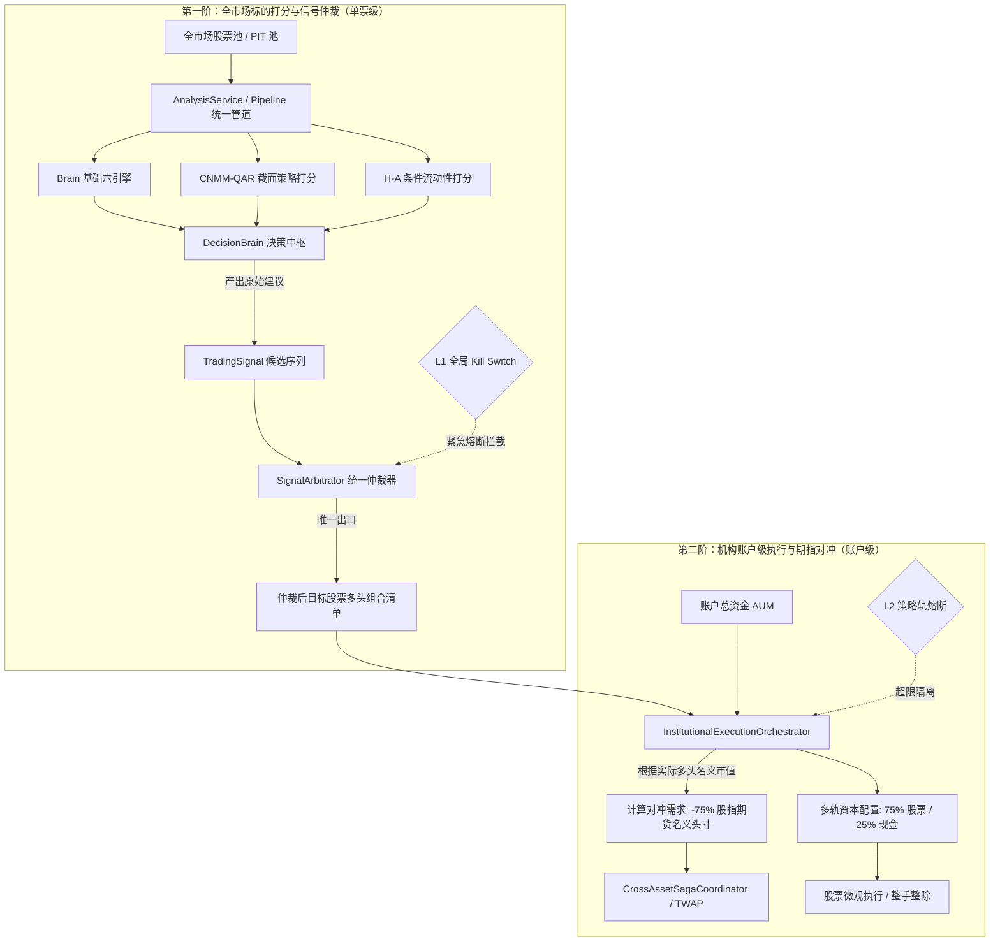

# UniQuant 决策体系收敛落地设计文档（T6b 定稿）

> **日期**：2026-11-21 · **性质**：Wave 3 施工技术蓝图（无悬空裁决，落地设计定稿）  
> **关联任务**：[REFACTOR_TASK_PLAN_20261121.md](REFACTOR_TASK_PLAN_20261121.md) T6b / T6d / T7-实施  
> **裁决锁定基准**：①C（QAR 股票腿收进统一管道走仲裁器）· ⑨B（期指对冲腿留在账户级编排器）· ⑩B（双 Kill Switch 并存：L1 全局落盘 + L2 策略轨隔离）· ②B（容器降 UI 专用 + 脚本按需轻量 Bootstrap）。

---

## 1. 执行摘要与重构动机

当前 UniQuant 存在三套完全平行的信号决策体系：
1. **`AnalysisService` 七段链**（正统管道）：`regime → lppl → ntf → czsc → wyckoff → alpha → derived → DecisionBrain → Arbitrator`，产出标准 `TradingSignal`，受 `SharedKillSwitch` 保护，但此前**仅 UI 在调用**。
2. **`CNMM-QAR` 独立链**（`scripts/canslim/daily_signal_qar.py`）：直连 PIT 池与 `cnmm_qar_strategy.py` 打分，直接组装股票权重字典并喂入执行编排器，**不生成 `TradingSignal`，绕过仲裁器与安全熔断**，且内嵌 `4000.0` 假点位与 `50.0` 假股价违规兜底。
3. **`H-A` 独立链**（`scripts/canslim/daily_signal_ha.py` / `ha_unified_adapter.py`）：独立脚本直接构造 `TradingSignal` 喂入回测引擎，绕过 `DecisionBrain` 与仲裁。

**收敛目标**：消除决策多头，将所有股票标的选拔收敛至**“同一生产管道、同一信号契约、唯一仲裁出口、两级分层风控”**；同时尊重机构对冲业务现实，将账户级名义对冲与单票股票信号解耦。

---

## 2. 核心架构设计：标的信号轨与账户资产配置轨双轨解耦

根据裁决 ⑨B 与 ①C，系统决策层解耦为清晰的**两阶流水线**：

---

## 3. QAR 股票腿接入统一管道方案（①C 细化）

### 3.1 策略打分抽取为标准化引擎适配器
- 将 `scripts/qar/cnmm_qar_strategy.py` 中的截面多因子打分（成长因子 + 质量因子 + 动量因子）沉淀为策略适配器 `CNMMQARStrategyAdapter`（放置于 `src/uniquant/signal/adapters.py` 或 `src/uniquant/services/`）。
- 打分输出映射为标准数据契约 `TradingSignal`：

| `TradingSignal` 字段 | QAR 映射规则 | 说明 |
|---|---|---|
| `action` | 仅输出 `"BUY"`（买入/持有调优）或 `"SELL"`（剔除） | 严格遵守 `interfaces.py:155` 与 `arbitrator.py:155` |
| `symbol` | 标准 6 位代码带后缀（如 `600519.SH`） | 统一代码归一化 |
| `confidence` | 综合打分（归一化至 `[0.0, 1.0]`） | 用于仲裁器置信度竞价 |
| `shares` | 初步名义目标股数（按目标权重测算） | 供下游执行引擎参考 |
| `price` | 数据湖最新真实收盘价 | **严禁假价兜底** |
| `metadata["strategy"]` | `"CNMM-QAR"` | 标明策略来源 |
| `metadata["weight"]` | 目标组合目标权重（如 `0.025`） | 供组合构建器参考 |
| `metadata["track"]` | `"75/25-IH"` | 策略轨标识 |

### 3.2 统一仲裁规则（Arbitration Policy）
- 仲裁器坚持 **Rule 6（A股交易规则）** 与 **Sell-Priority（卖出优先）** 核心原则；
- 若 QAR 信号与 Wyckoff/FSM/LPPL 信号在同一标的发生冲突：
  - 任何引擎发出确信的 `"SELL"` 信号时，仲裁器无条件优先卖出（防踏空次之，避险绝对优先）；
  - 多方均发出 `"BUY"` 信号时，置信度加权竞价，选拔出最终前 N 强标的。

---

## 4. 账户级期指对冲腿独立编排方案（⑨B 细化）

1. **绝对不在单票信号中伪造期指动作**：
   - `TradingSignal.action` 仅允许股票动作。严禁扩展 `SHORT_IF` 或附加期指腿字段破坏冻结契约。
2. **期指头寸计算保持在编排器**：
   - 期指空头头寸完全由 `InstitutionalExecutionOrchestrator.plan_futures_hedging_structure` 依据账户仲裁后实际多头名义市值总额实时动态推导：
     $$\text{Futures Notional} = \text{Actual Equity Long Value} \times \text{Hedge Ratio (0.75)}$$
   - 现货基准价格（如 `000300.SH`）必须从数据湖或 `TdxDataOnlineSource` 获取真实收盘价，**若不可用直接 Fail-Fast 退出，绝不使用 4000.0 假点位兜底**。

---

## 5. 两级 Kill Switch 运行规程（⑩B 细化）

| 级别 | 实体 | 状态持久化 | 熔断阈值 | 触发后果 | 复位机制 |
|---|---|---|---|---|---|
| **Level 1 (全局紧急停机)** | `SharedKillSwitch` (进程级单例) | **通过 T9a StateStore 落盘** (`data/state/kill_switch.json`) | 手工介入 / 系统级严重故障 | 全系统全策略立即禁止开仓，仅允许只减不上 | 必须手工介入清除状态文件 |
| **Level 2 (策略轨隔离熔断)** | `OrchestratorConfig.enable_kill_switch` | 内存 + 账户日志 | `quarantine_kill_threshold_rmb` (500万元) / 保证金风险度 > 115% | 仅隔离熔断当前 QAR 策略轨或特定 PB 账户，不干扰其他策略轨 | 日终结算且风控重核后复位 |

---

## 6. 生产 CLI 改造形态与失真清除

### 6.1 `scripts/canslim/daily_signal_qar.py` 改造
- 废弃手工拼装逻辑，改由轻量 Bootstrap 初始化必要的 `DataService` 与 `AnalysisService`；
- **清除假数据与假点位**：
  - 移除 line 107：`futures_price_points = 4000.0` 兜底；改用 `DataFetcher` 获取真实基准日收盘点位，获取失败抛出明确异常并退出码 1 终止；
  - 移除 line 139：`real_price = 50.0` 兜底；改用数据湖真实最新价，缺价直接抛出 `DataIntegrityError` 并显式告警；
- 产出标准 `results/daily_qar/{date}_signals.json`，供 `reconcile_qar.py` 对账。

### 6.2 `scripts/daily/unified_daily_eod.py` 改造
- 移除 line 86-88 的 `np.linspace(3500.0, 3900.0)` 伪造行情逻辑，改为严格读取指数，无数据时 Fail-Fast 退出；
- 移除 line 214 硬编码股票列表；
- 移除 line 249-251 mock 持仓，接入真实持仓文件或要求 CLI 参数必须显式传入。

---

## 7. 测试与对账验收方案（Wave 3 实施准则）

1. **核心文件改造清单（8 文件 ~3,466 LOC）**：
   - `scripts/qar/cnmm_qar_strategy.py` (570 LOC)
   - `src/uniquant/hands/backtest/institutional_execution_orchestrator.py` (370 LOC)
   - `src/uniquant/services/analysis_service_v2.py` (640 LOC)
   - `src/uniquant/signal/arbitrator.py` (425 LOC)
   - `src/uniquant/signal/adapters.py` (667 LOC)
   - `scripts/canslim/daily_signal_qar.py` (229 LOC)
   - `scripts/canslim/ha_unified_adapter.py` (307 LOC)
   - `scripts/daily/unified_daily_eod.py` (258 LOC)
2. **专属测试矩阵（10 测试文件 100% 保持全绿）**：
   - `tests/test_cnmm_qar_strategy_and_backtest.py`
   - `tests/scripts/test_daily_signal_qar.py`
   - `tests/scripts/test_reconcile_qar.py`
   - `tests/hands/backtest/test_phase2_institutional_execution_orchestrator.py`
   - `tests/test_signal_arbitrator.py`
   - `tests/test_cffex_twap_saga_production.py`
   - `tests/test_ha_rotation_buffer.py`
   - `tests/test_bp_ha_portfolio.py`
   - `tests/scripts/test_unified_daily_eod.py`
   - `tests/scripts/test_ha_engineering.py`
3. **对账一致性硬指标**：
   - 改造后统一管道生成的股票选拔列表，与旧版独立运行结果比对：Top 标的重合度 100%，头寸权重漂移容差 $\le 0.50\%$ (50 bps)；
   - 对账结果自动生成 JSON 记录并纳入 evidence manifest。
