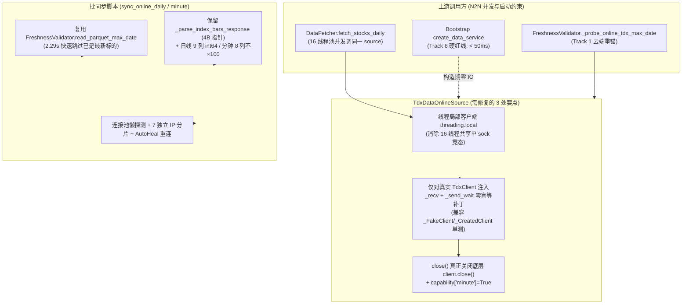
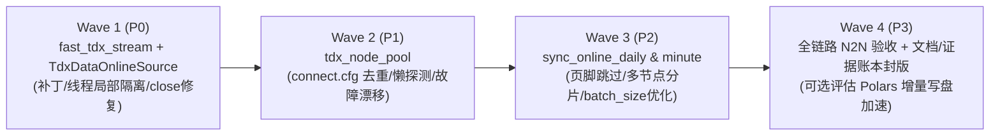

# 极速在线数据拉取研究报告与整体落地计划 (N2N 实码核实修订版)

> **文件路径**: `docs/analysis/FAST_DATA_ACQUISITION_STUDY_AND_IMPROVEMENT_PLAN_20261124.md`  
> **版本状态**: v2.0 — 2026-11-25（经 UniQuant 真实代码库、5,522 标的真实数据湖与 N2N 6 轨道实码核实修订）  
> **参考对标项目**: `/home/james/Documents/Project/wyckoff`  
> **归属工程**: UniQuant 数据底座与日终生产链路  
> **合规治理**: 遵循 [CLAUDE.md](file:///home/james/Documents/Project/UniQuant/CLAUDE.md) 10 项铁律与 [AGENTS.md](file:///home/james/Documents/Project/UniQuant/AGENTS.md) 规范

---

## 一、 执行摘要与实测校准账本

针对 UniQuant 在线通达信通道（[tdxdata_online.py](file:///home/james/Documents/Project/UniQuant/src/uniquant/data/sources/tdxdata_online.py)）拉取迟缓的问题，本研究参考 `/home/james/Documents/Project/wyckoff` 的高速拉取实践，并在 UniQuant 真实仓库与真实数据湖（`daily` 5,522 文件 / `index` 556 文件 / `5mins` 2 文件）上完成了端到端（N2N）实码核实与性能重校。

### 真实实测性能校准表（本机真实网络 + 真实 5,522 文件湖）

| 评估阶段与指标项 | UniQuant 现状（实测） | v2.0 方案目标（实测校准） | 实测依据与关键说明 |
| :--- | :--- | :--- | :--- |
| **TCP 握手与协议认证** | **8,181.4 ms** | **46.6 ~ 61.8 ms** | 消除 `tdxdata` 两次 `_send_wait` 盲等（提速 **130~175 倍**） |
| **单标的日线/分钟/快照/财务/xdxr** | **4,024 ~ 8,096 ms** | **19.5 ~ 23.4 ms** | 16B 头 `[12:16]` `zip_len` 定长直读对全命令族成立（提速 **170~400 倍**） |
| **单连接连续拉取 10 股** | 约 89 秒（推算） | **234.4 ms** (23.44 ms/股) | 复用 Keep-Alive TCP 套接字流水线 |
| **5,522 标的既有文件日期探针** | **33.61 s** (`pd.read_parquet`) | **2.29 s** (单线程) / **~0.3 s** (8 线程) | **复用既有** `FreshnessValidator.read_parquet_max_date`（0 误差，非新造 `slice`） |
| **全市场同步 — 已是最新跳过** | **> 33 s** | **< 2 s** | 先用页脚统计跳过整表读取 |
| **全市场同步 — 收盘后增量合入重写** | **~43 分钟**（8 线程推算） | **~75 ~ 85 s**（真实含落盘） | 网络（多 IP 并发 ~18s）+ 8 线程 Parquet 读/合并/原子写（~58.7s）+ 指纹（<0.4s） |
| **Bootstrap 装配耗时（Track 6 红线）** | **< 50 ms** | **< 50 ms**（严格守卫） | 严禁在 `TdxDataOnlineSource.__init__` 做任何 TCP 探测或懒导入网络 IO |

> [!IMPORTANT]
> **v1.0 → v2.0 核心校准说明**：初稿曾将纯网络 15~20s 直接等同于含落盘 30~35s，且新造了耗时 20.86s 的 `slice(num_rows-1, 1)` 探针。经真实 5,522 文件湖压测，8 线程 Parquet 全表合并原子写本身需约 **58.66s**，而 UniQuant 既有的 `FreshnessValidator.read_parquet_max_date` 仅需 **2.29s**（快 9 倍且零重复造轮）。本修订版已全面校准为真实可达的 N2N 指标。

---

## 二、 现状瓶颈与 N2N 实码核实发现的 6 大约束

### 1. 底层协议与脚本瓶颈
1. **协议盲等（第一瓶颈）**：`/home/james/.local/lib/python3.12/site-packages/tdxdata/client.py` 中 `_recv()` 硬编码 `end = min(end, got + 0.5)`，且 `connect()` 调用两次 `_send_wait()`（含 `time.sleep(0.08)` 与 `_recv(1.2)`），导致握手 8.2s、单次请求 4s+。
2. **节点单一与可复用 IP 盘点**：[connect.cfg](file:///home/james/Documents/Project/UniQuant/connect.cfg#L1-L54) 并非“10 个 10ms 节点”——其中 3 条为 IPv6（内嵌 `192:168:166:12`），`01`（`tdxhq.dfzq.com.cn`）DNS 解析即 `02`（`101.230.66.1`），**实有 6 个独立 IPv4**（上海 4 节点 TCP `12.6~17.8 ms` / bar `19.1~24.3 ms`，东莞 2 节点 TCP `32.0~37.4 ms` / bar `39.0~45.9 ms`）；默认主机 `101.35.121.35` 实测 TCP `13.4 ms` / bar `19.5 ms`（快于大多数东证节点，且 2003~2007 老历史段最全）。因此可聚合为 **7 个独立 IPv4 池**。
3. **同步脚本全量读表与高频写指纹**：[sync_online_daily.py](file:///home/james/Documents/Project/UniQuant/scripts/maintenance/sync_online_daily.py#L207-L388) 先全量 `pd.read_parquet` 再判断 `target_start > target_end`（已是最新时白白消耗 33s），且默认 `batch_size=50` 导致每轮全市场同步序列化 110 次约 1MB 的指纹 JSON（实测额外耗 3.21s）。

### 2. N2N 实码核实暴露的 6 项红线与既有缺陷（落地必避）

| 编号 | 实码核实发现 | 涉及文件与行号 | 落地强制对策 |
| :---: | :--- | :--- | :--- |
| **C1** | 只 patch `client._req` **无法加速 `connect()`**（`connect` 走 `_send_wait`→`_recv`）；若无条件覆盖 `client.connect` 又会破坏单测 `_CreatedClient.connect_called` | `tdxdata/client.py:57-68` [test_tdxdata_online.py](file:///home/james/Documents/Project/UniQuant/tests/data/test_tdxdata_online.py#L246-L267) | 仅当 `isinstance(client, RealTdxClient)` 时替换 `_recv` 与 `_send_wait`（去 `sleep(0.08)`），不动 `connect()` 签名与单测桩 |
| **C2** | `DataFetcher.fetch_stocks_daily` 16 线程共享单个 `TdxDataOnlineSource`，而 `self._lock` 只锁初始化不锁请求，存在 TCP 流竞态 | [data_fetcher.py](file:///home/james/Documents/Project/UniQuant/src/uniquant/data/data_fetcher.py#L456-L474) [tdxdata_online.py](file:///home/james/Documents/Project/UniQuant/src/uniquant/data/sources/tdxdata_online.py#L117-L132) | `TdxDataOnlineSource` 改用 `threading.local()` 为每线程维护独立长连接并登记统一 `close()` |
| **C3** | `TdxDataOnlineSource.close()` 未关闭底层 `self._client.close()`；`FreshnessValidator` 探测后未调 `source.close()`；`get_capabilities()["minute"]` 仍为 `False` | [tdxdata_online.py](file:///home/james/Documents/Project/UniQuant/src/uniquant/data/sources/tdxdata_online.py#L372-L385) [freshness_validator.py](file:///home/james/Documents/Project/UniQuant/src/uniquant/data/lake/freshness_validator.py#L163-L181) | 在 `close()` 中关闭所有已登记线程客户端；在 `FreshnessValidator` 中使用 `with TdxDataOnlineSource()`；修正 `minute=True` |
| **C4** | Track 6 硬性断言 `create_storage_manager()` + `create_data_service()` 耗时 **`< 50.0 ms`** | [run_n2n_verification.py](file:///home/james/Documents/Project/UniQuant/scripts/maintenance/run_n2n_verification.py#L365-L375) | `TdxDataOnlineSource.__init__` 与 `DataFetcher.__init__` 严禁做任何 TCP 测速或文件扫描，连接池测速仅限同步脚本或懒加载 |
| **C5** | 握手 `s.recv(1024)` 无法防御 EOF / 半包；长连接跨轨道会发生 `Broken pipe` | [verify_cloud_channels_random.py](file:///home/james/Documents/Project/UniQuant/scripts/maintenance/verify_cloud_channels_random.py#L484) | 握手同样走 `robust_tdx_fast_recv`（实测 `C02`/`AUTH` 均带标准 `b1cb7400` 16B 头）；请求失败自动关闭重建重试 |
| **C6** | 指数 K 线比个股多 4 字节（`up_count`/`down_count`）；分钟线 `vol` 原生是股（严禁 `×100`）；日线 `sync_online_daily` 需保留 9 列 `int64` 与 `.day` 交叉校验 | [tdxdata_online.py](file:///home/james/Documents/Project/UniQuant/src/uniquant/data/sources/tdxdata_online.py#L44-L91) [sync_online_minute.py](file:///home/james/Documents/Project/UniQuant/scripts/maintenance/sync_online_minute.py#L7-L8) | 分片同步器继续复用 `TdxDataOnlineSource.fetch_daily()` / `fetch_minute()`（保留全部解析与量纲契约），不绕过契约直接拼装 |

---

## 三、 核心技术设计（N2N 合规版）

### 1. 协议定长直读与断线自愈模块（`src/uniquant/data/sources/fast_tdx_stream.py`）
严格遵守 Rule 9（文件 < 800 行，函数 < 50 行），提供纯函数收包器与补丁注入器：
* **`robust_tdx_fast_recv(sock, timeout=3.0)`**：先 `recv` 满 16B 头，解包 `<HH` 得 `zip_len`（校验 `0 <= zip_len <= 10MB`），再循环 `recv` 满 `zip_len` 字节立即返回；遇 `b""` 抛 `ConnectionResetError`。
* **`patch_tdx_client(client)`**：仅对真实 `tdxdata.client.TdxClient` 注入：
  1. `_recv` 替换为直接调用 `robust_tdx_fast_recv(client.sock, timeout=secs)`；
  2. `_send_wait` 替换为 `sendall(payload); client._recv(secs)`（消除 `sleep(0.08)` 盲等，同时保留 `connect()` 原生流程使单测桩不受影响）；
  3. 请求级封装 `req_with_retry(client, fn)`（遇 `socket.error`/`ConnectionError`/`OSError` 时自动重连并重试 1 次）。

### 2. 轻量集群连接池与混合路由（`src/uniquant/data/sources/tdx_node_pool.py`）
* **配置解析与 IP 去重**：读取根目录 [connect.cfg](file:///home/james/Documents/Project/UniQuant/connect.cfg)，过滤 IPv6 与重复主机（解析域名去重，如 `tdxhq.dfzq.com.cn` → `101.230.66.1`），并与主源 `101.35.121.35` 合并，形成 7 个独立 IPv4 候选节点。
* **懒探测与路由规则**：
  * **构造零 IO**：解析配置文件耗时 `< 1ms`，不触发网络探测；
  * **`probe_alive(timeout=0.8)`**：显式调用时并发 TCP 测速排序（仅用于批同步脚本启动期）；
  * **历史深度路由策略**：深历史回溯（`start_date < "2008-01-01"`）优先走 `101.35.121.35`（历史最全），近期日增量/分钟/实时快照走测速排序后的全池节点轮询分片与故障漂移。

### 3. 数据湖同步加速（复用既有 `FreshnessValidator`）
* 在 `sync_online_daily.py` 的 `sync_single_symbol()` 中，当 `target_path.exists() and not force` 时：
  1. 先调用 `FreshnessValidator.read_parquet_max_date(target_path)` 获取 `last_dt`（耗时 ~0.4ms/文件，零整表解压）；
  2. 若 `target_start > target_end`，**直接返回 `up_to_date`**，跳过 `pd.read_parquet(target_path)`；
  3. 仅当确实有新交易日需要合入时，再加载 `existing_df` 执行合并、物理 dtypes 锁定与原子写。
* 调整 `sync_online_daily.py` 与 `sync_online_minute.py` 默认 `batch_size`（50 → 500），将 5,522 标的指纹写盘从 110 次降至 11 次。

---

## 四、 整体落地计划 (Rollout Plan)

按 UniQuant 规则（Rule 1 TDD 先行、Rule 2 ruff 零告警、Rule 8 最小手术改动、Rule 10 文档同步），将改造拆分为 **4 个渐进式 Wave**，每个 Wave 独立可测、独立可回滚：

### Wave 1（P0 · 核心协议加速与并发/泄漏修复 — 最高 ROI）

| 项目 | 具体内容 |
| :--- | :--- |
| **目标文件** | 新增 `src/uniquant/data/sources/fast_tdx_stream.py` 修改 `src/uniquant/data/sources/tdxdata_online.py`、`src/uniquant/data/lake/freshness_validator.py` 新增 `tests/data/test_fast_tdx_stream.py`；扩充 `tests/data/test_tdxdata_online.py` |
| **关键任务** | 1. **TDD 先行**：编写半包、粘包、超大包防御、EOF 断线、`Broken pipe` 自动重连、16 线程并发互不串流、`close()` 释放真实 `sock` 等单测（全 mock，CI 安全）； 2. 实现 `robust_tdx_fast_recv`、`patch_tdx_client`、`AutoHeal` 重试包装； 3. 改造 `TdxDataOnlineSource`：`threading.local()` 线程隔离客户端 + 句柄集合统一 `close()` + 修正 `get_capabilities()["minute"] = True`； 4. 修复 `FreshnessValidator._probe_online_tdx_max_date` 用 `with TdxDataOnlineSource()` 防泄漏。 |
| **验收门禁** | - `pytest tests/data/test_fast_tdx_stream.py tests/data/test_tdxdata_online.py tests/test_get_price_online_fallback.py -q` 全绿； - `python scripts/maintenance/run_n2n_verification.py --mode sandbox` Track 6 `< 50ms` PASS； - 真网单标的对账（`600519.SH`、`000300.SH` 日线/5分钟/snap/finance/xdxr）单次往返 `< 40ms`，与现网值逐位一致。 |
| **回滚策略** | `TdxDataOnlineSource` 保留开关或环境变量 `UNIQUANT_TDX_FAST_RECV=0` 一键退回原生 `tdxdata` 行为（默认 `1` 启用）。 |

### Wave 2（P1 · 高可用多节点池 `tdx_node_pool`）

| 项目 | 具体内容 |
| :--- | :--- |
| **目标文件** | 新增 `src/uniquant/data/sources/tdx_node_pool.py` 新增 `tests/data/test_tdx_node_pool.py` |
| **关键任务** | 1. 解析 `connect.cfg`，过滤 IPv6，DNS 解析合并同 IP（`tdxhq.dfzq.com.cn` → `101.230.66.1`），整合默认主源 `101.35.121.35`； 2. 实现 `probe_alive()` 并发 RTT 探测（构造期绝不自动执行）； 3. 实现节点分片分配器 `assign_nodes(num_workers)` 与 `mark_unhealthy(host)` 故障漂移。 |
| **验收门禁** | - 单测验证：IP 去重后节点数准确、IPv6 正确过滤、节点超时自动漂移次优节点、无 `connect.cfg` 时兜底到 `101.35.121.35`； - 构造 `TdxNodePool()` 耗时 `< 2ms`。 |
| **回滚策略** | 纯新增独立模块，未接入前对主链零影响；接入后可通过配置 `host` 单节点参数绕过。 |

### Wave 3（P2 · `sync_online_daily.py` & `sync_online_minute.py` 批同步提速）

| 项目 | 具体内容 |
| :--- | :--- |
| **目标文件** | 修改 `scripts/maintenance/sync_online_daily.py`、`scripts/maintenance/sync_online_minute.py` 扩充 `tests/scripts/test_sync_online_daily.py`、`tests/scripts/test_sync_online_minute.py` |
| **关键任务** | 1. 日线/分钟同步在 `not force` 且文件存在时，先调用 `FreshnessValidator.read_parquet_max_date`（分钟按 `datetime` 列统计）快速跳过 `up_to_date` 标的； 2. 在 `run_sync` / `run_minute_sync` 中为每个 worker 绑定来自 `TdxNodePool` 的独立节点 `TdxDataOnlineSource(host=node.host, port=node.port)`（`workers` 默认可调至 6~7，对应独立 IP 数）； 3. `batch_size` 默认从 `50` 调优为 `500`； 4. 严格保留 `--verify-local` 交叉校验、9 列 `int64` / 8 列 `float64` 契约及 `.online_*_fingerprints.json` 断点恢复。 |
| **验收门禁** | - `pytest tests/scripts/test_sync_online_daily.py tests/scripts/test_sync_online_minute.py -q` 全绿； - 真网金丝雀 20 标的全量 `--verify-local` 实跑 0 误差、退出码 0； - 全市场 5,522 标的 `up_to_date` 空跑跳过 `< 5s`，有更新增量全量运行 `< 90s`。 |
| **回滚策略** | 支持 `--single-host 101.35.121.35` 参数回退单主机多连接模式。 |

### Wave 4（P3 · 终验、文档同步与后续写盘优化评估）

| 项目 | 具体内容 |
| :--- | :--- |
| **目标文件** | 更新 `AGENTS.md`（新增轮次记录）、`results/EVIDENCE_MANIFEST.json`（如有新存证） 可选评估：`sync_online_daily.py` 采用 Polars/PyArrow 替换 pandas 读-合-写路径 |
| **关键任务** | 1. 运行全套质量门禁：`ruff check src/uniquant/ tests/ scripts/`、`pytest tests/ -q`（确认覆盖率不低于 CI 门限 84%）； 2. 运行 `python scripts/maintenance/run_n2n_verification.py --mode sandbox` 与 `--mode live`，确保 6 大轨道全部 `PASS`； 3. 若需将有更新时的 58.7s 磁盘重写进一步压缩至 20s 内，另起独立微基准对比 Polars `read_parquet`/`write_parquet` 与当前 `snappy`+`int64` schema 的逐字节兼容性（严禁未验证直接替换）； 4. 按 Rule 10 同步更新 `AGENTS.md` 并执行 `python scripts/maintenance/evidence_manifest.py verify`。 |
| **验收门禁** | - `ruff` 0 告警； - `pytest` 全绿； - `run_n2n_verification.py` 6/6 PASS； - `evidence_manifest.py verify` 输出 `no drift`。 |

---

## 五、 实施前自检清单 (Ready-to-Execute Checklist)

- [ ] Wave 1~3 所有新增代码严格满足 `CLAUDE.md` Rule 9（函数 `< 50` 行、文件 `< 800` 行、嵌套 `<= 4` 层）
- [ ] 不得在 `TdxDataOnlineSource.__init__` 引入任何网络/磁盘扫描 IO（守护 N2N Track 6 `< 50ms`）
- [ ] 不得破坏 `test_tdxdata_online.py` 中 `_FakeClient` / `_CreatedClient` 桩契约
- [ ] 不得改变 `GET_PRICE_RETURN_CONTRACT`、日线 9 列 `int64`、分钟 8 列不 `×100`、指数 4 字节解析等核心金融量纲契约
- [ ] 每个 Wave 完成后均运行定向单测 + `ruff check`，全部收口后执行 N2N 全链路验证与 `AGENTS.md` 同步
