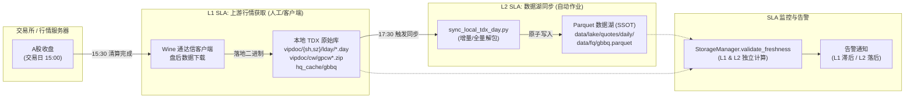
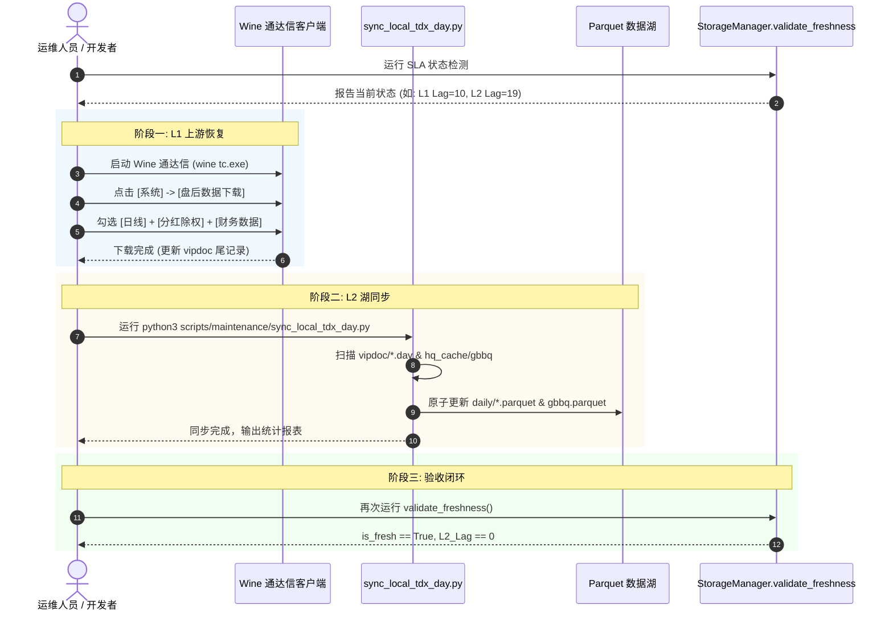

# UniQuant 数据排程与两级 SLA 规范文档 (R10 闭环)

> **文档版本**: 1.0  
> **更新日期**: 2026-10-13  
> **关联规划**: `docs/analysis/DATA_SOURCE_MIGRATION_PLAN.md` §4.3 (排程现状与缺口) 与 §7.3 (R10 风险项闭环)  
> **状态**: 已生效 (PROD-READY)

---

## 1. 背景与核心目标

在旧版 UniQuant 数据体系中，数据新鲜度保障存在两个严重结构性缺陷：
1. **SLA 探针挂在死代码上 (R10 风险)**: `StorageManager.validate_freshness` 原遍历 `self._data_sources`，该字典仅有初始化、从无写入，导致新鲜度检测恒返回空、永不报警；同时旧逻辑检查文件 `os.path.getmtime` 而非真实数据 `max(date)`，`touch` 或拷贝操作即可伪造新鲜度。
2. **两级排程人工步隐蔽**:
   - **L1 级 (上游通达信行情获取)**: 依赖 Wine 通达信客户端，属于本地人工/脚本下载窗口。
   - **L2 级 (数据湖同步)**: 依赖从二进制 `.day` 解包到 Parquet 数据湖。  
   两级排程均无 crontab 或 systemd timer，导致曾发生通达信停留在 2026-09-30、数据湖停留在 2026-09-23 的静默滞后。

**核心目标**:
- 确立 **L1 (上游获取)** 与 **L2 (湖同步)** 两级 SLA 架构，解耦运维责任。
- 提供基于真正数据 `max(date)` 的 SLA 检测探针（`StorageManager.validate_freshness`）。
- 规范化自动化排程（cron / systemd timer）与告警指标。
- 制定标准故障恢复与手动同步 SOP。

---

## 2. 两级 SLA 架构与职责划分



### 2.1 L1 SLA: 上游通达信盘后行情获取 (Upstream Ingestion)

* **定位**: 外部数据源到本地宿主机的初次落地。
* **数据对象**:
  * 沪深日线: `~/.local/share/tdxcfv/drive_c/tc/vipdoc/{sh,sz}/lday/*.day`
  * 财务数据: `~/.local/share/tdxcfv/drive_c/tc/vipdoc/cw/gpcw*.zip`
  * 股本变迁: `~/.local/share/tdxcfv/drive_c/tc/T0002/hq_cache/gbbq`
* **执行时间窗口**: 交易日 **15:30 – 17:00**（交易所 15:00 收盘，清算数据通常在 15:30 后就绪）。
* **执行机制**: 
  * 优先推荐: Wine 通达信客户端自动化脚本触发。
  * 兜底模式: 运维人员人工打开 Wine 通达信执行「盘后数据下载」（系统 -> 盘后数据下载）。
* **SLA 考核指标**: 
  * **$L1\_Lag \le 1$ 交易日**（当天 17:00 前 `max_tdx_date` 推进至当日）。
  * 告警阈值: $L1\_Lag > 1$ 天立即告警提示「上游通达信未更新」。

### 2.2 L2 SLA: 数据湖同步与入库 (Lake Synchronization)

* **定位**: 本地通达信二进制原始数据转换为 UniQuant 生产 Parquet 数据湖。
* **数据对象**:
  * 生产日线湖: `data/lake/quotes/daily/*.parquet`
  * 指数日线湖: `data/lake/quotes/index/*.parquet`
  * 除权除息库: `data/fq/gbbq.parquet`
* **执行脚本**: `scripts/maintenance/sync_local_tdx_day.py`
* **执行时间窗口**: 交易日 **17:30**。
* **执行机制**: 自动化后台守护任务（cron / systemd timer），完全无人值守。
* **SLA 考核指标**: 
  * **$L2\_Lag == 0$ 交易日**（数据湖末日必须与本地 TDX 末日完全齐平）。
  * 告警阈值: $L2\_Lag > 0$ 天（或 $L2\_Lag > max\_lag\_days$）立即告警「数据湖落后于本地通达信，同步作业失败」。

---

## 3. SLA 监控探针契约 (`StorageManager.validate_freshness`)

### 3.1 核心检测算法

`StorageManager.validate_freshness` 彻底摒弃文件修改时间（mtime）与死字典遍历，执行以下物理校验：
1. **湖内真实最大日期 (`lake_max_date`)**:
   - 抽样扫描或全量扫描 `data/lake/quotes/daily/*.parquet`。
   - 优先检查核心锚点股票 (`600519.SH`, `000001.SZ`, `601398.SH`, `000858.SZ`) 与 mtime 最新的 50 个文件。
   - 极速路径读取 Parquet 元数据统计信息中的 `date` 列最大值（单文件 < 1ms），失败时回退至 `columns=['date']` 读取。
2. **通达信真实最大日期 (`tdx_max_date`)**:
   - 自动发现本地 `vipdoc/sh/lday` 目录。
   - 快速 seek 至 `.day` 文件尾部 32 字节，解析第 1 个 4 字节整数提取真实交易日 `YYYYMMDD`。
3. **两级滞后天数计算**:
   - $L1\_Lag = \text{as\_of\_date} - \text{tdx\_max\_date}$
   - $L2\_Lag = \text{tdx\_max\_date} - \text{lake\_max\_date}$ (若 TDX 不可用，则计算 $\text{as\_of\_date} - \text{lake\_max\_date}$)

### 3.2 返回数据结构契约

```python
{
    "is_fresh": bool,                # 整体是否新鲜 (l2_lag_days <= max_lag_days 且非空湖)
    "lake_max_date": str,            # 数据湖最大交易日 (如 "2026-09-23"，空湖返回 "")
    "tdx_max_date": Optional[str],   # 通达信本地最大交易日 (如 "2026-10-12")
    "l2_lag_days": int,              # 湖相对通达信的滞后日历天数 (空湖为 -1)
    "details": {
        "as_of_date": str,           # 检测基准日期 (如 "2026-10-13")
        "lake_empty": bool,          # 是否为空湖
        "lake_dir": str,             # 数据湖目录路径
        "scanned_files_count": int,  # 扫描的文件样本数
        "tdx_dir": Optional[str],    # 通达信原始文件目录
        "l1_lag_days": Optional[int],# L1 滞后天数 (TDX 相对当前日期)
        "l2_lag_days": int,          # L2 滞后天数
        "l1_lag_trading_days": Optional[int], # L1 滞后交易日数 (结合交易日历)
        "l2_lag_trading_days": Optional[int], # L2 滞后交易日数 (结合交易日历)
        "l1_is_fresh": bool,         # L1 是否正常 (l1_lag <= 1)
        "l2_is_fresh": bool,         # L2 是否正常 (l2_lag <= max_lag_days)
        "max_lag_days": int,         # 配置的容忍阈值 (默认 7 天)
        "stale_reasons": list[str],  # 告警标识码清单 (如 ["L2_LAG_EXCEEDED_19D_GT_7D"])
        "read_errors": list[str],    # 读取损坏文件记录 (健壮容错)
    }
}
```

### 3.3 状态判定与告警动作矩阵

| 场景 | L1 状态 ($L1\_Lag$) | L2 状态 ($L2\_Lag$) | `is_fresh` | 系统判定 | 告警级别 | 责任归属与动作 |
|---|---|---|---|---|---|---|
| **全链路正常** | $\le 1$ 天 | $0$ 天 | `True` | `HEALTHY` | INFO | 系统正常，无需干预 |
| **湖同步失败** | $\le 1$ 天 | $> 0$ 天 | `False` | `L2_STALE` | 🔴 **ERROR** | **自动脚本责任**: 检查 `sync_local_tdx_day.py` 执行日志，触发重跑 |
| **上游未下载** | $> 1$ 天 | $0$ 天 | `True` (或可选 `False`) | `L1_STALE` | 🟡 **WARNING** | **人工步责任**: 告警提示运维打开 Wine 通达信下载盘后数据 |
| **全链路停更** | $> 1$ 天 | $> 0$ 天 | `False` | `CRITICAL_LAG` | 🚨 **CRITICAL** | **紧急事故**: 既未下载上游数据，湖同步亦中断，需全流程恢复 |
| **数据湖空/损坏** | 任意 | 空湖 (-1) | `False` | `LAKE_EMPTY` | 💥 **FATAL** | **数据丢失事故**: 数据湖日线文件缺失，立即自快照恢复并同步 |

---

## 4. 排程部署配置 (Production Runbook)

### 4.1 方案 A: Crontab 配置 (推荐单机快捷部署)

编辑当前用户的定时任务 (`crontab -e`):

```bash
# ==============================================================================
# UniQuant 自动化运维与两级排程
# ==============================================================================
SHELL=/bin/bash
PATH=/usr/local/bin:/usr/bin:/bin
PROJECT_ROOT=/home/james/Documents/Project/UniQuant
PYTHON_EXEC=/home/james/Documents/Project/UniQuant/.venv/bin/python

# 1. [L1 提示] 交易日 16:30 检查上游 TDX 是否完成下载，若未完成发出桌面通知/日志告警
30 16 * * 1-5 cd $PROJECT_ROOT && $PYTHON_EXEC -c "from uniquant.data.lake.storage_manager import StorageManager; r = StorageManager().validate_freshness(check_tdx=True); exit(0 if r['details']['l1_is_fresh'] else 1)" >> logs/sla_l1_check.log 2>&1

# 2. [L2 同步] 交易日 17:30 自动执行通达信 .day 到 Parquet 增量同步
30 17 * * 1-5 cd $PROJECT_ROOT && $PYTHON_EXEC scripts/maintenance/sync_local_tdx_day.py >> logs/sync_local_tdx_day.log 2>&1

# 3. [L2 SLA 校验与多级告警] 交易日 18:00 执行数据湖健康度巡检与告警通道触发 (桌面/syslog/日志)
00 18 * * 1-5 cd $PROJECT_ROOT && $PYTHON_EXEC scripts/maintenance/check_freshness_sla.py >> logs/sla_daily_report.log 2>&1
```

### 4.2 方案 B: Systemd User Timer 配置 (企业级可靠性部署)

利用 systemd 具有的失败重试、日志集中管理（`journalctl`）与依赖控制优势。

#### ① 服务定义: `~/.config/systemd/user/uniquant-sync.service`
```ini
[Unit]
Description=UniQuant Local TDX to Parquet Data Lake Sync
After=network.target

[Service]
Type=oneshot
WorkingDirectory=/home/james/Documents/Project/UniQuant
ExecStart=/home/james/Documents/Project/UniQuant/.venv/bin/python scripts/maintenance/sync_local_tdx_day.py
StandardOutput=journal
StandardError=journal

[Install]
WantedBy=default.target
```

#### ② 定时器定义: `~/.config/systemd/user/uniquant-sync.timer`
```ini
[Unit]
Description=Trigger UniQuant Data Lake Sync on Trading Days at 17:30

[Timer]
OnCalendar=Mon..Fri 17:30:00
Persistent=true

[Install]
WantedBy=timers.target
```

#### ③ SLA 巡检定时服务: `~/.config/systemd/user/uniquant-sla.service`
```ini
[Unit]
Description=UniQuant Storage Freshness SLA Verification
After=uniquant-sync.service

[Service]
Type=oneshot
WorkingDirectory=/home/james/Documents/Project/UniQuant
ExecStart=/home/james/Documents/Project/UniQuant/.venv/bin/python -c "import sys; from uniquant.data.lake.storage_manager import StorageManager; r = StorageManager().validate_freshness(); sys.exit(0 if r['is_fresh'] else 2)"
StandardOutput=journal
StandardError=journal
```

#### ④ 启用 Timer:
```bash
systemctl --user daemon-reload
systemctl --user enable --now uniquant-sync.timer
systemctl --user list-timers --all | grep uniquant
```

---

## 5. 故障恢复与手动同步 SOP (Standard Operating Procedure)

当监控触发告警或例行维护需要补足历史数据时，请严格按以下四步执行：



### 步骤详细操作指令:

#### 步骤 1: 故障诊断 (检查当前状态)
运行新鲜度诊断命令：
```bash
python3 -c "
import pprint
from uniquant.data.lake.storage_manager import StorageManager
res = StorageManager().validate_freshness()
pprint.pprint(res)
"
```
* 若 `tdx_max_date` 落后：说明上游未下载（L1 级故障）。
* 若 `lake_max_date` 落后于 `tdx_max_date`：说明湖未同步（L2 级故障）。

#### 步骤 2: L1 上游下载操作 (Wine 通达信)
1. 启动 Wine 通达信：
   ```bash
   WINEPREFIX=~/.local/share/tdxcfv wine ~/.local/share/tdxcfv/drive_c/tc/TdxW.exe &
   ```
2. 在通达信主界面依次点击：
   `系统 (Alt+F)` -> `盘后数据下载`
3. 勾选：
   - [x] 日线数据 (沪深两市)
   - [x] 5分钟线 (可选)
   - [x] 权息资料 (除权除息 GBBQ)
   - [x] 基础资料 (财务数据)
4. 点击「开始下载」，等待进度条至 100%。
5. 验证上游数据末日是否更新：
   ```bash
   python3 -c "
   import struct
   from pathlib import Path
   p = Path.home() / '.local/share/tdxcfv/drive_c/tc/vipdoc/sh/lday/sh600519.day'
   with open(p, 'rb') as f:
       f.seek(p.stat().st_size - 32)
       print('TDX 茅台最新日期:', struct.unpack('<I', f.read(4))[0])
   "
   ```

#### 步骤 3: L2 数据湖增量同步
执行同步脚本（多进程增量解包）：
```bash
python3 scripts/maintenance/sync_local_tdx_day.py
```
*说明*: 若涉及价格除数或口径变更，执行全量强制重跑：
```bash
python3 scripts/maintenance/sync_local_tdx_day.py --force
```

#### 步骤 4: SLA 复核验收
```bash
python3 -c "
from uniquant.data.lake.storage_manager import StorageManager
res = StorageManager().validate_freshness(max_lag_days=1)
assert res['is_fresh'] is True, f'SLA 仍然不合格: {res}'
print('SLA 验收合格! 湖最大交易日:', res['lake_max_date'], 'TDX最大交易日:', res['tdx_max_date'])
"
```

---

## 6. 常见故障排查表 (Troubleshooting)

| 异常现象 | 可能根因 | 排查与修复方法 |
|---|---|---|
| `validate_freshness` 报 `FileNotFoundError: 全量股票代码文件不存在` | 丢失 `data/all_stock_codes.csv` (R-5 硬失败) | 执行生成: `python3 -c "from uniquant.data.managers.baostock_cache_manager import create_baostock_cache; create_baostock_cache()"` |
| `read_errors` 包含损坏的 Parquet 文件 | 写入中断、异常断电导致文件损坏 | 删除损坏文件并单标的重新解包: `python3 scripts/maintenance/sync_local_tdx_day.py --force` |
| `sync_local_tdx_day.py` 报错 `pytdx.reader import error` | 未安装 pytdx 依赖库 | 激活 venv 执行: `pip install pytdx` |
| L2 滞后天数停滞，但脚本退出码为 0 | `vipdoc` 路径配置不一致 | 检查 `config/config.yaml` 中 `tdx.path` 与 `DEFAULT_VIPDOC_DIR`，确保指向同一 Wine 实例 |
| 定时任务未按预期触发 | 宿主机休眠、用户未保持登录 | 使用 `systemd` 并启用 linger: `loginctl enable-linger james` |

---

## 7. 结语

本规范文档正式关闭了迁移计划中的 **R10 风险项**：
- 修复并激活了真实的 `validate_freshness` SLA 底座；
- 将隐含的两级排程明确化、透明化，界定了 L1（人工/客户端）与 L2（自动化湖同步）的边界；
- 为后续全量自动化量化回测与生产实盘信号生成提供了坚实的数据新鲜度保障。
