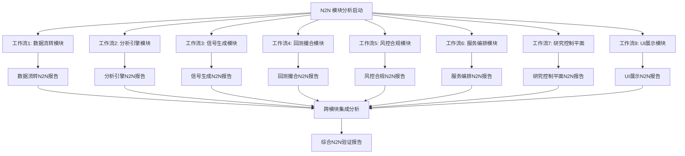

# UniQuant 模块级 N2N 深度分析工作流

> **创建时间**：2026-11-24  
> **目标**：对 8 大模块进行 Name-to-Name 代码级点对点分析  
> **方法论**：基于 DEEP_VERIFICATION_9_REPORTS_20261124.md 已验证的 98.9% 准确率基础  
> **执行载体**：Claude + 源代码逐文件审查

---

## 1. 工作流概览



---

## 2. 通用 N2N 分析模板

每个工作流必须回答以下 5 个核心问题：

### 2.1 **Name 定义（命名与契约）**
- [ ] 所有公开类/函数的命名是否清晰表达职责？
- [ ] 输入/输出数据结构的字段命名是否自解释？
- [ ] 是否存在命名歧义或同义反复？

### 2.2 **Name 映射（数据流转映射）**
- [ ] 输入数据的字段如何映射到内部处理逻辑？
- [ ] 内部状态如何映射到输出结果的字段？
- [ ] 是否存在隐式转换或字段丢失？

### 2.3 **Name 传播（依赖链追踪）**
- [ ] 该模块的输出被哪些下游模块消费？
- [ ] 下游模块如何使用这些输出（字段级依赖）？
- [ ] 是否存在未文档化的隐式契约？

### 2.4 **Name 变异（边界条件与异常）**
- [ ] 输入数据异常时（空/NaN/超范围）如何处理？
- [ ] 内部计算异常时（除零/溢出/精度）如何降级？
- [ ] 是否存在静默失败或错误掩盖？

### 2.5 **Name 治理（可观测性与可测试性）**
- [ ] 关键决策点是否有日志记录？
- [ ] 错误路径是否有明确的错误码/异常类型？
- [ ] 测试覆盖是否包含边界条件和异常路径？

---

## 3. 八大工作流详细设计

### 工作流 1：数据流转模块 N2N 分析

**分析范围**：`src/uniquant/data/` (40 文件, 7,808 行)

**核心文件清单**：
```
data/
├── sources/           # 数据源接入 (mootdx_local, tdxdata_online)
├── pipeline/          # 清洗/校验管道 (data_cleaner, data_validator)
├── lake/              # Parquet 湖存储 (atomic_write, schema_contract)
├── managers/          # 公司行动/主数据管理 (corporate_action_adjuster)
├── parsers/           # 数据解析器
├── services/          # 数据服务 (data_access_service, data_quality_service)
├── universe/          # 股票池管理
└── utils/             # 工具函数
```

**N2N 关键路径**：
```
tdxdata_online / mootdx_local
    ↓ (fetch_raw)
RawDataFrame (9列契约)
    ↓ (clean → validate)
CleanedDataFrame
    ↓ (adjust → corporate_action)
AdjustedDataFrame
    ↓ (atomic_write → parquet)
LakeStorage (L1/L2/L3)
    ↓ (read → cache)
DataService.fetch_for_brain → AnalysisService
```

**必查问题**：
1. 9 列冻结契约 (date/open/high/low/close/amount/volume/reserved/code) 在每个转换节点是否严格保持？
2. FreshnessValidator 存在但未被调用（深度验证发现的唯一失败项）— 确认是否已在第 25 轮修复？
3. C3 红线（禁止 bfill）在 data_cleaner 中如何强制执行？
4. 量纲自校准 (LOCAL_VOLUME_HAND_RATIO_RANGE = 60-160) 的触发条件和降级策略？
5. 原子写（atomic_write）的崩溃恢复机制是否覆盖所有写入路径？

**产出物**：`docs/analysis/n2n/01_data_flow_n2n.md`

---

### 工作流 2：分析引擎模块 N2N 分析

**分析范围**：`src/uniquant/brain/` (73 文件, 20,917 行)

**核心引擎清单**：
```
brain/
├── fsm/               # 有限状态机 (7状态: IDLE/SIGNAL/PROBE/MONITOR/PYRAMID/EXIT/CIRCUIT_BREAK)
├── czsc/              # 缠论 (is_3rd_buy 三买信号)
├── lppl/              # 对数周期幂律 (diagnostic_only=True, 已被证伪)
├── ntf/               # 神经趋势跟随 (RESISTANCE + intensity≥0.6 → SELL)
├── regime/            # 市场状态 (NORMAL/STRESSED/FROZEN/UNKNOWN)
├── wyckoff/           # 威科夫 (30+字段输出, 恒不产SELL-as-entry)
├── factors/           # 因子注册表 (FactorRegistry 单例)
├── indicators/        # 技术指标
├── screener/          # 筛选器
└── alpha_decoupler/   # Alpha 解耦器
```

**N2N 关键路径**：
```
DataService.fetch_for_brain (ResearchDataPack)
    ↓
AnalysisEngineFactory.create(engine_name)
    ↓ (lazy_import)
EachEngine.analyze(data_pack) → EngineOutput
    ↓
DecisionBrain.make_decision(all_outputs) → MarketSignalContext
    ↓
TradingSignalCollector.collect(context) → List[TradingSignal]
```

**必查问题**：
1. 8 个引擎的输出字段如何映射到 MarketSignalContext？
2. FSM 的 infer_state() 使用前一日数据 (df.iloc[:-1]) 避免前视偏差 — 确认所有引擎是否一致？
3. LPPL 已被证伪但仍在代码库中 — 确认 diagnostic_only=True 是否真正阻止其产生交易信号？
4. Wyckoff 的 30+ 字段中哪些被 adapters.py 消费？是否存在字段浪费？
5. Regime 的市场级缓存 (24h TTL) 的失效策略和并发安全？

**产出物**：`docs/analysis/n2n/02_brain_engines_n2n.md`

---

### 工作流 3：信号生成模块 N2N 分析

**分析范围**：`src/uniquant/signal/` (3 文件, 1,194 行)

**核心文件**：
```
signal/
├── adapters.py        # 9个适配器 (LPPL/CZSC/Wyckoff/FSM/Regime/NTF/AlphaScore/MAStatus/QAR)
├── aggregator.py      # 信号聚合
└── arbitrator.py      # Sell-Priority 仲裁 (ENGINE_PRIORITY: fsm:1, lppl:99)
```

**N2N 关键路径**：
```
EngineOutput (from brain layer)
    ↓
EachAdapter.adapt(output) → Optional[TradingSignal]
    ↓ (action/confidence/reason/metadata)
SignalAggregator.aggregate(signals) → AggregatedSignal
    ↓ (feature_flags.signal_arbitration)
SignalArbitrator.arbitrate(aggregated) → FinalSignal
    ↓
UnifiedBacktestEngine.run(final_signal)
```

**必查问题**：
1. 9 个适配器的 action 映射规则 (BUY/SELL/HOLD) 是否有冲突？
   - FSM: BUY←BUY/ADD/EXECUTE_BUY, SELL←SELL/EXECUTE_SELL/FORCE_EXIT
   - Wyckoff: 恒不产 SELL-as-entry
   - Regime: 从不产生 SELL (FROZEN/STRESSED→HOLD)
2. ENGINE_PRIORITY (fsm:1 最高, lppl:99 最低) 的仲裁逻辑是"优先级高者胜"还是"Sell-Priority"？
3. 置信度门控 (Wyckoff 默认 0.40, NTF intensity≥0.6) 的阈值来源和可配置性？
4. QARAdapter 如何将 QAR 策略输出映射到 TradingSignal 契约？
5. SignalArbitrator 的特性开关关闭时的降级路径？

**产出物**：`docs/analysis/n2n/03_signal_generation_n2n.md`

---

### 工作流 4：回测撮合模块 N2N 分析

**分析范围**：`src/uniquant/hands/backtest/` (20 文件, 4,681 行)

**核心文件**：
```
hands/backtest/
├── unified_engine.py              # 主回测循环 (七大防线)
├── unified_matching_engine.py     # 向量化撮合 (compute_limit_status_vectorized)
├── cost_model.py                  # 成本模型 (印花税/佣金/过户费)
├── slippage_model.py              # 滑点模型 (分段平方根冲击)
├── limit_checker.py               # 涨跌停检查 (main±10%/sci_tech±20%/gem±20%/beijing±30%/st±5%)
└── market_rules.py                # A股规则 (T+1/整手/停牌)
```

**N2N 关键路径**：
```
List[TradingSignal] (from signal layer)
    ↓
UnifiedBacktestEngine.run(signals, initial_capital)
    ↓ (for each trading_day)
    ├─ compute_limit_status_vectorized() → 涨跌停状态
    ├─ check_t1() → T+1约束
    ├─ calculate_position_size() → 目标仓位
    ├─ compute_execution_prices() → 执行价格 (含滑点)
    ├─ calculate_cost() → 交易成本
    └─ execute_order() → 更新持仓
    ↓
BacktestResult (equity_curve/trade_records/metrics)
```

**必查问题**：
1. 七大防线 (T+1/涨跌停/停牌/资金/成本/滑点/整手) 的执行顺序和优先级？
2. LPPL SELL 优先级遗留逻辑 (unified_engine.py:340) — 确认是否已修复？
3. 30 日坏账清退 (跌停拒卖 retry_count≥30 时 0 元出清) 的触发条件和影响？
4. 互斥排队保护 (INV-6: RETRYING 状态拦截买入信号) 的实现细节？
5. 向量化快路径 vs 慢路径的分支条件 (names 和 trading_days_listed 是否存在)？

**产出物**：`docs/analysis/n2n/04_backtest_matching_n2n.md`

---

### 工作流 5：风控合规模块 N2N 分析

**分析范围**：`src/uniquant/risk/` (5 文件, 1,655 行) + 分散在其他层的风控逻辑

**核心文件**：
```
risk/
├── sizer.py                  # 仓位管理 (T+1惩罚系数CN:1.2, Kelly公式, 几何止损)
├── drawdown.py               # 回撤控制
├── evt_risk.py               # VaR/CVaR (百分位数法, 非真正EVT)
├── structural_risk.py        # 结构风险
├── portfolio_optimizer.py    # 组合优化 (Ledoit-Wolf收缩)
├── sparse_convex.py          # 稀疏凸优化
└── compliance_engine.py      # 合规引擎 (7大防线: 2.5%/10%/4只/75%/25%/175%/±0.5%/1200手)

shared/kill_switch.py         # 熔断开关 (Fail-Closed, 单例+线程安全)
```

**N2N 关键路径**：
```
BacktestResult / LivePosition
    ↓
PositionSizer.calculate_shares(signal, capital, atr) → target_shares
    ↓ (geometry_stop = max(ATR_stop, CZSC_bottom_stop))
RiskMetrics (VaR/CVaR/MaxDrawdown)
    ↓
ComplianceEngine.check(portfolio) → ComplianceResult
    ↓ (7大防线检查)
    ├─ max_single_stock_weight ≤ 2.5%
    ├─ max_industry_weight ≤ 10%
    ├─ max_long_weight ≤ 75%
    ├─ min_cash_buffer_weight ≥ 25%
    ├─ max_gross_leverage ≤ 175%
    ├─ max_net_exposure_abs ≤ ±0.5%
    └─ max_pb_contract_limit ≤ 1200手
    ↓
KillSwitch.monitor() → CircuitBreak (if triggered)
```

**必查问题**：
1. VaR/CVaR 使用百分位数法而非真正 EVT — 是否在文档中明确标注？
2. 合规引擎的 8 个参数 (2.5%/10%/4只/75%/25%/175%/±0.5%/1200手) 是否可配置？
3. KillSwitch 的持久化状态恢复 (T9a Fail-Closed) 在重启后如何继承停机态？
4. T+1 惩罚系数 (CN:1.2) 的计算逻辑和影响范围？
5. 几何止损 (max ATR/CZSC底分形) 的"最保守"选择策略是否正确？

**产出物**：`docs/analysis/n2n/05_risk_compliance_n2n.md`

---

### 工作流 6：服务编排模块 N2N 分析

**分析范围**：`src/uniquant/services/` (28 文件, 8,554 行)

**核心文件**：
```
services/
├── service_container.py           # DI容器 (13个服务注册, 懒加载工厂)
├── analysis_service_v2.py         # 主分析编排 (~300行纯编排器)
├── data_service.py                # 数据服务门面
├── cache_coordinator.py           # 缓存协调
├── market_cache.py                # 市场级缓存 (24h TTL)
├── research_pipeline.py           # 研究流水线 (Analysis→Signals→Arbitration→Backtest)
├── report_service.py              # 报告服务
├── scan_service.py                # 扫描服务
├── health_service.py              # 健康检查
└── analysis/
    └── engine_factory.py          # 引擎工厂 (9个引擎注册, bind_orchestrator)
```

**N2N 关键路径**：
```
ServiceContainer.initialize()
    ↓ (7步初始化: config→data→engine_factory→analysis→backtest→signal→research)
    ↓
c.get("analysis_service") → AnalysisService
    ↓
AnalysisService.run_ticker_analysis(ticker, analysis_df)
    ↓
AnalysisEngineFactory.create_all() → Dict[engine_name, EngineOutput]
    ↓
DecisionBrain.make_decision() → MarketSignalContext
    ↓
TradingSignalCollector.collect() → List[TradingSignal]
    ↓ (optional)
SignalArbitrator.arbitrate() → FinalSignal
    ↓
UnifiedBacktestEngine.run() → PipelineResult
```

**必查问题**：
1. 13 个服务的依赖关系图 (DAG) 是否严格单向无循环？
2. bind_orchestrator 解决循环依赖的时机和机制？
3. 6 个生命周期事件 (RunStarted/DataLoaded/DecisionProduced/SignalsCollected/BacktestCompleted/RunCompleted) 的发布顺序和消费者？
4. 特性开关 (SignalArbitrator/FactorRegistry) 的配置加载和热更新？
5. 懒加载机制 (双重检查锁定 RLock) 的线程安全保证？

**产出物**：`docs/analysis/n2n/06_service_orchestration_n2n.md`

---

### 工作流 7：研究控制平面 N2N 分析

**分析范围**：`src/uniquant/research/` (12 文件, 1,885 行)

**核心文件**：
```
research/
├── gates/
│   └── alpha_tier_engine.py       # Alpha 四阶门禁 (UNRATED/A/B/C/D)
├── ledger/
│   └── degrees_of_freedom_ledger.py  # 自由度账本 (BH-FDR/Bonferroni)
└── sandboxes/                      # 策略沙盒
```

**N2N 关键路径**：
```
FactorTrial (from FactorRegistry.register_trial)
    ↓
DegreesOfFreedomLedger.register_trial(trial)
    ↓ (BH-FDR 多重测试校正)
AdjustedPValue
    ↓
AlphaTierEngine.evaluate(factor, ic, t_nw, icir, pbo)
    ↓ (四阶门禁: |IC|≥0.025, |t_NW|≥3.00, |ICIR|≥0.70, PBO≤0.20)
AlphaTier (UNRATED/A/B/C/D)
    ↓
FactorAccessLevel (FREE/WARN/BLOCK)
```

**必查问题**：
1. 四阶门禁的参数 (|IC|≥0.025, |t_NW|≥3.00, |ICIR|≥0.70, PBO≤0.20) 的来源和依据？
2. BH-FDR 校正在多重测试中的具体实现？
3. Lookahead Bias 检测 (33%/50%/66% cutoffs) 的三段式验证逻辑？
4. AnalysisMode (BACKTEST/LIVE) 切换时禁止负 shift 的实现？
5. 配置失败必须可见 (不允许静默回退) 的异常处理策略？

**产出物**：`docs/analysis/n2n/07_research_control_plane_n2n.md`

---

### 工作流 8：UI 展示模块 N2N 分析

**分析范围**：`src/uniquant/ui/` (8 文件, 3,400 行)

**核心文件**：
```
ui/
├── dashboard.py               # Streamlit 主仪表板
├── health_check.py            # 健康检查页面
├── lppl_visualization.py      # LPPL 可视化
└── ui_manager.py              # UI 管理器逻辑
```

**N2N 关键路径**：
```
ServiceContainer (from services layer)
    ↓
StreamlitApp.render()
    ↓ (sidebar: ticker_input, date_range, engine_select)
UserInput
    ↓
AnalysisService.run_ticker_analysis() → PipelineResult
    ↓
PlotlyFigure (equity_curve, trade_records, engine_outputs)
    ↓
st.plotly_chart() / st.dataframe() / st.metric()
```

**必查问题**：
1. 用户输入 (ticker/date_range/engine_select) 如何映射到 AnalysisService 调用参数？
2. PipelineResult 的哪些字段被展示？是否存在字段浪费？
3. 错误处理和用户提示 (如数据缺失/引擎失败) 的用户体验？
4. LPPL 可视化是否明确标注 "diagnostic_only, 已被证伪"？
5. Streamlit 的 rerun 机制如何影响缓存策略？

**产出物**：`docs/analysis/n2n/08_ui_presentation_n2n.md`

---

## 4. 跨模块集成分析

### 4.1 **端到端数据流追踪**

选择一个典型交易信号 (如 Wyckoff SPRING → BUY)，追踪其从数据湖到回测结果的完整路径：

```
Parquet Lake (600519.SH daily data)
    ↓ DataService.fetch_for_brain()
ResearchDataPack (9列契约)
    ↓ WyckoffEngine.analyze()
WyckoffOutput (phase=SPRING, confidence=0.75, direction=做多)
    ↓ WyckoffAdapter.adapt()
TradingSignal (action=BUY, confidence=0.75, reason="Wyckoff SPRING")
    ↓ SignalAggregator + SignalArbitrator
FinalSignal (action=BUY, priority=4)
    ↓ UnifiedBacktestEngine.run()
    ├─ compute_limit_status() → 非涨跌停
    ├─ check_t1() → 通过
    ├─ calculate_position_size() → 1000股
    ├─ compute_execution_prices() → 1685.00 (含滑点)
    ├─ calculate_cost() → 印花税0 + 佣金5元
    └─ execute_order() → 持仓更新
    ↓
BacktestResult.trade_records[0] = {date, action=BUY, shares=1000, price=1685.00, cost=5.0}
```

### 4.2 **跨模块契约一致性检查**

- [ ] `interfaces.py` 定义的 `TradingSignal` 在所有模块中字段一致？
- [ ] `ResearchDataPack` 的 9 列契约在数据流转中无丢失？
- [ ] `EngineOutput` 的公共字段 (action/confidence/reason) 在所有引擎中统一？
- [ ] `PipelineResult` 的字段在 UI 展示和回测记录中一致？

### 4.3 **特性开关传播路径**

- [ ] `feature_flags.signal_arbitration` 从 config.yaml → ServiceContainer → SignalArbitrator 的传播？
- [ ] `feature_flags.factor_gate` 从 config.yaml → FactorRegistry → 因子访问门控的传播？
- [ ] 开关关闭时的降级路径是否经过测试？

---

## 5. 执行计划与优先级

### 5.1 **P0 关键工作流 (必须首先完成)**

| 工作流 | 优先级 | 原因 | 预计耗时 |
|---|---|---|---|
| **工作流1: 数据流转** | 🔴 P0 | 数据是所有分析的基础，FreshnessValidator 未调用是已知风险 | 4-6 小时 |
| **工作流3: 信号生成** | 🔴 P0 | 信号是决策的核心输出，适配器逻辑复杂 (9个) | 3-5 小时 |
| **工作流4: 回测撮合** | 🔴 P0 | A股规则实现的关键，LPPL 遗留逻辑需确认修复 | 4-6 小时 |

### 5.2 **P1 重要工作流**

| 工作流 | 优先级 | 原因 | 预计耗时 |
|---|---|---|---|
| **工作流2: 分析引擎** | 🟡 P1 | brain 层最重 (36.7%)，需验证 8 引擎的一致性 | 6-8 小时 |
| **工作流5: 风控合规** | 🟡 P1 | 合规引擎 7 大防线是实盘必需 | 3-5 小时 |
| **工作流6: 服务编排** | 🟡 P1 | DI 容器和生命周期管理是架构核心 | 4-6 小时 |

### 5.3 **P2 补充工作流**

| 工作流 | 优先级 | 原因 | 预计耗时 |
|---|---|---|---|
| **工作流7: 研究控制平面** | 🟢 P2 | 独立于生产链路，但影响因子治理 | 2-3 小时 |
| **工作流8: UI 展示** | 🟢 P2 | 展示层，不影响核心逻辑 | 2-3 小时 |

### 5.4 **推荐执行顺序**

```
Day 1: 工作流1 (数据流转) + 工作流6 (服务编排)
Day 2: 工作流2 (分析引擎) + 工作流3 (信号生成)
Day 3: 工作流4 (回测撮合) + 工作流5 (风控合规)
Day 4: 工作流7 (研究控制平面) + 工作流8 (UI展示) + 跨模块集成分析
Day 5: 综合报告撰写 + 修复建议
```

---

## 6. 产出物清单

```
docs/analysis/n2n/
├── 01_data_flow_n2n.md              # 数据流转模块 N2N 报告
├── 02_brain_engines_n2n.md          # 分析引擎模块 N2N 报告
├── 03_signal_generation_n2n.md      # 信号生成模块 N2N 报告
├── 04_backtest_matching_n2n.md      # 回测撮合模块 N2N 报告
├── 05_risk_compliance_n2n.md        # 风控合规模块 N2N 报告
├── 06_service_orchestration_n2n.md  # 服务编排模块 N2N 报告
├── 07_research_control_plane_n2n.md # 研究控制平面 N2N 报告
├── 08_ui_presentation_n2n.md        # UI 展示模块 N2N 报告
├── 09_cross_module_integration.md   # 跨模块集成分析
└── N2N_COMPREHENSIVE_REPORT.md      # 综合 N2N 验证报告
```

---

## 7. 质量门禁

每个工作流完成必须满足：

- [ ] 所有核心文件已逐行审查
- [ ] 5 个核心问题 (Name 定义/映射/传播/变异/治理) 全部回答
- [ ] 至少 3 个端到端数据流路径已追踪
- [ ] 至少 2 个边界条件/异常路径已验证
- [ ] 所有代码引用精确到行号
- [ ] 与深度验证报告的结论交叉验证 (98.9% 准确率基础)
- [ ] 发现的问题按严重程度分级 (CRITICAL/HIGH/MEDIUM/LOW)
- [ ] 给出可执行的修复建议

---

## 8. 与现有报告的关系

| 报告 | 层级 | 关注点 | 本工作流关系 |
|---|---|---|---|
| `DEEP_VERIFICATION_9_REPORTS_20261124.md` | 系统级 | 95 项声明验证 (98.9% 准确率) | **基础输入**：已验证的事实作为起点 |
| `N2N_VERIFICATION_PLAN_20261122.md` | 系统级 | 六大轨道端到端验证 | **互补**：那是系统级集成测试，这是模块级代码审查 |
| `00_architecture_map.md` ~ `07_risk_live_readiness.md` | 模块级 | 8 个阶段分析报告 | **参考**：已验证的模块分析，本工作流更深入到代码级 |
| **本工作流** | 代码级 | Name-to-Name 点对点分析 | **深化**：逐文件逐函数的代码级审查 |

---

## 9. 启动命令

```bash
# 1. 确认代码基线
git log --oneline -1  # 应为 434aab1 (第25轮)

# 2. 确认测试通过
pytest tests/ -q --co | wc -l  # 应为 3509+ 个测试

# 3. 开始工作流 1 (数据流转)
# 按 docs/analysis/n2n/01_data_flow_n2n.md 模板逐文件审查

# 4. 记录发现
# 所有代码引用格式: file_path:line_number
# 所有问题按 CRITICAL/HIGH/MEDIUM/LOW 分级
```

---

**创建人**：Claude (Anthropic)  
**方法论**：基于 98.9% 准确率的深度验证报告，深化到代码级 N2N 分析  
**预期产出**：10 份模块级 N2N 报告 + 1 份综合报告  
**预计总耗时**：30-40 小时 (5 个工作日)
