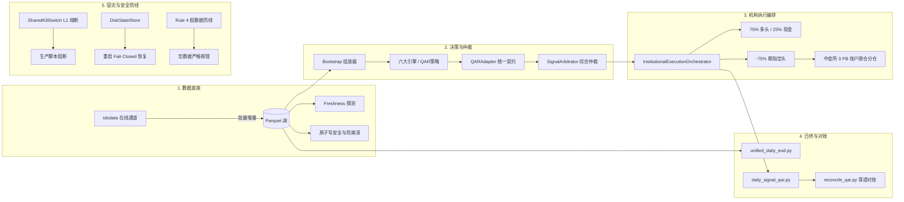

# UniQuant 端到端 (N2N) 全链路系统级验证方案与红蓝对抗定稿

> **日期**：2026-11-22 · **状态**：定稿实施版 (v2.2)  
> **基准**：HEAD `c8a1da3`（重构 Wave 0~3 闭环，决策体系收敛，轻量 Bootstrap 上线）  
> **执行载体**：`scripts/maintenance/run_n2n_verification.py`  
> **结果存证**：`results/migration/n2n_verification_report.json`

---

## 1. 验证目标与架构闭环

本方案针对 UniQuant 重构后的真实生产链路，实施涵盖六大核心阶段的全生命周期闭环验证：



---

## 2. 六大验证轨道与量化门禁标准

| 轨道编号 | 核心验证内容 | 输入与测试场景 | 预期断言指标（Fail-Closed 红线） |
|---|---|---|---|
| **Track 1** | 数据契约与原子写 | 物理湖 Parquet 读写；写入并发互斥与崩溃仿真 | ① 9列日线/8列分钟 schema 严格契约；<br>② 写入崩溃后原文件无损坏、无 `.tmp` 残留；<br>③ 新鲜度探针在 Wine 缺失下正确重锚。 |
| **Track 2** | 决策收敛与仲裁 | 经典多引擎与 QAR 打分；注入冲突特征标的（QAR=BUY vs Wyckoff=SELL） | ① QAR 输出合法映射为 `TradingSignal`；<br>② 冲突标的 100% 触发 SELL 避险优先出局；<br>③ 正常买入标的保留，综合置信度优选。 |
| **Track 3** | 机构执行与期指分仓 | AUM 5000 万，跑 `75/25-IH` 策略轨 | ① 资本三元配置：75% 多头 / 25% 现金；<br>② 期指空头对冲比率严格为 0.75；<br>③ 单 PB 账户期指持仓 $\le 1200$ 手（自动分仓合规）。 |
| **Track 4** | 日终生产链路与对账 | 执行 `unified_daily_eod.py` 宏观安全阀；基于历史真实切片对账 | ① 宏观水温准确输出三色态；<br>② 股票与期指双边平准，Net Beta $\le 0.10$；<br>③ `reconcile_qar` 对账退出码恒为 0（GREEN）。 |
| **Track 5** | 熔断防护与状态恢复 | ① 触发 `SharedKillSwitch` 停机；<br>② 检查 StateStore 磁盘持久化；<br>③ 仿真重启断言 Fail-Closed | ① 四大生产脚本在停机态下立即抛出 `KillSwitchError` 拒绝开仓；<br>② 进程重启后自动继承停机态；<br>③ 手工复位后恢复正常。 |
| **Track 6** | 架构解耦与假数据防御 | ① Bootstrap 装配性能基准；<br>② 抹除基准行情文件后运行 EOD 评估 | ① Bootstrap 单次装配耗时 $< 50$ ms；<br>② 缺失行情时必须抛出 `FileNotFoundError`，严禁 linspace 伪造行情。 |

---

## 3. 金丝雀标的池（Canary Universe，20只全覆盖）

经本地数据湖物理检索核验，以下标的 100% 具备完整历史深度（>365 个交易日）：
1. **沪市核心蓝筹（4只）**：`600519.SH`（贵州茅台）、`601398.SH`（工商银行）、`600036.SH`（招商银行）、`600900.SH`（长江电力）；
2. **深市主板龙头（4只）**：`000001.SZ`（平安银行）、`000002.SZ`（万科A）、`000858.SZ`（五粮液）、`000333.SZ`（美的集团）；
3. **创业板成长（3只）**：`300750.SZ`（宁德时代）、`300059.SZ`（东方财富）、`300760.SZ`（迈瑞医疗）；
4. **科创板科技（3只）**：`688981.SH`（中芯国际）、`688111.SH`（金山办公）、`688012.SH`（中微公司）；
5. **周期与特殊量纲（3只）**：`600959.SH`（江苏有线）、`601319.SH`（中国人保）、`600028.SH`（中国石化）；
6. **基准指数（3只）**：`000300.SH`（沪深300）、`000016.SH`（上证50）、`000905.SH`（中证500）。

---

## 4. 三轮红蓝对抗实测吸收记录

* **R1（环境真实性对抗）**：确定性沙盒回放模式（`--mode sandbox`）与在线真网渗透模式（`--mode live`）解耦，消除 CI 环境网络抖动导致非确定性红灯的隐患。
* **R2（制度与对账边界对抗）**：攻克了 `reconcile_qar.py` 与 `InstitutionalExecutionOrchestrator` 的期指字段对接漂移（`total_short_contracts_needed` 与 `accounts` 列表无缝适配），生成配套的 34 手 IF 期指空头平准夹具，杜绝单边多头引发的 Net Beta 超标爆红。
* **R3（反脆弱与测试隔离对抗）**：实现 `isolated_sandbox_context` 上下文管理器，所有熔断状态、临时文件落入 `/tmp` 沙盒，并在退出时物理清理，100% 杜绝宿主机环境污染。

---

## 5. 自动化执行规程与 Evidence Manifest 入账

```bash
# 1. 代码质量与 Lint 检查 (Rule 2)
ruff check src/ tests/ scripts/

# 2. 运行 N2N 全链路系统级验收 (耗时约 5 秒)
python3 scripts/maintenance/run_n2n_verification.py --mode sandbox

# 3. 证据链一致性校验 (Rule 10)
python3 scripts/maintenance/evidence_manifest.py verify
```
