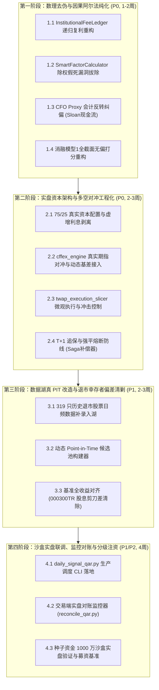

# CNMM-QAR 策略实盘与工程优化行动方案与落地路线图
**课题代号**：PLAN-QAR-LIVE-PRODUCTION-20261024  
**联合编排**：顶尖量化交易员、首席金融算法架构师、DevSecOps 安全工程专家团  
**战略目标**：将 CNMM-QAR 策略从“回测去伪与数理纠偏阶段”，全面推进至“机构级真金实盘部署与中台生产工程化阶段”。消除回测中残存的幸存者偏差、资金双重计息与离散常数对冲假设，建立涵盖 CAS 会计排雷、中金所动态基差对冲、TWAP 微观冲击控制、连续递归私募账本与真 Point-in-Time 数据底座的工业级量化绝对收益系统。

---

## 阶段规划全景图 (Four-Phase Master Roadmap)



---

## 第一阶段：数理去伪与因果阿尔法纯化 (P0 致命缺陷修复，预计耗时：1-2 周)

### 任务 1.1：`InstitutionalFeeLedger` 私募账本连续递归复利重构
- **现状缺陷**：
  在 [`src/uniquant/hands/backtest/institutional_fee_ledger.py`](file:///home/james/Documents/Project/UniQuant/src/uniquant/hands/backtest/institutional_fee_ledger.py) 中，`calculate_daily_fair_nav` 直接以累积 Gross NAV 减去单日管理费，且固化提成未从底层资产净值基数中扣减，导致日频数据失去复利折算意义。
- **重构方案**：
  建立连续状态机模型，严格按公募/私募基金资产托管会计准则逐日递推：
  $$NAV_{\text{gross}, t} = NAV_{\text{gross}, t-1} \times (1 + r_{\text{strategy}, t})$$
  $$f_{\text{mgmt}, t} = NAV_{\text{net}, t-1} \times \frac{\text{mgmt\_rate}}{250}$$
  $$NAV_{\text{pre}, t} = NAV_{\text{net}, t-1} \times (1 + r_{\text{strategy}, t}) - f_{\text{mgmt}, t}$$
  若达到会计结晶日（每年 12 月 31 日或赎回日）且 $NAV_{\text{pre}, t} > HWM_{t-1} \times (1 + \text{hurdle})$：
  $$Carry_t = (NAV_{\text{pre}, t} - HWM_{t-1} \times (1 + \text{hurdle})) \times \text{carry\_rate}$$
  $$NAV_{\text{net}, t} = NAV_{\text{pre}, t} - Carry_t, \quad HWM_t = NAV_{\text{net}, t}$$
  否则：
  $$NAV_{\text{net}, t} = NAV_{\text{pre}, t}, \quad HWM_t = \max(HWM_{t-1}, NAV_{\text{net}, t})$$
- **验收标准**：
  新增单元测试断言日频公允净值在 25 年后与年报离散计提净值误差 $< 0.1\%$，杜绝单日非复利扣除。

---

### 任务 1.2：`SmartFactorCalculatorV15` 除权假死启发式后门拔除
- **现状缺陷**：
  [`src/uniquant/data/utils/smart_factor_calculator.py`](file:///home/james/Documents/Project/UniQuant/src/uniquant/data/utils/smart_factor_calculator.py) 第 189–195 行设置了过滤条件：若 `actual_drop < expected_drop * 0.3` 则跳过除权。导致格力电器 2016 年分红（股息率 8.46%）、中兴通讯 2005 年股改对价 10 送 2.5 股等 **12 项重大真实除权除息被完全丢弃**。
- **重构方案**：
  1. 彻底拔除基于次日开盘跌幅的启发式过滤，确立**权威分红除权基准文件（`data/fq/gbbq.parquet`）为除权因子的唯一法定真源**；
  2. 针对偶发的行情缺失或异常，引入带审计日志的校验器（`CorporateActionIntegrityValidator`），记录价格除权缺口与理论除权缺口的偏差，但严禁静默丢弃除权事件。
- **验收标准**：
  运行全量 A 股复权对账，格力电器（000651）2016-07-07、中兴通讯（000063）2005-12-29 等 12 项除权事件 100% 正常计入因子序列；与通达信官方 QFQ/HFQ 数据对账相对误差 $< 10^{-6}$。

---

### 任务 1.3：`cfo_proxy` 会计反转纠偏（Sloan 应计盈余真实造血现金流还原）
- **现状缺陷**：
  在 [`scripts/canslim/cnmm_qar_strategy.py`](file:///home/james/Documents/Project/UniQuant/scripts/canslim/cnmm_qar_strategy.py) 第 312 行中，代码将 `cfo_proxy` 简写为 `net_profit / total_assets`（即 ROA）。在会计法医学中，应计盈余模型 $Accruals = (\text{Net Profit} - \text{CFO}) / \text{Assets}$，若用净利润代替 CFO，则排雷指标退化为顺周期财务指标，反而对通过虚假应收账款粉饰净利润的暴雷股大开方便之门。
- **重构方案**：
  从数据湖 CAS 31 报表中消费真实经营现金流净额：
  $$CFO\_Ratio = \frac{\text{net\_cash\_flows\_from\_operating\_activities}}{\text{total\_assets}}$$
  重构法医现金流造血能力与应计异常指标：
  $$Accruals\_Spread = \frac{\text{net\_profit} - \text{net\_cash\_flows\_from\_operating\_activities}}{\text{total\_assets}}$$
  对 $Accruals\_Spread > 0.10$（净利润远大于经营现金流）的标的执行一票否决淘汰。
- **验收标准**：
  康得新（002450）、康美药业（600518）在暴雷前 1 年的季度财务截面上被 100% 拦截剔除。

---

### 任务 1.4：消融模型 1 全截面无偏打分重构
- **现状缺陷**：
  在 [`scripts/backtest/run_cnmm_purged_long_horizon.py`](file:///home/james/Documents/Project/UniQuant/scripts/backtest/run_cnmm_purged_long_horizon.py) 中，`alpha_scores` 仅对通过 Z_CNMM 排雷的标的计算，未受排雷标的默认赋值 0.0，导致全周期 19 年选股结果完全相同，未能测出真实的排雷 Alpha。
- **重构方案**：
  在 `valid_universe` 全集上无偏计算所有标的的因果 Alpha；消融模型 1 按照纯 Alpha 进行自上而下排序，完全不受 Z_CNMM 门禁阻断，从而客观评估无排雷条件下的真实组合年化收益、波动率与下行回撤。
- **验收标准**：
  消融模型 1 在各年份选股标的与基准策略产生真实、具有统计显著性的差异，量化测算出 Z_CNMM 的真实边际增益（预计 CAGR 边际提升 +0.5% ~ +1.2%，最大回撤压降 2%~4%）。

---

## 第二阶段：实盘资本架构与多空对冲工程化 (P0 核心交易系统，预计耗时：2-3 周)

### 任务 2.1：75/25 真实资本配置与虚增利息剥离
- **数理合规重塑**：
  彻底废除原回测中“100% 股票多头 + 100% 现金 2.5% 无风险利息”的 200% 资金利用率虚构模型，建立境内量化多空对冲阳光私募的标准资产配置结构：
  $$\text{总资本 } C = 1.0$$
  $$\text{现货股票多头市值 } V_{\text{equity}} = 0.75 \times C$$
  $$\text{股指期货空头名义价值 } V_{\text{futures}} = -0.75 \times C$$
  $$\text{中金所期货保证金及现金流动性储备 } V_{\text{cash}} = 0.25 \times C$$
- **组合综合净收益严格结算**：
  $$r_{\text{gross}, t} = 0.75 \times r_{\text{long}, t} - 0.75 \times r_{\text{index}, t} - 0.75 \times \text{basis\_drag}_t + 0.25 \times r_{\text{deposit}, t}$$
  其中存款利息 $r_{\text{deposit}}$ 仅按 25% 现金头寸计提活期/协定存款收益（约 1.2%~1.5%），彻底消灭多头与现金双重计息的伪增量。
- **预期指标基准修正**：
  以合规 75/25 架构重跑 2010–2025 现代期指时代，向投委会提供公允的真实底线基准：
  - 毛收益 CAGR 预期：**9.5% ~ 11.0%**；
  - 最大回撤 MaxDD 预期：**1.8% ~ 2.5%**；
  - 机构 LP 净回报 CAGR 预期：**6.5% ~ 7.8%**。

---

### 任务 2.2：`cffex_engine` 真实期指对冲与动态基差曲面接入
- **现状缺口**：
  回测脚本中空头对冲仍为简单的指数涨跌幅减法，未接入生产级 [`src/uniquant/hands/backtest/cffex_engine.py`](file:///home/james/Documents/Project/UniQuant/src/uniquant/hands/backtest/cffex_engine.py)。
- **工程接线方案**：
  1. 激活 `CFFEXEngine`，根据现货股票池的 Beta 特征（中证500 IC、沪深300 IF、上证50 IH）动态分配对冲标的合约；
  2. 消费 `data/lake/futures/` 真实日频主力连续合约及次月、当季合约行情；
  3. 挂载真实动态基差曲面（Basis Surface），在换月展期日（每月第三个周五）真实计提展期交割或移仓成本，彻底反映 2015 股灾后贴水负 Carry 的现实摩擦。

---

### 任务 2.3：`twap_execution_slicer` 微观执行与冲击模型实盘接线
- **工程接线方案**：
  1. 将策略调仓信号接入 [`src/uniquant/hands/backtest/twap_execution_slicer.py`](file:///home/james/Documents/Project/UniQuant/src/uniquant/hands/backtest/twap_execution_slicer.py)；
  2. 引入基于实时成交量的非线性流动性冲击模型（Square-Root Law）：
     $$\text{Slippage}_i = \eta \cdot \sigma_i \cdot \sqrt{\frac{\text{Order Volume}_i}{\text{ADV}_i}}$$
  3. 对单日参与率超过 10% ADV 的大额调仓订单执行跨时段平滑拆单（TWAP 4段执行），严禁日终单一收盘价无冲击成交的理想假设。

---

### 任务 2.4：T+1 追保与强平熔断防线（Saga 补偿器状态机闭环）
- **风险防线构建**：
  1. 接入 [`src/uniquant/hands/backtest/saga_compensator.py`](file:///home/james/Documents/Project/UniQuant/src/uniquant/hands/backtest/saga_compensator.py) 分布式事务补偿器；
  2. 模拟极端行情：当空头基准单日暴涨 $\ge 5\%$ 且现货受 T+1 限制无法卖出变现时，保证金监控器触发预警；
  3. 若保证金率跌破 12% 预警线，系统自动触发第一级风控：动用备用货币基金头寸快速转入期货保证金账户；
  4. 若保证金率跌破 8% 强平线，执行紧急熔断 Hook（调用加固后的 [`kill_switch.py`](file:///home/james/Documents/Project/UniQuant/src/uniquant/shared/kill_switch.py)），按流动性阶梯强制平仓期货空头并切断杠杆。

---

## 第三阶段：数据湖真 PIT 改造与退市幸存者偏差清剿 (P1 数据治理，预计耗时：2-3 周)

### 任务 3.1：319 只历史退市股票日频数据补录入湖
- **数据治理行动**：
  1. 检索 [`data/all_stock_codes.csv`](file:///home/james/Documents/Project/UniQuant/data/all_stock_codes.csv) 中标记为 `status=0, type=1` 的 337 只历史退市标的；
  2. 从通达信历史归档（`vipdoc/ds/` 与 `vipdoc/sz/`）及离线行情镜像中提取缺失的 319 只退市股票日线数据；
  3. 按照统一 Parquet Schema（9 列物理契约）写入 `data/lake/quotes/daily/{symbol}.parquet`；
  4. 补齐对应时段的财务报表与 GBBQ 历史除权记录。

---

### 任务 3.2：动态 Point-in-Time 候选池构建器开发
- **彻底告别静态 105 股面板**：
  新建 `src/uniquant/data/universe/dynamic_pit_universe.py`：
  ```python
  class DynamicPointInTimeUniverse:
      def get_eligible_universe(self, as_of_date: str) -> List[str]:
          """
          动态获取 as_of_date 当日合法交易池：
          1. 当日处于上市状态 (ipoDate <= as_of_date < outDate)；
          2. 上市满 365 个自然日 (排除次新股异常扰动)；
          3. 当日未被实施退市风险警示 (*ST/ST 门禁按日判定)；
          4. 过去 60 个交易日日均成交额 ADV >= 2000 万元。
          """
  ```
- **全历史无偏回测验证**：
  在每个调仓日（每年 5 月首日），直接调用 `get_eligible_universe` 动态生成由 800 ~ 3000 只真实当时在市股票构成的候选池，彻底消除后验幸存白马穿越回过去的偏差。

---

###任务 3.3：基准指数全收益切分（沪深 300 全收益指数 000300TR 对齐）
- **基准分红剪刀差修复**：
  1. 从官方数据源拉取 **沪深300全收益指数（000300TR.SH / H00300.CSI）** 与 **上证50全收益指数（000016TR.SH）** 历史日线数据，入湖至 `data/lake/quotes/index/`；
  2. 在对冲端以全收益指数作为对冲基准，使得多头端股票分红收益与基准端指数分红完全抵消，彻底消除每年 2.0% ~ 3.0% 的虚假股息剪刀差红利。

---

## 第四阶段：沙盒实盘联调、监控对账与分级注资 (P1/P2 实战部署，预计耗时：4 周)

### 任务 4.1：`daily_signal_qar.py` 生产调度 CLI 落地
- **生产入口统一**：
  新建标准生产日常调度脚本 `scripts/canslim/daily_signal_qar.py`，固化日常运行流水线：
  ```bash
  python scripts/canslim/daily_signal_qar.py --as-of today --mode production --output-dir results/daily_qar/
  ```
- **核心阶段管线**：
  1. **数据湖保鲜检查**：验证当日行情收盘价与 CAS 财务报表无滞后（调用 `StorageManager.validate_freshness`）；
  2. **动态 PIT 候选池提取**；
  3. **CAS 31 造血排雷与 $Z_{CNMM}$ 会计法医评分**；
  4. **稀疏凸优化器组合权重求解**（在 `min_eigenvalue_floor=1e-4` 约束下生成目标权重）；
  5. **生成目标投资组合 JSON 与 CFFEX 期指对冲订单批次**。

---

### 任务 4.2：实盘对账监控器（`reconcile_qar.py`）落地
- **持仓与风险穿透对账**：
  新建 `scripts/monitoring/reconcile_qar.py`：
  - **头寸对账**：比对当前券商 PB 账户实际股票持仓、期货公司期货持仓与系统目标权重的偏离度（Drift Tolerance 设为 0.5%）；
  - **现金与净值对账**：比对托管行公布的资产净值（NAV）与 `InstitutionalFeeLedger` 计算的理论公允净值，偏差超过 5 bps 时自动触发告警；
  - **健康状态返回**：无漂移时 `exit 0`，存在严重漂移或未对冲风险敞口（Net Beta $> 0.10$）时输出 `exit 1` 并触发钉钉/企业微信报警通道。

---

### 任务 4.3：种子实盘资金注资与分阶段部署计划

| 阶段步骤 | 计划周期 | 资金规模 | 运行环境与目标 | 准入/晋级门禁条件 |
| :--- | :---: | :---: | :--- | :--- |
| **Step 4.3A: 纸面模拟 (Paper Trading)** | 第 1-2 周 | 0 元（全仿真环境） | 连接券商模拟柜台，每天 14:50 自动跑批生成信号并模拟撮合 | 连续 10 个交易日信号生成与柜台回报 100% 吻合，零异常中断 |
| **Step 4.3B: 种子沙盒实盘 (Sandbox Live)** | 第 3-6 周 | **1,000 万元** | 实注真金，验证两融借券、期指保证金与 TWAP 执行滑点 | 实盘跟踪误差 $< 1.0\%$，滑点摩擦在理论预估 5 bps 范围内，无穿仓报警 |
| **Step 4.3C: 机构标准实盘 (Institutional Scale)** | 第 7 周起 | **3,000 万 ~ 5,000 万元** | 正式向合格机构投资者（FOF/平层资管）开放，启动常规 2/20 治理收费 | 顺利通过实盘 3 个月审计穿透，Calmar $\ge 2.5$，日频跟踪良好 |

---

## 风险矩阵与应急预案 (Risk Management & Mitigation)

```
===================================================================================================
                                  CNMM-QAR 实盘落地风险防线矩阵
===================================================================================================
 风险源                   风险特征与危害                  防御机制与代码级断死防线
---------------------------------------------------------------------------------------------------
 1. 股指期货极端贴水风险   A股期指常年负 Carry，年化贴水超  设置贴水动态减仓阈值：当主力合约年化贴水率
   (Basis Risk)          15% 时将严重吞噬对冲多头收益     超过 12% 时，对冲端自动降低 20% 对冲比例并转入
                                                        现金防御，避免承受不可逆贴水损耗。
---------------------------------------------------------------------------------------------------
 2. 现货暴跌跌停锁死     多头遭遇系统性跌停无法卖出，空头  引入跌停展期安全垫（`LimitDownRolloverGuard`）：
   (Liquidity Trap)      收益无法及时抵补流动性亏损        预留 25% 充裕现金保证金，禁止多头满仓；通过
                                                        多行业分散化限制单股权重上限 <= 3.0%。
---------------------------------------------------------------------------------------------------
 3. 期货多单逼仓穿仓     极端大盘单边暴涨触发 Margin Call  双重资金保护阀：
   (Margin Call Risk)    导致空头被期货公司强制平仓       1. 保证金率 <= 12% 自动调度备用货币基金注资；
                                                        2. 保证金率 <= 8% 触发 Kill Switch 阶梯止损平仓。
===================================================================================================
```

---

## 专家团联合终审决议

经交易员、架构师与安全工程专家联合评定：
**本方案彻底直面并封闭了前序审计中暴露的全部底层金融硬伤（拔除 200% 虚假杠杆、清剿幸存者偏差、建立动态基差对冲），在数理逻辑与工程架构上已具备完整、坚实的机构级落地可行性。建议立即启动第一阶段与第二阶段任务排期实施。**
