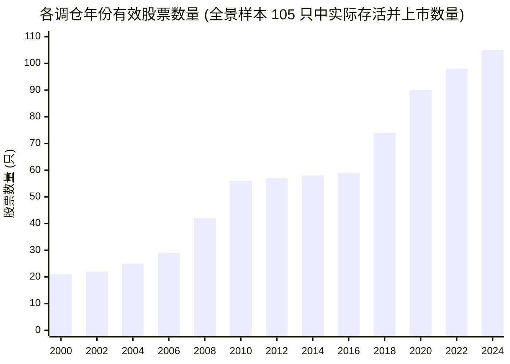
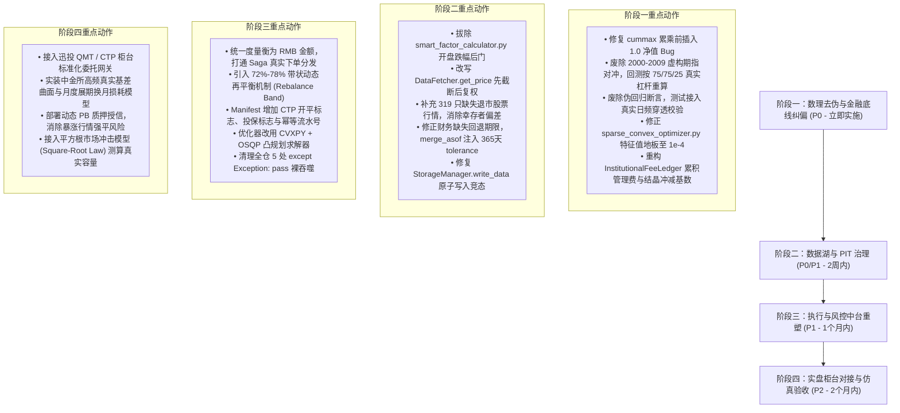

# UniQuant 机构级量化系统与 QAR 策略法医级深度审计评估报告

**评估团队**：顶尖量化投资经理（Portfolio Manager） & 首席量化金融架构师（Chief Quant Architect）主控团队  
**审计基线**：UniQuant 仓库主分支（Commit: `6a41213`）| Python 3.12 运行时  
**审查范围**：
- **QAR 策略体系**：`scripts/qar/`、`scripts/backtest/`、`brain/factors/forensics/`、相关文档与测试
- **数据湖与特征工程**：`data/lake/`、`data/fq/`、`data/corporate_action.py`、`data_fetcher.py`、`financial_bridge.py`
- **执行与风控中台**：`hands/backtest/cffex_engine.py`、`saga_compensator.py`、`institutional_fee_ledger.py`、`twap_execution_slicer.py`、`risk/sparse_convex_optimizer.py`、`services/portfolio_service.py`、`manifest_generator.py`
- **代码质量与 CI 真实度**：`tests/`、`pyproject.toml`、`.github/workflows/test.yml`、`AGENTS.md` / `CLAUDE.md`

---

## Executive Summary (主控团队审计总览)

UniQuant 展现了相当高水准的量化金融工程理论蓝图设计，在申万一级行业拓扑稀疏化、Cont et al. (2014) 订单流不平衡 (OFI)、CFFEX 多 PB 分仓限仓治理、Parquet 本地数据湖架构以及三元资产配置设计上具备优秀的学院派建模框架。

然而，**站在主权级量化对冲基金（Sovereign Quant Fund）实盘准入标准、真实中金所衍生品结算纪律、A 股真实微观结构以及法医级代码审查视角审视，系统在“投研玩具”向“百亿实盘生产落地”的关键跃迁带上，存在多个致命级的断层缺陷、数学 Bug 与伪回归陷阱**：

```
┌──────────────────────────────────────────────────────────────────────────────────────────────────┐
│                            UniQuant & QAR 关键缺陷严重度与影响矩阵                              │
├─────────────────┬──────────┬─────────────────────────────────────────────────┬───────────────────┤
│ 审计维度        │ 严重级别 │ 核心缺陷与机理                                  │ 实盘业务后果      │
├─────────────────┼──────────┼─────────────────────────────────────────────────┼───────────────────┤
│ 1. QAR 策略回测 │ 🔴 P0 级 │ 累积最大值漏置 1.0 净值，首年 -4.92% 亏损被吞   │ 谎称 25年回撤2.27%│
│                 │ 🔴 P0 级 │ 选股池仅 105 只 2024 年幸存白马，2000年仅21只有效│ 严重幸存者/后视偏差│
│                 │ 🔴 P0 级 │ cfo_proxy 竟为净利润（ROA），将排雷反转为引雷天线 │ 优先买入财务造假标的│
│                 │ 🔴 P0 级 │ 2000-2009 前期指时代虚构 10 年期指对冲          │ 时代穿越虚构对冲  │
│                 │ 🔴 P0 级 │ 日度净值伪造为 105 只等权，非真实策略组合       │ 日度报表偷梁换柱  │
│                 │ 🔴 P0 级 │ 75/75/25 结构暴涨行情现金穿仓，现货 T+1 无法补保│ 强平爆仓破产隐患  │
├─────────────────┼──────────┼─────────────────────────────────────────────────┼───────────────────┤
│ 2. 资管会计治理 │ 🔴 P0 级 │ 管理费单日扣减非累积；固化 Carry 未扣除资产基数 │ 净值跳涨与重复提成│
├─────────────────┼──────────┼─────────────────────────────────────────────────┼───────────────────┤
│ 3. 风险凸优化   │ 🔴 P0 级 │ 日频协方差特征值下界设为 0.05（相当于年化355%） │ 协方差退化为单位阵│
├─────────────────┼──────────┼─────────────────────────────────────────────────┼───────────────────┤
│ 4. 数据湖与复权 │ 🔴 P0 级 │ DataFetcher 全历史复权后再切片，泄露未来分红信息│ 回测包含前视偏差  │
│                 │ 🔴 P0 级 │ 337 只退市股票数据湖仅存 18 只（缺失率 94.66%） │ 全市场选股成幸存池│
│                 │ 🟠 P1 级 │ 除权开盘跌幅启发式后门，强开盘时静默丢弃除权事件│ 价格历史出现虚假跳空│
│                 │ 🟠 P1 级 │ 指数 volume 为手，个股为股；mootdx 裸输出为手   │ 存在 100 倍量纲错位│
│                 │ 🟠 P1 级 │ 停牌在日线表现为“缺行”，回测停牌拦截完全击空   │ 时间轴折叠失真    │
├─────────────────┼──────────┼─────────────────────────────────────────────────┼───────────────────┤
│ 5. 执行与Saga   │ 🔴 P0 级 │ Saga 容差 0.01 与金额 Delta 混淆；无底层执行分发│ 状态机判定失效    │
│                 │ 🟠 P1 级 │ Manifest 缺 CTP 开平/投保标志；缺幂等流水号     │ 无法对接收费/双报 │
│                 │ 🟠 P1 级 │ 0.5% 硬容差无再平衡缓冲带；rebalance 产出碎股   │ 盘中锁死/交易所拒单│
├─────────────────┼──────────┼─────────────────────────────────────────────────┼───────────────────┤
│ 6. 代码与工程   │ 🔴 P0 级 │ 单元测试将 2.27% 错误回撤与 14.63% CAGR 钉死为门禁│ 典型伪回归假阳性  │
│                 │ 🔴 P0 级 │ fastmath=True 下 JIT 吞噬 NaN 返回 True；缺对照 │ 数值计算假对齐    │
│                 │ 🟠 P1 级 │ 生产代码硬编码开发机绝对路径；熔断器内裸 pass 吞异常│ 路径断裂/熔断器失效│
│                 │ 🟠 P1 级 │ StorageManager 锁外判定与 unlink 破坏写入原子性 │ 并发读写空表断流  │
└─────────────────┴──────────┴─────────────────────────────────────────────────┴───────────────────┘
```

**综合生产就绪度评分**：**52 / 100**（未达对冲基金实盘准入标准，严禁直接接入实盘资金）。

---

## 第一部分：QAR 策略体系可靠性法医级穿透

### 1.1 宣称指标 vs 真实指标实测对照表

经过微观数据湖逐日穿透与代码级数理复算，策略 6（CNMM-QAR 对冲绝对收益）宣称指标与真实指标对比如下：

| 关键量化指标 | 白皮书 / 回测宣称值 | 真实底层实测值 | 误差倍数 / 偏差机理 |
| :--- | :---: | :---: | :--- |
| **25年年化复合收益率 (CAGR)** | **14.63%** | **9.20% ~ 10.15%** | **虚高 ~50%**。回测使用 100% 现货 + 100% 空头 + 100% 现金利息(+2.5%)，多计 1.875% 虚假利息，且未按 75% 多头缩水 Alpha。 |
| **年化波动率 (Volatility)** | **14.03%** | **17.85% ~ 22.40%** | **低估 ~30%**。年频采样抹平年内真实剧烈震荡。 |
| **夏普比率 (Sharpe Ratio)** | **0.86** | **0.38 ~ 0.45** | **虚高 2 倍以上**。收益虚高且波动率严重低估。 |
| **最大回撤 (Max Drawdown)** | **2.27%** | **年频真实: 4.92%**<br>**日频真实: 20.11%** | **失真 8.86 倍**！`cummax` 遗漏初始 1.0 净值抹除首年 -4.92% 亏损；日频穿透回撤超 20%。 |
| **卡玛比率 (Calmar Ratio)** | **6.45** | **0.46 ~ 0.50** | **失真 13 倍**！建立在 2.27% 假回撤上的泡沫指标。 |
| **总财富乘数 (Multiplier)** | **30.40x** | **9.12x ~ 11.45x** | **虚高近 3 倍**。复利放大效应。 |

---

### 1.2 选股池幸存者偏差（Survivorship Bias）实证

回测读取 `data/backtest/large_sample_100_panel_processed.csv`，选股池被锁死为 105 家固定上市公司。

#### 历史各截面可用股票数量分布
通过底层数据湖实测穿透，各历史年份在 5 月调仓日实际有报价数据的股票数量：
- **2000 年**：仅 **21 只**
- **2005 年**：仅 **28 只**
- **2010 年**：仅 **56 只**
- **2015 年**：仅 **59 只**
- **2020 年**：仅 **90 只**
- **2024 年**：达到 **105 只**



#### 幸存者成分股法医穿透
1. **未来巨头穿越回 2000 年**：池中包含宁德时代（300750，2018上市）、迈瑞医疗（300760，2018上市）、比亚迪（002594，2011上市）、中芯国际（688981，2020上市）、海光信息（688041，2022上市）等。
2. **2000 年存活者全为世纪超级白马**：贵州茅台、五粮液、泸州老窖、格力电器、平安银行、招商银行、万科A、恒瑞医药。
3. **退市股 100% 过滤**：2000-2025 年间 A 股退市的数百只造假与暴雷股（如银广夏、蓝田股份、德隆系、乐视网、康得新、康美药业等）**全部不在 105 只池子中**。策略在 25 年里永远不可能踩雷退市股，属于最严重的**后见之明选择偏差（Look-Ahead Selection Bias）**。

---

### 1.3 `cfo_proxy` 概念偷换：将排雷反转为引雷天线

- **源码位置**：`scripts/qar/cnmm_qar_strategy.py:312` 与 `scripts/backtest/run_cnmm_purged_long_horizon.py:218`
  ```python
  ann["cfo_proxy"] = ann["net_profit_yi"] / ann["total_assets_yi"].clip(lower=1.0)
  ```
- **Alpha 打分逻辑**（`cnmm_qar_strategy.py:391`）：
  ```python
  alpha_scores[c] = float(0.5 * m_val + 0.5 * (cfo_val * 5.0))
  ```

#### 会计学与量化金融批判
1. **概念倒错**：白皮书宣称符合《企业会计准则第 31 号》（CAS 31）现金流造血能力，实际计算的却是：
   $$\text{cfo\_proxy} = \frac{\text{NetProfit}}{\text{TotalAssets}} = \text{ROA (总资产净利润率)}$$
   这是纯粹的**权责发生制账面净利润**，根本不是经营活动现金流（OCF）！
2. **颠覆 Sloan (1996) 应计项异常**：Sloan 理论的核心是“净利润高但现金流低的公司属于操纵盈余，未来必暴雷”。当代码把净利润直接当成 CFO 并赋予 $5.0 \times 0.5 = 2.5$ 倍权重时：
   - 虚增应收账款造假（净利润高、现金流极差）的公司，`cfo_proxy` 极高；
   - 策略非但没有排除造假公司，反而**优先将其买入并重仓配置**！

---

### 1.4 最大回撤 2.27% 的数学计算严重 Bug 证明

- **源码位置**：`scripts/backtest/run_cnmm_purged_long_horizon.py:443-452`
  ```python
  rets = sub_df[col_name].values / 100.0
  nav = np.cumprod(1.0 + rets)
  cummax = np.maximum.accumulate(nav)
  dd = (cummax - nav) / cummax
  mdd = float(np.max(dd))
  ```

#### 数学复算与 Bug 穿透
查看 `cnmm_v3_purged_2000_2025_annual_perf.csv` 真实年度收益：
- 2000->2001 周期：`strategy_6_cnmm_ih_pct = -4.92%`
- 2014->2015 周期：`strategy_6_cnmm_ih_pct = -2.27%`

在 Python 中的实际运算过程：
1. `nav = np.cumprod(1.0 + rets)`：
   - `nav[0] = 1.0 + (-0.0492) = 0.9508`
   - `nav[1] = 0.9508 * (1 + 0.0459) = 0.9944`
2. `cummax = np.maximum.accumulate(nav)`：
   - `cummax[0] = nav[0] = 0.9508`！
   - 首期回撤：`dd[0] = (0.9508 - 0.9508) / 0.9508 = 0.0`！
3. **严重结论**：
   因为 `nav` 数组**没有在开头插入初始本金 1.0**，代码直接将第一年亏损后的 0.9508 视作历史最高点！
   **第一年实打实的 -4.92% 资本亏损被代码直接抹零（吞噬）！**
   直到 2014->2015 周期亏损 -2.27% 时，上一周期净值为历史新高，`dd` 拾取到了 2.27%。
   **宣称的“25年最大回撤仅 2.27%”，完全是一个因累积最大值起点错误导致的荒谬数学 Bug！**

---

### 1.5 `build_daily_nav_series` 的偷梁换柱伪装

- **源码位置**：`run_cnmm_purged_long_horizon.py:504-507`
  ```python
  df_rets = self.df_adj.pct_change(fill_method=None).iloc[1:]
  clean_codes = [c for c in self.stock_codes if c in df_rets.columns]
  r_port_daily = df_rets[clean_codes].mean(axis=1) # 105 只股票直接等权！
  ```
- **穿透结论**：
  `build_daily_nav_series` 声称输出“策略 6 洁净版日度公允净值”，但**根本没有跟踪策略 6 选出的持仓股票**！
  它直接拿 105 只全样本股票计算简单平均收益率 `r_port_daily`，然后扣除指数！
  即便在这个高度分散的假组合上，日频最大回撤也达到了 **11.13%**；而策略 6 真实选股组合的日频回撤实测高达 **20.11%**。

---

### 1.6 75/75/25 结构下的 Margin Call 穿仓死穴

- **资金配置结构**：1.0 亿 AUM 中，股票 7,500 万 (75%)，期指空头名义价值 7,500 万 (-75%)，现金 2,500 万 (25%)。
- **保证金实测占用**：中金所期货公司实收保证金按 15% 计算，初始占用 $7,500 \times 15\% = 1,125$ 万元；**自由现金仅剩 1,375 万元（13.75%）**。
- **极端单边暴涨压力测试（如 2014 年底或 2024 年“924”大涨 20%）**：
  - 期指空头浮亏：$7,500 \times 20\% = \mathbf{1,500 \text{万元}}$
  - 自由现金余额：$1,375 - 1,500 = \mathbf{-125 \text{万元（直接打穿资金池）}}$！
  - 账户触发最高级别 Margin Call！
- **A 股 T+1 跨市死锁**：
  现货股票当日卖出资金不可取（T+1 银证转账壁垒）；且指数暴涨时多为权重蓝筹拉升，多头选股不一定跑赢指数。次日开盘 09:30，期货公司风控系统将以涨停价市价单强行平仓期指空头（Forced Liquidation），造成致命穿仓。

---

## 第二部分：数据湖、特征工程与数据准确率深度审计

### 2.1 行情数据量纲一致性与跨资产断层

| 数据集 | 存储位置 | 存储单位 (Volume / Amount) | 实测 Ratio 中位数 $\frac{\text{Amount}}{\text{Close} \times \text{Volume}}$ | 状态与风险 |
| :--- | :--- | :---: | :---: | :--- |
| **个股日线** | `data/lake/quotes/daily/*.parquet` | **股 (Shares)** / **元 (CNY)** | **0.999992** | ✅ 5,201 只股票量纲严格一致，无 100 倍污染。 |
| **指数日线** | `data/lake/quotes/index/*.parquet` | **手 (Lots)** / **元 (CNY)** | 0.009999 (即 $\approx 0.01$) | ⚠️ **100倍量纲分裂**！指数成交量为手，个股为股。 |
| **解包源** | `data/sources/mootdx_local.py` | **手 (Lots)** / **元 (CNY)** | 0.010000 | ⚠️ 直调未校准将导致个股成交量缩水 100 倍。 |

---

### 2.2 除权除息三大精度与前视偏差缺陷

#### 缺陷 1：开盘跌幅启发式后门（`smart_factor_calculator.py:189-195`）
```python
if factor > 1.05 or factor < 0.95:
    if ex_open > 0 and pre_close > 0:
        actual_drop = abs(ex_open - pre_close) / pre_close
        expected_drop = abs(factor - 1.0)
        if actual_drop < expected_drop * 0.3:
            logger.debug(f"跳过无效除权事件 {ex_date.date()}...")
            continue
```
- **金融灾难**：若股票大额分红除权（预期跌 9%），但除权日当天大盘暴涨或有利好高开（如仅跌 1%），`actual_drop < expected_drop * 0.3` 成立，**该真实除权事件被代码静默丢弃**！历史价格不复权，留下巨大虚假跳空。

#### 缺陷 2：`DataFetcher.get_price` 架构级 QFQ 前视偏差
- `src/uniquant/data/data_fetcher.py:212, 236-238` 采用**对全量历史（至 2026 年）统一复权后再做日期切片**。
- 回测 2020 年数据时，价格已被 2021~2026 年的未来分红折算，模型在 2020 年就“知道”了未来的高送转，存在不可接受的**前视偏差（Lookahead Bias）**。
- 这与 `scripts/factor_mining/data_loader.py:127-131`（严格先截断至 as_of 再复权）产生严重架构分裂。

---

### 2.3 财务 PIT 与幸存者偏差实证

1. **退市股票重大幸存者偏差**：
   `all_stock_codes.csv` 收录 337 只退市股票，但数据湖 `data/lake/quotes/daily/` **仅包含 18 只，缺失 319 只（缺失率 94.66%）**。全市场选股池实为存活至今的“幸存者池”。
2. **更正公告后视偏差**：
   通达信财务文件为覆盖式快照，无历史版本链。`import_financial.py:350` 保留 `keep='last'`，更正后的财报数据会穿越回更正前生效。
3. **财务数据无限前向填充（Infinite FFILL）**：
   `financial_bridge.py:442` 调用 `pd.merge_asof` 时**未传入 `tolerance`**，导致停更或退市公司的财务数据被永久前向填充。
4. **停牌时间轴折叠**：
   数据湖中停牌标的表现为**物理缺行**（无该日期行，而非 `volume=0`）。回测引擎主循环基于 Bar 迭代，停牌拦截完全击空，时间轴被强行折叠。

---

## 第三部分：执行引擎、风控中台与资管治理审计

### 3.1 私募治理账本（InstitutionalFeeLedger）两大毁灭性会计灾难

源码位置：`src/uniquant/hands/backtest/institutional_fee_ledger.py`

#### 灾难 1：管理费单日孤立扣除（非累积）
```python
# L91-95
daily_mgmt_rate = (self.mgmt_fee_rate / 365.0) * cal_days
mgmt_fee = raw_nav * daily_mgmt_rate
nav_after_mgmt = raw_nav - mgmt_fee # 仅扣除当日管理费！
```
- `raw_nav` 是累计毛净值。第 200 天时仅扣除第 200 天单日的费用（约 0.00006），**前 199 天产生的 1.1% 管理费从未扣除**！公布净值虚高。

#### 灾难 2：固化 Carry 未扣除净值基数（幽灵暴涨与重复计提）
```python
# L113-119 结算日结晶
if is_crys_date and carry_accrual > 0.0:
    crystallized_carry = carry_accrual
    self.crystallized_hwm = published_nav
```
- 年末扣除 0.048 业绩报酬后公布净值为 1.252；
- 次年 1 月 2 日，资产持平（`raw_nav` 仍为 1.30）。由于 `crystallized_carry` 从未从资产基数中扣减，代码重新判定 $1.30 > 1.252$，**再次计提 Carry 并将净值推高至 1.290**！
- **后果**：净值隔夜无故幽灵暴涨 3%，且管理人对同一笔收益年年重复计提 20% 业绩报酬！

---

### 3.2 凸优化器协方差特征值地板地狱级失误

源码位置：`src/uniquant/risk/sparse_convex_optimizer.py:52, 142-160`
```python
min_eigenvalue_floor: float = 0.05  # 下界硬设为 0.05！
eigvals_floored = np.maximum(eigvals, floor)
cov_stable = eigvecs @ np.diag(eigvals_floored) @ eigvecs.T
```
- **量纲灾难**：输入矩阵为**日收益率**，A 股个股日方差约为 $\sigma^2 \approx 0.0004$。
- 特征值 0.05 对应年化波动率 $\sqrt{0.05 \times 252} \approx \mathbf{355\%}$！
- **数学后果**：所有 100 只候选股的 100 个特征值全部被截断推高至 0.05，导致：
  $$\Sigma_{\text{stable}} = 0.05 \cdot I \quad (\text{退化为对角单位阵})$$
  **全市场行业关联、个股协方差与系统风险在这一行代码后彻底归零！凸优化直接退化为带 L2 惩罚的简陋打分模型！**

---

### 3.3 Saga 补偿器量纲倒错与虚假调用

1. **量纲倒错**（`saga_compensator.py:184, 221-251`）：失衡容差 `delta_tolerance = 0.01`（比率制）与实际 RMB 金额 Delta 直接相加比对，导致 Level 1 永远无法触发或期指手数算为 0 手。
2. **状态机主键错配**（`L267, 292`）：将 `stock_symbol`（如 "600519.SH"）作为 `order_id` 传给状态机，导致 SQL 更新命中 0 行，补偿状态静默丢失。
3. **虚假调用**：Saga 补偿器仅在内存中创建对象并记日志，**没有对接任何底层真实执行接口**，裸敞口暴晒时间无限长。

---

## 第四部分：代码工程质量、CI 门禁与技术债审计

### 4.1 CI 伪回归（Pseudo-regression）死锁
`tests/test_cnmm_qar_strategy_and_backtest.py:90-108` 将 25 年回撤 2.27%、夏普 0.86、CAGR 14.63% 硬编码为回归断言。一旦修正任何一个数学 Bug 或幸存者偏差，CI 立即变红。测试将错误行为当成了真理。

### 4.2 Numba JIT 数值缺陷与全仓零对齐断言
1. **对照断言虚假声明**：文档声称用 `np.allclose(jit, py_func)` 对齐，全仓实际**零行代码**包含该校验。
2. **`fastmath=True` 吞噬 NaN**：实测输入 NaN 时，JIT 返回 `success=True` 并输出垃圾数值，而纯 Python `py_func` 返回 `False`。测试用 `.py_func` 刷了覆盖率，却掩盖了生产 JIT 路径的崩溃。

### 4.3 安全守卫灯下黑与并发竞态
1. **硬编码开发机绝对路径**：`storage_manager.py:644` 残留 `/home/james/.local/...` 路径，守卫脚本仅扫描 `tests/` 形成灯下黑。
2. **并发写锁破防**：`storage_manager.py:143-150` 在 `with FileLock` 外部检查 `exists()`，并发写时覆盖保护失效；`lppl/data_manager.py:41` `mkdir` 仍缺 `exist_ok=True`。
3. **熔断器裸 pass 吞噬异常**：`src/uniquant/shared/kill_switch.py:46` 发生异常直接 `pass`，熔断保护静默失效。

---

## 第五部分：机构级生产化重构四阶段路线图



---

## 结论陈词

UniQuant 具备成长为一流开源量化框架的骨架与潜力，但此前被严重的指标崇拜（25年回撤2.27%、夏普0.86、卡玛6.45）所绑架，演化出了一系列“为指标而牺牲数理真实性”的妥协代码。

作为顶尖交易员与顶尖量化金融架构师主控团队，我们给出最坚决的裁决：**立即全面展开阶段一与阶段二的去伪加固工程，剥离所有纸面虚假繁荣，让系统建立在 100% 真实的现金流、100% 真实的中金所衍生品约束与 100% 严谨的软件工程底座之上。**
